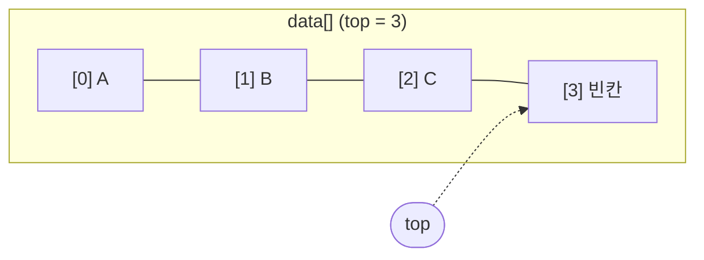
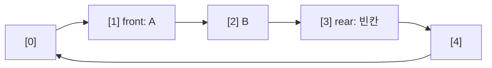
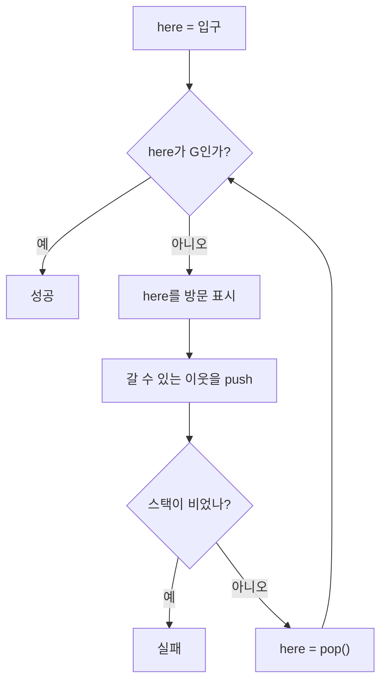

## 개요

자료구조 수업 전반부에서 다룬 **배열 기반 자료구조**를 정리합니다. 모두 고정 크기 배열 하나와 인덱스 변수 한두 개로 만들 수 있는 구조입니다.

- **배열 리스트**: 순서가 있는 데이터를 보관하고, 중간 삽입·삭제 때 원소를 밀고 당깁니다.
- **스택**: 마지막에 넣은 것을 먼저 꺼냅니다(LIFO).
- **원형 큐**: 먼저 넣은 것을 먼저 꺼냅니다(FIFO). 배열 끝에서 앞으로 돌아가도록 나머지 연산(`%`)을 씁니다.
- **미로 탐색**: 스택에 "다음에 가 볼 칸"을 쌓아 두고 깊이 우선 탐색(DFS)으로 길을 찾습니다.

코드는 과제에서 직접 채운 함수 위주로 발췌했고, 입출력·메뉴 같은 뼈대는 생략했습니다.

## 원소 타입 분리: `elem_t`

과제 코드는 자료구조 코드와 원소 타입을 `elem.h`로 분리했습니다. 스택이 `int`를 담든 좌표 구조체를 담든 `stack.c`는 그대로 두고 `elem.h`만 바꾸면 됩니다. 추상 자료형(ADT)을 "연산의 집합"으로 보고, 원소가 무엇인지는 나중에 정하는 방식입니다.

```c title="elem.h (미로용)"
typedef struct point {
    int r;   // 행
    int c;   // 열
} elem_t;

char* str(elem_t e);   // 출력용 문자열 변환
```

> [!note] 왜 `str()`을 따로 두는가
> `printf("%d")`는 원소가 `int`일 때만 맞습니다. 출력 형식을 `str()`에 맡기면 스택의 `print_stack()`은 원소 타입을 몰라도 됩니다.

## 배열 리스트

### 구조

`size`는 현재 들어 있는 원소 개수이면서, 다음 원소가 들어갈 위치입니다.

```c title="arrlist.h"
typedef struct {
    int size;          // 현재 원소 개수
    int array[100];    // 실제 저장 공간
} arrlist_t;
```

### 삽입과 삭제: 이동 방향이 핵심

중간에 끼워 넣으려면 `pos` 이후 원소를 한 칸씩 뒤로 밀어야 합니다. 이때 **뒤에서부터** 옮겨야 합니다. 앞에서부터 옮기면 `array[pos]`의 값이 `array[pos+1]`을 덮고, 그 값이 다시 다음 칸을 덮어서 같은 값만 복사됩니다.

```c title="arrlist.c"
void insert_list(arrlist_t* lp, int pos, int val) {
    for (int k = lp->size - 1; k >= pos; k--)   // 뒤에서 앞으로
        lp->array[k + 1] = lp->array[k];
    lp->array[pos] = val;
    lp->size++;
}

int delete_list(arrlist_t* lp, int pos) {
    int saved = lp->array[pos];                  // 지우기 전에 보관
    for (int k = pos; k < lp->size - 1; k++)     // 앞에서 뒤로
        lp->array[k] = lp->array[k + 1];
    lp->size--;
    return saved;
}

void add_list(arrlist_t* lp, int val) {
    lp->array[lp->size++] = val;                 // 넣고 나서 증가
}

int find(arrlist_t* lp, int e) {
    for (int i = 0; i < lp->size; i++)
        if (lp->array[i] == e) return i;
    return -1;                                   // 없으면 -1
}
```

`delete_list`가 지운 값을 돌려주는 이유는 호출한 쪽이 그 값을 쓰거나, 원소가 동적 할당된 포인터라면 `free`할 기회를 주기 위해서입니다.

리스트 연산을 함수로 감싸 두면 응용 코드는 내부 배열을 몰라도 됩니다. 예를 들어 합계는 `len()`과 `get_at()`만으로 구합니다.

```c title="main.c"
int get_sum(arrlist_t* lp) {
    int sum = 0;
    for (int i = 0; i < len(lp); i++)
        sum += get_at(lp, i);
    return sum;
}
```

같은 인터페이스로 집합 연산도 만들 수 있습니다. 합집합은 첫 집합을 모두 넣은 뒤 두 번째 집합에서 `find(result, x) == -1`인 원소만 추가하고, 교집합·차집합은 `find(set2, x)`의 결과가 `-1`이 아닌지/인지로 거릅니다.

### 예전 코드에서 찾은 실수: `sizeof`는 개수가 아니다

1학년 때 전역 배열로 작성한 삽입 함수에는 이런 조건이 있었습니다.

```c title="lesson5.c (수정 전)"
#define MAX 10
int arr[MAX];
int size = 0;

bool insert(int index, int value) {
    if (size < sizeof(arr) && index >= 0 && index <= size) { ... }
}
```

`sizeof(arr)`는 원소 개수 10이 아니라 바이트 수 40입니다. 그래서 배열이 가득 차도 삽입이 계속 허용되고 배열 밖을 씁니다. 개수로 비교하려면 `MAX`나 `sizeof(arr) / sizeof(arr[0])`를 써야 합니다. 전역 배열 방식은 리스트를 하나밖에 못 만든다는 한계도 있어서, 이후 과제에서는 위처럼 구조체 포인터를 넘기는 방식으로 바꿨습니다.

### 시간복잡도

| 연산 | 시간복잡도 | 비고 |
| --- | --- | --- |
| `get_at(i)`, `update_list(i)` | O(1) | 인덱스로 바로 접근 |
| `add_list` (맨 뒤 추가) | O(1) | 이동 없음 |
| `insert_list(pos)` | O(n) | 뒤쪽 원소를 모두 밀어야 함 |
| `delete_list(pos)` | O(n) | 뒤쪽 원소를 모두 당겨야 함 |
| `find` | O(n) | 순차 탐색 |

## 스택

### `top`의 의미를 먼저 정한다

스택 구현에서 가장 헷갈리는 부분은 `top`이 무엇을 가리키느냐입니다. 과제 코드는 `top = 0`에서 시작하고, `top`을 **다음에 넣을 빈칸**의 인덱스로 씁니다. 그러면 원소 개수도 `top`과 같습니다.



이 약속에서 `push`는 "넣고 증가"(`data[top++]`), `pop`은 "감소하고 꺼냄"(`data[--top]`)입니다. `top = -1`에서 시작하는 교재 방식이라면 `top`이 마지막 원소를 가리키므로 증감 순서가 반대가 됩니다. 두 방식을 섞으면 한 칸씩 어긋납니다.

```c title="stack.c"
void push(stack_t* s, elem_t e) {
    if (is_full(s)) {
        fprintf(stderr, "스택 포화 에러\n");
        return;
    }
    s->data[(s->top)++] = e;      // 빈칸에 넣고 top 증가
}

elem_t pop(stack_t* s) {
    elem_t err = { -1, -1 };
    if (is_empty(s)) {
        fprintf(stderr, "스택 공백 에러\n");
        return err;
    }
    return s->data[--(s->top)];   // top을 내린 뒤 꺼냄
}

elem_t peek(stack_t* s) {         // top은 바꾸지 않는다
    return s->data[s->top - 1];
}

int is_empty(stack_t* s) { return s->top == 0; }
int is_full(stack_t* s)  { return s->top == MAX_STACK_SIZE; }
```

### 응용: 후위 표기식 계산

후위 표기식(`2 3 4 * +`)은 피연산자를 만나면 push하고, 연산자를 만나면 두 개를 pop해서 계산한 결과를 다시 push합니다. 주의할 점은 **먼저 꺼낸 값이 오른쪽 피연산자**라는 것입니다. 뺄셈과 나눗셈에서 순서를 바꾸면 결과가 틀립니다.

```c title="eval.c (요약)"
if (is_op(token[0])) {
    double rhs = pop(sp);   // 먼저 꺼낸 것이 오른쪽
    double lhs = pop(sp);
    switch (token[0]) {
    case '+': push(sp, lhs + rhs); break;
    case '-': push(sp, lhs - rhs); break;
    case '*': push(sp, lhs * rhs); break;
    case '/': push(sp, lhs / rhs); break;
    }
} else {
    push(sp, atof(token));
}
```

중위식을 후위식으로 바꾸는 연습도 같이 했습니다. 예를 들어 `2 + 3 * (4 + 5 * 6) - 1`은 `2 3 4 5 6 * + * + 1 -`가 됩니다. 괄호 안이 먼저, 같은 괄호 안에서는 `*`가 `+`보다 먼저 묶인다는 순서를 그대로 따라가면 됩니다.

### 시간복잡도

| 연산 | 시간복잡도 |
| --- | --- |
| `push` | O(1) |
| `pop` | O(1) |
| `peek` | O(1) |
| `is_empty`, `is_full` | O(1) |

## 원형 큐

### 왜 원형인가

배열로 큐를 만들면 `front`(꺼낼 위치)와 `rear`(넣을 위치)가 계속 오른쪽으로만 움직입니다. 앞쪽이 비어 있어도 `rear`가 배열 끝에 닿으면 더 넣을 수 없습니다. 인덱스를 `(i + 1) % MAX`로 증가시키면 끝 다음이 0이 되어 빈 앞자리를 다시 씁니다.



### 공백과 포화 구분

`front == rear`를 공백으로 정하면, 꽉 찼을 때도 `front == rear`가 되어 둘을 구분할 수 없습니다. 그래서 **한 칸을 비워 두고** `rear`의 다음 칸이 `front`이면 포화로 봅니다. 크기가 `MAX`인 배열에는 최대 `MAX - 1`개가 들어갑니다.

```c title="cqueue.c"
void init_queue(queue_t* q) { q->front = q->rear = 0; }

int is_empty(queue_t* q) { return q->front == q->rear; }

int is_full(queue_t* q) {
    return (q->rear + 1) % MAX_QUEUE_SIZE == q->front;
}

void enqueue(queue_t* q, elem_t e) {
    if (is_full(q)) return;
    q->data[q->rear] = e;
    q->rear = (q->rear + 1) % MAX_QUEUE_SIZE;
}

elem_t dequeue(queue_t* q) {
    if (is_empty(q)) return err_elem;
    elem_t e = q->data[q->front];
    q->front = (q->front + 1) % MAX_QUEUE_SIZE;
    return e;
}

int size(queue_t* q) {
    if (q->front <= q->rear)
        return q->rear - q->front;
    return MAX_QUEUE_SIZE - q->front + q->rear;   // rear가 한 바퀴 돈 경우
}
```

`size()`는 `(rear - front + MAX) % MAX` 한 줄로도 쓸 수 있습니다.

### 시간복잡도

| 연산 | 시간복잡도 |
| --- | --- |
| `enqueue` | O(1) |
| `dequeue` | O(1) |
| `peek` | O(1) |
| `size` | O(1) |

## 스택으로 미로 찾기

### 아이디어

미로를 `#`(벽), `.`(길), `G`(목표) 문자로 된 2차원 배열로 받습니다. 현재 칸에서 갈 수 있는 이웃 칸을 모두 스택에 넣고, 하나를 꺼내 이동합니다. 막다른 길에 닿으면 새로 넣을 칸이 없으니, 다음 pop은 자연스럽게 **가장 최근의 갈림길**에서 아직 안 가 본 칸을 꺼냅니다. 따로 되돌아가는 코드를 쓰지 않아도 백트래킹이 됩니다.



### 이웃 push 순서

스택은 마지막에 넣은 것이 먼저 나오므로, **먼저 가 보고 싶은 방향을 마지막에 push**합니다. 아래 코드는 상 → 좌 → 하 → 우 순서로 넣으므로 실제 탐색은 우 → 하 → 좌 → 상 순서가 됩니다.

```c title="miro.c"
void push_next(stack_t* sp, elem_t here) {
    int r = here.r, c = here.c;
    push_loc(sp, r - 1, c);   // 상
    push_loc(sp, r, c - 1);   // 좌
    push_loc(sp, r + 1, c);   // 하
    push_loc(sp, r, c + 1);   // 우: 마지막에 넣었으니 먼저 꺼냄
}

void push_loc(stack_t* sp, int r, int c) {
    if (r < 0 || c < 0 || r >= maze_size || c >= maze_size) return;  // 범위 검사 먼저
    if (maze[r][c] == WALL || maze[r][c] == VISIT) return;
    elem_t e = { r, c };
    push(sp, e);
}
```

범위 검사를 벽 검사보다 먼저 해야 합니다. 순서를 바꾸면 `maze[-1][c]`처럼 배열 밖을 먼저 읽게 됩니다.

### 탐색 루프

과제에서는 반복문 본문이 빈칸으로 주어졌고, 위 흐름도대로 채웠습니다.

```c title="miro.c — find_miro 핵심"
while (1) {
    if (maze[here.r][here.c] == GOAL) {        // 1. 도착 확인
        printf("현재 위치 %s - 성공\n", str(here));
        break;
    }
    maze[here.r][here.c] = VISIT;              // 2. 방문 표시
    push_next(&mystack, here);                 // 3. 이웃 후보 push

    print_stack(&mystack);
    print_maze(maze, maze_size);

    if (is_empty(&mystack)) {                  // 4. 더 갈 곳이 없음
        printf("실패\n");
        return 1;
    }
    here = pop(&mystack);                      // 5. 다음 위치로 이동
}
```

방문 표시를 push보다 먼저 해야 합니다. 그렇지 않으면 이웃 칸에서 다시 현재 칸을 후보로 넣어 같은 두 칸을 오가게 됩니다.

> [!note] 같은 칸이 두 번 들어가는 경우
> `push_loc`은 push 시점에만 `VISIT`을 확인합니다. 두 갈림길에서 같은 칸을 이웃으로 보면 그 칸이 스택에 두 번 들어갈 수 있습니다. 나중에 꺼낸 쪽은 이미 방문한 칸이라 다시 이웃을 넣어도 모두 걸러지므로 결과는 맞지만 한 단계를 낭비합니다. pop 직후 `maze[here.r][here.c] == VISIT`이면 바로 다음 pop으로 넘어가면 이 낭비를 없앨 수 있습니다.

### 실제 경로만 출력하려면

스택에는 "가 볼 후보"가 쌓이므로, 스택 내용이 곧 경로는 아닙니다. 시험에서는 꺼낸 다음 위치가 현재 위치와 상하좌우로 붙어 있는지 확인하는 `is_neighbor`가 나왔습니다. 맨해튼 거리가 1이면 바로 옆 칸이고, 아니면 갈림길로 되돌아간 것입니다.

```c title="miro.c"
int is_neighbor(elem_t a, elem_t b) {
    return abs(a.r - b.r) + abs(a.c - b.c) == 1;
}
```

경로 스택을 하나 더 두고, 다음 위치가 현재 경로의 끝과 인접하지 않으면 인접해질 때까지 경로 스택을 pop하면 되돌아간 구간이 지워지고 입구에서 목표까지의 경로만 남습니다.

### 시간복잡도

미로가 N×N이면 칸은 V = N²개입니다. 각 칸은 한 번만 방문 표시되고 칸마다 이웃 4개를 검사하므로 전체 탐색은 **O(N²)** 입니다. 스택 크기도 최악의 경우 칸 수에 비례하므로 `MAX_STACK_SIZE`는 미로 크기에 맞춰 잡아야 합니다. 과제의 50은 작은 미로 기준입니다.

| 항목 | 복잡도 |
| --- | --- |
| 칸 하나 처리 (`push_next`) | O(1), 이웃 4개 |
| 전체 탐색 | O(N²) |
| 스택 공간 | O(N²) |

스택 대신 큐를 쓰면 같은 코드가 너비 우선 탐색(BFS)이 되고, 입구에서 가까운 칸부터 퍼져 나가므로 최단 경로를 찾을 수 있습니다.

##### 참조

- 경기대학교 자료구조 수업 실습 과제(배열 리스트, 스택 미로 탐색)
- 동양미래대학교 자료구조 수업 실습 과제(배열 삽입·삭제)
- [[Backtracking]]
