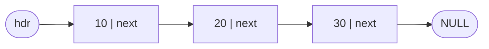
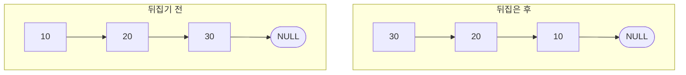
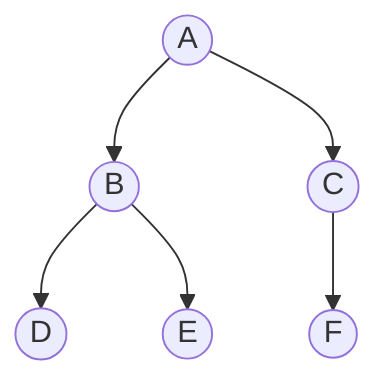
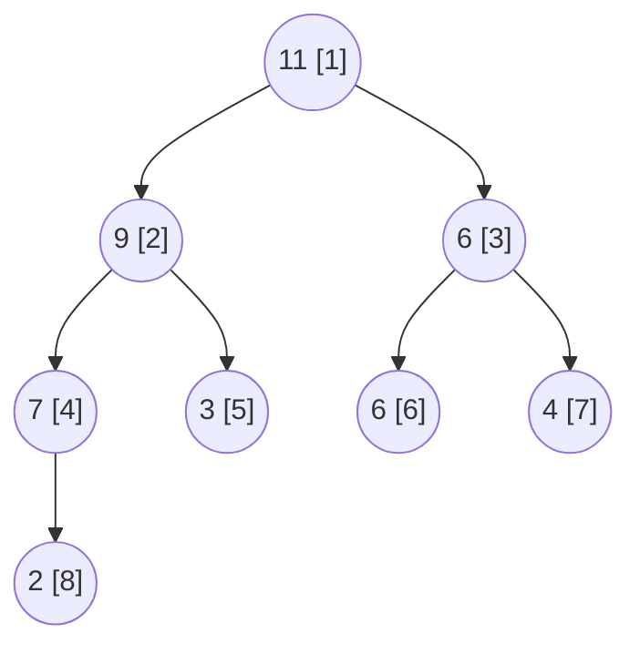

## 개요

[[스택 · 큐와 미로 탐색 (C)]]에서 다룬 구조는 모두 고정 크기 배열 위에 있었습니다. 이번에는 `malloc`으로 노드를 하나씩 만들고 포인터로 잇는 구조를 정리합니다.

- **단순 연결 리스트**: 노드가 다음 노드의 주소를 가집니다. 중간 삽입·삭제에 원소 이동이 없습니다.
- **이진 트리**: 노드가 왼쪽·오른쪽 자식 두 개를 가집니다. 대부분의 연산이 재귀로 자연스럽게 표현됩니다.
- **힙**: 완전 이진 트리라서 포인터 없이 배열 인덱스만으로 부모·자식을 찾습니다. 우선순위 큐의 표준 구현입니다.

실습 과제에서 직접 작성한 함수 위주로 발췌했고, 제출 당시 코드에 있던 버그는 고친 형태로 싣고 무엇이 문제였는지 따로 적었습니다.

## 단순 연결 리스트

### 구조

리스트는 첫 노드를 가리키는 포인터 `hdr` 하나로 표현합니다. `hdr == NULL`이면 빈 리스트입니다.

```c title="node.h"
typedef int elem_t;
typedef struct node {
    elem_t data;
    struct node* next;
} node_t;
```



맨 앞 노드가 바뀔 수 있는 함수(앞에 삽입, 첫 노드 삭제, 뒤집기)는 모두 **새 `hdr`을 반환**하고 호출하는 쪽에서 `hdr = insert_first(hdr, e);`처럼 다시 받습니다. 포인터를 값으로 넘기기 때문에 함수 안에서 `hdr`을 바꿔도 밖에는 반영되지 않기 때문입니다.

### 삽입

```c title="node.c"
node_t* new_node(elem_t e) {
    node_t* p = (node_t*)malloc(sizeof(node_t));
    p->data = e;
    p->next = NULL;          // 새 노드의 next는 항상 NULL로 시작
    return p;
}

node_t* insert_first(node_t* hdr, elem_t e) {
    node_t* p = new_node(e);
    p->next = hdr;
    return p;                // 새 노드가 새 머리
}

void insert_after(node_t* prev, elem_t e) {
    node_t* p = new_node(e);
    p->next = prev->next;    // 순서가 중요: 먼저 뒤를 잇고
    prev->next = p;          // 그다음 앞을 잇는다
}
```

`insert_after`에서 두 줄의 순서를 바꾸면 `prev->next`가 먼저 덮여서 원래 뒤쪽 노드를 잃어버립니다.

정렬된 상태를 유지하며 넣는 `insert_sort`는 "새 값보다 큰 값이 처음 나오는 노드의 직전"을 찾아 `insert_after`를 부릅니다. 맨 앞에 들어가야 하는 경우만 따로 처리합니다.

```c title="node.c"
node_t* insert_sort(node_t* hdr, elem_t e) {
    if (hdr == NULL || e < hdr->data)
        return insert_first(hdr, e);
    node_t* p = hdr;
    while (p->next != NULL && p->next->data <= e)
        p = p->next;
    insert_after(p, e);
    return hdr;
}

// 기존 리스트를 건드리지 않고 정렬된 새 리스트를 만든다
node_t* sorted_list(node_t* hdr) {
    node_t* sorted = NULL;
    for (node_t* p = hdr; p != NULL; p = p->next)
        sorted = insert_sort(sorted, p->data);
    return sorted;
}
```

`sorted_list`는 삽입 정렬과 같아서 O(n²)입니다.

### 삭제

단순 연결 리스트에서 노드를 지우려면 **지울 노드의 앞 노드**가 필요합니다. 그래서 `find_prev`로 앞 노드를 찾습니다.

```c title="node.c"
node_t* find_prev(node_t* hdr, elem_t e) {
    for (node_t* p = hdr; p != NULL && p->next != NULL; p = p->next)
        if (p->next->data == e) return p;
    return NULL;             // 못 찾으면 NULL
}

node_t* delete_list(node_t* hdr, elem_t e) {
    if (hdr == NULL) return NULL;
    if (hdr->data == e) {    // 첫 노드는 앞 노드가 없으므로 따로 처리
        node_t* q = hdr->next;
        free(hdr);
        return q;
    }
    node_t* prev = find_prev(hdr, e);
    if (prev == NULL) return hdr;
    node_t* q = prev->next;
    prev->next = q->next;    // 건너뛰도록 연결한 뒤
    free(q);                 // 해제
    return hdr;
}
```

> [!note] 제출 코드의 버그: 못 찾았을 때의 반환값
> 처음 작성한 `find_prev`는 반복문이 끝난 뒤 `return p;`를 했습니다. 값을 못 찾으면 `p`는 NULL이 아니라 **마지막 노드**입니다. 그러면 `delete_list`의 `prev == NULL` 검사를 통과해 `q = prev->next`가 NULL이 되고, `q->next`에서 프로그램이 죽습니다. "없음"을 뜻하는 값은 함수 끝에서 명시적으로 반환해야 합니다.

같은 값을 모두 지우는 `remove_all_list`도 처음에는 `find_prev`와 `delete_list`를 반복 호출하는 방식이었습니다. 그러면 매번 처음부터 다시 찾으므로 O(n²)이고, 위 버그와 겹쳐 종료 조건도 맞지 않았습니다. 한 번 훑으면서 지우는 편이 단순합니다.

```c title="listmain.c"
node_t* remove_all_list(node_t* hdr, elem_t e) {
    while (hdr != NULL && hdr->data == e) {   // 앞쪽에 연속된 e 제거
        node_t* q = hdr->next;
        free(hdr);
        hdr = q;
    }
    node_t* p = hdr;
    while (p != NULL && p->next != NULL) {
        if (p->next->data == e) {
            node_t* q = p->next;
            p->next = q->next;                // p는 그대로 두고 다음 후보 검사
            free(q);
        } else {
            p = p->next;
        }
    }
    return hdr;
}
```

### 뒤집기

새 노드를 만들지 않고 링크 방향만 바꿉니다. `prev`, `cur`, `next` 세 포인터를 한 칸씩 밀면서 `cur->next`를 `prev`로 돌립니다.

```c title="listmain.c"
node_t* reverse_list(node_t* hdr) {
    node_t *prev = NULL, *cur = NULL, *next = hdr;
    while (next != NULL) {
        prev = cur;
        cur = next;
        next = next->next;   // 링크를 바꾸기 전에 다음 노드를 기억
        cur->next = prev;
    }
    return cur;              // 원래 마지막 노드가 새 머리
}
```



> [!note] 제출 코드의 버그: `return` 누락
> 처음 제출한 `reverse_list`와 `insert_after`에는 `return`이 없었습니다. 반환 타입이 `node_t*`인데 값을 돌려주지 않으면 C에서는 정의되지 않은 동작이고, 호출부의 `hdr = reverse_list(hdr);`는 쓰레기 값을 받습니다. 컴파일러 경고(MSVC C4716, GCC `-Wreturn-type`)를 무시하지 말아야 하는 이유입니다.

### 짝수·홀수로 나누기

출력 매개변수로 두 리스트를 돌려받아야 해서 `node_t**`를 씁니다. 원래 순서를 유지하려고 맨 뒤에 붙였습니다.

```c title="listmain.c"
node_t* insert_last(node_t* hdr, elem_t e) {
    node_t* newp = new_node(e);
    if (hdr == NULL) return newp;
    node_t* p = hdr;
    while (p->next != NULL) p = p->next;
    p->next = newp;
    return hdr;
}

void split_list(node_t* hdr, node_t** oddp, node_t** evenp) {
    for (node_t* p = hdr; p != NULL; p = p->next) {
        if (p->data % 2 != 0) *oddp  = insert_last(*oddp,  p->data);
        else                  *evenp = insert_last(*evenp, p->data);
    }
}
```

`insert_last`가 매번 끝까지 걸어가므로 전체는 O(n²)입니다. 각 리스트의 꼬리 포인터(tail)를 따로 들고 있으면 O(n)으로 줄일 수 있습니다. 또 `p->data % 2 == 1`로 홀수를 판별하면 음수 홀수(`-3 % 2 == -1`)를 짝수로 분류하므로 `!= 0`으로 비교했습니다.

### 시간복잡도

| 연산 | 시간복잡도 | 비고 |
| --- | --- | --- |
| `insert_first` | O(1) | |
| `insert_after(prev)` | O(1) | `prev`를 이미 알 때 |
| `insert_last` | O(n) | tail 포인터가 있으면 O(1) |
| `insert_sort` | O(n) | 위치 탐색 |
| `find_prev`, 탐색 | O(n) | 순차 접근만 가능 |
| `delete_list(e)` | O(n) | 탐색 비용, 연결 변경 자체는 O(1) |
| `reverse_list` | O(n) | 추가 메모리 O(1) |
| `get_at(i)` | O(n) | 배열 리스트의 O(1)과 대비 |

배열 리스트와 비교하면 "위치를 알고 있을 때의 삽입·삭제"는 빨라지고 "i번째 원소 접근"은 느려집니다.

## 이진 트리

### 구조와 용어

```c title="tnode.h"
typedef struct tnode {
    elem_t data;
    struct tnode *left, *right;
} tnode_t;
```

- 높이가 h인 이진 트리의 노드는 최대 2ʰ − 1개입니다.
- 노드가 n개인 이진 트리의 높이는 최소 ⌈log₂(n + 1)⌉, 최대 n입니다.
- **포화 이진 트리**: 모든 레벨이 꽉 찬 트리입니다.
- **완전 이진 트리**: 마지막 레벨을 뺀 모든 레벨이 꽉 차 있고, 마지막 레벨은 왼쪽부터 빈틈없이 채운 트리입니다. 힙이 이 모양입니다.

### 순회

루트(V)를 언제 방문하느냐에 따라 세 가지로 나뉩니다.

```c title="treemain.c"
void preorder(tnode_t* t) {      // V L R
    if (t == NULL) return;
    printf("%d ", t->data);
    preorder(t->left);
    preorder(t->right);
}

void inorder(tnode_t* t) {       // L V R
    if (t == NULL) return;
    inorder(t->left);
    printf("%d ", t->data);
    inorder(t->right);
}

void postorder(tnode_t* t) {     // L R V
    if (t == NULL) return;
    postorder(t->left);
    postorder(t->right);
    printf("%d ", t->data);
}
```



위 트리에서 전위는 `A B D E C F`, 중위는 `D B E A F C`, 후위는 `D E B F C A`입니다.

트리를 텍스트로 그릴 때는 전위 순회를 하면서 깊이만큼 들여쓰기를 했습니다. 부모가 자식보다 먼저 찍히므로 위에서 아래로 읽으면 구조가 보입니다.

```c title="tnode.c"
void print_tree(tnode_t* t, int level) {
    if (t == NULL) return;
    for (int i = 0; i < level; i++) printf("... ");
    printf("%d\n", t->data);
    print_tree(t->left,  level + 1);
    print_tree(t->right, level + 1);
}
```

### 개수·높이 구하기

"왼쪽 서브트리의 답과 오른쪽 서브트리의 답으로 내 답을 만든다"는 형태라 모두 후위 순회 구조입니다.

```c title="treemain.c"
int count_node(tnode_t* t) {
    if (t == NULL) return 0;
    return 1 + count_node(t->left) + count_node(t->right);
}

int count_leaf(tnode_t* t) {
    if (t == NULL) return 0;
    if (t->left == NULL && t->right == NULL) return 1;
    return count_leaf(t->left) + count_leaf(t->right);
}

int height(tnode_t* t) {
    if (t == NULL) return 0;
    int lh = height(t->left), rh = height(t->right);
    return 1 + (lh > rh ? lh : rh);
}
```

### 이진 탐색 트리(BST)

모든 노드에서 `왼쪽 서브트리 < 루트 < 오른쪽 서브트리`가 성립하는 이진 트리입니다. 그래서 **중위 순회하면 오름차순**으로 나옵니다. 실습 1단계의 `add_node`는 빈 자식 자리에 순서대로 붙이는 연습용이었고, 이후 값의 대소로 방향을 정하는 BST 삽입으로 발전시켰습니다.

```c title="bst.c"
tnode_t* search(tnode_t* t, elem_t key) {
    while (t != NULL && t->data != key)
        t = (key < t->data) ? t->left : t->right;
    return t;
}

tnode_t* insert_bst(tnode_t* t, elem_t key) {
    if (t == NULL) return new_node(key);       // 빈 자리에 새 노드
    if (key < t->data)      t->left  = insert_bst(t->left,  key);
    else if (key > t->data) t->right = insert_bst(t->right, key);
    return t;                                  // 중복이면 넣지 않음
}
```

삭제는 지울 노드의 자식 수에 따라 세 경우로 나뉩니다.

1. **자식 없음(단말)**: 부모의 링크를 NULL로 끊습니다.
2. **자식 하나**: 그 자식을 부모에 바로 붙입니다.
3. **자식 둘**: 오른쪽 서브트리의 최솟값(중위 후속자)으로 값을 바꾼 뒤, 오른쪽 서브트리에서 그 값을 지웁니다. 왼쪽 서브트리의 최댓값을 써도 됩니다.

```c title="bst.c"
tnode_t* delete_bst(tnode_t* t, elem_t key) {
    if (t == NULL) return NULL;
    if (key < t->data) {
        t->left = delete_bst(t->left, key);
    } else if (key > t->data) {
        t->right = delete_bst(t->right, key);
    } else if (t->left == NULL || t->right == NULL) {   // 경우 1, 2
        tnode_t* child = t->left ? t->left : t->right;
        free(t);
        return child;
    } else {                                           // 경우 3
        tnode_t* succ = t->right;
        while (succ->left != NULL) succ = succ->left;
        t->data = succ->data;
        t->right = delete_bst(t->right, succ->data);
    }
    return t;
}
```

### 시간복잡도

| 연산 | 평균 | 최악(한쪽으로 치우친 트리) |
| --- | --- | --- |
| 순회, 개수, 높이 | O(n) | O(n) |
| BST 탐색 | O(log n) | O(n) |
| BST 삽입 | O(log n) | O(n) |
| BST 삭제 | O(log n) | O(n) |

정렬된 순서로 값을 넣으면 BST는 연결 리스트처럼 한 줄이 되어 최악이 됩니다. 이를 막는 것이 AVL·레드블랙 트리 같은 균형 트리입니다.

## 힙과 우선순위 큐

### 배열로 표현하는 완전 이진 트리

최대 힙은 **모든 노드의 키가 자식보다 크거나 같은 완전 이진 트리**입니다. 완전 이진 트리는 빈칸 없이 왼쪽부터 채워지므로, 1번부터 번호를 붙여 배열에 넣으면 포인터 없이 관계를 계산할 수 있습니다.

| 관계 | 인덱스 |
| --- | --- |
| 부모 | `i / 2` |
| 왼쪽 자식 | `2 * i` |
| 오른쪽 자식 | `2 * i + 1` |

0번 칸을 비우고 1번부터 쓰는 이유가 이 계산을 단순하게 하기 위해서입니다.

```c title="heap.h"
#define MAX_ELEMENT 200
typedef struct {
    int heap[MAX_ELEMENT];   // heap[1]부터 사용
    int heap_size;
} heap_t;
```

실습 입력 `9 2 6 7 3 6 4 11`을 차례로 넣으면 다음 힙이 됩니다. 배열로는 `[_, 11, 9, 6, 7, 3, 6, 4, 2]`입니다.



### 삽입: 업힙(up-heap)

새 원소를 마지막 자리(`++heap_size`)에 두고, 부모보다 크면 부모를 끌어내리며 위로 올라갑니다. 매번 교환하지 않고 부모를 한 칸 내린 뒤 마지막에 한 번만 대입하는 방식입니다.

```c title="heap.c"
void insert_max_heap(heap_t* h, int key) {
    int i = ++(h->heap_size);
    while (i != 1 && key > h->heap[i / 2]) {
        h->heap[i] = h->heap[i / 2];   // 부모를 아래로
        i /= 2;
    }
    h->heap[i] = key;
}
```

위 예에서 마지막으로 11을 넣을 때를 따라가면 8번 자리에서 시작해 부모 2(4번), 7(2번), 9(1번)보다 모두 크므로 루트까지 올라갑니다.

### 삭제: 다운힙(down-heap)

최대 힙에서 꺼내는 것은 항상 루트입니다. 마지막 원소를 루트 자리로 올렸다고 보고, 두 자식 중 **더 큰 쪽**과 비교하며 내려갑니다. 큰 쪽과 바꿔야 그 자식이 새 부모가 되어도 힙 조건이 유지됩니다.

```c title="heap.c"
int delete_max_heap(heap_t* h) {
    int item = h->heap[1];
    int temp = h->heap[(h->heap_size)--];   // 마지막 원소
    int parent = 1, child = 2;
    while (child <= h->heap_size) {
        if (child < h->heap_size && h->heap[child] < h->heap[child + 1])
            child++;                         // 더 큰 자식 선택
        if (temp >= h->heap[child]) break;   // 자리 찾음
        h->heap[parent] = h->heap[child];    // 자식을 위로
        parent = child;
        child *= 2;
    }
    h->heap[parent] = temp;
    return item;
}
```

예시 힙에서 한 번 삭제하면 11이 빠지고 마지막 원소 2가 내려가면서 9 → 7이 한 칸씩 올라와 `[_, 9, 7, 6, 2, 3, 6, 4]`가 됩니다. 실습 출력과 같은 결과입니다.

> [!note] 원소가 구조체일 때
> 실습에서는 `elem_t`를 `{ name, key }` 구조체의 포인터로 두고 `h->heap[i]->key`로 비교했습니다. 힙은 포인터만 옮기므로 원소가 커도 이동 비용이 같고, 꺼낸 원소는 호출한 쪽에서 `free`합니다.

### 시간복잡도

완전 이진 트리의 높이가 ⌊log₂ n⌋이므로 업힙·다운힙은 높이만큼만 움직입니다.

| 연산 | 시간복잡도 |
| --- | --- |
| 최댓값 확인 (`heap[1]`) | O(1) |
| 삽입 (업힙) | O(log n) |
| 삭제 (다운힙) | O(log n) |
| n개 삽입 후 n개 삭제 (힙 정렬) | O(n log n) |

정렬되지 않은 배열로 우선순위 큐를 만들면 삽입 O(1)·삭제 O(n), 정렬된 배열이나 정렬 연결 리스트(`insert_sort`)로 만들면 삽입 O(n)·삭제 O(1)입니다. 힙은 둘 다 O(log n)으로 맞춰서 삽입과 삭제가 섞여 일어날 때 유리합니다.

##### 참조

- 경기대학교 자료구조 수업 실습 과제(연결 리스트 실습 1~3, 트리 1단계, 트리·힙 실습)
- [[스택 · 큐와 미로 탐색 (C)]]
- [[Recursion(재귀) algorithm 과 D&C(분할과 정복) 시간복잡도 분석]]
