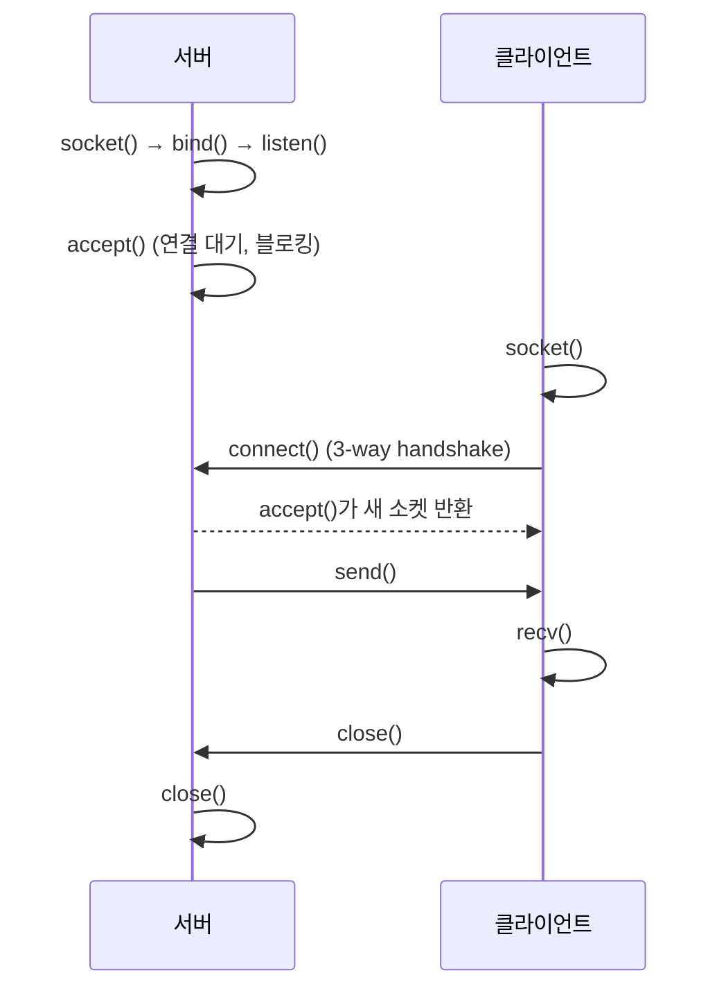
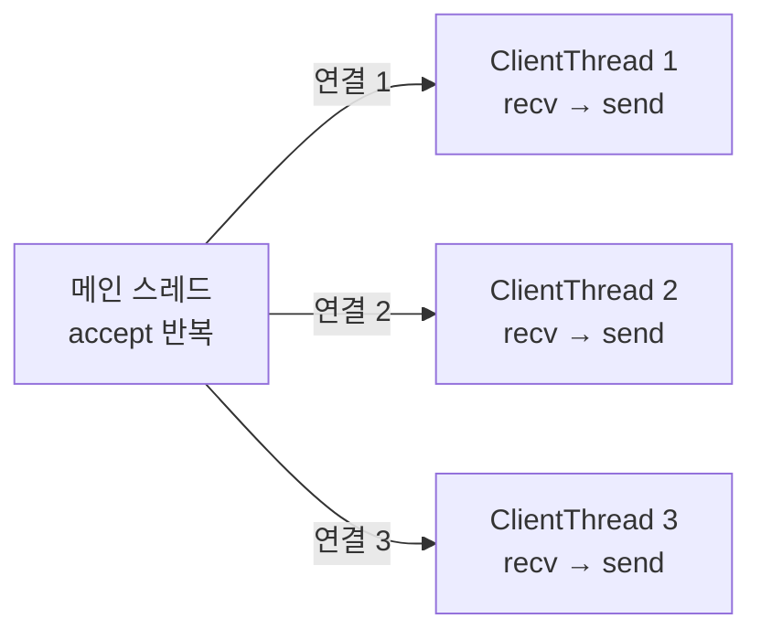

## 개요

소켓 프로그래밍 수업(라즈베리파이 기반 IoT 실습)의 앞부분에서 다룬 Python 소켓 코드를 다시 정리한 글입니다. 다루는 내용은 다음과 같습니다.

1. 연결 하나만 처리하는 가장 단순한 TCP 서버와 클라이언트
2. 클라이언트마다 스레드를 하나씩 만드는 다중 접속 에코 서버
3. 연결 없이 메시지를 뿌리는 UDP 브로드캐스트와 TCP와의 차이

당시 실습 코드를 그대로 옮기지 않고, 다시 읽으면서 발견한 문제(스레드에서 전역 변수 참조, 연결 종료 미처리 등)를 고친 형태로 실었습니다.

> [!note]
> 예제의 IP는 모두 `127.0.0.1`(자기 자신)이나 빈 문자열(모든 인터페이스)입니다. 다른 기기에서 접속하려면 서버가 실제 네트워크 인터페이스 주소나 `0.0.0.0`에 바인딩해야 합니다.

## TCP 소켓의 기본 흐름

TCP는 데이터를 주고받기 전에 연결을 먼저 맺습니다. 서버와 클라이언트가 호출하는 함수 순서는 다음과 같습니다.



핵심은 `accept()`가 **새 소켓을 반환**한다는 점입니다. `listen()` 중인 소켓은 연결 요청을 받는 창구 역할만 하고, 실제 데이터는 `accept()`가 돌려준 소켓으로 주고받습니다.

| 함수 | 쓰는 쪽 | 역할 |
| --- | --- | --- |
| `socket()` | 둘 다 | 소켓 객체 생성. 기본값이 `AF_INET`(IPv4) + `SOCK_STREAM`(TCP) |
| `bind((host, port))` | 서버 | 소켓을 특정 주소·포트에 묶음 |
| `listen(n)` | 서버 | 연결 요청 대기열 크기를 정하고 수신 대기 상태로 전환 |
| `accept()` | 서버 | 대기열에서 연결 하나를 꺼내 `(새 소켓, 클라이언트 주소)` 반환 |
| `connect((host, port))` | 클라이언트 | 서버에 연결 요청 |
| `send()` / `sendall()` | 둘 다 | 바이트 전송. `sendall()`은 전부 보낼 때까지 반복 |
| `recv(bufsize)` | 둘 다 | 최대 `bufsize` 바이트 수신. 상대가 연결을 닫으면 `b''` 반환 |

## 가장 단순한 TCP 서버와 클라이언트

연결이 들어오면 인사 메시지 하나를 보내고 바로 끊는 서버입니다.

```python title="server.py"
import socket

s = socket.socket()                 # TCP 소켓 (AF_INET, SOCK_STREAM)
host = socket.gethostname()         # 이 컴퓨터의 호스트 이름
port = 2222
s.bind((host, port))
s.listen(50)                        # 대기열 최대 50개
print("Server start")

while True:
    c, addr = s.accept()            # 연결이 올 때까지 블로킹
    print("Got connection from", addr)
    c.send(b"Thank you for connecting")
    c.close()                       # 이 클라이언트와의 연결만 종료
```

```python title="client.py"
import socket

s = socket.socket()
s.connect((socket.gethostname(), 2222))
print(s.recv(1024))                 # 서버가 보낼 때까지 대기
s.close()
```

서버를 먼저 켜고 클라이언트를 실행하면 서버에는 `Got connection from (클라이언트 주소, 포트)`가, 클라이언트에는 `b'Thank you for connecting'`이 찍힙니다.

몇 가지 짚어 둘 점이 있습니다.

- 소켓은 **바이트(`bytes`)** 를 주고받습니다. 문자열은 `encode()`로 보내고 받은 뒤 `decode()`로 되돌립니다. 위 예제가 `b"..."` 리터럴을 쓰는 이유입니다.
- 이 서버는 한 번에 한 클라이언트만 처리합니다. `accept()` 뒤의 작업이 길어지면 그동안 다른 클라이언트는 대기열에서 기다립니다.
- 클라이언트 쪽 포트는 `bind()`하지 않으면 운영체제가 임의로(ephemeral port) 정합니다. 서버 로그에 찍히는 포트가 매번 다른 이유입니다.

## 다중 접속: 클라이언트마다 스레드 하나

여러 클라이언트와 동시에 대화하려면 `accept()`를 하는 메인 루프와 클라이언트별 송수신을 분리해야 합니다. 가장 간단한 방법은 연결 하나당 스레드 하나를 띄우는 것입니다.



받은 문자열을 그대로 돌려주는 에코 서버이고, 클라이언트가 `bye`를 보내면 해당 연결을 닫습니다.

```python title="mserver.py"
import socket, threading

class ClientThread(threading.Thread):
    def __init__(self, addr, conn):
        super().__init__(daemon=True)
        self.addr = addr            # 스레드마다 자기 클라이언트 주소를 보관
        self.conn = conn
        print("New connection added:", addr)

    def run(self):
        print("Connection from:", self.addr)
        while True:
            data = self.conn.recv(2048)
            if not data:            # 상대가 연결을 끊음
                break
            msg = data.decode()
            if msg == "bye":
                break
            print(f'"{msg}" from client {self.addr}')
            self.conn.sendall(msg.encode("utf-8"))
        self.conn.close()
        print("Client at", self.addr, "disconnected...")

s = socket.socket(socket.AF_INET, socket.SOCK_STREAM)
s.setsockopt(socket.SOL_SOCKET, socket.SO_REUSEADDR, 1)
s.bind(("127.0.0.1", 8080))
s.listen(5)
print("Server started")
print("Waiting for client request..")

while True:
    conn, addr = s.accept()
    ClientThread(addr, conn).start()
```

```python title="mclient.py"
import socket

c = socket.socket(socket.AF_INET, socket.SOCK_STREAM)
c.connect(("127.0.0.1", 8080))
c.sendall("This is from client".encode("utf-8"))

while True:
    print("From Server:", c.recv(1024).decode())
    out = input()
    c.sendall(out.encode("utf-8"))
    if out == "bye":
        break
c.close()
```

클라이언트 두 개를 띄우면 서버 콘솔에는 대략 이런 순서로 찍힙니다.

```text title="서버 출력 (형태)"
Server started
Waiting for client request..
New connection added: ('127.0.0.1', 51234)
Connection from: ('127.0.0.1', 51234)
"This is from client" from client ('127.0.0.1', 51234)
New connection added: ('127.0.0.1', 51240)
Connection from: ('127.0.0.1', 51240)
"This is from client" from client ('127.0.0.1', 51240)
Client at ('127.0.0.1', 51234) disconnected...
```

### 실습 코드에서 고친 부분

처음 실습할 때 쓴 코드는 동작은 했지만 다시 보니 문제가 몇 가지 있었습니다.

> [!warning] 스레드 안에서 전역 `addr` 참조
> `run()` 안에서 `self.addr`가 아니라 메인 루프의 전역 변수 `addr`를 출력하고 있었습니다. 두 번째 클라이언트가 접속하면 전역 `addr`가 덮어써지므로, 첫 번째 스레드의 로그에도 두 번째 클라이언트 주소가 찍힙니다. 스레드가 쓰는 값은 생성자에서 인스턴스 변수로 받아 두어야 합니다.

- **연결 종료를 처리하지 않음**: 클라이언트가 `bye` 없이 창을 닫으면 `recv()`가 계속 `b''`를 돌려줍니다. 빈 바이트를 검사하지 않으면 서버 스레드가 빈 문자열을 무한히 처리합니다. `if not data: break`로 막았습니다.
- **`listen()`을 루프 안에서 호출**: `listen()`은 소켓을 수신 대기 상태로 바꾸는 설정이므로 `bind()` 직후 한 번만 호출하면 됩니다.
- **`send()` 대신 `sendall()`**: `send()`는 일부만 보내고 보낸 바이트 수를 반환할 수 있습니다. 짧은 메시지에서는 차이가 없지만 습관적으로 `sendall()`을 쓰는 편이 안전합니다.
- **`SO_REUSEADDR`**: 서버를 껐다 바로 다시 켜면 이전 연결이 `TIME_WAIT` 상태로 남아 `Address already in use`가 납니다. 이 옵션을 켜면 같은 포트에 바로 다시 바인딩할 수 있습니다.

> [!note] 스레드 방식의 한계
> 연결마다 스레드를 만드는 방식은 이해하기 쉽지만 접속자가 수천 명이 되면 스레드 생성·전환 비용이 커집니다. 규모가 커지면 `selectors`/`asyncio` 같은 이벤트 기반 I/O나 스레드 풀을 씁니다.

## UDP와 비교

같은 `socket` 모듈로 UDP도 쓸 수 있습니다. 타입만 `SOCK_DGRAM`으로 바꾸면 되고, 연결을 맺지 않으므로 `listen`·`accept`·`connect`가 없습니다. 보낼 때마다 `sendto(data, (host, port))`로 목적지를 지정하고, 받을 때는 `recvfrom()`이 `(데이터, 보낸 쪽 주소)`를 함께 돌려줍니다.

아래는 1초마다 브로드캐스트 메시지를 보내는 송신 측과, 같은 포트로 받는 수신 측입니다. 송신 주소의 `"<broadcast>"`는 Python이 브로드캐스트 주소(`255.255.255.255`)로 해석하는 특수 문자열입니다.

```python title="udp_broadcast_sender.py"
import socket, time

u = socket.socket(socket.AF_INET, socket.SOCK_DGRAM, socket.IPPROTO_UDP)
u.setsockopt(socket.SOL_SOCKET, socket.SO_BROADCAST, 1)   # 브로드캐스트 허용

while True:
    u.sendto(b"broadcast message", ("<broadcast>", 37020))
    print("Broadcast message")
    time.sleep(1)
```

```python title="udp_broadcast_receiver.py"
import socket

u = socket.socket(socket.AF_INET, socket.SOCK_DGRAM, socket.IPPROTO_UDP)
u.setsockopt(socket.SOL_SOCKET, socket.SO_BROADCAST, 1)
u.bind(("", 37020))                 # 모든 인터페이스의 37020 포트
print("Broadcast receiver start")

while True:
    data, addr = u.recvfrom(1024)
    print("Message from", addr, data)
```

UDP는 상대가 받았는지 알려 주지 않으므로, 응답을 기다리는 쪽은 `settimeout(초)`을 걸고 `socket.timeout` 예외를 `try/except`로 처리해 "응답 없음"을 판단합니다.

| 구분 | TCP (`SOCK_STREAM`) | UDP (`SOCK_DGRAM`) |
| --- | --- | --- |
| 연결 | 연결을 맺고 유지 | 연결 없음. 필요할 때 바로 전송 |
| 사용 함수 | `listen`, `accept`, `connect`, `send`, `recv` | `sendto`, `recvfrom` |
| 신뢰성 | 순서·도착 보장, 재전송 | 보장하지 않음 (유실·순서 뒤바뀜 가능) |
| 데이터 경계 | 바이트 스트림 (메시지 경계 없음) | 데이터그램 단위로 경계 유지 |
| 브로드캐스트 | 불가 | 가능 (`SO_BROADCAST`) |
| 쓰임 | 파일 전송, 채팅, HTTP | 장치 탐색, 센서 값 방송, 스트리밍 |

> [!tip] TCP는 메시지 경계가 없다
> TCP에서 `send("ab")`, `send("cd")`를 연달아 보내면 받는 쪽 `recv()`가 `"abcd"`를 한 번에 받을 수도, `"a"`와 `"bcd"`로 나눠 받을 수도 있습니다. 위 에코 예제는 사람이 한 줄씩 입력하므로 문제가 드러나지 않지만, 실제 프로토콜에서는 줄바꿈 구분자나 길이 헤더로 메시지 경계를 직접 정해야 합니다.

## 정리

- TCP 서버는 `socket → bind → listen → accept`, 클라이언트는 `socket → connect` 순서로 연결하고, 데이터는 `accept()`가 돌려준 새 소켓으로 주고받습니다.
- 여러 클라이언트를 동시에 받으려면 `accept` 루프와 클라이언트별 송수신을 분리합니다. 스레드를 쓸 때는 스레드마다 자기 상태를 인스턴스 변수로 들고 있어야 합니다.
- `recv()`가 `b''`를 돌려주면 상대가 연결을 닫은 것이므로 반드시 루프를 빠져나옵니다.
- UDP는 연결 과정 없이 `sendto`/`recvfrom`으로 주고받고, 신뢰성 대신 가볍고 브로드캐스트가 가능합니다.

##### 참조

- [Python 공식 문서 — socket](https://docs.python.org/3/library/socket.html)
- [Python 공식 문서 — Socket Programming HOWTO](https://docs.python.org/3/howto/sockets.html)
- [Python 공식 문서 — threading](https://docs.python.org/3/library/threading.html)
