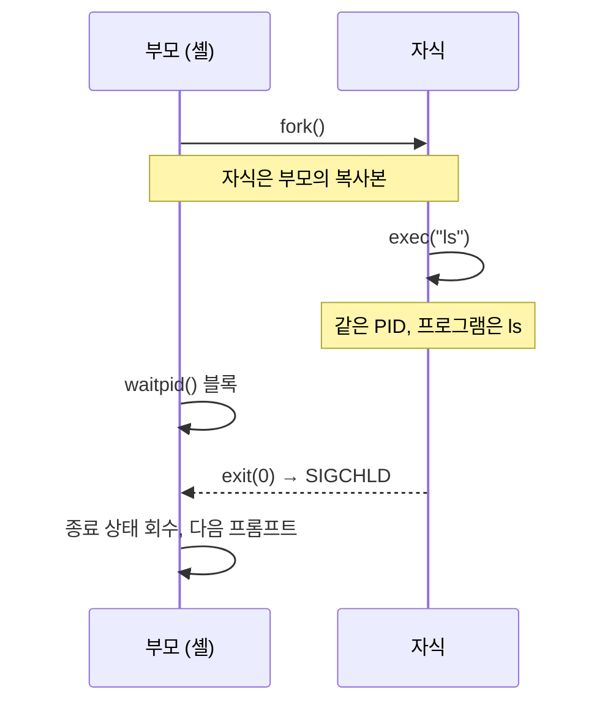

## 개요

리눅스 셸에서 `ls`를 입력하면 셸이 `ls`로 바뀌는 것이 아닙니다. 셸은 **자기 자신을 복제(fork)**하고, 복제된 자식이 **`ls` 프로그램으로 자신을 덮어쓰고(exec)**, 셸은 **자식이 끝날 때까지 기다립니다(wait)**. 리눅스의 거의 모든 프로세스는 이 세 단계로 만들어집니다.

이 글에서는 세 시스템 콜을 C 코드로 하나씩 실행하며 결과를 확인합니다. 그다음 `wait`를 빠뜨렸을 때 생기는 좀비(zombie) 프로세스와, 부모가 먼저 끝났을 때 생기는 고아(orphan) 프로세스를 `ps`로 직접 관찰합니다. 마지막으로 실습 중에 자주 쓰는 프로세스 관리 명령을 정리합니다.

> [!note] 실습 환경
> 예제는 일반적인 x86-64 리눅스 배포판의 `gcc`로 컴파일했습니다. 출력에 나오는 PID 값은 실행할 때마다 달라집니다.

## 프로세스 트리와 PID 1

리눅스의 모든 프로세스는 부모를 가집니다. 부팅 후 커널이 처음 실행하는 사용자 프로세스가 PID 1번이고, 최근 배포판에서는 `systemd`입니다. 나머지 프로세스는 모두 이 프로세스에서 fork를 거듭해 만들어진 자손입니다. `pstree`로 이 구조를 확인할 수 있습니다.

```bash title="pstree -p 출력 일부"
$ pstree -p | head -5
systemd(1)-+-ModemManager(812)
           |-NetworkManager(790)
           |-cron(745)
           |-sshd(901)---sshd(2310)---bash(2311)---pstree(2405)
```

`bash(2311)` 아래에 `pstree(2405)`가 달려 있습니다. 셸에서 실행한 명령은 셸의 자식 프로세스라는 뜻입니다.

## fork: 프로세스 복제

`fork()`는 호출한 프로세스를 그대로 복제해 자식 프로세스를 만듭니다. 자식은 부모의 코드, 데이터, 힙, 스택, 열린 파일 디스크립터를 복사본으로 받습니다. 리눅스는 실제로는 페이지를 바로 복사하지 않고, 어느 한쪽이 쓰기를 할 때 복사하는 Copy-on-Write 방식을 씁니다. 그래서 fork 자체는 빠릅니다.

핵심은 **한 번 호출하면 두 번 반환한다**는 점입니다.

| 반환값 | 의미 |
| --- | --- |
| `0` | 지금 코드를 실행하는 쪽이 자식 |
| `> 0` | 부모. 값은 새로 만든 자식의 PID |
| `-1` | 실패(프로세스 수 제한 등). 자식이 만들어지지 않음 |

```c title="fork_basic.c"
#include <stdio.h>
#include <unistd.h>
#include <sys/types.h>
#include <sys/wait.h>

int main(void) {
    int x = 10;
    pid_t pid = fork();

    if (pid < 0) {
        perror("fork");
        return 1;
    }

    if (pid == 0) {          /* 자식 */
        x += 1;
        printf("[자식] pid=%d ppid=%d x=%d\n", getpid(), getppid(), x);
    } else {                 /* 부모 */
        x -= 1;
        wait(NULL);          /* 자식이 끝날 때까지 대기 */
        printf("[부모] pid=%d child=%d x=%d\n", getpid(), pid, x);
    }
    return 0;
}
```

```text title="실행 결과"
$ gcc -o fork_basic fork_basic.c && ./fork_basic
[자식] pid=4121 ppid=4120 x=11
[부모] pid=4120 child=4121 x=9
```

두 가지를 확인할 수 있습니다.

1. 자식의 `ppid`가 부모의 `pid`와 같습니다.
2. 같은 변수 `x`를 바꿨는데 자식은 11, 부모는 9입니다. **fork 이후 두 프로세스의 메모리는 완전히 분리**되어 있습니다. 서로의 값을 공유하려면 파이프, 공유 메모리 같은 IPC가 필요합니다.

부모가 `wait(NULL)`을 호출하지 않으면 두 줄의 출력 순서는 보장되지 않습니다. 누가 먼저 실행될지는 스케줄러가 정합니다.

> [!tip] fork와 출력 버퍼
> `printf("hello");`처럼 줄바꿈 없이 출력한 직후 fork하면 "hello"가 두 번 찍힐 수 있습니다. 아직 비우지 않은 stdio 버퍼까지 자식에게 복사되기 때문입니다. 출력을 파일이나 파이프로 리다이렉트하면 버퍼가 줄 단위가 아니라 블록 단위로 바뀌어서 이 현상이 더 자주 나타납니다. fork 전에 `fflush(stdout)`을 호출하면 막을 수 있습니다.

## exec: 프로세스 이미지 교체

fork만으로는 같은 프로그램이 두 개가 될 뿐입니다. 다른 프로그램을 실행하려면 `exec` 계열 함수(`execl`, `execlp`, `execv`, `execvp`, `execve` 등)를 씁니다. exec는 **새 프로세스를 만들지 않습니다.** 현재 프로세스의 코드·데이터·스택을 새 프로그램으로 덮어쓰고, PID는 그대로 유지합니다. 성공하면 원래 코드로 돌아오지 않으므로, exec 다음 줄이 실행됐다면 실패했다는 뜻입니다.

| 구분 | fork | exec |
| --- | --- | --- |
| 새 프로세스 생성 | O (새 PID) | X (PID 유지) |
| 기존 프로세스 | 그대로 남음 | 새 프로그램으로 덮어씀 |
| 반환 | 부모·자식에서 각각 반환 | 성공 시 반환하지 않음 |

이름의 접미사는 인자 전달 방식을 나타냅니다. `l`은 인자를 나열(list), `v`는 배열(vector)로 넘깁니다. `p`가 붙으면 `PATH`에서 프로그램을 찾고, `e`가 붙으면 환경 변수를 직접 지정합니다.

셸에서도 exec를 체험할 수 있습니다. 명령 앞에 `exec`를 붙이면 셸이 fork 없이 그 명령으로 바뀝니다.

```bash
$ echo $$          # 현재 셸의 PID
2311
$ exec ps -o pid,cmd
  PID CMD
 2311 ps -o pid,cmd
```

`ps`의 PID가 셸의 PID(2311)와 같습니다. `ps`가 끝나면 돌아갈 셸이 없으므로 터미널 세션도 종료됩니다.

## wait: 자식 회수와 종료 상태

부모는 `wait()` 또는 `waitpid()`로 자식의 종료를 기다리고 종료 상태(exit status)를 받습니다. 아래 예제는 셸이 명령을 실행하는 과정을 그대로 축소한 것입니다.

```c title="mini_shell.c"
#include <stdio.h>
#include <stdlib.h>
#include <unistd.h>
#include <sys/types.h>
#include <sys/wait.h>

int main(void) {
    pid_t pid = fork();

    if (pid < 0) {
        perror("fork");
        exit(1);
    }

    if (pid == 0) {
        /* 자식: ls -l /tmp 로 자신을 교체 */
        execlp("ls", "ls", "-l", "/tmp", (char *)NULL);
        perror("execlp");    /* 여기까지 왔다면 exec 실패 */
        exit(127);
    }

    int status;
    waitpid(pid, &status, 0);   /* 특정 자식이 끝날 때까지 블록 */

    if (WIFEXITED(status))
        printf("[부모] 자식 %d 정상 종료, exit code=%d\n", pid, WEXITSTATUS(status));
    else if (WIFSIGNALED(status))
        printf("[부모] 자식 %d 시그널 %d로 종료\n", pid, WTERMSIG(status));
    return 0;
}
```

```text title="실행 결과"
$ ./mini_shell
total 4
drwx------ 3 root root 4096 Oct 25 10:12 systemd-private-...
[부모] 자식 4188 정상 종료, exit code=0
```

`/tmp` 대신 존재하지 않는 경로를 주면 `ls`가 실패하면서 `exit code=2`가 출력됩니다. 셸에서 `echo $?`로 보는 값이 바로 이 종료 상태입니다.

전체 흐름은 다음과 같습니다.



## 좀비 프로세스

자식이 종료되면 커널은 메모리 같은 자원을 대부분 해제합니다. 하지만 부모가 종료 상태를 읽어 갈 수 있도록 **PID와 종료 상태가 담긴 프로세스 테이블 항목은 남겨 둡니다.** 부모가 `wait`로 이 항목을 회수하기 전까지 자식은 좀비(zombie) 상태입니다.

```c title="zombie.c"
#include <stdio.h>
#include <stdlib.h>
#include <unistd.h>

int main(void) {
    pid_t pid = fork();

    if (pid == 0) {
        printf("[자식] %d 종료\n", getpid());
        exit(0);
    }

    printf("[부모] wait 없이 30초 대기 (자식=%d)\n", pid);
    sleep(30);      /* 이 동안 자식은 좀비로 남는다 */
    return 0;
}
```

```text title="다른 터미널에서 확인"
$ ./zombie &
[1] 4201
[부모] wait 없이 30초 대기 (자식=4202)
[자식] 4202 종료

$ ps -o pid,ppid,stat,cmd -p 4201,4202
  PID  PPID STAT CMD
 4201  2311 S    ./zombie
 4202  4201 Z    [zombie] <defunct>
```

`STAT`이 `Z`이고 명령 이름 뒤에 `<defunct>`가 붙습니다. 좀비는 이미 죽은 프로세스라서 `kill -9`로도 없어지지 않습니다. 해결 방법은 다음과 같습니다.

- 부모가 `wait`/`waitpid`를 호출해 회수합니다. 자식이 여럿이면 `SIGCHLD` 핸들러에서 `waitpid(-1, &status, WNOHANG)`을 반복 호출하는 패턴을 많이 씁니다.
- 부모가 종료되면 좀비는 아래에서 설명할 고아가 되어 새 부모(init)에게 넘어가고, init이 회수합니다. 위 예제에서도 30초 뒤 부모가 끝나면 좀비가 사라집니다.

좀비 한두 개는 메모리를 거의 쓰지 않습니다. 하지만 오래 도는 서버가 자식을 계속 만들면서 회수하지 않으면 PID가 고갈되어 새 프로세스를 만들 수 없게 됩니다.

## 고아 프로세스

반대로 **부모가 자식보다 먼저 종료**하면 자식은 고아(orphan)가 됩니다. 커널은 고아를 PID 1(init/systemd)에게 입양시킵니다. 이 새 부모가 나중에 자식의 종료 상태를 회수해 줍니다.

```c title="orphan.c"
#include <stdio.h>
#include <unistd.h>

int main(void) {
    pid_t pid = fork();

    if (pid > 0) {
        printf("[부모] %d 먼저 종료\n", getpid());
        return 0;
    }

    printf("[자식] 처음 ppid=%d\n", getppid());
    sleep(2);                       /* 그사이 부모가 끝난다 */
    printf("[자식] 2초 후 ppid=%d\n", getppid());
    return 0;
}
```

```text title="실행 결과"
$ ./orphan
[부모] 4310 먼저 종료
[자식] 처음 ppid=4310
$ [자식] 2초 후 ppid=1
```

부모가 끝나자마자 셸이 프롬프트(`$`)를 다시 띄우고, 그 뒤에 자식의 출력이 끼어듭니다. 자식의 ppid는 4310에서 1로 바뀌었습니다.

데스크톱 환경에서는 1 대신 다른 PID가 나올 수 있습니다. `systemd --user`처럼 서브리퍼(subreaper)로 지정된 프로세스가 있으면 고아를 그 프로세스가 대신 입양하기 때문입니다.

| 구분 | 좀비 프로세스 | 고아 프로세스 |
| --- | --- | --- |
| 상황 | 자식이 끝났는데 부모가 wait하지 않음 | 부모가 자식보다 먼저 끝남 |
| 상태 | 이미 종료됨(`Z`) | 아직 실행 중 |
| 처리 | 부모가 wait로 회수 | init/서브리퍼가 입양 후 회수 |

## 프로세스 관리 명령 정리

### ps와 STAT 코드

`ps aux`(BSD 형식)나 `ps -ef`(System V 형식)로 시스템의 모든 프로세스를 볼 수 있습니다. `ps aux`의 주요 열은 `USER`, `PID`, `%CPU`, `%MEM`, `VSZ`(가상 메모리), `RSS`(실제 메모리), `STAT`입니다.

| STAT | 의미 |
| --- | --- |
| `R` | 실행 중이거나 실행 대기 중 |
| `S` | 인터럽트 가능한 대기(sleep) |
| `D` | 인터럽트 불가능한 대기(주로 디스크 I/O) |
| `T` | 정지됨(시그널 또는 디버거) |
| `Z` | 좀비 |
| `<` / `N` | 우선순위가 높음 / 낮음 |
| `s` | 세션 리더 |
| `l` | 멀티스레드 |
| `+` | 포어그라운드 프로세스 그룹 |

앞 절의 좀비 실습에서 본 `Z`가 이 표의 좀비 상태입니다. `top -d 2 -p <PID>`는 특정 프로세스를 2초 간격으로 모니터링합니다.

### 포어그라운드와 백그라운드

```bash
$ sleep 100 &        # & 를 붙이면 백그라운드로 실행
[1] 4402
$ sleep 200          # 포어그라운드 실행 중 Ctrl+Z
^Z
[2]+  Stopped                 sleep 200
$ jobs
[1]-  Running                 sleep 100 &
[2]+  Stopped                 sleep 200
$ bg %2              # 정지된 작업을 백그라운드에서 계속 실행
$ fg %1              # 1번 작업을 포어그라운드로
```

`jobs`의 `+`는 현재 작업(`fg`나 `bg`에 번호를 생략하면 대상이 되는 작업)이고, `-`는 그다음 작업입니다. 로그아웃해도 작업을 계속 실행하려면 `nohup 명령 &`을 사용합니다. 이때 출력은 `nohup.out`에 저장됩니다.

### 시그널

시그널(Signal)은 프로세스에 비동기적으로 이벤트를 알리는 방법입니다. `kill -l`로 전체 목록을 볼 수 있습니다.

| 시그널 | 번호 | 키 / 용도 | 기본 동작 |
| --- | --- | --- | --- |
| `SIGINT` | 2 | `Ctrl+C` | 종료 |
| `SIGQUIT` | 3 | `Ctrl+\` | 종료 + 코어 덤프 |
| `SIGTSTP` | 20 | `Ctrl+Z` | 정지 |
| `SIGTERM` | 15 | `kill`의 기본값 | 종료(처리 가능) |
| `SIGKILL` | 9 | `kill -9` | 강제 종료(처리·무시 불가) |
| `SIGCHLD` | 17 | 자식 종료 시 부모에게 | 무시 |

```bash
$ kill 4402              # SIGTERM: 정리할 기회를 줌
$ kill -9 4402           # SIGKILL: 즉시 강제 종료
$ pgrep sleep            # 이름으로 PID 찾기
$ pkill sleep            # 이름으로 시그널 보내기
$ killall sleep          # 같은 이름의 프로세스 모두 종료
```

먼저 `SIGTERM`으로 종료를 요청하고, 응답하지 않을 때만 `SIGKILL`을 쓰는 것이 좋습니다. `SIGKILL`은 프로세스가 임시 파일이나 락을 정리할 기회를 주지 않습니다. 시그널 번호는 x86/ARM 리눅스 기준이며 아키텍처에 따라 다를 수 있습니다.

### nice와 우선순위

`ps -l`의 `PRI`와 `NI`는 값이 **작을수록 우선순위가 높습니다.** nice 값은 -20부터 19까지이고 기본값은 0입니다. 일반 사용자는 nice 값을 올리기(우선순위 낮추기)만 할 수 있고, 내리는 것은 root만 가능합니다.

```bash
$ nice -n 10 ./long_job &        # 우선순위를 낮춰 실행
$ renice -n 5 -p 4402            # 실행 중인 프로세스의 nice 값 변경
```

이 값은 CPU 스케줄러가 CPU 시간을 나눠 줄 때 가중치로 반영됩니다.

### /proc

`/proc`은 커널이 메모리에서 만들어 보여 주는 가상 파일 시스템입니다. 프로세스마다 `/proc/<PID>/` 디렉터리가 있고, 그 안의 `status` 파일에서 상태, PPID, 메모리 사용량 등을 텍스트로 볼 수 있습니다. `ps`와 `top`도 이 파일들을 읽어서 출력합니다.

```bash
$ grep -E 'State|PPid' /proc/4202/status
State:  Z (zombie)
PPid:   4201
```

## 정리

- **fork**: 프로세스를 복제합니다. 자식에게는 0을, 부모에게는 자식 PID를 반환하고, 이후 두 프로세스의 메모리는 분리됩니다.
- **exec**: PID는 그대로 두고 현재 프로세스를 새 프로그램으로 덮어씁니다.
- **wait**: 자식의 종료 상태를 회수합니다. 회수하지 않으면 좀비가 남고, 부모가 먼저 죽은 자식(고아)은 PID 1이 입양합니다.
- 셸이 명령을 실행하는 과정이 바로 fork → exec → wait입니다. `ps`, `jobs`, `kill`, `nice`는 이렇게 만들어진 프로세스를 관찰하고 제어하는 도구입니다.

##### 참조

- Linux man-pages: `fork(2)`, `execve(2)`, `exec(3)`, `wait(2)`, `signal(7)`, `ps(1)`, `proc(5)`
- Abraham Silberschatz, Peter B. Galvin, Greg Gagne, *Operating System Concepts*, 10th ed., Wiley — 3장 Processes
- 리눅스 운영체제 실습 노트 (프로세스 관리)
