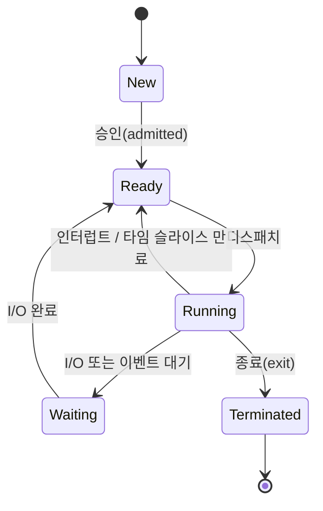
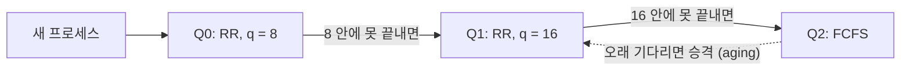

## 개요

CPU는 한 번에 하나의 프로세스(코어 기준)만 실행할 수 있습니다. 그런데 프로세스는 대부분의 시간을 CPU 연산이 아니라 디스크나 네트워크 같은 I/O를 기다리는 데 씁니다. 그래서 운영체제는 여러 프로세스를 메모리에 올려 두고, 한 프로세스가 I/O를 기다리는 동안 다른 프로세스에게 CPU를 넘깁니다. 이것이 다중 프로그래밍(Multiprogramming)이고, **준비된 프로세스 중 누구에게 CPU를 줄지** 정하는 것이 CPU 스케줄링(CPU Scheduling)입니다.

이 글에서는 프로세스의 상태 전이를 먼저 정리합니다. 그다음 대표적인 스케줄링 알고리즘을 같은 기준(평균 대기 시간)으로 직접 계산해 비교합니다.

## 프로세스와 상태 전이

프로세스(Process)는 실행 중인 프로그램입니다. 운영체제는 프로세스마다 PCB(Process Control Block)를 두고 PID, 상태, 레지스터 값, 스케줄링 정보, 열린 파일 목록 등을 기록합니다. 한 프로세스 안에서 만든 스레드(Thread)들은 코드·데이터·열린 파일 같은 자원을 공유하고, 각자 레지스터와 스택만 따로 가집니다. 스레드를 지원하는 운영체제에서는 실제 스케줄링 대상이 프로세스가 아니라 커널 스레드입니다.

프로세스는 실행되는 동안 다음 상태를 오갑니다.

- **Ready**: 실행할 준비가 끝났고 CPU만 기다리는 상태입니다. 이 프로세스들이 모인 곳이 준비 큐(ready queue)입니다.
- **Waiting**: I/O 완료 같은 이벤트를 기다리는 상태입니다. CPU를 줘도 할 일이 없습니다.
- **Running**: 지금 CPU에서 명령어를 실행하는 상태입니다.

### CPU 버스트와 I/O 버스트

프로세스 실행은 CPU를 쓰는 구간(CPU burst)과 I/O를 기다리는 구간(I/O burst)이 번갈아 나타납니다. 대부분의 프로그램은 짧은 CPU 버스트가 많고 긴 CPU 버스트는 드뭅니다. 스케줄러 설계는 이 분포를 전제로 합니다. I/O 중심(I/O-bound) 프로세스는 CPU 버스트가 짧고, CPU 중심(CPU-bound) 프로세스는 CPU 버스트가 깁니다.

## 스케줄링은 언제 일어나는가

준비 큐에서 다음 프로세스를 고르는 것은 단기 스케줄러(short-term scheduler, CPU 스케줄러)의 역할입니다. 스케줄링 결정은 다음 네 시점에 일어날 수 있습니다.

| 시점 | 예 | 방식 |
| --- | --- | --- |
| Running → Waiting | I/O 요청, `wait()` 호출 | 비선점에서도 발생 |
| Running → Ready | 타이머 인터럽트 | 선점 |
| Waiting → Ready | I/O 완료 | 선점 |
| Terminated | 프로세스 종료 | 비선점에서도 발생 |

- **비선점(Nonpreemptive, 협력적) 스케줄링**: 프로세스가 스스로 CPU를 내려놓을 때(대기 전환 또는 종료)만 스케줄링합니다. 구현이 단순하지만, 오래 걸리는 프로세스가 CPU를 붙잡고 있으면 다른 프로세스는 기다려야 합니다.
- **선점(Preemptive) 스케줄링**: 실행 중인 프로세스에게서 CPU를 강제로 뺏을 수 있습니다. 현대 범용 운영체제는 모두 선점형입니다. 대신 공유 데이터를 수정하던 도중에 CPU를 뺏기면 데이터가 어긋날 수 있으므로 동기화가 필요합니다.

### 디스패처

스케줄러가 "누구"를 정하면, 실제로 CPU를 넘기는 일은 디스패처(Dispatcher)가 합니다.

1. 컨텍스트 스위칭(context switch): 현재 프로세스의 레지스터 상태를 PCB에 저장하고 다음 프로세스의 상태를 복원합니다.
2. 사용자 모드로 전환합니다.
3. 프로그램이 이어서 실행할 위치로 점프합니다.

이 과정에 걸리는 시간이 디스패치 지연(dispatch latency)입니다. 이 시간에는 아무도 유용한 일을 하지 못하므로 짧을수록 좋습니다.

## 스케줄링 평가 기준

| 기준 | 의미 | 목표 |
| --- | --- | --- |
| CPU 이용률(CPU utilization) | CPU가 일하는 시간의 비율 | 최대화 |
| 처리량(Throughput) | 단위 시간당 완료한 프로세스 수 | 최대화 |
| 반환 시간(Turnaround time) | 도착부터 완료까지 걸린 시간 | 최소화 |
| 대기 시간(Waiting time) | 준비 큐에서 기다린 시간의 합 | 최소화 |
| 응답 시간(Response time) | 도착부터 첫 실행(첫 응답)까지 걸린 시간 | 최소화 |

아래 예제에서는 다음 관계를 이용해 대기 시간을 계산합니다.

$$
\text{반환 시간} = \text{완료 시각} - \text{도착 시각}, \qquad
\text{대기 시간} = \text{반환 시간} - \text{CPU 버스트}
$$

대화형 시스템에서는 평균값만 보면 안 됩니다. 응답 시간이 들쭉날쭉하지 않게, 즉 분산을 줄이는 것도 중요합니다.

## FCFS (First-Come, First-Served)

가장 먼저 CPU를 요청한 프로세스에게 먼저 CPU를 줍니다. 준비 큐를 FIFO 큐로 관리하면 되고, 비선점 방식입니다.

**예제 1**: 세 프로세스가 모두 시각 0에 도착하고, 큐에 P1 → P2 → P3 순서로 들어왔다고 합시다.

| 프로세스 | CPU 버스트 |
| --- | --- |
| P1 | 24 |
| P2 | 3 |
| P3 | 3 |

```mermaid
gantt
    title FCFS (P1 → P2 → P3)
    dateFormat X
    axisFormat %s
    section CPU
    P1 : 0, 24
    P2 : 24, 27
    P3 : 27, 30
```

| 프로세스 | 완료 시각 | 대기 시간 |
| --- | --- | --- |
| P1 | 24 | 0 |
| P2 | 27 | 24 |
| P3 | 30 | 27 |

평균 대기 시간은 $(0 + 24 + 27) / 3 = 17$입니다.

같은 프로세스가 P2 → P3 → P1 순서로 도착했다면 대기 시간은 각각 0, 3, 6이 되고 평균은 $(0 + 3 + 6) / 3 = 3$입니다. **도착 순서만 바뀌었는데 평균 대기 시간이 17에서 3으로 줄었습니다.**

이처럼 긴 프로세스 하나가 앞에 있으면 짧은 프로세스들이 줄줄이 기다리는 현상을 호송 효과(Convoy effect)라고 합니다. CPU 중심 프로세스 하나가 CPU를 오래 잡고 있는 동안 I/O 중심 프로세스들이 모두 준비 큐에 묶여, CPU와 I/O 장치가 번갈아 놀게 됩니다.

## SJF (Shortest-Job-First)

CPU가 비면 **다음 CPU 버스트가 가장 짧은** 프로세스를 고릅니다. 버스트 길이가 같으면 FCFS로 정합니다.

**예제 2**: 모두 시각 0에 도착합니다.

| 프로세스 | CPU 버스트 |
| --- | --- |
| P1 | 6 |
| P2 | 8 |
| P3 | 7 |
| P4 | 3 |

```mermaid
gantt
    title SJF (비선점)
    dateFormat X
    axisFormat %s
    section CPU
    P4 : 0, 3
    P1 : 3, 9
    P3 : 9, 16
    P2 : 16, 24
```

| 프로세스 | 시작 시각 | 대기 시간 |
| --- | --- | --- |
| P1 | 3 | 3 |
| P2 | 16 | 16 |
| P3 | 9 | 9 |
| P4 | 0 | 0 |

평균 대기 시간은 $(3 + 16 + 9 + 0) / 4 = 7$입니다. 같은 집합을 P1 → P2 → P3 → P4 순서의 FCFS로 돌리면 $(0 + 6 + 14 + 21) / 4 = 10.25$입니다.

SJF는 주어진 프로세스 집합에 대해 **평균 대기 시간이 최소인 최적(optimal) 알고리즘**입니다. 짧은 작업을 긴 작업 앞으로 옮기면 짧은 작업의 대기 시간이 줄어드는 양이 긴 작업의 대기 시간이 늘어나는 양보다 크기 때문입니다.

문제는 다음 CPU 버스트 길이를 미리 알 수 없다는 점입니다. 실제로는 과거 버스트로 다음 값을 예측합니다. 흔히 쓰는 방법은 지수 평균(exponential averaging)입니다.

$$
\tau_{n+1} = \alpha \, t_n + (1 - \alpha)\, \tau_n \qquad (0 \le \alpha \le 1)
$$

$t_n$은 직전 실제 버스트, $\tau_n$은 직전 예측값입니다. $\alpha$가 클수록 최근 값을 더 크게 반영합니다.

### SRTF (Shortest-Remaining-Time-First)

SJF의 선점 버전입니다. 새 프로세스가 도착했을 때 그 버스트가 **현재 프로세스의 남은 시간보다 짧으면** CPU를 뺏습니다.

**예제 3**: 도착 시각이 서로 다릅니다.

| 프로세스 | 도착 시각 | CPU 버스트 |
| --- | --- | --- |
| P1 | 0 | 8 |
| P2 | 1 | 4 |
| P3 | 2 | 9 |
| P4 | 3 | 5 |

```mermaid
gantt
    title SRTF (선점형 SJF)
    dateFormat X
    axisFormat %s
    section CPU
    P1 : 0, 1
    P2 : 1, 5
    P4 : 5, 10
    P1 (나머지) : 10, 17
    P3 : 17, 26
```

- 시각 1: P2(4)가 도착합니다. P1의 남은 시간은 7이므로 P2가 CPU를 뺏습니다.
- 시각 2, 3: P3(9), P4(5)가 도착하지만 P2의 남은 시간(3, 2)보다 길어서 선점하지 못합니다.
- 시각 5: P2가 끝납니다. 남은 시간은 P1 7, P3 9, P4 5이므로 P4가 실행됩니다.
- 시각 10 이후에는 P1(7)이, 그다음 P3(9)이 실행됩니다.

| 프로세스 | 완료 시각 | 반환 시간 | 대기 시간 |
| --- | --- | --- | --- |
| P1 | 17 | 17 | 9 |
| P2 | 5 | 4 | 0 |
| P3 | 26 | 24 | 15 |
| P4 | 10 | 7 | 2 |

평균 대기 시간은 $(9 + 0 + 15 + 2) / 4 = 6.5$입니다. 같은 입력을 비선점 SJF로 처리하면 P1(0–8) → P2(8–12) → P4(12–17) → P3(17–26) 순서가 되어 평균 대기 시간이 $(0 + 7 + 15 + 9) / 4 = 7.75$입니다.

## 우선순위 스케줄링 (Priority Scheduling)

프로세스마다 우선순위를 매기고 가장 높은 프로세스에게 CPU를 줍니다. 이 글에서는 **숫자가 작을수록 우선순위가 높다**고 가정합니다. SJF도 "다음 CPU 버스트가 짧을수록 우선순위가 높은" 우선순위 스케줄링의 특수한 경우로 볼 수 있습니다. 선점·비선점 모두 가능합니다.

**예제 4**: 모두 시각 0에 도착하고 비선점으로 실행합니다.

| 프로세스 | CPU 버스트 | 우선순위 |
| --- | --- | --- |
| P1 | 10 | 3 |
| P2 | 1 | 1 |
| P3 | 2 | 4 |
| P4 | 1 | 5 |
| P5 | 5 | 2 |

```mermaid
gantt
    title 우선순위 스케줄링 (비선점)
    dateFormat X
    axisFormat %s
    section CPU
    P2 : 0, 1
    P5 : 1, 6
    P1 : 6, 16
    P3 : 16, 18
    P4 : 18, 19
```

대기 시간은 P1 6, P2 0, P3 16, P4 18, P5 1이고, 평균은 $(6 + 0 + 16 + 18 + 1) / 5 = 8.2$입니다.

> [!warning] 기아 상태와 노화
> 높은 우선순위 프로세스가 계속 들어오면 낮은 우선순위 프로세스는 영원히 CPU를 받지 못할 수 있습니다. 이를 기아 상태(Starvation) 또는 무기한 봉쇄(indefinite blocking)라고 합니다. 해결책은 노화(Aging)입니다. 준비 큐에서 오래 기다린 프로세스의 우선순위를 시간이 지날수록 조금씩 올려 주는 방법입니다.

## 라운드 로빈 (Round-Robin, RR)

시분할 시스템을 위한 선점형 FCFS입니다. 각 프로세스는 최대 **시간 할당량(time quantum)** $q$만큼만 CPU를 쓰고, 그 안에 끝나지 않으면 선점되어 준비 큐의 맨 뒤로 갑니다.

**예제 5**: 예제 1과 같은 입력(P1 24, P2 3, P3 3, 모두 시각 0 도착)을 $q = 4$로 실행합니다.

```mermaid
gantt
    title RR (q = 4)
    dateFormat X
    axisFormat %s
    section CPU
    P1 : 0, 4
    P2 : 4, 7
    P3 : 7, 10
    P1 : 10, 14
    P1 : 14, 18
    P1 : 18, 22
    P1 : 22, 26
    P1 : 26, 30
```

P2와 P3는 할당량보다 짧아서 한 번에 끝납니다. 이후 준비 큐에는 P1만 남으므로 P1이 연속으로 할당량을 받습니다.

| 프로세스 | 완료 시각 | 대기 시간 |
| --- | --- | --- |
| P1 | 30 | 30 − 24 = 6 |
| P2 | 7 | 4 |
| P3 | 10 | 7 |

평균 대기 시간은 $(6 + 4 + 7) / 3 \approx 5.67$입니다. SJF보다 평균 대기 시간은 길 수 있지만, 모든 프로세스가 늦어도 $(n-1)q$ 안에 다시 CPU를 받으므로 응답 시간이 좋습니다.

RR의 성능은 $q$ 크기에 크게 좌우됩니다.

- $q$가 매우 크면 아무도 선점되지 않으므로 FCFS와 같아집니다.
- $q$가 매우 작으면 $n$개 프로세스가 각각 $1/n$ 속도의 CPU를 가진 것처럼 보입니다(processor sharing). 하지만 컨텍스트 스위칭이 너무 잦아져 오버헤드가 커집니다.
- 그래서 $q$는 컨텍스트 스위칭 시간보다 충분히 커야 합니다. 경험적으로 **CPU 버스트의 약 80%가 $q$보다 짧게** 잡습니다.

## 알고리즘 비교

| 알고리즘 | 선점 여부 | 장점 | 단점 |
| --- | --- | --- | --- |
| FCFS | 비선점 | 구현이 가장 단순함 | 호송 효과, 평균 대기 시간이 큼 |
| SJF | 비선점 | 평균 대기 시간 최소 | 버스트 길이 예측 필요, 긴 작업 기아 |
| SRTF | 선점 | SJF보다 평균 대기 시간이 더 짧을 수 있음 | 잦은 선점, 예측 필요 |
| 우선순위 | 둘 다 | 중요도 반영 가능 | 기아 상태(노화로 완화) |
| RR | 선점 | 응답 시간이 좋고 공평함 | $q$ 선택에 민감, 스위칭 오버헤드 |

## 다단계 큐와 다단계 피드백 큐

### 다단계 큐 (Multilevel Queue)

준비 큐를 여러 개로 나누고, 프로세스를 성격에 따라 한 큐에 **고정으로** 배정합니다. 예를 들어 대화형(foreground) 프로세스는 RR 큐에, 일괄 처리(background) 프로세스는 FCFS 큐에 넣습니다. 큐 사이에도 스케줄링이 필요합니다.

- **고정 우선순위**: 상위 큐가 비어야 하위 큐를 실행합니다. 하위 큐가 기아 상태에 빠질 수 있습니다.
- **시간 분할**: 큐마다 CPU 시간 비율을 정합니다. 예를 들어 foreground에 80%, background에 20%를 줍니다.

### 다단계 피드백 큐 (Multilevel Feedback Queue)

프로세스가 **큐 사이를 이동할 수 있게** 한 방식입니다. 예를 들면 다음과 같습니다.

CPU 버스트가 짧은 대화형 프로세스는 상위 큐에서 빨리 끝나고, CPU를 오래 쓰는 프로세스는 자연스럽게 하위 큐로 내려갑니다. 오래 기다린 프로세스를 위로 올려 주면 노화가 되어 기아 상태도 막을 수 있습니다. 대신 큐의 수, 각 큐의 알고리즘, 승격·강등 조건, 새 프로세스를 넣을 큐 같은 매개변수가 많아서 설계가 가장 복잡합니다.

## 스레드·다중 처리기·실시간 스케줄링

### 스레드 스케줄링의 경쟁 범위

- **PCS(Process-Contention Scope)**: 사용자 수준 스레드 라이브러리가 같은 프로세스 안의 스레드끼리 경쟁시킵니다.
- **SCS(System-Contention Scope)**: 커널이 시스템 전체의 커널 스레드를 놓고 스케줄링합니다. Linux처럼 일대일(One-to-One) 모델을 쓰는 운영체제는 SCS만 사용합니다.

### 다중 처리기 스케줄링

- **비대칭 다중 처리**: 한 프로세서가 스케줄링을 전담하고, 나머지는 사용자 코드만 실행합니다.
- **대칭 다중 처리(SMP)**: 각 프로세서가 스스로 스케줄링합니다. 오늘날 가장 일반적인 방식입니다.
- **부하 분산(Load Balancing)**: 바쁜 CPU의 작업을 다른 CPU로 밀어내는 푸시 이주(push migration)와, 한가한 CPU가 작업을 가져오는 풀 이주(pull migration)가 있습니다.
- **처리기 친화성(Processor Affinity)**: 스레드가 실행되던 CPU의 캐시에는 그 스레드의 데이터가 남아 있습니다. 다른 CPU로 옮기면 캐시를 다시 채워야 하므로 가능하면 같은 CPU에 두려고 합니다. 운영체제가 노력만 하는 소프트(soft) 친화성과, 실행 가능한 CPU 집합을 명시하는 하드(hard) 친화성이 있습니다. 부하 분산과 친화성은 서로 상충합니다.
- **NUMA**: NUMA를 인식하는 운영체제는 스레드가 실행되는 CPU에 가까운 메모리를 할당합니다.
- **멀티스레드 코어**: 코어가 메모리를 기다리며 멈추는(memory stall) 동안 다른 하드웨어 스레드를 실행합니다. 이때 스케줄링은 두 단계로 나뉩니다. 운영체제는 소프트웨어 스레드를 논리 프로세서에 배정하고, 코어는 어느 하드웨어 스레드를 실행할지 고릅니다.

### 실시간 스케줄링

- **연성 실시간(Soft real-time)**: 중요한 프로세스를 우선하지만 언제 실행될지는 보장하지 않습니다.
- **경성 실시간(Hard real-time)**: 마감 시간(deadline) 안에 반드시 끝나야 합니다. 마감을 넘기면 실패입니다.

실시간 스케줄러는 선점형 우선순위 기반이어야 합니다. 이벤트가 발생해서 처리가 시작되기까지의 지연은 인터럽트 지연(interrupt latency)과 디스패치 지연으로 나뉘고, 둘 다 짧아야 합니다. 주기적(periodic) 프로세스는 처리 시간 $t$, 마감 $d$, 주기 $p$로 표현하며 $0 \le t \le d \le p$입니다.

- **Rate-Monotonic**: 주기가 짧을수록(빈도 $1/p$가 높을수록) 높은 고정 우선순위를 줍니다. 고정 우선순위 방식 중에서는 최적이지만, CPU 이용률이 높으면 마감을 놓칠 수 있습니다.
- **EDF(Earliest Deadline First)**: 마감이 가까운 프로세스일수록 우선순위를 높입니다. 우선순위가 동적으로 바뀝니다.
- **비례 배분(Proportional Share)**: 전체 $T$ 몫(share) 중 $N$을 받은 애플리케이션은 CPU 시간의 $N/T$를 보장받습니다. 약속한 몫을 지키려면 승인 제어(admission control)로 새 요청을 받을지 판단해야 합니다.

> [!note] 정리
> - 평균 대기 시간만 보면 SJF/SRTF가 가장 좋지만, 버스트 길이를 미리 알 수 없어서 예측에 의존합니다.
> - 응답성과 공평성이 중요하면 RR, 중요도가 다르면 우선순위 스케줄링을 쓰고, 기아 상태는 노화로 막습니다.
> - 실제 운영체제는 이 아이디어들을 섞은 다단계 피드백 큐 계열을 주로 사용합니다.

##### 참조

- Abraham Silberschatz, Peter B. Galvin, Greg Gagne, *Operating System Concepts*, 10th ed., Wiley — 3장 Processes, 5장 CPU Scheduling
- 대학 운영체제 강의 정리 노트 (CPU 스케줄링)
