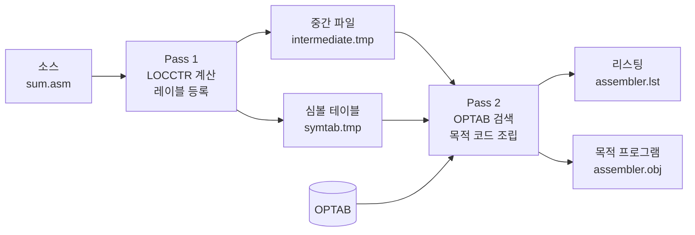

## 개요

시스템 소프트웨어 학기 프로젝트로 **SIC(Simplified Instructional Computer)** 머신의 어셈블러를 C로 구현했습니다. 어셈블리 소스(`.asm`)를 읽어 주소를 배정하고, 기계어로 번역해 **어셈블리 리스팅(`.lst`)** 과 **목적 프로그램(`.obj`)** 을 만드는 프로그램입니다.

한 번에 전체를 짜지 않고, 데이터 흐름도(DFD)의 모듈을 하나씩 붙이며 8단계로 나누어 만들었습니다. 이 글에서는 다음 순서로 정리합니다.

1. SIC 어셈블러가 왜 두 번(2-pass) 읽어야 하는지
2. 단계별로 모듈을 늘려 간 과정
3. Pass 1: LOCCTR 계산과 SYMTAB 구성
4. Pass 2: OPTAB 검색과 목적 코드 조립
5. H/T/E 레코드 작성
6. `sum.asm` 예제의 입력과 출력, 그리고 출력에서 발견한 버그

## SIC 머신과 2-pass 구조

SIC는 교재(Beck, *System Software*)에서 설명용으로 만든 가상의 머신입니다. 이 프로젝트에서 필요한 특징은 다음 정도입니다.

- 메모리는 바이트 단위 주소, **1 word = 3바이트(24비트)**
- 명령어는 모두 **3바이트 고정 길이**: `opcode(8비트) | x(1비트) | address(15비트)`
- `x` 비트가 1이면 인덱스 모드로, 실제 주소는 `address + (X 레지스터)`

어셈블러가 두 번 읽어야 하는 이유는 **전방 참조(forward reference)** 때문입니다.

```asm
        LDX     ZERO      ← ZERO의 주소를 아직 모름
        ...
ZERO    WORD    0         ← 여기까지 읽어야 주소가 정해짐
```

첫 줄을 번역하려면 `ZERO`의 주소가 필요한데, 그 주소는 한참 아래에서 정해집니다. 그래서 Pass 1에서 소스 전체를 훑으며 모든 레이블의 주소만 먼저 정해 두고(SYMTAB), Pass 2에서 그 표를 보며 실제로 번역합니다.



두 Pass는 별도 실행 파일(`pass1_run`, `pass2_run`)로 나뉘어 있고, 그 사이 데이터는 **중간 파일과 SYMTAB 파일**로만 주고받습니다. Pass 1이 각 줄의 주소·파싱 결과·에러 코드를 중간 파일에 써 두기 때문에 Pass 2는 소스를 다시 파싱할 필요가 없습니다.

```text title="intermediate.tmp (탭 구분: LOC, 에러, 레이블, 옵코드, 피연산자, 원본)"
2000	0				. Initialize Index(X) and Accumulator(A)
2000	0		LDX	ZERO	        LDX     ZERO
2003	0		LDA	ZERO	        LDA     ZERO
2006	0	LOOP	ADD	TABLE,X	LOOP    ADD     TABLE,X
```

## 단계별로 기능을 늘린 과정

각 단계 폴더에는 그 시점까지의 모듈과, 그 모듈만 시험하는 `test_main.c`가 들어 있습니다. 매 단계 `gcc`로 직접 엮어 컴파일하고 `test.asm`으로 결과를 확인한 뒤 다음 모듈을 붙였습니다.

| 단계 | 추가한 모듈 | 확인한 것 |
| --- | --- | --- |
| 1 | `P1_read_source.c` | 한 줄씩 읽기, 줄바꿈(`\n`, `\r\n`) 제거, 너무 긴 줄 감지 |
| 2 | `parse_line.c`, `P1_assign_loc.c` | 레이블/옵코드/피연산자 분리, 줄마다 LOCCTR 출력 |
| 3 | `P1_assign_sym.c`, `Access_symtab.c` | 레이블 형식 검사, 중복 검사, SYMTAB 구성 |
| 4 | `Access_int_file.c`, `test_pass2.c` | 중간 파일 쓰기/읽기 왕복, Pass 2 실행 파일 분리 |
| 5 | `optab.c`, `test_optab.c` | 니모닉 → 기계어 opcode 이진 탐색 |
| 6 | `P2_assemble_inst.c` | 명령어·WORD·BYTE의 목적 코드 생성 |
| 7 | `P2_write_list.c`, `error_handler.c` | 리스팅 파일 출력, 에러 코드 → 메시지 |
| 8 | `P2_write_obj.c`, `Makefile` | H/T/E 레코드 작성, 정적 라이브러리로 빌드 정리 |

1~7단계는 `gcc test_main.c P1_read_source.c parse_line.c ...`처럼 파일을 일일이 나열해 컴파일했는데, 모듈이 11개가 되자 관리가 어려워졌습니다. 마지막 단계에서 메인 함수가 없는 모듈을 `libassembler.a`로 묶고, 두 실행 파일이 이 라이브러리를 링크하도록 `Makefile`을 정리했습니다.

```makefile title="Makefile (발췌)"
MODULE_OBJS = $(MODULE_SRCS:.c=.o)
LIB_NAME = libassembler.a

$(LIB_NAME): $(MODULE_OBJS)
	$(AR) $(ARFLAGS) $@ $^

$(EXEC_P1): test_main.c $(LIB_NAME)
	$(CC) $(CFLAGS) -o $@ $< -L. -lassembler

%.o: %.c assembler.h
	$(CC) $(CFLAGS) -c $<
```

모든 모듈이 공유하는 구조체·에러 코드·함수 원형은 `assembler.h` 하나에 모았습니다. 에러 코드를 Pass별 번호대(10번대 `assign_loc`, 20번대 `assign_sym`, 30번대 Pass 2)로 나눠 두어, 리스팅에서 메시지만 보고도 어느 모듈에서 났는지 알 수 있게 했습니다.

## Pass 1: LOCCTR와 SYMTAB

Pass 1의 메인 루프는 한 줄마다 **읽기 → 파싱 → 심볼 등록 → 다음 주소 계산 → 중간 파일 쓰기**를 반복합니다.

### 파싱

SIC 소스는 고정 형식이 아니라 공백·탭으로 구분됩니다. 판단 기준은 **줄의 첫 글자**입니다.

- `.`으로 시작하면 주석
- 공백·탭이 아니면 첫 토큰이 레이블
- 그 다음 토큰이 옵코드(대문자로 통일), 그 다음이 피연산자

`strtok` 계열 함수는 문자열 안에 널 문자를 넣어 토큰을 자르므로, 파싱은 복사본(`temp_line`)에 대해 `strtok_r`로 했습니다. 원본 줄은 리스팅에 그대로 찍어야 해서 중간 파일용 원본도 따로 저장하는데, 7단계까지는 이 복사를 파싱 뒤에 하다가 최종본에서 **파싱 전에 복사**하도록 순서를 바꿨습니다. 파싱 함수가 나중에 바뀌어 입력 버퍼를 건드리더라도 원본이 보존되게 하려는 것입니다.

### LOCCTR 계산

LOCCTR(Location Counter)는 "지금 줄이 메모리 어디에 놓이는가"를 나타냅니다. 옵코드별로 다음 줄의 주소가 얼마나 늘어나는지만 정하면 됩니다.

```c title="P1_assign_loc.c (발췌)"
if (strcmp(line->opcode, "START") == 0)
    *next_locctr_ptr = (int)strtol(line->operand, NULL, 16);   // 시작 주소는 16진수
else if (strcmp(line->opcode, "WORD") == 0)
    *next_locctr_ptr = current_locctr + 3;
else if (strcmp(line->opcode, "RESW") == 0)
    *next_locctr_ptr = current_locctr + atoi(line->operand) * 3;
else if (strcmp(line->opcode, "RESB") == 0)
    *next_locctr_ptr = current_locctr + atoi(line->operand);
else if (strcmp(line->opcode, "BYTE") == 0) {
    int hex_len = strlen(line->operand) - 3;                    // X'...'에서 X, ' , ' 제외
    if (hex_len % 2 != 0) *error_flag_ptr = ERROR_INVALID_BYTE_LENGTH;
    else *next_locctr_ptr = current_locctr + hex_len / 2;       // 16진수 2자리 = 1바이트
}
else if (strcmp(line->opcode, "END") != 0)
    *next_locctr_ptr = current_locctr + 3;                      // 일반 명령어는 모두 3바이트
```

| 옵코드 | 증가량 |
| --- | --- |
| 일반 명령어, `WORD` | 3 |
| `RESW n` | 3 × n |
| `RESB n` | n |
| `BYTE X'..'` | 16진수 자릿수 ÷ 2 (홀수면 에러) |
| `START`, `END`, 주석 | 변화 없음 (`START`는 LOCCTR를 피연산자 값으로 설정) |

`START`의 피연산자는 16진수(`strtol(.., 16)`), `RESW`/`RESB`/`WORD`의 피연산자는 10진수(`atoi`)라는 점이 헷갈리기 쉬운 부분입니다.

### SYMTAB 등록

레이블이 있는 줄이면 현재 LOCCTR를 그 레이블의 주소로 등록합니다. 등록 전에 두 가지를 검사합니다.

- 형식: 1~6자, 첫 글자는 알파벳, 나머지는 알파벳·숫자
- 중복: 이미 SYMTAB에 있으면 `ERROR_DUPLICATE_SYMBOL`

SYMTAB은 최대 500개 배열이고, Pass 1이 끝나면 `레이블\t주소` 형식의 텍스트 파일로 저장해 Pass 2가 다시 읽어 들입니다.

## Pass 2: OPTAB과 목적 코드

### OPTAB

OPTAB은 니모닉과 기계어 opcode의 대응표입니다. 내용이 바뀌지 않으므로 `static const` 배열로 두고, **니모닉 알파벳순으로 정렬해 이진 탐색**했습니다.

```c title="optab.c (발췌)"
static const OpcodeEntry OPTAB[] = {
    {"ADD", 0x18}, {"COMP", 0x28}, {"DIV", 0x24}, {"J", 0x3C},
    {"JEQ", 0x30}, {"JGT", 0x34}, {"JLT", 0x38}, {"JSUB", 0x48},
    {"LDA", 0x00}, {"LDL", 0x08}, {"LDX", 0x04}, {"MUL", 0x20},
    /* ... RD, RSUB, STA, STL, STX, SUB, TD, TIX, WD */
};
```

> [!warning] 정렬이 틀리면 이진 탐색이 조용히 실패한다
> 처음에는 `LDX`를 `LDL`보다 앞에 두었는데, `strcmp` 기준으로는 `"LDL" < "LDX"`입니다. 정렬이 하나만 어긋나도 이진 탐색은 그 근처 항목을 못 찾고 `Invalid opcode`를 낼 수 있습니다. 컴파일러가 잡아 주지 않는 실수라서, 표를 바꿀 때마다 `test_optab.c`로 모든 니모닉을 한 번씩 조회해 보는 편이 안전합니다.

### 명령어 조립

SIC 명령어 하나는 `opcode << 16 | address`로 만들어집니다. 피연산자가 `,X`로 끝나면 인덱스 모드이므로 주소의 최상위 비트(`0x8000`)를 켭니다.

```c title="P2_assemble_inst.c (발췌)"
P2_search_optab(opcode, &machine_opcode);

char *comma_x = strstr(symbol, ",X");
if (comma_x != NULL) {
    is_indexed = 1;
    *comma_x = '\0';                       // "TABLE,X" → "TABLE"
}
if (Access_symtab(SYMTAB_SEARCH, symbol, 0, &operand_address) != 0)
    obj_code_ptr->error_flag = ERROR_UNDEFINED_SYMBOL;
if (is_indexed)
    operand_address |= 0x8000;             // x 비트

obj_code_ptr->code = (machine_opcode << 16) | (operand_address & 0xFFFF);
```

`sum.asm`의 `LOOP ADD TABLE,X`로 계산해 보면 다음과 같습니다.

| 항목 | 값 |
| --- | --- |
| `ADD` opcode | `0x18` |
| `TABLE` 주소 (SYMTAB) | `0x2015` |
| `,X` → x 비트(`0x8000`) OR | `0xA015` |
| 목적 코드 | `18A015` |

지시어는 따로 처리합니다. `WORD`는 10진수 값을 24비트로 마스킹(범위를 넘으면 에러), `BYTE X'F1A2'`는 16진수 두 자리씩 바이트 배열로 변환, `RESW`/`RESB`/`START`/`END`는 목적 코드를 만들지 않습니다. `RSUB`는 피연산자가 없으므로 주소를 0으로 둡니다(`4C0000`).

## 목적 프로그램: H/T/E 레코드

목적 프로그램은 로더가 읽는 형식으로, 세 종류의 레코드로 이루어집니다. 필드 구분자는 `^`를 썼습니다.

| 레코드 | 형식 | 내용 |
| --- | --- | --- |
| H (Header) | `H^이름^시작주소^길이` | 프로그램 이름(6자), 시작 주소, 전체 길이 |
| T (Text) | `T^시작주소^길이^코드...` | 한 레코드에 최대 30바이트(16진수 60자)의 목적 코드 |
| E (End) | `E^실행시작주소` | 첫 실행 명령어 주소 (`END` 피연산자) |

구현에서 신경 쓴 부분은 두 가지입니다.

**H 레코드의 길이는 마지막에 채운다.** 프로그램 길이는 `END`까지 가야 알 수 있습니다. 그래서 `START`를 만나면 길이 자리에 `000000`을 먼저 쓰고 `ftell`로 위치를 기억해 두었다가, 끝에서 `fseek`으로 돌아가 덮어씁니다.

```c title="P2_write_obj.c (발췌)"
// START를 만났을 때
fprintf(obj_file, "H^%-6s^%06X^", label, data_line->locctr);
h_record_length_pos = ftell(obj_file);   // 길이 필드 위치 저장
fprintf(obj_file, "000000");             // 자리만 확보

// Pass 2 종료 시
flush_t_record();
fprintf(obj_file, "\nE^%06X\n", first_exec_addr);
fseek(obj_file, h_record_length_pos, SEEK_SET);
fprintf(obj_file, "%06X", prog_length);  // 실제 길이로 덮어쓰기
```

**T 레코드는 버퍼에 모았다가 끊어서 쓴다.** 목적 코드를 버퍼에 이어 붙이다가 다음 세 경우에 버퍼를 비우고(flush) 새 T 레코드를 시작합니다.

1. 이번 코드를 더하면 30바이트를 넘을 때
2. 이번 코드의 주소가 버퍼 끝 주소와 이어지지 않을 때
3. `RESW`/`RESB`를 만났을 때 (예약 공간은 목적 코드가 없으므로 주소에 빈틈이 생김)

또 Pass 1이나 Pass 2에서 에러가 하나라도 나면 목적 파일을 닫은 뒤 `remove()`로 지웁니다. 잘못된 목적 프로그램이 남아 있으면 로더가 그대로 읽을 수 있기 때문입니다. 에러 내용은 리스팅 파일의 해당 줄에 메시지로 남습니다.

## 실행 예제: sum.asm

테이블의 세 값(10, 20, 30)을 인덱스 레지스터로 돌면서 더하는 프로그램입니다. `TIX`는 X를 1 증가시키고 `COUNT`와 비교하며, `JLT`로 X가 3보다 작은 동안 반복합니다.

```asm title="sum.asm"
SUM     START   2000
        LDX     ZERO
        LDA     ZERO
LOOP    ADD     TABLE,X
        TIX     COUNT
        JLT     LOOP
        STA     TOTAL
        RSUB
TABLE   WORD    10
        WORD    20
        WORD    30
COUNT   WORD    3
ZERO    WORD    0
TOTAL   RESW    1
        END     SUM
```

> [!note]
> 이 예제는 `WORD`가 3바이트이고 X가 1씩 증가하므로 `TABLE,X`가 실제로는 `TABLE`, `TABLE+1`, `TABLE+2` 바이트를 가리킵니다. 원소를 제대로 순회하려면 X를 3씩 늘려야 합니다. 어셈블러의 번역 결과를 확인하려는 입력이라 프로그램 의미는 따지지 않았습니다.

```text title="assembler.lst (주석 줄 생략)"
LOC      SOURCE                         OBJECT
--------------------------------------------------
2000     SUM     START   2000
2000             LDX     ZERO           042021
2003             LDA     ZERO           002021
2006     LOOP    ADD     TABLE,X        18A015
2009             TIX     COUNT          2C201E
200C             JLT     LOOP           382006
200F             STA     TOTAL          0C2024
2012             RSUB                   4C0000
2015     TABLE   WORD    10             00000A
2018             WORD    20             000014
201B             WORD    30             00001E
201E     COUNT   WORD    3              000003
2021     ZERO    WORD    0              000000
2024     TOTAL   RESW    1
2027             END     SUM
2027             END     SUM
--------------------------------------------------
```

```text title="assembler.obj"
H^SUM   ^002000^000027
T^002000^1E^04202100202118A0152C201E3820060C20244C000000000A00001400001E
T^00201E^06^000003000000
E^000000
```

- H: 이름 `SUM`, 시작 `002000`, 길이 `0x2027 - 0x2000 = 0x27`
- 첫 T 레코드: 명령어 7개(21바이트) + `WORD` 3개(9바이트) = 정확히 30바이트(`1E`)에서 끊김
- 두 번째 T 레코드: `COUNT`, `ZERO` 6바이트. 그 뒤 `TOTAL RESW`에서 flush

### 출력에서 발견한 버그 두 가지

결과를 다시 보니 두 군데가 틀려 있었습니다.

> [!bug] E 레코드가 `E^000000`
> `END SUM`이므로 실행 시작 주소는 `002000`이어야 합니다. `symtab.tmp`를 열어 보니 `SUM 0000`으로 등록되어 있었습니다. Pass 1 루프에서 **심볼 등록(`P1_assign_sym`)이 `START`의 LOCCTR 설정보다 먼저** 실행되기 때문에, 첫 줄의 레이블만 초기값 0으로 들어간 것입니다. `START` 줄은 LOCCTR를 먼저 설정하고 나서 레이블을 등록하도록 순서를 바꾸면 해결됩니다.

> [!bug] END 줄이 두 번 찍힘
> `P1_read_source`가 EOF를 반환해도 루프는 그 회차의 처리를 끝까지 한 뒤에 빠져나갑니다. 이때 `fgets`가 실패해 버퍼에는 **직전 줄(`END SUM`)이 그대로 남아** 있으므로 같은 줄이 중간 파일에 한 번 더 기록됩니다. 읽기 결과가 `READ_EOF`이면 파싱 전에 바로 `break`해야 합니다.

두 버그 모두 각 모듈의 단위 테스트에서는 드러나지 않았고, 모듈을 이어 붙인 메인 루프의 **호출 순서**에서 생긴 문제였습니다. 리스팅만 보고 넘어가지 말고 목적 프로그램의 E 레코드까지 손으로 검산해 봤어야 했습니다.

## 정리

- 2-pass 구조는 전방 참조 때문에 필요합니다. Pass 1은 주소(LOCCTR, SYMTAB), Pass 2는 번역(OPTAB, 목적 코드)을 맡습니다.
- 두 Pass를 중간 파일로 분리하면 Pass 2가 소스 파싱을 다시 하지 않아도 되고, 각 Pass를 따로 시험할 수 있습니다.
- SIC 명령어는 `opcode << 16 | address`이고, 인덱스 모드는 `0x8000` 비트로 표시합니다.
- T 레코드는 30바이트 제한, 주소 불연속, `RESW`/`RESB`에서 끊고, H 레코드 길이는 `ftell`/`fseek`으로 나중에 채웁니다.
- 모듈을 하나씩 붙이며 만든 덕분에 각 기능은 단계별로 검증했지만, 전체 루프의 순서 문제는 최종 출력을 검산해야 보였습니다.

##### 참조

- Leland L. Beck, *System Software: An Introduction to Systems Programming*, 3rd ed., Chapter 2 (Assemblers)
- [SIC/XE 명령어 집합 개요 — Wikipedia, Simplified Instructional Computer](https://en.wikipedia.org/wiki/Simplified_Instructional_Computer)
