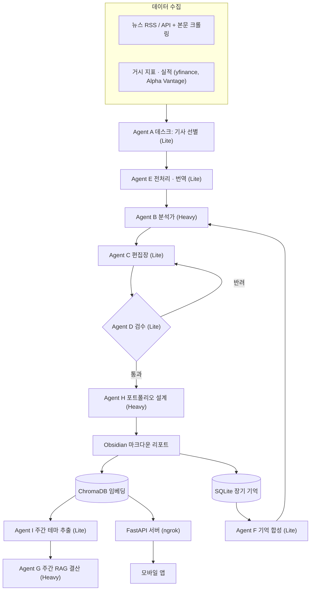

## 개요

![[daily-macro-report-banner.png]]

매일 아침 국내외 경제 뉴스, 거시 지표, 시장 주도주 데이터를 모아 **역할별 AI 에이전트 9개**가 일간 리포트를 작성하는 사람 손이 필요 없는(Zero-touch) 리서치 시스템입니다. 완성된 리포트는 Obsidian 마크다운으로 저장되고, 저장과 동시에 Vector DB(ChromaDB)에 임베딩됩니다. 주말에는 RAG 기반 주간 결산을 쓰고, 검색 API와 이를 보여 주는 Android 앱 **Daily Macro Report**로 리포트를 어디서든 볼 수 있게 했습니다.

전부터 만들어 보고 싶던 에이전트였습니다. 라즈베리파이라는 작은 서버와 **무료 API 한도**라는 제약 안에서 성능을 최대한 끌어내는 데 집중했습니다.

## 주요 기능

- **멀티 에이전트 일간 파이프라인**: 기사 선별(A) → 노이즈 제거와 번역(E) → 과거 맥락 합성(F) → 심층 분석(B) → 조판(C) → 검수(D) → 포트폴리오 액션 제안(H) 순서로 진행합니다.
- **자가 수정 루프**: 검수 에이전트(D)가 리포트를 채점하고, 기준에 못 미치면 편집장(C)에게 돌려보내 다시 쓰게 합니다(LLM-as-a-Judge).
- **장기 기억**: SQLite에 매일 요약을 저장하고, 분석할 때 최근 5일 치 흐름을 프롬프트에 넣어 추세의 변곡점을 추론하게 합니다.
- **RAG 주간 결산**: 테마 추출(I)이 이번 주 핵심 키워드를 뽑으면, 전략가(G)가 Vector DB에서 관련 기사를 찾아 테마별 주간 리포트를 씁니다.
- **모바일 연동 API**: FastAPI로 `/api/report/today`, `/api/search`(의미 기반 검색)를 제공하고, ngrok 고정 도메인으로 외부에 노출합니다.
- **보안과 방어 로직**: API Key 인증, 프롬프트 인젝션 방어, HTML escaping(XSS 방어), 입력 길이 제한을 적용했습니다.
- **Android 앱 (Daily Macro Report)**: 일간·주간 리포트 뷰어, 의미 기반 검색, 검색 결과 원문 보기를 제공합니다.
- **운영 자동화**: crontab으로 주 5일 실행하고, Discord Webhook으로 알림을 보내며, 리포트를 연-월 폴더로 나눠 저장합니다.

## 아키텍처

## Android 앱 — Daily Macro Report

![[daily-macro-report-icon.png|120]]

에이전트가 만든 리포트를 휴대폰에서 바로 보려고 만든 뷰어 앱입니다. Google AI Studio로 초안을 만들고 Kotlin · Jetpack Compose로 다듬었습니다.

  
  

### 주요 화면

- **일일 / 주간 리포트 탭**: `/api/report/today`, `/api/report/weekly`에서 마크다운 리포트를 받아 보여 줍니다. 상단에 리포트 날짜, 마지막 갱신 시각, 데이터 출처 배지(LIVE API / 오프라인)를 표시하고, 새로고침 버튼으로 다시 불러옵니다.
- **시장 국면 카드**: 리포트 frontmatter의 `market_phase`와 태그를 읽어 카드로 보여 줍니다(예: 보합/차별화).
- **의미 기반 검색**: `/api/search?q=&top_k=`로 Vector DB를 검색합니다. 결과 개수(top_k)를 칩으로 고르고, 결과를 누르면 `/api/report/detail`로 원문 리포트를 엽니다.

### 구현 포인트

- **마크다운 렌더러 직접 구현**: 리포트는 Obsidian 마크다운이라 frontmatter, 제목, 인용 블록, 표, 목록, `[[위키링크]]`, 굵게, 인라인 코드를 직접 파싱해 Compose 컴포넌트로 그렸습니다. 인용 블록은 요약 카드로, 위키링크는 강조 키워드로 바꿨고, 포트폴리오 표의 액션 셀(확대·축소·유지)은 색 배지로 표시합니다.
- **다단계 장애 대응(Failover)**: 라즈베리파이 서버는 가정용 네트워크 뒤에 있어 끊길 수 있습니다. 그래서 고정 도메인 터널 → 예비 터널 → 앱에 내장한 샘플 리포트 순서로 시도하고, 오프라인일 때는 배너로 알립니다.
- **인증 헤더 주입**: OkHttp Interceptor로 모든 요청에 API Key 헤더와 ngrok 경고 페이지 우회 헤더를 붙였습니다.
- **상태 관리**: MVVM 구조로 ViewModel이 리포트·검색·상세 화면 상태를 `StateFlow`로 관리합니다.

| 영역 | 기술 |
| --- | --- |
| UI | Kotlin, Jetpack Compose, Material 3 |
| 네트워크 | Retrofit, OkHttp, Moshi |
| 구조 | MVVM (ViewModel + StateFlow + Repository), Coroutines |
| 도구 | Google AI Studio, Android Studio (minSdk 24) |

## 기술 스택

| 영역 | 기술 |
| --- | --- |
| Language / 패키지 | Python 3.11+, uv |
| LLM / 임베딩 | Google Gemini API (google-genai), gemini-embedding-001 |
| DB | ChromaDB (Vector DB), SQLite3 (장기 기억) |
| API 서버 | FastAPI, Uvicorn, ngrok |
| 데이터 수집 | yfinance, Alpha Vantage, feedparser, trafilatura, Naver API |
| 모바일 앱 | Kotlin, Jetpack Compose, Retrofit, OkHttp, Moshi |
| 운영 | Raspberry Pi, crontab, systemd, Discord Webhook |

## 담당 역할 / 기여

개인 프로젝트라서 설계, 구현, 배포, 운영을 모두 혼자 했습니다.

- **병렬 처리**: `ThreadPoolExecutor`로 기사 분석 요청을 동시에 보내 순차 처리 병목을 줄였습니다.
- **Rate Limit 대응**: `smart_gemini_call` 래퍼를 만들었습니다. 429 오류는 백오프 후 재시도하고, 503 오류가 반복되면 하위 모델로 넘어갑니다(fallback). 임베딩은 배치로 처리합니다.
- **모델 티어링**: 선별, 조판, 검수는 Lite 모델에, 분석과 결산은 Heavy 모델에 맡겨 모델별 한도를 나눠 썼습니다. 그 결과 기사 수집 풀을 50개(선별 8~10개)로 늘렸습니다.
- **수치 데이터 직접 주입**: 환율, 금리, 지수는 LLM이 읽게 하지 않고 수집기가 직접 가져와 프롬프트에 넣었습니다. 토큰을 아끼고 환각을 줄이기 위해서입니다.
- **동적 키워드**: 고정 검색어를 쓰지 않고 데스크 에이전트가 그날의 핵심 키워드를 뽑게 해서, 예상 못 한 이슈도 놓치지 않게 했습니다.
- **안정화**: 에이전트 응답 정규화와 파싱 함수를 넣었고, 파일명 특수문자를 치환했으며, 무인 운영 중 생긴 버그를 고쳤습니다.
- **Vector DB와 RAG 검색**을 추가해 주간 리포트 품질을 개선했습니다.
- **Android 앱**을 만들어 API를 실제로 쓰는 클라이언트까지 연결했습니다.

## 배운 점

- 무료 API의 RPM, TPM, RPD 한도 같은 **제한된 자원 안에서 아키텍처를 설계**하는 경험을 했습니다. 모델 티어링, 배치, 재시도, fallback이 모두 그 결과입니다.
- 에이전트끼리 줄글 대신 **구조화된 출력(JSON)**을 주고받게 하면 토큰도 줄고 파싱도 안정적입니다.
- LangGraph 같은 무거운 프레임워크를 쓰지 않고 SQLite와 Vector DB만으로 기억과 RAG를 가볍게 구현할 수 있었습니다.
- API만 만들 때는 보이지 않던 문제(서버 다운, 느린 응답, 빈 응답)를 앱을 붙이면서 체감했고, 클라이언트 쪽 failover와 오프라인 대비가 필요하다는 것을 배웠습니다.
- 앞으로 MCP, LangGraph 등으로 확장할 계획입니다.
