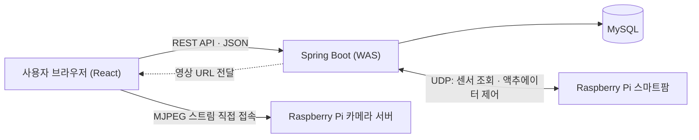

## 개요

동양미래대학교 컴퓨터소프트웨어공학과 **졸업작품** 「M.G.M(멀티그린마스터)」입니다.

바쁜 사람들도 식물 키우기를 여가로 즐길 수 있도록, 방치형 "분재 게임"처럼 **웹에서 실제 식물을 키우는** 서비스를 목표로 했습니다.

- 스마트팜에 배치된 화분을 무작위로 배정받고, 어떤 식물이 자랄지 기대하며 키웁니다.
- 카메라 영상과 센서 정보로 식물 상태를 확인하고, 물 주기·조명·화분 회전을 원격으로 조작합니다.
- 식물이 일정 단계까지 자라면 실제 식물을 집으로 배송해 성취감을 주는 구조를 구상했습니다.

시스템은 세 부분으로 나뉩니다.

| 구성 | 저장소 | 내용 |
| --- | --- | --- |
| 프론트엔드 | [Flower_React_View](https://github.com/chanhi/Flower_React_View) | React SPA (본인 개발) |
| 백엔드 | [MGM_Back](https://github.com/chanhi/MGM_Back) | Spring Boot REST API |
| 스마트팜 | [MGM_Raspi](https://github.com/logg9715/MGM_Raspi) | 라즈베리파이 센서 수집 · 액추에이터 제어 · 카메라 스트리밍 |

## 주요 기능

- **메인 페이지**: 추천 수가 많은 글과 공지사항을 보여 줍니다. 다크 모드를 지원하며, 비로그인 상태에서는 게시글 읽기만 가능합니다.
- **게시판**: 자유게시판 목록·상세·작성·수정, 사진 여러 장 첨부, 좋아요, 댓글과 대댓글(재귀 컴포넌트로 렌더링), 내 댓글 수정·삭제.
- **내 식물 스트리밍**: 스마트팜 카메라 영상(MJPEG)을 실시간으로 보면서 회전, 캡처(스크린샷), 조명, 물 주기를 조작합니다. 온도·습도·일조량 센서 값을 실시간으로 표시하고, 일조량에 따라 아이콘이 바뀝니다.
- **방명록(마이페이지)**: 최근 쓴 글과 댓글, GitHub 잔디처럼 활동량을 보여 주는 히트맵, 친구 추가·삭제, 내 정보 수정, 일기장 공개 범위(전체·친구·비공개) 설정.
- **일기장**: 내 식물의 재배 일기 작성과 조회.
- **관리자 콘솔**: 관리자 계정만 접근해 회원과 식물(스마트팜 장치)을 관리합니다.

## 아키텍처

- **클라이언트 ↔ 웹서버**: REST API(JSON)로 통신합니다. 세션 기반 로그인을 쓰고, 관리자·본인·친구 여부에 따라 접근을 제한합니다.
- **웹서버 ↔ 라즈베리파이**: 식물 페이지가 열리면 웹서버가 UDP 소켓으로 센서 정보를 주기적으로 요청하고, 모터·조명 제어 명령을 보냅니다. 라즈베리파이는 통신 스레드와 센서·액추에이터 스레드를 나눠 공유 메모리로 값을 주고받습니다.
- **영상**: 웹서버가 해당 사용자 화분의 스트림 URL을 알려 주면, 클라이언트가 라즈베리파이 카메라 서버(MJPEG)에 직접 접속합니다.

### 데이터 모델

회원(`usermember`)을 중심으로 자유게시판·댓글(대댓글은 부모 댓글 자기참조)·추천·사진, 일기장·사진, 공지사항, 친구, 보유 식물(`plant`, 화분별 장치 주소) 테이블로 구성했습니다.

## 기술 스택

| 영역 | 기술 |
| --- | --- |
| Frontend | React 18, Chakra UI, React Router v6, TanStack Query(react-query), Axios, React Hook Form, CKEditor 5, react-heatmap-grid |
| Backend | Java, Spring Boot 3, Spring MVC, Spring Data JPA, Gradle |
| Database | MySQL |
| IoT | Raspberry Pi 4B, C(pthread · UDP 서버, WiringPi), Python(Picamera2 MJPEG 스트리밍) |
| 센서 · 액추에이터 | 온습도 센서(SHT30-D), 조도 센서, 워터펌프, DC 모터(L298N), 식물용 LED |

## 담당 역할 / 기여

4인 팀에서 **프론트엔드와 UI/UX를 전담**하고, **백엔드 API 설계/개발**과 IoT 연동을 함께 맡았습니다.

- **프론트엔드 · UI/UX**: React와 Chakra UI로 전체 화면을 설계하고 구현했습니다. 프론트엔드 저장소의 커밋 21개를 모두 직접 작성했습니다.
- **백엔드 API 설계/개발 · 연동**: 회원·게시판·식물·마이페이지·관리자 기능의 REST API를 함께 설계하고, 프론트엔드와의 API 통신을 구현했습니다. 백엔드 저장소에서는 CORS 설정, 삭제 API를 `PUT`에서 `DELETE`로 바꾸는 REST 규칙 정리, 게시글 사진 null 오류 수정 등을 맡았습니다.
- **IoT 연동**: 라즈베리파이 카메라 스트림에 직접 연결하고, 센서 데이터를 화면에 실시간으로 반영했습니다.

## 트러블슈팅

- **React 이해 부족**: hook과 모듈 구조가 익숙하지 않아 공식 문서와 여러 자료를 보며 학습했습니다.
- **react-query 활용**: 처음에는 사용법이 미숙해 코드가 난잡하고 쓰는 의미가 거의 없었습니다. 사용법을 다시 익히고 데이터 패칭 코드를 정리해 해결했습니다.
- **실시간 센서 데이터**: 백엔드에서 스레드로 주기적으로 갱신하는 방식은 구현이 복잡했습니다. 그래서 프론트엔드에서 `useEffect`로 주기적으로 갱신하는 방식으로 바꿔 코드를 단순화했습니다.
- **프론트엔드–백엔드 통신 에러**: CORS 에러는 각 서버 주소를 허용 목록에 등록해 해결했습니다. API 응답 형식이 맞지 않는 문제는 백엔드 팀원과 소통해 형식을 통일했습니다.
- **UI/UX**: 식물을 키우는 서비스 특성상 눈에 보이는 동적인 화면이 필요해 React를 선택했습니다. 디자인 완성도는 다른 사이트와 템플릿을 참고하며 보완했습니다.

## 배운 점

- 프론트엔드를 맡으면서 그동안 배운 프론트엔드 기술을 정리하는 계기가 됐습니다. 수업에서 React를 배우지는 않았지만, 혼자 문서를 읽고 공부하면서 여러 라이브러리를 쓰는 법에 익숙해졌습니다.
- 시간이 부족해 디자인과 UX의 디테일을 살리지 못한 점은 아쉽습니다. 그래도 주요 기능을 사용자 경험을 생각하며 만들었고, 힘들었지만 재미있고 성취감도 컸습니다.
- 프론트엔드와 백엔드를 함께 맡으면서 CORS 설정, REST 메서드 규칙, 응답 형식(JSON)처럼 **양쪽이 맞물리는 지점**을 미리 약속해 두는 것이 중요하다는 걸 배웠습니다.
- 팀 전체로는 개발 중반에 코드를 통합하면서 서로 다른 결과물을 만들고 있었다는 걸 알게 됐습니다. 이후 URL과 이름 규칙을 통일하고 구조를 다시 잡으면서, **개발 전에 설계와 규칙을 먼저 정하는 것**이 얼마나 중요한지 배웠습니다.
- 팀 회고에서 나온 설계 개선점도 있습니다. 댓글과 대댓글을 따로 설계했다가 자기참조 구조로 통합했고, 게시판과 공지사항은 권한 기반의 하나의 구조로 합칠 수 있었습니다. 사진도 인코딩 문자열보다 파일 경로로 저장하는 편이 더 효율적이었습니다.
