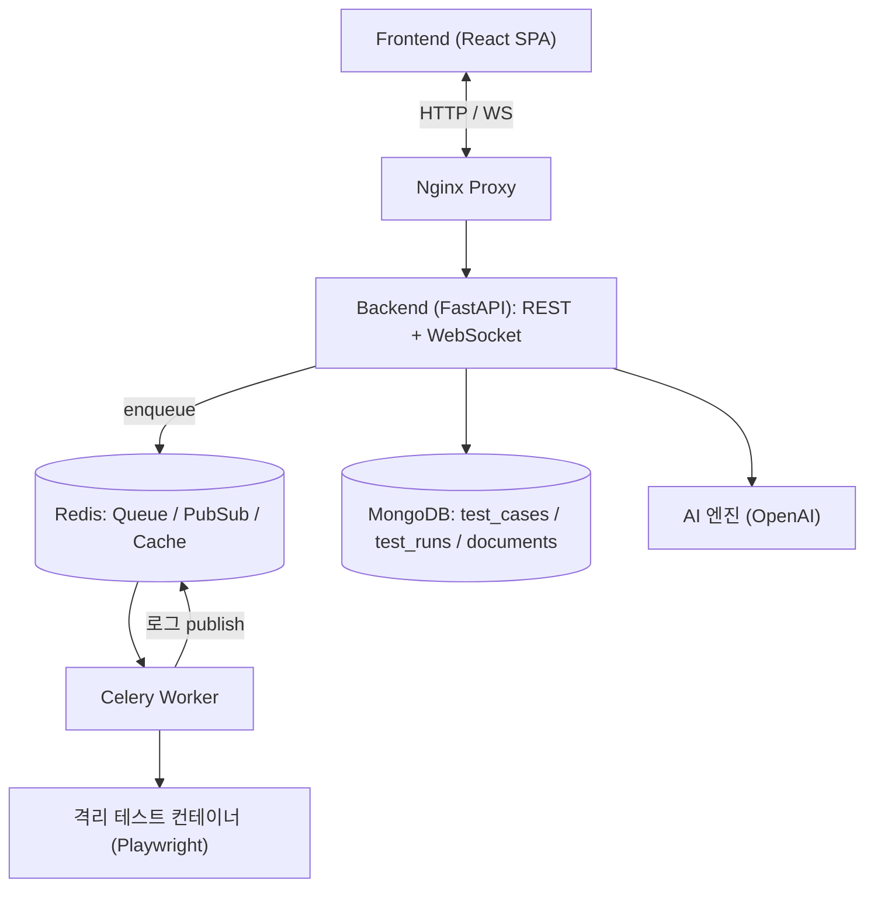

## 개요

경기대학교 소프트웨어경영대학 **기초 캡스톤디자인** 프로젝트입니다(팀 TQ7). 산학협력 기업이 제안한 기획서 가운데 팀 투표로 「AI를 이용한 테스트 자동화 플랫폼」을 골랐습니다.

사용자가 자연어로 테스트 시나리오를 적으면 AI가 Playwright 테스트 코드를 만듭니다. 이 코드는 격리된 컨테이너에서 실행되고, 진행 로그는 WebSocket으로 실시간 전달됩니다. 캡스톤디자인 경진대회에서 **장려상**을 받았습니다.

- 회고 글: [기초/심화 캡스톤 디자인 프로젝트 회고](/retrospect/tistory-32/)

## 주요 기능

- **자연어 → 테스트 코드**: 한국어나 영어 프롬프트를 AI가 Playwright 테스트로 변환합니다.
- **비동기 테스트 실행**: Redis와 Celery 작업 큐로 여러 테스트를 병렬 처리합니다(실행 취소는 Celery revoke로 지원).
- **실시간 로그 스트리밍**: WebSocket과 Redis Pub/Sub으로 상태, 로그, 진행률, 완료 이벤트를 전달합니다. 재접속하면 이전 로그 히스토리도 받을 수 있습니다.
- **Step DSL**: DB에 등록하지 않아도 JSON 한 번으로 즉시 실행할 수 있습니다. `goto`, `fill`, `click`, `assert_url` 등 11종 action을 지원하고 셀렉터를 자동 추론합니다.
- **Docker 격리 실행**: 모든 테스트는 격리된 컨테이너 안에서 돌아갑니다.
- **블랙박스 테스트 기법**: 동등 분할, 경계값 분석 등 6가지 기법을 지원합니다.
- **결과 내보내기**: JSON, CSV, XLSX, MD, YAML, Playwright, HTML 7가지 포맷으로 내보낼 수 있습니다.
- **기획서 업로드 · 대시보드**: 프로젝트 단위로 문서, 테스트 케이스, 실행 결과를 관리합니다.

## 아키텍처

| 서비스 | 역할 |
| --- | --- |
| database | MongoDB 6.0: 시나리오와 실행 기록 저장 |
| broker | Redis 7: Celery 큐, Pub/Sub, 상태 캐시 |
| backend | FastAPI: REST와 WebSocket API |
| worker | Celery worker: 격리 컨테이너에서 Playwright 실행 |
| frontend | Nginx: SPA 호스팅과 백엔드 프록시 |

## 기술 스택

| 영역 | 기술 |
| --- | --- |
| Frontend | React 19, Vite, React Router, Tailwind CSS, Recharts, Axios |
| Backend | Python 3.12, FastAPI, Pydantic, Motor(MongoDB) |
| 비동기 처리 | Celery, Redis (Broker / Pub/Sub) |
| 테스트 실행 | Playwright, Docker 격리 컨테이너 |
| AI | OpenAI API |
| Infra / 테스트 | Docker Compose, Nginx, Pytest |

## 담당 역할 / 기여

- **팀 리더**: 주제를 고른 뒤, 테스팅 개념이 익숙하지 않은 팀원들에게 소프트웨어 테스팅이 왜 중요하고 이 주제가 어떤 가치가 있는지 설명하며 방향을 맞췄습니다.
- **백엔드 · API 아키텍처 설계/개발**: FastAPI 기반 REST · WebSocket API와 Redis/Celery 작업 큐, 격리 컨테이너 실행 구조를 설계하고 개발했습니다.
- 저장소 초기 세팅으로 `docker-compose` 구성과 PR 템플릿을 추가했습니다.

## 배운 점

- 이번 프로젝트를 통해 내가 테스트에 대해 얼마나 모르는지 알게 됐습니다. 처음에는 소프트웨어공학에서 배운 테스트 기법을 그대로 적용하면 될 줄 알았습니다. 하지만 테스트를 만들려면 요구사항을 정확하게 분석해야 했고, 처음 기대처럼 테스트 코드가 마법같이 생성되지는 않았습니다.
- 덕분에 실제로 테스트를 만들고 수행하려면 무엇이 필요한지 실무적으로 체감했고, 테스트 자동화가 왜 어려운 일인지 알게 됐습니다.
- 시간이 더 있었다면 테스트 케이스를 더 구체적으로 생성하고, 다양한 플랫폼에서 실행되도록 확장해 보고 싶습니다.
- 주제를 정해도 팀원들이 도메인(소프트웨어 테스팅)을 이해하지 못하면 회의가 잘 굴러가지 않았습니다. 이 프로젝트를 하면서 도메인 이해를 맞추는 것이 기획의 출발점이라는 걸 느꼈습니다.
- 다른 팀들의 협업 방식(commit 규칙, push rule, Discord 알림 등)을 보고 배워 팀 단위 협업 방법을 고민하게 됐습니다.
