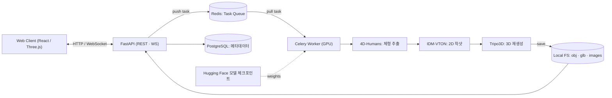

## 개요

경기대학교 **심화 캡스톤디자인(산학협력 프로젝트)**입니다. 주제는 「SMPL을 이용한 3D 스타일 피팅 서비스」이고, 협력기업 연구원에게 기술 자문을 받으며 진행했습니다.

온라인 쇼핑몰은 대부분 2D 사진과 치수 정보에 의존합니다. 그래서 소비자는 실제로 입었을 때의 느낌을 예측하기 어렵고, 체형 차이 때문에 사이즈·스타일 선택에 실패해 반품으로 이어지는 경우가 많습니다. 기존 2D 가상 피팅(VTON)도 신체 곡률이나 자세 변화에 따른 자연스러운 착용감은 표현하지 못합니다.

RealFit은 **사진 한 장만으로 사용자 체형을 추출**하고, 이를 반영한 **3D 가상 피팅 결과**를 웹에서 여러 각도로 확인할 수 있게 하는 것을 목표로 했습니다.

- 2026 한국정보기술학회 하계종합학술대회 및 대학생논문경진대회에 논문을 게재했습니다 ([논문집](https://ki-it.or.kr/conference/summer26/notice/article/1077), 1486쪽부터).
- 캡스톤디자인 경진대회에서 **우수상**을 받았습니다.
- 회고 글: [기초/심화 캡스톤 디자인 프로젝트 회고](/retrospect/tistory-32/), [[심화캡스톤] SMPL을 이용한 3D 스타일 피팅 서비스](/retrospect/tistory-33/)

## 주요 접근 방법

핵심은 2D 합성 결과를 최종 결과물로 쓰지 않고 **3D 모델을 만들기 위한 중간 데이터로 활용**하는 것입니다. 그리고 처음 추출한 체형 정보를 마지막 단계에서 **다시 반영**해 체형 왜곡을 줄입니다.

| 단계 | 접근 방향 | 주요 역할 | 기대 효과 |
| --- | --- | --- | --- |
| 1단계 | 신체 정보 추출 | 사용자 이미지에서 신체 비율과 자세 정보 확보 | 개인화된 피팅 기준 데이터 |
| 2단계 | 2D 가상 착용 이미지 생성 | 의류의 시각적 특징을 사용자 체형에 맞게 합성 | 3D 재구성을 위한 고품질 중간 결과 |
| 3단계 | 3D 재구성 및 체형 보정 | 2D 결과를 3D로 확장하고 초기 체형 정보 재반영 | 체형 왜곡을 줄인 최종 3D 피팅 결과 |

## AI 파이프라인

1. **신체 정보 추출 · A-Pose 보정**: 4D-Humans(HMR 2.0)로 관절 위치와 실루엣을 분석해 SMPL 체형(β)·자세(θ) 파라미터를 뽑습니다. 임의 포즈를 그대로 쓰면 이후 단계에서 신체가 가려지거나 의류 텍스처가 왜곡되므로, 체형(β)은 유지하고 자세(θ)만 양팔을 약 45도 벌린 **A-Pose**로 보정합니다.
2. **2D 가상 피팅**: A-Pose 마네킹 이미지와 Rembg로 배경을 지운 의류 이미지를 IDM-VTON에 넣어, 의류 패턴과 텍스처를 유지한 착용 이미지를 만듭니다.
3. **3D 재구성 · SMPL 파라미터 보정**: 합성 이미지를 Tripo3D로 `.glb` 3D 에셋으로 만듭니다. 이때 2D 합성 과정에서 체형(β, 부피) 정보가 손실되어 모델이 실제보다 홀쭉해지는 문제가 있었습니다. 그래서 Three.js로 렌더링하는 시점에 **처음 추출한 SMPL 신체 메쉬 파라미터를 다시 대입**해 체형을 교정했습니다.
4. **사이즈 추천**: SMPL 정점(Vertex)으로 어깨너비, 가슴둘레, 팔 길이 등을 계산하고, 등록된 옷의 치수와 비교해 가장 맞는 사이즈를 추천합니다.

개인정보가 걱정되는 사용자는 사진 대신 **기본 체형 마네킹**을 골라 쓸 수도 있습니다.

## 아키텍처

- 전체 서비스는 **Docker Compose** 컨테이너로 관리하고, Nginx를 리버스 프록시로 둡니다.
- 무거운 AI 연산이 API 서버를 막지 않도록 **Redis를 브로커로 한 Celery 비동기 작업 큐**를 구성했습니다. 결과는 PostgreSQL과 로컬 파일시스템에 나눠 저장합니다.
- 이미지 빌드와 배포는 GitHub Actions와 Docker Hub로 자동화했습니다.

### 주요 API

| API | 설명 |
| --- | --- |
| `POST /api/v1/jobs` | 사용자 이미지 + 의류 이미지를 받아 작업 큐에 등록 |
| `GET /api/v1/jobs/{job_id}` | 작업 상태 조회 (PENDING / PROCESSING / COMPLETED / FAILED) |
| `GET /api/v1/jobs/{job_id}/result` | 최종 `.glb` 파일 URL 반환 |
| `POST /ai/preprocess/human` | 4D-Humans 마네킹 추출 및 A-Pose 보정 |
| `POST /ai/preprocess/garment` | Rembg 의류 배경 제거 |
| `POST /ai/vton` | IDM-VTON 2D 가상 피팅 |
| `POST /ai/tripo` | Tripo3D 3D 변환 |

## 기술 스택

| 영역 | 기술 |
| --- | --- |
| Frontend | React, TypeScript, Vite, Three.js (React Three Fiber), Zustand |
| Backend | FastAPI (Python), PostgreSQL, Redis / Celery (비동기 큐) |
| AI / ML | SMPL / SMPL-X, PyTorch, 4D-Humans, IDM-VTON, Tripo3D, Rembg |
| Infra | Docker Compose, Nginx 리버스 프록시, GPU 클라우드 서버, GitHub Actions, Docker Hub |

## 담당 역할 / 기여

5인 팀의 **팀 대표**로 **전체 아키텍처 설계, AI 시스템 구축, AI API 구현**을 맡았습니다. 팀원들은 논문·인프라·백엔드/AI API(1명), 프론트엔드(1명), 백엔드 API(2명)를 나눠 맡았습니다.

- **주제 선정 · 발표**: 3D 피팅 + SMPL 방식을 직접 조사해 제안하고, 발표를 모두 맡았습니다.
- **전체 아키텍처 설계**: 3단계 파이프라인과 FastAPI + Redis/Celery + PostgreSQL + Docker Compose 구조를 설계했습니다.
- **AI 시스템 구축 · AI API 구현**
  - AI 서버 초기 세팅, VTON 환경 구성, 이미지 합성 API를 구현했습니다.
  - AI 서버에 **계층형 아키텍처**(routers / services / schemas)를 도입하고, 3D 모델링 파이프라인을 통합하는 리팩터링을 했습니다.
  - GPU 없이도 프론트엔드·백엔드를 연동할 수 있도록 더미 결과를 돌려주는 **AI 테스트 모드**(`AI_MODE=test`)를 만들었습니다.
  - IDM-VTON 공식 모델을 적용해 보다가 최종적으로 VTON을 API 방식으로 전환했습니다.
- **방법 전환**: 처음 구상한 Depth Anything 깊이맵 투영 방식은 자동화가 어려워, 교수님 제안을 받아 **3D 재생성 모델(Tripo3D) + SMPL 메쉬 보정** 방식으로 바꿨습니다.

## 한계와 자문

- Tripo3D의 재구성 품질은 입력 2D 이미지에 크게 좌우되어, 복잡한 패턴이나 반투명 소재에서는 텍스처 왜곡이 생길 수 있습니다.
- 재생성 모델 특성상 **옷의 뒷면이 제대로 반영되지 않는** 문제가 있었습니다. 협력기업 자문에서 기간 내 기술적 해결보다는 시연에서 시야각을 제한하는 현실적인 방법을 제안받아 적용했습니다. 이 밖에 사용자 편의성과 포스터 개선점도 조언받았습니다.
- 전체 파이프라인 처리 시간이 길어 실시간 서비스에 적용하기에는 한계가 있습니다.

## 배운 점

- **3D·이미지 딥러닝 도구 경험**: 4D-Humans, IDM-VTON, Tripo3D처럼 3D 모델링과 관련된 AI 도구를 처음 사용해 봤습니다. 이미지 딥러닝 모델이 실제로 어떤 입력을 기대하고, 어디서 정보가 손실되는지를 직접 겪으며 많이 배웠습니다.
- **GPU 클라우드 서버**: 고성능 GPU 클라우드 서버를 처음 이용해 봤습니다. 비용이 생각보다 꽤 많이 나왔고, CUDA·드라이버·컨테이너 GPU 설정도 까다로웠습니다. 같은 작업을 로컬 GPU와 비교하며 성능 차이도 직접 확인했습니다.
- **모델 통합의 현실**: 여러 AI 모델을 하나의 파이프라인으로 묶으면서 데이터 포맷 불일치, 이미지 호환성, 컨테이너 간 파일 공유 같은 엔지니어링 문제를 직접 풀었습니다. Colab에서는 IDM-VTON 구성이 안 됐고, 일부 모델은 호환성 문제로 쓰지 못해 API로 대체하기도 했습니다.
- **방법 전환 판단**: 기간 안에 자동화하기 어려운 방식을 일찍 포기하고, 3D 재생성과 메쉬 보정을 결합하는 방식으로 바꿔 체형 정확도 문제를 상당 부분 해결했습니다.
- **명세와 협업**: 미리 작성한 아키텍처·API 명세가 실제 구현과 어긋나 다시 협의하는 데 시간이 걸렸습니다. 명세는 구현과 함께 꾸준히 갱신해야 하고, AI·백엔드·프론트엔드·인프라를 아우르는 개발일수록 영역 간 협업이 중요하다는 걸 느꼈습니다.
- **개선 방향**: API 비용을 줄이기 위한 모델 자체 서빙, 모델 튜닝, 옷 뒷면 반영이 다음 과제입니다.
