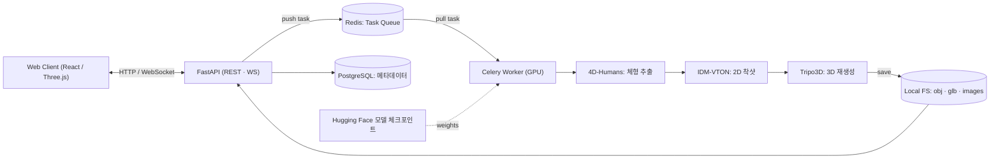

## 개요

경기대학교 **심화 캡스톤디자인(산학협력 프로젝트)**입니다. 주제는 「SMPL을 이용한 3D 스타일 피팅 서비스」이고, 협력기업 연구원에게 기술 자문을 받으며 진행했습니다.

온라인 쇼핑몰은 대부분 2D 사진과 치수 정보에 의존합니다. 그래서 소비자는 실제로 입었을 때의 느낌을 예측하기 어렵고, 체형 차이 때문에 사이즈·스타일 선택에 실패해 반품으로 이어지는 경우가 많습니다. 기존 2D 가상 피팅(VTON)도 신체 곡률이나 자세 변화에 따른 자연스러운 착용감은 표현하지 못합니다.

RealFit은 **사진 한 장만으로 사용자 체형을 추출**하고, 이를 반영한 **3D 가상 피팅 결과**를 웹에서 여러 각도로 확인할 수 있게 하는 것을 목표로 했습니다.

- 2026 한국정보기술학회 하계종합학술대회 및 대학생논문경진대회에 논문을 게재했습니다 ([논문집](https://ki-it.or.kr/conference/summer26/notice/article/1077), 1486쪽부터).
- 캡스톤디자인 경진대회에서 **우수상**을 받았습니다.
- 회고 글: [기초/심화 캡스톤 디자인 프로젝트 회고](/retrospect/tistory-32/), [[심화캡스톤] SMPL을 이용한 3D 스타일 피팅 서비스](/retrospect/tistory-33/)

## 주요 접근 방법

핵심은 2D 합성 결과를 최종 결과물로 쓰지 않고 **3D 모델을 만들기 위한 중간 데이터로 활용**하는 것입니다. 그리고 처음 추출한 체형 정보를 마지막 단계에서 **다시 반영**해 체형 왜곡을 줄입니다.

| 단계 | 접근 방향 | 주요 역할 | 기대 효과 |
| --- | --- | --- | --- |
| 1단계 | 신체 정보 추출 | 사용자 이미지에서 신체 비율과 자세 정보 확보 | 개인화된 피팅 기준 데이터 |
| 2단계 | 2D 가상 착용 이미지 생성 | 의류의 시각적 특징을 사용자 체형에 맞게 합성 | 3D 재구성을 위한 고품질 중간 결과 |
| 3단계 | 3D 재구성 및 체형 보정 | 2D 결과를 3D로 확장하고 초기 체형 정보 재반영 | 체형 왜곡을 줄인 최종 3D 피팅 결과 |

## AI 파이프라인

1. **신체 정보 추출 · A-Pose 보정**: 4D-Humans(HMR 2.0)로 관절 위치와 실루엣을 분석해 SMPL 체형(β)·자세(θ) 파라미터를 뽑습니다. 임의 포즈를 그대로 쓰면 이후 단계에서 신체가 가려지거나 의류 텍스처가 왜곡되므로, 체형(β)은 유지하고 자세(θ)만 양팔을 약 45도 벌린 **A-Pose**로 보정합니다.
2. **2D 가상 피팅**: A-Pose 마네킹 이미지와 Rembg로 배경을 지운 의류 이미지를 IDM-VTON에 넣어, 의류 패턴과 텍스처를 유지한 착용 이미지를 만듭니다.
3. **3D 재구성 · SMPL 파라미터 보정**: 합성 이미지를 Tripo3D로 `.glb` 3D 에셋으로 만듭니다. 이때 2D 합성 과정에서 체형(β, 부피) 정보가 손실되어 모델이 실제보다 홀쭉해지는 문제가 있었습니다. 그래서 Three.js로 렌더링하는 시점에 **처음 추출한 SMPL 신체 메쉬 파라미터를 다시 대입**해 체형을 교정했습니다.
4. **사이즈 추천**: SMPL 정점(Vertex)으로 어깨너비, 가슴둘레, 팔 길이 등을 계산하고, 등록된 옷의 치수와 비교해 가장 맞는 사이즈를 추천합니다.

개인정보가 걱정되는 사용자는 사진 대신 **기본 체형 마네킹**을 골라 쓸 수도 있습니다.

## 아키텍처



- 전체 서비스는 **Docker Compose** 컨테이너로 관리하고, Nginx를 리버스 프록시로 둡니다.
- 무거운 AI 연산이 API 서버를 막지 않도록 **Redis를 브로커로 한 Celery 비동기 작업 큐**를 구성했습니다. 결과는 PostgreSQL과 로컬 파일시스템에 나눠 저장합니다.
- 이미지 빌드와 배포는 GitHub Actions와 Docker Hub로 자동화했습니다.

### 주요 API

| API | 설명 |
| --- | --- |
| `POST /api/v1/jobs` | 사용자 이미지 + 의류 이미지를 받아 작업 큐에 등록 |
| `GET /api/v1/jobs/{job_id}` | 작업 상태 조회 (PENDING / PROCESSING / COMPLETED / FAILED) |
| `GET /api/v1/jobs/{job_id}/result` | 최종 `.glb` 파일 URL 반환 |
| `POST /ai/preprocess/human` | 4D-Humans 마네킹 추출 및 A-Pose 보정 |
| `POST /ai/preprocess/garment` | Rembg 의류 배경 제거 |
| `POST /ai/vton` | IDM-VTON 2D 가상 피팅 |
| `POST /ai/tripo` | Tripo3D 3D 변환 |

## 기술 스택

| 영역 | 기술 |
| --- | --- |
| Frontend | React, TypeScript, Vite, Three.js (React Three Fiber), Zustand |
| Backend | FastAPI (Python), PostgreSQL, Redis / Celery (비동기 큐) |
| AI / ML | SMPL / SMPL-X, PyTorch, 4D-Humans, IDM-VTON, Tripo3D, Rembg |
| Infra | Docker Compose, Nginx 리버스 프록시, GPU 클라우드 서버, GitHub Actions, Docker Hub |

## 기술 결정 과정

### 1. 깊이맵 투영에서 3D 재생성으로

초기 MVP 설계는 **4D-Humans(5초) → IDM-VTON(30초) → Depth Anything 깊이맵(3초)** 순서였습니다. 마네킹을 정면·측면·후면 3각도로 렌더링해 2D 착샷을 만들고, 이를 깊이맵과 함께 3D 마네킹에 다시 투영하는 구조입니다.

6주차에 PyTorch3D로 합성 이미지를 3D 마네킹에 역투영해 보니 문제가 분명했습니다.

- 깊이를 반영하지 못해 옷이 **무늬만 붙어 있는 느낌**이었습니다.
- 로고와 글자가 굴곡진 표면에서 늘어나 알아보기 어려웠습니다.
- 겨드랑이처럼 카메라가 비스듬히 보는 영역(grazing angle)에서 픽셀이 길게 늘어졌습니다.
- 카메라 거리, 마스킹 값, 법선 임계값을 옷·포즈마다 손으로 맞춰야 해서 **재사용이 어려웠습니다.**

보완책으로 **4단계 하이브리드 투영**을 검토했습니다.

| 단계 | 내용 |
| --- | --- |
| Step 1 베이스 투영 | PyTorch3D로 색상 톤과 대략적인 실루엣만 입힘 |
| Step 2 기하 맵 추출 | 렌더링 시점별 깊이 맵 · 법선 맵 추출 |
| Step 3 확산 모델 복원 | ControlNet(Depth) + Inpainting으로 늘어진 영역을 다시 그림. 마스크는 법선 z값이 0.2 미만인 정점으로 자동 생성 |
| Step 4 로고 재합성 | 원본 이미지의 고해상도 로고를 데칼처럼 다시 얹음 |

하지만 이 방식은 **너무 어렵고 무거웠습니다.** 파이프라인이 5~6단계로 늘어나고 튜닝 시간도 많이 듭니다. 교수님이 제안한 3D 재생성(Reconstruction) 방식은 **VTON → 3D 재생성, 2단계**로 끝납니다. 두 방식을 비교한 결과는 다음과 같습니다.

| 항목 | 역투영 | 3D 재생성 |
| --- | --- | --- |
| 옷의 부피감 | 마네킹 피부에 붙어 치마·헐렁한 셔츠 표현 불가 | 주름과 부피를 스스로 생성 |
| 로고 · 패턴 | 원본 픽셀을 그대로 써서 선명 | 다소 뭉개질 수 있음 |
| 뒷모습 | 비거나 늘어짐 | 앞모습을 보고 추정 |
| 애니메이션 | SMPL 뼈대가 있어 바로 가능 | 뼈대 없는 통짜 메쉬 |

목표가 **360도로 돌려 보며 핏을 확인하는 것**이었으므로 재생성 방식을 택했습니다. 대신 재생성에서 잃는 체형 정보는 SMPL 메쉬로 다시 보정하기로 했습니다.

### 2. 3D 재생성 모델 비교

7주차에 후보 모델을 비교했습니다.

| 모델 | 속도 | 텍스처 선명도 | 비고 |
| --- | --- | --- | --- |
| LRM (Large Reconstruction Model) | 빠름 | 우수 | 내부 블랙박스 |
| Tripo3D / TripoSR | 빠름 | 보통 | 내부 블랙박스 |
| CRM (Convolutional Reconstruction Model) | 보통 | 매우 우수 | 멀티뷰 가능 |

처음에는 멀티뷰로 앞뒷면을 함께 재구성할 수 있는 **CRM으로 양면 렌더링**을 시도했습니다. 하지만 CUDA와 라이브러리 의존성 충돌이 자주 났고, 프로젝트에서 쓰던 PyTorch 버전과도 맞출 수 없었습니다. 그래서 현실적인 대안으로 **Tripo3D를 API로 연동**해 VTON 결과 이미지를 `.glb`로 만들었습니다.

AI 서버의 3D 단계는 프론트엔드 진행률 표시와 에러 처리를 위해 **두 엔드포인트로 나눴습니다.**

- `POST /ai/tripo/generate`: VTON 이미지로 초기 3D 객체 생성
- `POST /ai/tripo/apply-mesh`: 생성된 객체에 사용자 체형(메쉬) 데이터 반영

### 3. 체형 보정 위치: 프론트엔드 → AI 서버

처음에는 **프론트엔드에서** 최종 3D 객체를 뷰어에 올리기 전에 마네킹 체형 데이터로 수정할 계획이었습니다. 10주차에 이 계획을 바꿨습니다.

- 프론트엔드에서는 3D 객체의 **메쉬 데이터를 직접 수정할 수 없었습니다.**
- Auto-Scaling으로 크기만 맞추면 모델이 **쪼그라드는 문제**가 생겼습니다.

그래서 **AI 서버에서 스케일을 맞추고 메쉬 데이터를 반영한 뒤** 최종 `.glb`를 돌려주도록 바꿨습니다. 이에 맞춰 백엔드 API도 둘로 나눴습니다.

| API | 흐름 |
| --- | --- |
| 마네킹 생성 | 유저 이미지 → AI 서버 → `.obj`·메쉬값을 DB에 저장 |
| 옷 합성 | DB의 `.obj`·메쉬값 → AI 서버 → 최종 `.glb` 반환 |

### 4. 사이즈 추천 알고리즘

사이즈 추천은 세 단계로 설계했습니다.

1. **신체 치수 추출**: 마네킹 `.obj`의 정점 y값 범위로 모델 키를 구하고, `실제 키 ÷ 모델 키`로 cm 변환 비율을 정합니다. 어깨·가슴·허리·골반은 좌우 기준 정점 사이의 거리에 이 비율을 곱해 구합니다.
2. **옷 데이터 표준화**: 브랜드, 카테고리, 사이즈, 핏 타입과 부위별 실측을 같은 스키마로 저장합니다. 사람 치수가 **단면(너비) 기준**이므로 둘레로 된 실측표는 2로 나눠 넣습니다.
3. **핏 매칭**: 부위별로 `여유분 = 옷 치수 - 신체 치수`를 구해 핏을 판정합니다.

| 여유분 (cm) | 판정 |
| --- | --- |
| -2 미만 | too_tight (사이즈 업 권장) |
| -2 이상 1 미만 | slim |
| 1 이상 4 미만 | regular |
| 4 이상 8 미만 | semi_oversized |
| 8 이상 | oversized |

```text
for 부위 in [어깨, 가슴, 허리, 골반]:
    diff = 옷[부위] - 신체[부위]
    판정[부위] = classify(diff)

if too_tight가 하나라도 있음:   "한 사이즈 업 고려"
elif oversized가 2개 이상:       "오버핏 실루엣"
elif (semi_)oversized가 있음:    "여유 있는 핏"
elif regular가 3개 이상:         "정핏"
else:                            "슬림핏"
```

단순한 S/M/L 추천에 그치지 않고, **부위별 핏과 자연어 설명**까지 함께 보여 주는 것이 목표였습니다.

## 담당 역할 / 기여

5인 팀의 **팀 대표**로 **전체 아키텍처 설계, AI 시스템 구축, AI API 구현**을 맡았습니다. 팀원들은 논문·인프라·백엔드/AI API(1명), 프론트엔드(1명), 백엔드 API(2명)를 나눠 맡았습니다.

- **주제 선정 · 발표**: 3D 피팅 + SMPL 방식을 직접 조사해 제안하고, 발표를 모두 맡았습니다.
- **전체 아키텍처 설계**: 3단계 파이프라인과 FastAPI + Redis/Celery + PostgreSQL + Docker Compose 구조를 설계했습니다.
- **AI 시스템 구축 · AI API 구현**
  - AI 서버 초기 세팅, VTON 환경 구성, 이미지 합성 API를 구현했습니다.
  - AI 서버에 **계층형 아키텍처**(routers / services / schemas)를 도입하고, 3D 모델링 파이프라인을 통합하는 리팩터링을 했습니다.
  - GPU 없이도 프론트엔드·백엔드를 연동할 수 있도록 더미 결과를 돌려주는 **AI 테스트 모드**(`AI_MODE=test`)를 만들었습니다.
  - IDM-VTON 공식 모델을 적용해 보다가 최종적으로 VTON을 API 방식으로 전환했습니다.
- **방법 전환**: 처음 구상한 Depth Anything 깊이맵 투영 방식은 자동화가 어려워, 교수님 제안을 받아 **3D 재생성 모델(Tripo3D) + SMPL 메쉬 보정** 방식으로 바꿨습니다.

## 한계와 자문

- Tripo3D의 재구성 품질은 입력 2D 이미지에 크게 좌우되어, 복잡한 패턴이나 반투명 소재에서는 텍스처 왜곡이 생길 수 있습니다.
- 재생성 모델 특성상 **옷의 뒷면이 제대로 반영되지 않는** 문제가 있었습니다. 협력기업 자문에서 기간 내 기술적 해결보다는 시연에서 시야각을 제한하는 현실적인 방법을 제안받아 적용했습니다. 이 밖에 사용자 편의성과 포스터 개선점도 조언받았습니다.
- 전체 파이프라인 처리 시간이 길어 실시간 서비스에 적용하기에는 한계가 있습니다.

## 배운 점

- **3D·이미지 딥러닝 도구 경험**: 4D-Humans, IDM-VTON, Tripo3D처럼 3D 모델링과 관련된 AI 도구를 처음 사용해 봤습니다. 이미지 딥러닝 모델이 실제로 어떤 입력을 기대하고, 어디서 정보가 손실되는지를 직접 겪으며 많이 배웠습니다.
- **GPU 클라우드 서버**: 고성능 GPU 클라우드 서버를 처음 이용해 봤습니다. 비용이 생각보다 꽤 많이 나왔고, CUDA·드라이버·컨테이너 GPU 설정도 까다로웠습니다. 같은 작업을 로컬 GPU와 비교하며 성능 차이도 직접 확인했습니다.
- **모델 통합의 현실**: 여러 AI 모델을 하나의 파이프라인으로 묶으면서 데이터 포맷 불일치, 이미지 호환성, 컨테이너 간 파일 공유 같은 엔지니어링 문제를 직접 풀었습니다. Colab에서는 IDM-VTON 구성이 안 됐고, 일부 모델은 호환성 문제로 쓰지 못해 API로 대체하기도 했습니다.
- **방법 전환 판단**: 기간 안에 자동화하기 어려운 방식을 일찍 포기하고, 3D 재생성과 메쉬 보정을 결합하는 방식으로 바꿔 체형 정확도 문제를 상당 부분 해결했습니다.
- **명세와 협업**: 미리 작성한 아키텍처·API 명세가 실제 구현과 어긋나 다시 협의하는 데 시간이 걸렸습니다. 명세는 구현과 함께 꾸준히 갱신해야 하고, AI·백엔드·프론트엔드·인프라를 아우르는 개발일수록 영역 간 협업이 중요하다는 걸 느꼈습니다.
- **개선 방향**: API 비용을 줄이기 위한 모델 자체 서빙, 모델 튜닝, 옷 뒷면 반영이 다음 과제입니다.
