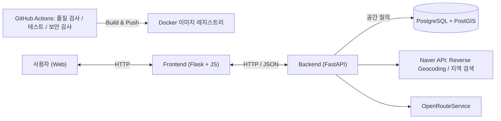

## 개요

경기대학교 **오픈소스SW** 수업 팀 프로젝트입니다(원본 저장소: [OpenSourceKGU/SmokingArea](https://github.com/OpenSourceKGU/SmokingArea)).

담배사업법 시행규칙 제3조 1항에 따라 **소매인 영업소 사이의 거리는 100m 이상**이어야 합니다. 입점 후보지를 고를 때 흔히 이런 문제가 생깁니다.

1. 도보 100m를 직접 계산하기 어렵습니다.
2. 후보지 여러 곳이 규정에 맞는지 일일이 확인하느라 시간이 듭니다.
3. 계산이 틀려 허가가 반려되면 손실이 생깁니다.

이 프로젝트는 위 문제를 지도 기반 서비스로 해결하려고 했습니다.

## 주요 기능

- **입점 가능 여부 확인**: 선택한 위치가 법적 제한에 걸리는지 확인합니다.
- **제한 구역 표시**: 담배 소매업 제한 구역을 지도 위에 시각적으로 보여 줍니다.
- **후보지 관리**: 위시리스트 기능을 제공합니다.
- **주변 상가 건물 검색**: 원하는 위치 근처에 입점 가능한 건물이 있는지 검색합니다.
- **좌표 변환**: 공공데이터 좌표계(EPSG:5174)를 WGS84로 바꿔 지도에 표시합니다.

## 아키텍처

- 백엔드 라우터는 `building`, `coordinates`, `restricted_zone`으로 나뉘고, 서비스 계층(`naver_api`, `ors_api`, `building_service`, `db_service`)과 `utils/geo.py`가 분리되어 있습니다.
- DB, 백엔드, 프론트엔드를 Docker Compose로 한 번에 띄웁니다(`run.sh` / `run.ps1`).

## 기술 스택

| 영역 | 기술 |
| --- | --- |
| Backend | Python 3.10, FastAPI, Uvicorn, SQLAlchemy |
| Database | PostgreSQL 16, PostGIS 3.4 |
| Frontend | Flask, HTML/CSS, JavaScript |
| External API | Naver Cloud Platform (Geocoding/Maps), Naver Developers (Search), OpenRouteService |
| DevOps | Docker, Docker Compose, GitHub Actions (code quality, tests, security audit, build-push, release) |
| Testing | Pytest, Httpx |

## 담당 역할 / 기여

원본 저장소 커밋 이력에서 확인되는 내용입니다(기여자 4명 중 커밋 수 가장 많음).

- **좌표계 변환**: `convert_epsg5174_to_wgs84` 함수를 적용하고, 변환 함수 오류를 수정했습니다.
- **건물 검색**: 백엔드에 주변 건물 검색 기능을 추가했습니다.
- **백엔드 리팩터링**: 백엔드 코드 구조를 정리했습니다.
- **테스트**: 모드 전환 함수와 테스트 함수를 정의했고, 단위 테스트 파일을 추가했으며 `conftest.py`도 손봤습니다.
- **CI/CD 구축**: GitHub Actions 워크플로를 단계별로 나눠 만들었습니다(`01-code-quality`, `02-tests`, `03-security-audit`, `04-build-push`, `05-create-release`). geocode 워크플로와 docker-compose도 수정했습니다.
- **협업 · 문서**: `main ← release ← develop` 브랜치 전략과 PR 규칙을 README에 정리하고, PR을 병합했으며, 시스템 아키텍처 문서를 작성했습니다.

## 배운 점

- **지도 API 활용**: Naver Maps, OpenRouteService 등 여러 지도·경로 API를 찾아보고 직접 써 보면서 익숙하게 다룰 수 있게 됐습니다.
- **공간 데이터 처리**: 공공데이터의 좌표계(EPSG:5174)를 WGS84로 바꾸는 것처럼, 지도 서비스에는 좌표계 변환 등 생각보다 처리해야 할 부분이 많다는 걸 알게 됐습니다.
- **우회해서 정보 얻기**: 기존 API가 직접 제공하지 않는 정보(주변 상가 건물 등)를 건물 검색 알고리즘처럼 다른 데이터를 조합해 우회적으로 얻는 방법을 익혔습니다.
