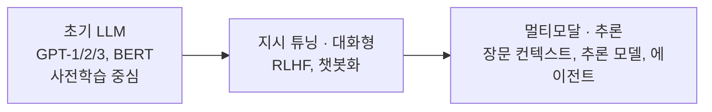
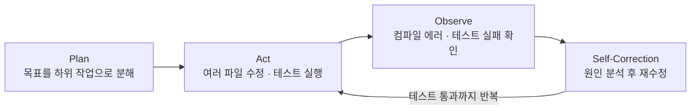

## LLM이 여기까지 온 과정

자연어 처리는 규칙 기반 → 통계 모델(N-gram) → 순환 신경망(RNN/LSTM)을 거쳤고, 2017년 **트랜스포머** 이후 대규모 텍스트를 사전학습해 다음 토큰을 예측하는 LLM 패러다임이 자리 잡았습니다.

최근 흐름에서 눈에 띄는 건 두 가지입니다. 하나는 **즉답형과 추론형의 분리**(빠른 일반 모델과, 내부 사고 과정을 거치는 추론 모델)이고, 다른 하나는 **도구 사용**입니다. 후자가 코딩 도구를 "에이전트"로 바꿔 놓았습니다.

> [!warning] 모델 정보는 금방 낡는다
> 모델 라인업과 컨텍스트 길이 같은 수치는 몇 달 만에 바뀝니다. 실제로 모델을 고를 때는 최신 공식 문서를 확인하고, 내 데이터로 평가하는 것이 맞습니다([[llm-model-change-evaluation]]).

## 코딩 도구의 세 세대

| 세대 | 방식 | 한계 |
|---|---|---|
| 1세대 인라인 완성 | 작성 중인 코드의 앞뒤 문맥으로 다음 몇 줄을 자동 완성 | 단일 파일의 지엽적인 조각만 생성, 프로젝트 구조를 모름 |
| 2세대 IDE 챗 | 코드를 선택하고 "설명해줘", "테스트 짜줘"라고 요청하면 마크다운으로 답변 | 사람이 직접 붙여넣고, 빌드 실패 로그를 다시 복사해 물어야 함 |
| 3세대 코딩 에이전트 | 파일 읽기/쓰기, 터미널 실행, 테스트 결과 확인 같은 **도구 권한**을 가짐 | 리뷰 부담, 루프에 빠질 위험 (아래 참고) |

3세대의 핵심은 ReAct 계열의 루프입니다.

CLI 중심의 에이전트(Claude Code 등), 에디터·터미널·브라우저를 통합한 에이전트형 IDE, 멀티파일 diff 검토에 강한 GUI AI IDE, 벤더 종속 없이 원하는 모델을 연결하는 오픈소스 도구까지 형태는 다양하지만, 이 루프를 돈다는 점은 같습니다.

## 일반 챗과는 아키텍처가 다르다

브라우저의 대화창에 코드를 붙여넣고 묻는 것과 코딩 에이전트를 쓰는 것은 **다른 시스템**입니다.

| 비교 항목 | 일반 챗 | 코딩 에이전트 |
|---|---|---|
| 실행 환경·도구 | 텍스트만 주고받음. 파일 트리, 환경 변수에 접근 불가 | 런타임이 파일 읽기/쓰기, 검색(`ripgrep`, `glob`), 셸 실행 도구를 제공하고 LLM이 직접 호출 |
| 피드백 루프 | 에러가 나면 사람이 로그를 복사해 다시 붙여넣음 | 직접 테스트를 돌리고, 실패하면 에러를 관측해 다시 고침 |
| 프로젝트 컨텍스트 | 붙여넣을 수 있는 분량만큼만 봄 | 검색 도구로 필요한 파일만 찾아 읽고, 기존 컨벤션을 따라 작성 |
| 개발자 역할 | "코더 겸 전달자" | "테크 리드 겸 리뷰어" |

## 도입하면 무엇이 바뀌나

### 역할의 변화

- **직접 타이핑하는 사람에서 리뷰어로.** 보일러플레이트, DTO, CRUD, 단위 테스트를 치던 시간이 줄고, 요구사항을 다듬어 전달하고 에이전트가 만든 diff를 검토·승인하는 일이 중심이 됩니다.
- **레거시 파악 시간 단축.** 문서가 부족한 코드베이스에서 "이 흐름의 진입점과 처리 파일을 정리해 줘"라고 요청하면 저장소를 탐색해 구조를 요약해 줍니다.
- **TDD와 자가 수정 루프.** "테스트를 먼저 쓰고 통과하도록 구현해"라고 하면 테스트를 돌려 실패 로그를 보며 통과할 때까지 반복합니다.

### 좋아지는 것

| 영역 | 변화 |
|---|---|
| 컨텍스트 스위칭 | 문서·검색 결과를 오가며 복사할 일이 줄어듦 |
| 반복 작업·마이그레이션 | 버전 업그레이드 같은 기계적 변경을 일괄 처리 |
| 테스트 커버리지 | 빠뜨리기 쉬운 엣지 케이스, 에러 처리 테스트를 함께 작성 |
| 새 스택 진입 | 익숙하지 않은 언어로도 빠르게 프로토타입 |

### 새로 생기는 병목

- **리뷰 피로와 무비판적 수용**: 수십 개 파일의 변경을 꼼꼼히 보기 어렵고, "테스트 통과했으니 괜찮겠지" 하다가 보안 취약점이나 미묘한 로직 왜곡이 들어갈 수 있습니다.
- **존재하지 않는 API**: 없는 메서드나 폐기된 옵션을 그럴듯하게 쓰는 일이 여전히 있습니다.
- **아키텍처 일관성 훼손(code sprawl)**: 규칙 파일이 없으면 기존 레이어 구조를 무시하고 중복 유틸리티를 만들어 넣습니다.
- **무한 루프**: 환경 문제로 빌드가 계속 실패할 때, 근본 원인을 못 찾고 엉뚱한 코드만 반복 수정하며 토큰과 시간을 씁니다.

> [!tip] 추론량(effort)도 작업에 맞춰 고른다
> 같은 모델이라도 effort를 높이면 더 많이 추론하고 검증하는 대신 토큰을 더 씁니다. Anthropic 글의 기준을 빌리면 브레인스토밍·간단한 수정은 낮게, 일반적인 기능 구현은 중간, 검증이 중요한 버그 수정은 높게, 엔드 투 엔드 구축처럼 완전히 맡기고 싶은 어려운 작업은 최대로 둡니다.

## 개발자에게 남는 역량

1. **명세화 능력**: "무엇을 해야 하고 무엇을 절대 건드리면 안 되는지" 경계 조건을 명확히 전달하는 능력
2. **비판적 코드 독해력**: AI가 쓴 코드의 논리 결함과 사이드 이펙트를 빠르게 찾아내는 능력
3. **규칙 파일 작성**: 컨벤션, 아키텍처 원칙, 금지 사항을 CLAUDE.md 같은 규칙 파일로 잘 정리해 두는 능력

세 번째는 결국 "모델에게 무엇을 어디에 알려 줄 것인가"의 문제라서, [[claude-code-and-skills]]와 [[context-engineering-and-agent-automation]]에서 더 자세히 다뤘습니다.

##### 참조
- [Claude Code - effort 사용법 (claude.dev)](https://claude.dev/blog/spending-your-effort/)
- [Claude Code 공식 문서](https://code.claude.com/docs/ko/quickstart)
