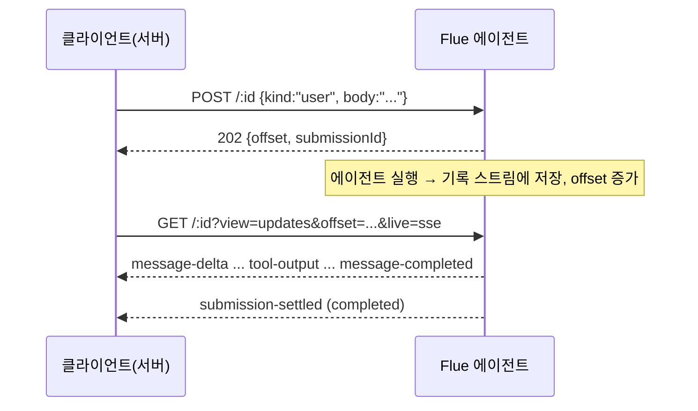
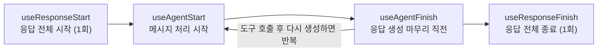
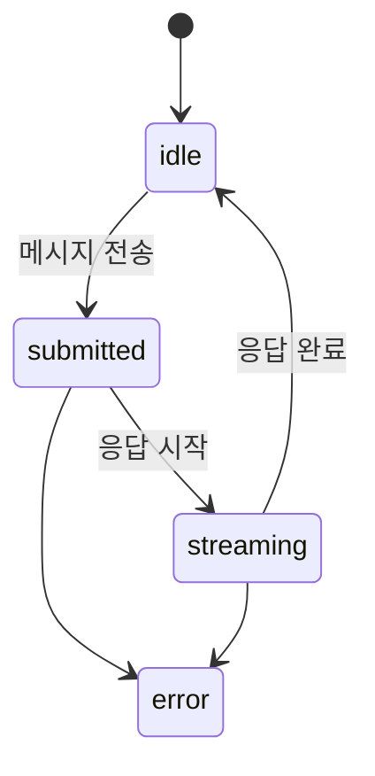

> [!summary]
> **Flue**는 Astro 제작진이 만든 오픈 **AI 에이전트 프레임워크**입니다. React와 비슷한 **Hook API**(`useModel`, `useTool` 등)로 TypeScript 에이전트를 만들고, 로컬(Node.js)이나 Cloudflare Workers에 배포합니다.
> - 에이전트 = 함수 하나. 함수가 반환하는 문자열이 지시문(Instructions)이 되고, 함수 안에서 Hook으로 모델·도구·상태·스킬·MCP·서브에이전트·샌드박스를 붙입니다.
> - 대화(Conversation)는 서버에 영속 저장되고, HTTP API(`POST`로 메시지 전송, `GET`으로 기록·스트림 조회)로 주고받습니다.
> - 강의를 들으며 필기한 내용을 공식 문서로 보완한 글입니다. 버전에 따라 API가 다를 수 있습니다(2026-10 기준).

## Flue 개요

- 만든 곳: Astro 제작진. 모델 연결은 여러 LLM 제공자를 지원하는 **Pi** 위에서 동작합니다.
- 서버는 [Hono](https://hono.dev), 빌드는 Vite 기반입니다.
- 실행 대상: **Node.js**(22.19.0 이상) 또는 **Cloudflare Workers**. CI(GitHub Actions, GitLab CI)에서 `flue run`으로 돌릴 수도 있습니다.

| 핵심 개념 | 설명 |
| --- | --- |
| **Agent** | 이름이 있는 영속 단위. `'use agent'` 모듈에서 export한 함수 하나가 에이전트이고, **함수 이름이 에이전트의 이름**이 됩니다 |
| **Conversation** | 영속 상태의 단위. 대화 id별로 기록이 저장됩니다(별도의 "워크플로우" 개념은 없음) |
| **Tool** | LLM이 호출해 실제 작업을 하는 함수. 에이전트 함수 안에서 `useTool`로 등록 |
| **Model** | `provider/model` 형식의 문자열로 지정(예: `anthropic/claude-haiku-4-5`) |

> [!tip] 다른 에이전트 도구와 비교
> 스킬·MCP·서브에이전트·샌드박스 같은 구성 요소는 [[claude-code-and-skills|Claude Code]]와 개념이 거의 같습니다. 차이는 Flue가 **내 서비스에 넣을 에이전트를 직접 만드는 프레임워크**라는 점입니다. 같은 계열로는 Python 기반 [[langgraph-and-multiturn-routing|LangGraph]]가 있습니다.

## 사전 지식: Cloudflare 생태계

| 이름 | 설명 |
| --- | --- |
| [Cloudflare](https://www.cloudflare.com) | 전 세계 분산 네트워크 기반으로 CDN, 보안, 서버리스 컴퓨팅 등 웹 인프라를 제공하는 플랫폼 |
| [Cloudflare Workers](https://developers.cloudflare.com/workers) | Cloudflare 글로벌 네트워크에서 JavaScript/TypeScript 코드를 실행하는 서버리스 플랫폼 |
| [Wrangler](https://developers.cloudflare.com/workers/wrangler) | Workers를 로컬에서 실행·배포하고 Cloudflare 리소스를 관리하는 공식 CLI |
| [create-cloudflare (C3)](https://developers.cloudflare.com/pages/get-started/c3) | Workers·Pages용 초기 구조와 설정을 만들어 주는 프로젝트 생성 CLI |
| [Hono](https://hono.dev) | 웹 표준 기반의 가볍고 빠른 웹 프레임워크. 여러 JS 런타임에서 동작하며 Flue의 서버도 Hono |
| Durable Objects | 상태를 가진 객체를 실행하는 기능. Flue를 Cloudflare에 배포하면 에이전트마다 `Flue<이름>Agent` Durable Object가 생기고 대화가 SQLite에 저장됩니다 |
| [Cloudflare Models](https://developers.cloudflare.com/ai/models) | Workers AI 모델 목록. Flue에서는 `cloudflare/@cf/...` 형식으로 API 키 없이 사용 |

```bash
# 최신 Wrangler로 브라우저 OAuth 인증을 거쳐 Cloudflare 계정 연결
npx wrangler@latest login

# 최신 create-cloudflare로 프로젝트 생성
npx create-cloudflare@latest flue-frontend
```

## 시작하기

### AI에게 첫 에이전트 만들기 맡기기

```text
Read https://flueframework.com/start.md then help create my first agent…
```

- Flue 공식 시작 문서를 읽고 첫 에이전트를 만들어 달라고 코딩 에이전트에게 요청하는 프롬프트입니다.
- 사용법을 일일이 설명하지 않아도 **공식 문서를 컨텍스트로 제공**해 최신 사용법으로 작업하게 할 수 있습니다(→ [[context-engineering-and-agent-automation|컨텍스트 엔지니어링]]).
- `@flue/cli` 설치 후에는 `npx flue docs search <검색어>`로 설치된 버전에 맞는 문서를 오프라인으로 볼 수 있습니다.

### 직접 만들기

```bash
# 프로젝트 생성 (--target은 필수, 의존성 설치는 따로)
npx flue init my-agent --target cloudflare   # 또는 --target node [--deploy]
```

```ts title="src/agents/assistant.ts"
'use agent';
import { useModel } from '@flue/runtime';

export function Assistant() {
  useModel('anthropic/claude-haiku-4-5');
  return 'You are a helpful assistant. Keep replies short.';
}
```

| 실행 방법 | 명령 | 용도 |
| --- | --- | --- |
| 서버 없이 실행 | `npx flue run src/agents/assistant.ts --message "Hello"` | 터미널에서 바로 대화. 출력된 대화 id를 `--id`로 넘기면 이어서 대화 |
| 개발 서버 | `npx vite dev` → `http://localhost:5173` | HTTP API로 테스트, 핫 리로드 |
| 운영 빌드 | `vite build` | Node는 `dist/server.mjs` 생성, Cloudflare는 Worker로 배포 |

> [!warning] API 키
> 실제 API 키를 파일에 넣지 않습니다. `.env`에는 자리표시자만 두고 비밀값은 직접 설정합니다.

## 에이전트 정의 기본

### Agent Instructions

- Flue의 에이전트는 **동기 함수**로 정의하고, 함수가 반환하는 문자열이 에이전트가 따를 **지시문(Instructions)**이 되어 LLM에 전달됩니다.
- `return "You are a helpful assistant. Keep replies short.";` → 도움이 되는 어시스턴트로 행동하고 답변을 짧게 하라는 지시입니다.
- [Building agents 문서](https://flueframework.com/docs/guide/building-agents)

### `useModel` — 모델 지정

- 에이전트가 사용할 LLM을 지정하는 Hook입니다. `provider-id/model-id` 형식이며, **한 번의 실행마다 하나의 모델**이 필요합니다.
- 모델 연결·인증·스트리밍·재시도는 Flue가 처리하므로 에이전트 코드에서는 모델만 선언하면 됩니다.
- 모델을 고정할 수도 있고, **에이전트 상태나 현재 입력에 따라 동적으로** 바꿀 수도 있습니다.
- 사용 가능한 모델 목록: `https://flueframework.com/models.json` · [Models 문서](https://flueframework.com/docs/guide/models)

> [!bug] Workers 무료 플랜 모델 오류
> `FlueError: Model @cf/zai-org/glm-5.3-flash is not available on the Workers Free plan`
>
> Workers 무료 플랜에서 쓸 수 없는 모델이라 발생합니다. 무료 플랜이면 사용 가능한 모델로 바꿉니다.
>
> ```ts
> useModel("cloudflare/@cf/zai-org/glm-4.7-flash");
> ```

## HTTP API로 대화하기 (REST Agent)

UI 없이 **서버끼리 통신**하거나 스크립트·CI에서 에이전트를 쓸 때는 HTTP API를 직접 호출합니다. 에이전트는 `src/app.ts`에서 **마운트 경로**에 연결되고, 대화 URL은 `마운트 경로/대화id`가 됩니다.

```ts title="src/app.ts"
import { createAgentRouter } from '@flue/runtime/routing';
import { Hono } from 'hono';
import { Hello } from './agents/hello.ts';

const app = new Hono();
app.route('/agents/hello', createAgentRouter(Hello));   // → /agents/hello/<대화id>
export default app;
```

> [!note] 마운트 경로는 자유롭게
> 공식 문서 예시는 `/agents/<이름>/<id>`지만 마운트 경로는 자유롭게 정할 수 있습니다. `/hello/world`에 마운트하면 `/hello/world/my-first-chat`처럼 됩니다. 대화 id(`my-first-chat`, `user-1`)는 호출하는 쪽이 정하고, **첫 메시지를 보낼 때 대화가 생성**됩니다.

### 경로

| 요청 | 역할 |
| --- | --- |
| `POST /:id` | 메시지 1건 전달. 메시지가 저장되면 **에이전트 실행 전에** `202 Accepted` 반환 |
| `GET /:id` | 대화 조회(`?view=history` 스냅샷, `?view=updates` 변경분, 실시간 스트림) |
| `HEAD /:id` | 본문 없이 스트림 정보(현재 offset)만 조회 |
| `POST /:id/abort` | 실행 중·대기 중인 작업 중단 |
| `GET /:id/attachments/:attachmentId` | 첨부 파일 다운로드 |

```bash
# 메시지 전송 → 202 + offset 반환
curl -X POST http://localhost:5173/hello/world/my-first-chat \
  -H 'content-type: application/json' \
  -d '{"kind":"user","body":"Tell me a joke."}'

# 대화 상태·기록 조회
curl http://localhost:5173/hello/world/my-first-chat | jq
```

### offset — 어디까지 읽었는지 표시하는 재개 토큰

- 대화는 서버에 **영속 기록 스트림**으로 쌓이고, **offset**은 그 스트림의 위치를 가리키는 토큰입니다(예: `0000000000000000_0000000000000003`).
- `POST` 응답에 그 시점의 `offset`(헤더 `Stream-Next-Offset`)과 `submissionId`가 옵니다. 이 offset부터 변경분을 읽으면 **이전 기록을 다시 받지 않고** 이번 메시지에 대한 응답만 받습니다.
- 에이전트가 작업할수록 offset이 증가합니다. 메시지 수가 아니라 저장 묶음(batch) 단위라 메시지보다 빨리 늘어납니다.
- 읽기는 **해당 offset 이후**만 반환합니다. `-1`부터 읽으면 전체 대화를 처음부터 받습니다.
- offset은 형식을 해석하거나 직접 만들지 말고 **받은 값을 그대로** 넘깁니다.

```bash
# 변경분 읽기 (즉시 / 롱폴링 / SSE 실시간)
GET /:id?view=updates&offset=<offset>
GET /:id?view=updates&offset=<offset>&live=long-poll   # 데이터가 없으면 최대 30초 대기
GET /:id?view=updates&offset=<offset>&live=sse         # 연결 유지, 실시간 이벤트
```

- **`HEAD`**: 본문 없이 `Stream-Next-Offset`(현재 스트림 끝 위치)만 돌려줍니다. "다음에 어디서부터 읽을지"만 알고 싶을 때 씁니다.
- 응답에 `Stream-Up-To-Date`가 없으면 더 읽을 데이터가 있다는 뜻이므로 `Stream-Next-Offset`부터 다시 읽습니다.
- 스트림 조각(chunk) 종류: `message-delta`(텍스트·추론 조각), `tool-input`/`tool-output`(도구 실행), `message-completed`, `submission-settled`(이번 전송의 최종 결과: 완료·실패·중단) 등.



> [!tip] SDK로 감싸기
> 직접 호출 대신 `@flue/sdk`의 `createFlueClient()`를 쓰면 `send()`, `wait()`, `history()`, `observe()`, `read()`, `abort()`로 같은 일을 하고, offset 기반 재개·재연결·중복 제거를 알아서 처리합니다. Flue 서버 **안**의 코드에서는 SDK 대신 `@flue/runtime`의 `dispatch()`를 씁니다.

> [!danger] 기본 인증 없음
> 마운트된 에이전트에는 인증이 없습니다. URL을 아는 누구나 메시지를 보내고 기록을 읽고 작업을 중단할 수 있습니다. 운영에서는 `app.ts`에서 마운트 **앞에** Hono 미들웨어로 **인증**(누구인가)과 **인가**(이 대화 id에 접근해도 되는가)를 모두 확인합니다.

## Agent Hooks

에이전트 함수 안에서 호출해 기능을 붙이는 Hook 모음입니다([Agent Hooks API 레퍼런스](https://flueframework.com/docs/reference/agent-hooks-api/)).

| Hook | 역할 |
| --- | --- |
| `useModel` | 사용할 LLM 지정 |
| `useTool` | LLM이 호출할 도구 등록 |
| `usePersistentState` | 실행이 끝나도 유지되는 상태 |
| `useInitialData` | 에이전트 생성 시 클라이언트가 넘긴 초기 데이터 조회 |
| `useDelivery` | 이번 실행을 시작시킨 메시지·이벤트 조회 |
| `useDataWriter` | 실행 중 구조화된 데이터를 클라이언트로 실시간 전송 |
| `useSkill` | 스킬 등록 |
| `useMcpConnection` | MCP 서버 연결 |
| `useSubagent` | 서브에이전트 등록 |
| `useSandbox` | 파일시스템·명령 실행 환경 연결 |
| `useResponseStart` 등 | 실행 시점별 라이프사이클 Hook |

### 도구: `useTool`

- LLM이 필요할 때 호출해 실제 작업을 수행하는 도구를 등록합니다. 이름, 설명, 입력 스키마, 실제로 실행할 `run` 함수를 정의합니다.
- 샌드박스나 모델에 접근해야 하는 도구는 `harness: true`를 설정합니다.
- 흐름: 사용자 요청 → LLM이 도구 호출 결정 → 입력 데이터 생성 → **스키마 검증** → `run` 실행 → (필요하면) Persistent State 변경
- [Tools 문서](https://flueframework.com/docs/guide/tools)

#### Durable Tools — 중단돼도 이어서 실행

- 도구 실행 중 서버가 종료·재시작되어도 **완료된 단계의 결과를 복구**해 나머지를 이어서 실행합니다.
- `useTool`에 `durable: true`를 설정하면 `run`에서 `step`을 쓸 수 있습니다.
- 주의: `step.do()` **밖**의 코드는 복구 시 다시 실행될 수 있고, step도 결과 기록 전에 중단되면 재실행될 수 있습니다. 외부 시스템을 바꾸는 작업에는 **멱등성** 처리가 필요합니다.
- 활용: 결제 처리, DB 작업, 외부 API 호출, 여러 단계로 된 장시간 작업 · [Durability 문서](https://flueframework.com/docs/guide/durability/#durable-tools-and-stepdo)

### 상태와 입력

- **`usePersistentState`**: 에이전트에 영속 저장되는 상태. React의 `useState`처럼 값과 setter를 반환하지만 **실행이 끝나도 유지**되어 다음 대화에서 다시 쓸 수 있습니다([문서](https://flueframework.com/docs/guide/agent-hooks/#persisted-state)).
- **`useInitialData`**: 에이전트가 처음 생성될 때 클라이언트가 넘긴 초기 데이터(예: 사용자 이름)를 가져옵니다([문서](https://flueframework.com/docs/reference/agent-hooks-api/#useinitialdata)).
- **`useDelivery`**: 현재 실행을 시작하게 만든 메시지나 이벤트를 가져옵니다. 입력에 따라 동작을 다르게 구성할 때 씁니다([문서](https://flueframework.com/docs/reference/agent-hooks-api/#usedelivery)).

### 실시간 데이터 전송: `useDataWriter`

- 작업하는 동안 클라이언트에 보여 줄 **구조화된 데이터**(진행 상태, 중간 결과)를 실시간으로 보냅니다.
- 첫 번째 인자는 데이터 이름, `schema`는 데이터 구조입니다. 클라이언트에는 스트림의 `data-part` 조각으로 도착합니다([문서](https://flueframework.com/docs/guide/agent-hooks/#streaming-data-to-the-client)).

### 라이프사이클 Hook

실행 과정의 특정 시점에 로직을 끼워 넣습니다([Event hooks 문서](https://flueframework.com/docs/guide/agent-hooks/#event-hooks)).



| Hook | 시점 | 활용 |
| --- | --- | --- |
| `useResponseStart` | 응답 전체가 시작될 때 1회 | 응답 생성 시작 시간 등 메타데이터 기록 |
| `useAgentStart` | 메시지가 전달되어 처리를 시작할 때 | LLM 실행 전 데이터 조회·초기화(비동기 가능) |
| `useAgentFinish` | 응답 생성을 마치려는 시점 | 도구 호출 횟수·토큰 사용량 확인. **한 응답에서 여러 번** 호출될 수 있음 |
| `useResponseFinish` | 응답 전체가 끝날 때 1회 | 최종 토큰 사용량·실행 시간 기록 |

### 스킬: `defineSkill` / `useSkill`

- 스킬은 에이전트에게 특정 작업을 하는 방법이나 행동 지침을 주는 기능입니다. 여러 스킬을 등록하면 LLM이 요청과 스킬 설명을 보고 필요한 스킬을 골라 씁니다.
- `defineSkill`: 코드에서 스킬을 직접 정의합니다.
- `useSkill`: 스킬을 에이전트에 등록합니다. **`SKILL.md` 파일**로 쓴 스킬도 등록할 수 있어 Claude의 Agent Skills와 같은 형식을 씁니다(→ [[claude-code-and-skills|Claude Code와 Skills]]).
- [Skills 문서](https://flueframework.com/docs/guide/skills)

### MCP 서버: `defineMcpConnection` / `useMcpConnection`

- **MCP(Model Context Protocol)**는 AI 앱이 외부 서비스·도구와 표준 방식으로 연결하도록 만든 프로토콜이고, **MCP 서버**는 그 규격으로 외부 기능을 제공하는 서버입니다.
- GitHub, Cloudflare 같은 외부 서비스 기능을 에이전트에서 쓸 때 사용합니다([Cloudflare 제공 MCP 서버 목록](https://developers.cloudflare.com/agents/model-context-protocol/cloudflare/servers-for-cloudflare/#product-specific-mcp-servers)).
- `defineMcpConnection`: MCP 서버의 이름·URL·인증 정보 등 연결 설정을 정의합니다. 여러 에이전트에서 같은 설정을 재사용할 때 유용합니다.
- `useMcpConnection`: 정의한 MCP 서버를 연결해 그 서버의 도구를 에이전트가 쓰게 합니다.
  - 공개 서버이고 인증이 필요 없으면 URL만으로 연결합니다.
  - 인증이 필요하면 `auth` 등의 옵션을 추가하고, 필요한 도구만 골라 쓸 수도 있습니다.
- [MCP 문서](https://flueframework.com/docs/guide/mcp)

### 서브에이전트: `defineSubagent` / `useSubagent`

- 메인 에이전트가 특정 작업을 **별도의 전문 에이전트에게 위임**하는 기능입니다. 조사·코드 분석·문서 작성 등 역할별로 나눌 수 있습니다.
- `defineSubagent`: 이름·설명·지침을 정의해 특정 작업에 특화된 에이전트를 만듭니다.
- `useSubagent`: 현재 에이전트에 등록합니다. 메인 에이전트의 LLM이 요청과 서브에이전트 설명을 보고 골라 위임합니다.
- **GeneralSubagent**: Flue가 기본 제공하는 범용 서브에이전트입니다.

| 항목 | GeneralSubagent |
| --- | --- |
| 대화 기록 | 부모 것을 **상속하지 않음** — 새 컨텍스트에서 독립적으로 작업 후 최종 결과만 반환 |
| 공유 | 부모의 모델, 샌드박스, 파일시스템 등 실행 환경 |
| 상속하지 않음 | 부모의 Instructions, Tools, Skills, Subagents, Persistent State |
| 언제 | 전문 설정 없이 범용 작업을 새 컨텍스트에 맡길 때. 전문 역할이 필요하면 `defineSubagent` |

- [Subagents 문서](https://flueframework.com/docs/guide/subagents/#the-general-purpose-delegate)

### 샌드박스: `useSandbox`

- 샌드박스는 에이전트가 파일을 읽고 수정하거나 Bash 명령을 실행하는 작업 환경입니다. `useSandbox()`로 연결하면 `read`, `write`, `edit`, `bash`, `grep`, `glob` 등의 도구를 쓸 수 있습니다([Sandboxes 문서](https://flueframework.com/docs/guide/sandboxes)).

| 구분 | just-bash (Virtual Sandbox) | Cloudflare Sandbox |
| --- | --- | --- |
| 방식 | TypeScript로 Bash 명령을 **가상 실행**(실제 OS 프로세스 없음) | 격리된 **실제 Linux 컨테이너** |
| 파일시스템 | `InMemoryFs` 등 메모리 기반 가상 파일 | 컨테이너 파일시스템 |
| 가능한 작업 | 기본적인 파일 조작·명령 | Python 실행, 패키지 설치, Git, 백그라운드 프로세스 등 |
| 설치 | `npm i just-bash`([npm](https://www.npmjs.com/package/just-bash)) | `@cloudflare/sandbox`([Flue 문서](https://flueframework.com/docs/ecosystem/sandboxes/cloudflare)) |

> [!warning] Cloudflare Sandbox 버전 주의
> - 로컬에서 실행·테스트하려면 **Docker**를 설치하고 실행해야 합니다.
> - 강의는 `@cloudflare/sandbox@0.11.0`을 쓰지만, 2026년 10월 기준 최신은 **1.x**이고 주요 API와 사용 방식이 크게 바뀌었습니다. 실습은 강의와 같은 버전으로 하거나 버전 차이에 주의합니다.
> - 0.x → 1.x 마이그레이션: [Sandbox SDK 마이그레이션 문서](https://developers.cloudflare.com/sandbox/sdk/migrate)

## 프론트엔드 연동 (React)

```bash
npm i @flue/react @flue/sdk
```

### `useFlueAgent`

- React에서 Flue 에이전트와 연결하는 Hook입니다. 에이전트 URL을 넘기면 **메시지 전송, 메시지 목록, 현재 상태** 등을 쓸 수 있습니다([React 문서](https://flueframework.com/docs/guide/react)).

`status` — 에이전트와의 통신 상태:

| 값 | 의미 |
| --- | --- |
| `idle` | 작업 없이 대기 중 |
| `connecting` | 에이전트와 연결 중 |
| `submitted` | 메시지를 보내고 응답을 기다리는 중 |
| `streaming` | 응답을 실시간으로 받는 중 |
| `error` | 요청·연결 중 오류 발생 |



상태에 맞춰 로딩 표시, 오류 메시지 등 UI를 바꿉니다.

### Message Parts

메시지는 문자열 하나가 아니라 여러 **part**로 구성되며, `part.type`을 보고 종류에 맞는 UI를 렌더링합니다.

| `part.type` | 내용 |
| --- | --- |
| `text` | 사용자나 에이전트가 쓴 일반 텍스트 |
| `reasoning` | 모델이 응답을 만들며 제공하는 추론 데이터(지원 여부·내용은 모델마다 다름) |
| `dynamic-tool` | 에이전트가 호출한 도구 정보. 도구 이름, 입력값, 출력값, 실행 상태 |
| `file` | 메시지에 포함된 파일 데이터(바이트는 `/:id/attachments/:attachmentId`로 받음) |

`dynamic-tool`의 `state` — 도구 호출 단계:

| 값 | 의미 |
| --- | --- |
| `input-available` | 도구를 호출할 입력 데이터가 준비됨 |
| `output-available` | 실행이 끝나 결과를 쓸 수 있음 |
| `output-error` | 실행 중 오류 발생 |

### `createFlueClient` — 인증·사용자 지정 클라이언트

- 에이전트와 통신할 클라이언트를 만드는 함수입니다. 에이전트 URL과 인증 토큰 등을 설정하고, 만든 클라이언트를 `useFlueAgent`에 넘겨 씁니다.
- `token`을 설정하면 에이전트로 가는 **모든 요청**(스트림 재연결 포함)의 `Authorization` 헤더에 들어갑니다. 클라이언트 하나가 대화 하나를 가리킵니다.

```ts
import { createFlueClient } from '@flue/sdk';

const conversation = createFlueClient({
  url: 'https://example.com/agents/support/ticket-8472',
  token: process.env.FLUE_TOKEN,
});
```

- [인증·커스텀 클라이언트 문서](https://flueframework.com/docs/guide/react/#authentication-and-custom-clients)

## Observability (관측성)

에이전트 실행 중 일어나는 일을 **이벤트 스트림**으로 받아 로그·트레이스로 남깁니다. 별도의 켜기 스위치 없이 `observe()`로 구독하면 됩니다.

```ts title="src/app.ts (모듈 최상단)"
import { observe } from '@flue/runtime';

observe((event) => {
  if (event.type === 'submission_settled' && event.outcome === 'failed') {
    console.error(`[${event.agentName}] submission ${event.submissionId} failed:`, event.error?.message);
  }
});
```

- **이벤트 종류**: 에이전트 시작·종료, 전송 결과(`submission_settled`, 가장 확실한 종료 신호), 모델 턴, 메시지, 도구 호출(`tool_start`, `tool`), 서브에이전트 작업, 컨텍스트 압축, 로그
- **토큰·비용**: 모델 호출마다 `turn` 이벤트에 `usage`(input, output, cacheRead, cacheWrite, totalTokens)와 추정 `cost`가 담깁니다. 상위 이벤트에 합계가 또 있으니 **한 단계만 합산**해야 중복 집계가 안 됩니다.
- 주의: 구독 함수는 동기로 실행되므로 빨리 끝내야 합니다. 프로세스(Cloudflare는 isolate)별로 동작하고 지난 이벤트는 다시 받을 수 없습니다. `app.ts`에 등록한 구독은 `flue run`에서는 동작하지 않습니다.

| 내보내기 대상 | 내용 | 설정 |
| --- | --- | --- |
| **Sentry** | 실패를 이슈로, 로그는 Sentry Logs로, AI 트레이스(선택) | `flue add tooling sentry` |
| **Braintrust** | 모델·도구·작업 단위 LLM 트레이스 | `flue add tooling braintrust` |
| **OpenTelemetry** | GenAI span·메트릭·로그를 OTel 호환 백엔드로 | `@flue/opentelemetry` |
| **Cloudflare** | Workers Logs·Traces(`invoke_agent`, `chat`, `execute_tool` span) | `wrangler.jsonc`에서 활성화 |

> [!warning] 민감 정보
> 프롬프트, 도구 입력·결과, 추론 내용이 이벤트에 들어갈 수 있고 트레이스 어댑터는 기본으로 내용을 수집합니다. 저장되는 내용과 접근 권한을 확인하고, 필요하면 `content: false`로 끕니다.

LLM 호출 추적은 [[langfuse-tracing-users-scores|Langfuse]]를 참고하세요. Flue의 공식 내보내기 목록에 Langfuse는 없지만, OpenTelemetry를 거쳐 연결하는 방법은 검토해 볼 만합니다(미확인).

##### 참조

- [Flue 공식 사이트](https://flueframework.com/) / [Getting Started](https://flueframework.com/docs/guide/getting-started/) / [start.md (AI용 시작 문서)](https://flueframework.com/start.md)
- [Building agents](https://flueframework.com/docs/guide/building-agents) / [Models](https://flueframework.com/docs/guide/models) / [Tools](https://flueframework.com/docs/guide/tools) / [Agent Hooks](https://flueframework.com/docs/guide/agent-hooks/) / [Durability](https://flueframework.com/docs/guide/durability/)
- [Skills](https://flueframework.com/docs/guide/skills) / [MCP](https://flueframework.com/docs/guide/mcp) / [Subagents](https://flueframework.com/docs/guide/subagents) / [Sandboxes](https://flueframework.com/docs/guide/sandboxes)
- [Routing](https://flueframework.com/docs/guide/routing/) / [Streaming Protocol](https://flueframework.com/docs/reference/streaming-protocol/) / [Agent SDK](https://flueframework.com/docs/sdk/overview/) / [React](https://flueframework.com/docs/guide/react) / [Observability](https://flueframework.com/docs/guide/observability/)
- [Cloudflare Workers](https://developers.cloudflare.com/workers) / [Wrangler](https://developers.cloudflare.com/workers/wrangler) / [Cloudflare Sandbox 마이그레이션](https://developers.cloudflare.com/sandbox/sdk/migrate)
- 관련 글: [[langgraph-and-multiturn-routing|LangGraph]], [[claude-code-and-skills|Claude Code와 Skills]], [[context-engineering-and-agent-automation|컨텍스트 엔지니어링과 에이전트 자동화]], [[langfuse-tracing-users-scores|Langfuse]]
