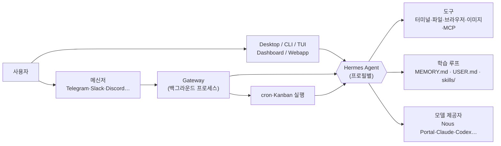
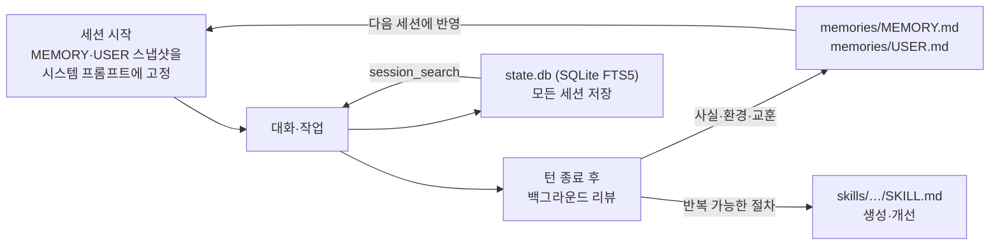

> [!summary] 요약
> **Hermes Agent**는 Nous Research가 만든 오픈소스(MIT) **개인용 AI 에이전트**입니다. OpenClaw와 같은 계열입니다.
> - **학습 루프(learning loop)**: 사용하면서 기억(`MEMORY.md`·`USER.md`)과 스킬(`SKILL.md`)을 스스로 쌓고 고칩니다. 공식 문서는 이를 가장 큰 특징으로 내세웁니다.
> - **어디서나 접속**: 노트북뿐 아니라 VPS·Docker·서버리스(Modal 등)에서 돌리고, **게이트웨이**를 통해 Telegram·Slack·Discord 같은 메신저에서 대화합니다.
> - **자동화**: cron 예약 작업, Kanban 작업 보드, `/goal` 반복 실행, 프로필(여러 에이전트)로 무인 자동화에 맞춰져 있습니다.
> - 이 글은 2026-11-06 기준 **v0.23.0 "The Hearth Release"**(2026-11-05 출시)의 공식 문서로 필기 내용을 보완했습니다. 업데이트가 잦아 명령어가 바뀔 수 있습니다.



---

## 1. Hermes Agent란?

OpenClaw와 같은 **개인용 AI 에이전트**입니다. [[claude-code-and-skills|Claude Code]]가 코딩에 집중한다면, Hermes는 **개인 비서처럼 늘 켜 두고** 메신저·예약 작업으로 일을 시키는 데 맞춰져 있습니다.

| 항목 | 내용 |
|---|---|
| 만든 곳 | Nous Research (Hermes·Nomos·Psyche 모델을 만든 연구소) |
| 라이선스 | MIT (무료·오픈소스. 모델 제공자와 호스팅 서비스는 따로 과금) |
| 최신 버전 | v0.23.0 "The Hearth Release" (2026-11-05) |
| 실행 환경 | Python 3.14. macOS·Linux·WSL2·Windows·Android(Termux)·Docker |
| 기존 에이전트에서 이전 | OpenClaw, Claude Code, Codex CLI, Cursor 설정을 가져올 수 있음 (`hermes import-agent`) |

### 주요 기능

- **어디에서든 사용**: $5짜리 VPS, GPU 클러스터, 서버리스(Modal·Daytona)에서 돌리고 메신저로 접속합니다.
- **다양한 플랫폼 연동**: 게이트웨이 하나로 20개 이상의 메신저를 연결합니다. (5장 참고)
- **자동화에 최적화**: cron, Kanban, `/goal`, `/loop`, 서브에이전트 위임(`delegate_task`)을 지원합니다.
- **웹 브라우징**: 브라우저 자동화(`browser_exec`, CDP 기반)와 웹 검색·스크래핑을 지원합니다.
- **멀티태스킹**: 백그라운드 작업(`/bg`), 프로필별 에이전트, Kanban 워커를 동시에 돌릴 수 있습니다.
- **독립된 샌드박스**: 터미널 백엔드를 Docker·SSH·Modal 등으로 바꿔 격리된 환경에서 명령을 실행합니다. (7.3절 참고)
- **학습 루프**: 경험에서 스킬을 만들고, 쓰면서 개선하고, 지난 대화를 검색하고, 사용자에 대한 이해를 쌓습니다. (2장 참고)
- **스킬 표준 호환**: [agentskills.io](https://agentskills.io) 표준의 `SKILL.md`를 씁니다. 이는 [[claude-code-and-skills|Claude Agent Skills]]와 같은 형식입니다. MCP도 지원합니다.

### Nous Portal

[Nous Portal](https://portal.nousresearch.com/)은 Hermes에 **모델·도구·클라우드**를 한 계정으로 붙여 주는 서비스입니다. 쓰지 않고 내 API 키나 구독(Claude, Codex 등)만 연결해도 됩니다.

- **모델**: 200개 이상의 모델을 제공합니다. 무료 모델도 있고, 무료 계정은 무료 모델만 쓸 수 있습니다.
- **Tool Gateway**: 웹 검색, 스크래핑, 이미지 생성, 브라우저, 음성을 제공하며 사용량만큼 과금합니다.
- **클라우드 호스팅**: 클릭 한 번으로 배포해 에이전트를 24시간 돌립니다.

| 플랜 | 가격 | 포함 내용 |
|---|---|---|
| Free | $0 | 무료 모델만, 기본 요청 한도, 월 크레딧 없음 |
| Plus | $20/월 | 사용량 포함(일·주·월 한도), 클라우드 에이전트 1개 (RAM 4GB, 디스크 25GB) |
| Super | $100/월 | 클라우드 에이전트 1개 (RAM 4GB, 디스크 100GB) |
| Ultra | $200/월 | 클라우드 에이전트 1개 (RAM 8GB, 디스크 100GB) |

- **API 키 사용 시**: 포함 사용량이 아니라 항상 크레딧(종량제)으로 과금됩니다.
- **ChatGPT 구독 연결**: 유료 Nous 구독 없이도 추론에 쓸 수 있습니다.
- 가격은 2026-11-06 기준입니다.

---

## 2. 학습 루프와 메모리

Hermes는 "학습 루프가 내장된 유일한 에이전트"를 표방합니다. 대화가 끝날 때마다 **백그라운드에서 돌아보고**, 기억할 것은 메모리에, 반복할 절차는 스킬로 저장합니다. [[wikiskill-paper-review|WikiSkill]] 연구가 말하는 "실행 경험으로 스킬을 진화시키는 구조"를 제품으로 구현한 사례에 가깝습니다.



| 파일·저장소 | 역할 | 제한 |
|---|---|---|
| `memories/MEMORY.md` | **에이전트 자신의 메모**. 환경 정보, 작업하며 배운 교훈 | 2,200자 (약 800토큰) |
| `memories/USER.md` | **사용자에 대한 정보**. 선호, 작업 방식 | 1,375자 (약 500토큰) |
| `skills/` | 경험에서 만든 스킬(`SKILL.md`) | — |
| `state.db` | 모든 CLI·메신저 세션 기록. `session_search` 도구로 검색 | — |

- **세션 시작 시점의 스냅샷**: 메모리는 세션을 시작할 때 시스템 프롬프트에 고정됩니다. 대화 중에 메모리를 수정해도 **다음 세션부터** 반영됩니다.
- **자동 압축 없음**: 한도를 넘으면 쓰기가 실패하고, 에이전트가 직접 항목을 합쳐 정리합니다. 중복은 거부되고, 프롬프트 인젝션 패턴도 검사합니다.
- **백그라운드 리뷰**: 저장되면 채팅에 "💾 Memory updated"가 표시됩니다.
  - `/refine [초점]`: 지금 바로 리뷰를 실행합니다.
  - `auxiliary.background_review`: 더 싼 모델에 맡기거나 끌 수 있습니다.
- **승인 후 저장**: `memory.write_approval`·`skills.write_approval`을 켜면 저장 전에 검토합니다. `/memory pending|approve|reject`, `/skills pending|diff|approve|reject`로 처리합니다.
- **`/new`로 끊어 주기**: 메신저 대화는 하나의 긴 세션이라 학습 루프가 잘 돌지 않습니다. 작업이 끝나면 `/new`로 세션을 끊는 것이 좋다고 공식 문서가 권장합니다.
- **외부 메모리 제공자**: 내장 메모리와 함께 **하나만** 켤 수 있습니다. Honcho, Mem0, Supermemory, OpenViking 등이 있고, `hermes memory setup`으로 설정합니다.

> [!tip] Claude Code와 비교
> `SOUL.md`는 Claude Code의 `CLAUDE.md`(지시문), `MEMORY.md`는 auto-memory에 해당합니다. Hermes는 여기에 **스킬 자동 생성과 사용자 모델링**까지 더했습니다. 컨텍스트 설계 관점은 [[context-engineering-and-agent-automation|컨텍스트 엔지니어링과 에이전트 자동화 설계 원칙]]을 참고하세요.

---

## 3. 시작하기

### 3.1 설치

```bash
# Linux / macOS / WSL2
curl -fsSL https://hermes-agent.nousresearch.com/install.sh | bash
source ~/.bashrc          # 또는 source ~/.zshrc

# Windows (PowerShell)
iex (irm https://hermes-agent.nousresearch.com/install.ps1)
```

- **Hermes Desktop**: macOS(Apple Silicon, v0.23.0부터 macOS 13 이상)용 `.dmg`와 Windows(64비트)용 `.exe` 또는 Microsoft Store 버전이 있습니다. Linux는 터미널 설치 후 `hermes desktop`으로 앱을 빌드해 실행합니다.
- **설치 옵션**: `--skip-browser`, `--skip-computer-use`로 브라우저·컴퓨터 조작 도구를 빼고 설치할 수 있습니다. `--non-interactive`는 질문 없이 설치합니다.
- **설치 위치**: 코드는 `~/.hermes/hermes-agent/`, 실행 파일은 `~/.local/bin/hermes`, 데이터는 `~/.hermes/`에 들어갑니다. Windows는 `%LOCALAPPDATA%\hermes\`입니다.
- **Windows 오탐**: Defender가 `uv.exe`를 오탐할 수 있습니다. 이때는 `"$env:LOCALAPPDATA\hermes\bin"`을 검사 예외로 추가합니다.

### 3.2 처음 실행

1. [Nous Portal](https://portal.nousresearch.com/)에 가입합니다. (선택)
2. Hermes Desktop을 설치합니다. CLI 등 다른 방법도 있습니다.
3. Hermes Desktop을 실행하고 모델을 선택합니다.
   1. 무료 계정이면 무료 모델을 선택할 수 있습니다.
   2. 본인이 가진 Codex, Claude 등의 구독·API 키를 연동할 수도 있습니다.
4. 대화를 시작합니다. 파일과 폴더는 아래처럼 참조합니다.
   - `@file:파일명`
   - `@folder:폴더명`

```bash
hermes setup --portal   # 가장 빠른 방법: Nous Portal OAuth → 모델 + Tool Gateway 한 번에 설정
hermes setup            # 설정 마법사 (model, tts, terminal, gateway, tools, agent 중 일부만 설정 가능)
hermes model            # 기본 제공자·모델 선택, 제공자 추가·OAuth
hermes                  # 대화 시작
```

> [!note] 다른 에이전트 설정 가져오기
> `hermes setup`을 처음 실행하면 `~/.openclaw`, `~/.claude`, `~/.codex`, `~/.cursor`를 찾아 가져올지 묻습니다. 대화 중의 `/model`은 이미 설정한 제공자 사이에서 바꾸는 것만 할 수 있습니다. 새 제공자는 `hermes model`로 추가합니다.

---

## 4. 사용법

### 4.1 Hermes Desktop

Electron 앱이며 CLI와 같은 에이전트 코어를 씁니다.

| 메뉴 | 설명 |
|---|---|
| **Project** | 프로젝트별로 지정된 작업 공간(여러 폴더 가능)에서 세션을 생성합니다. CLI의 `hermes project`와 같습니다 |
| **Capabilities** | 스킬, 도구, 커넥터, 플러그인을 추가·관리합니다. 직접 만들었거나 에이전트가 학습한 스킬도 여기서 관리합니다 |
| **Messaging** | 메신저를 연결해 봇으로 대화합니다 (5장 참고) |
| **Tools** | 이미지 생성 모델, 브라우저 자동화, 컴퓨터 조작 권한 등을 설정합니다 (7장 참고) |
| **Profile** | 에이전트를 분리해 페르소나를 만듭니다 (6장 참고) |
| **Scheduled jobs** | cron 작업을 만듭니다. 결과를 Desktop 외에 연결된 메신저로도 받을 수 있습니다 (8.1절 참고) |

- 그 밖에 Bot Mode(프로필을 봇으로 운영, 그룹 채팅), 아티팩트, 파일 브라우저, 터미널, git 리뷰·워크트리, 메모리 그래프, 음성 입력도 지원합니다.
- `hermes webapp`을 쓰면 **브라우저 탭에서 Desktop 화면을 그대로** 씁니다. v0.23.0에 추가되었고, 포트는 9120입니다.

### 4.2 자주 쓰는 슬래시 명령

대화창에서 쓰는 명령입니다. 설치된 스킬도 `/<스킬이름>`으로 호출할 수 있습니다.

| 명령 | 설명 |
|---|---|
| `/new` | 새 세션 시작 (`/reset`). 학습 루프가 돌도록 작업 단위마다 끊어 주는 것이 좋음 |
| `/journey` | 에이전트가 **무엇을 배웠는지**(스킬·메모리) 타임라인으로 보여 줌. `list`, `delete <id>`, `edit <id>` 지원 (메신저에서는 사용 불가) |
| `/learn <자료>` | 폴더, URL, 방금 함께 한 작업 흐름, 붙여 넣은 메모 등으로 재사용 가능한 **스킬(`SKILL.md`)을 만듦** |
| `/goal <목표>` | 목표를 정하면 **완수할 때까지 여러 턴에 걸쳐 반복**. 매 턴 뒤 보조 판정 모델이 완료 여부를 판단 (기본 최대 20턴, `status`·`pause`·`resume`·`clear`) |
| `/undo` | 마지막 사용자·어시스턴트 대화 한 쌍을 제거 |
| `/rewind [N]` | N턴 전으로 되감기 (Esc 두 번). `fork N`으로 분기 |
| `/rollback` | 체크포인트로 파일 변경을 되돌림 |
| `/diff` | 변경 사항을 보여 줌 |
| `/retry` | 마지막 메시지 다시 시도 |
| `/loop [간격] <프롬프트>` | 일정 간격이나 조건(`--until`)까지 반복 실행 |
| `/bg <프롬프트>` | 백그라운드 작업으로 실행 |
| `/steer <프롬프트>` | 실행 중인 작업에 다음 도구 호출 뒤 끼워 넣을 지시 |
| `/plan [작업]` | 계획을 `.hermes/plans/`에 작성 |
| `/init` | `AGENTS.md` 생성 |
| `/model` | 모델 전환 (`--session`, `--once` 등) |
| `/compress` | 대화 압축 |
| `/yolo` | 위험 명령 승인 프롬프트를 끔 (주의, 10.장) |

> [!warning] `/undo`는 작업 결과까지 되돌리지는 않습니다
> 공식 문서상 `/undo`는 **마지막 대화 한 쌍을 기록에서 지우는 명령**입니다. 에이전트가 이미 수정한 파일을 원래대로 돌리려면 `/rollback`(체크포인트)을 씁니다.

### 4.3 Hermes CLI

| 명령 | 설명 |
|---|---|
| `hermes` | 현재 위치에서 Hermes CLI 실행 (`hermes chat`과 같음) |
| `hermes --tui` | TUI(터미널 UI)로 실행 |
| `hermes desktop` | Desktop 앱 실행 (CLI만 설치했다면 빌드 후 실행) |
| `hermes doctor` | 설정·의존성 문제 진단 |
| `hermes doctor --fix` | 문제를 고치거나 수정안을 제안 |
| `hermes sessions list` | 세션 목록 (그 밖에 export, prune, rename, delete) |
| `hermes -c` / `hermes -r <세션>` | 가장 최근 세션 이어서 / 특정 세션 재개 |
| `hermes -z "<프롬프트>"` | 스크립트용 1회 실행 (최종 텍스트만 출력) |
| `hermes cron list` | 예약 작업 목록 |
| `hermes dashboard` | 웹 대시보드 실행. Desktop 같은 관리 화면이 링크(`http://127.0.0.1:9119`)로 열림 |
| `hermes pause` / `hermes resume` | **전체 비상 정지** / 재개. 정지 중에는 새 cron·Kanban·게이트웨이 작업이 시작되지 않고, 진행 중인 작업은 끝까지 실행됨 (종료 아님) |
| `hermes status` | 에이전트·인증·플랫폼 상태 |
| `hermes update` | 최신 안정판으로 업데이트 |
| `hermes import-agent openclaw` | OpenClaw 설정·메모리·스킬 이전 (`agent-importers` 플러그인) |

- 프로필에 이름을 붙이면 `hermes -p <프로필> ...`이나 별칭 명령(`coder chat`)으로 실행합니다.
- 이 명령들은 일반 터미널(cmd)과 Hermes를 실행한 터미널 양쪽에서 모두 쓸 수 있습니다.

---

## 5. Messaging Gateway

**게이트웨이**는 메신저와 Hermes를 이어 주는 **백그라운드 프로세스**입니다. 이 프로세스가 cron·Kanban도 실행하므로, **끄면 휴대폰·SNS 연결과 예약 작업이 모두 멈춥니다.**

- **지원 플랫폼**: Telegram, Discord, Slack, WhatsApp, Signal, Microsoft Teams, Google Chat, Matrix, LINE, 이메일, SMS, Feishu/Lark, WeCom, iMessage(BlueBubbles) 등 20개 이상과 Webhook·API 서버입니다.

```bash
hermes gateway setup      # 플랫폼 연결 마법사
hermes gateway run        # 포그라운드로 실행 (WSL·Docker·Termux 권장)
hermes gateway start      # 백그라운드로 실행
hermes gateway stop
hermes gateway restart
hermes gateway status
hermes gateway list       # 모든 프로필의 게이트웨이 목록
hermes gateway install    # 서비스 등록 (Linux systemd / macOS launchd / Windows 예약 작업)
```

| 메신저 명령 | 설명 |
|---|---|
| `/start` | Telegram 등이 처음 연결할 때 자동으로 보내는 명령. Hermes는 **답하지 않고 조용히 확인만** 함. 게이트웨이 연결 확인용으로 직접 보내도 됨 |
| `/sethome` | 현재 채팅을 **홈 채널**로 지정. cron 결과와 재시작 알림이 이 채널로 옴 |
| `/pause [사유]` | 대화창에서 쓰는 `hermes pause`. `/pause off`로 재개 |
| `/approve` / `/deny` | 위험 명령 실행 승인·거부 |
| `/new` | 새 세션 |

> [!warning] 접근 제어
> 게이트웨이는 기본적으로 **허용 목록에 없거나 페어링하지 않은 사람을 모두 거부**합니다.
> - 허용 목록은 `TELEGRAM_ALLOWED_USERS` 같은 환경변수로 지정합니다.
> - 모르는 사용자가 말을 걸면 페어링 코드를 받고, 소유자가 `hermes pairing approve telegram <코드>`로 승인합니다.
> - `GATEWAY_ALLOW_ALL_USERS=true`는 터미널 권한이 있는 봇이라면 **절대 켜지 않습니다.**

---

## 6. 프로필(Profiles)

프로필은 **서로 독립된 Hermes 인스턴스**입니다. 에이전트를 분리해 페르소나를 만들 때 씁니다. 예: 코딩용 `coder`, 리서치용 `researcher`

- 각 프로필은 설정, API 키, 성격, 메모리, 세션, 스킬, cron 작업을 따로 가집니다.
- 기본 프로필은 `~/.hermes` 자체이고, 이름 있는 프로필은 `~/.hermes/profiles/<이름>/`에 저장됩니다. (`/username`, `/username2`, …)

| 파일 | 역할 |
|---|---|
| `SOUL.md` | 에이전트의 **성격과 지시문**. 시스템 프롬프트에 들어감. `/personality`로 덧씌우기 가능 |
| `memories/MEMORY.md` | 에이전트가 **작업하며 기억할 것** (환경, 교훈) |
| `memories/USER.md` | **사용자에 대한** 정보 |
| `config.yaml` | 모델, 제공자, 도구 세트 등 그 프로필의 모든 설정 |
| `.env` | API 키, 봇 토큰 |
| `skills/`, `sessions/`, `state.db`, `cron/`, `logs/` | 스킬, 세션, 검색 DB, 예약 작업, 로그 |

```bash
hermes profile list
hermes profile create coder               # 프로필 + "coder" 별칭 명령 생성 (기본 스킬 포함, 기존 프로필 내용은 복사 안 함)
hermes profile create work --clone        # 기존 프로필의 설정·.env·SOUL.md·스킬·메모리를 복사 (세션·cron은 제외)
hermes profile create backup --clone-all  # 세션 기록·cron을 뺀 거의 전부 복사
hermes profile create bare --no-skills    # 기본 제공 스킬도 없는 빈 프로필 (clone 옵션과 같이 못 씀)
hermes profile use work                   # 기본 프로필 전환

hermes -p coder --tui                     # 해당 프로필로 실행 (또는 coder chat)
hermes -p coder setup                     # 프로필 설정 마법사
hermes -p coder setup --reset             # 처음부터 다시 물어봄
hermes profile export work -o ./work.tar.gz   # 내보내기 (자격증명 제외)
```

> [!warning] 프로필은 샌드박스가 아닙니다
> - 로컬 백엔드라면 어느 프로필이든 **내 계정의 파일 전체에 접근**할 수 있습니다.
> - 한 프로필을 두 프로세스가 동시에 쓰면 안 됩니다.
> - 메신저 봇 토큰은 `--clone-channels`를 주지 않으면 복사되지 않습니다. 프로필마다 다른 봇 토큰을 씁니다.

---

## 7. 도구와 모델 설정

### 7.1 Tools

| 도구 | 설명 |
|---|---|
| **Image Generation** | 이미지 생성 모델 설정 (`image_generate`, FAL·Krea 등) |
| **Browser Automation** | 사용할 브라우저(Chrome·Brave·Edge, CDP 연결)와 개인 계정 사용 허용 여부(쿠키·세션 등) 설정. v0.23.0부터 `browser_exec` 하나로 통합 |
| **Computer Use** | 마우스·키보드로 컴퓨터를 조작하도록 허용할지 설정. `hermes computer-use install`·`permissions`로 권한 설정 필요 |
| 기타 | 웹 검색·추출, 터미널·파일, 비전, 음성(TTS), `execute_code`, `delegate_task`(서브에이전트), `cronjob`, MCP |

이렇게 도구마다 권한을 주거나 모델을 정해 두면, 작업에 맞는 모델로 자동화를 돌릴 수 있습니다. 플랫폼별로 켤 도구는 `hermes tools`나 `/tools`로 정합니다. 예를 들어 Telegram 봇에서는 터미널을 끄는 식입니다.

### 7.2 Auxiliary models (보조 모델)

이미지 분석, 대화 압축 같은 **부수 작업을 맡을 모델**을 따로 정해 둡니다. 주 모델이 못하는 일을 맡기거나, 더 싸고 빠른 모델로 처리할 수 있습니다.

- **설정할 수 있는 작업**: 압축(compression), 비전(vision), 위험 명령 승인 판정(smart approvals), 제목 생성, `/review`, 백그라운드 학습 리뷰, `/goal`·`/loop` 완료 판정, Kanban 작업 분해 등
- 기본값은 `provider: auto`로, 주 모델을 그대로 씁니다.

```yaml
# config.yaml
auxiliary:
  vision:
    provider: openrouter
    model: google/gemini-2.5-flash
```

### 7.3 터미널 백엔드 (샌드박스)

에이전트가 명령을 **어디서 실행할지** 정합니다.

| 백엔드 | 설명 |
|---|---|
| `local` | 기본값. 내 컴퓨터에서 바로 실행 |
| `docker` | 컨테이너 하나를 계속 띄워 그 안에서 실행 |
| `ssh` | 원격 서버에서 실행. 에이전트가 자기 코드를 고칠 수 없어 **보안상 권장** |
| `modal` / `daytona` / `vercel_sandbox` | 클라우드 샌드박스. 쉬는 동안 잠들어 비용 절약 |

```yaml
terminal:
  backend: docker
  docker_image: python:3.11-slim
  cwd: "."
```

---

## 8. 자동화

### 8.1 cron 예약 작업

자연어로 부탁해도 에이전트가 직접 cron 작업을 만듭니다. 예: "매일 아침 9시에 Hacker News에서 AI 뉴스를 요약해 Telegram으로 보내 줘"

```bash
/cron add "every 2h" "Check server status"                                  # 대화창에서
hermes cron create "every 1d at 09:00" "Audit open PRs" --workdir ~/projects/acme
hermes cron create "0 9 * * 1-5" --timezone Asia/Seoul "업무 시작 브리핑"
hermes cron list | pause | resume | run | remove | edit
```

- **전달 대상**: `origin`(요청한 곳), `telegram`, `slack`, `email`, `all` 등을 지정할 수 있습니다.
- **실행 주체**: 게이트웨이가 60초마다 확인해 실행하므로, **게이트웨이가 켜져 있어야** 합니다.
- **안전장치**: cron 실행 중에는 위험 명령이 기본적으로 거부됩니다(`approvals.cron_mode: deny`). cron 작업이 다른 cron 작업을 만드는 것도 기본으로 막혀 있습니다.

### 8.2 Kanban

**모든 프로필이 공유하는 작업 보드**입니다. 에이전트용 작업을 넣어 두면 담당 프로필의 워커가 알아서 처리합니다.

```bash
hermes kanban init
hermes gateway start                                          # 디스패처가 게이트웨이 안에서 동작
hermes kanban create "research AI funding landscape" --assignee researcher
hermes kanban watch
```

- **상태 흐름**: triage → todo → ready → running → blocked / review → done 순으로 이동합니다.
- **워커**: 담당 프로필로 실행되는 별도 OS 프로세스입니다.
- **`delegate_task`와의 차이**: 공식 문서는 "`delegate_task`는 함수 호출이고, Kanban은 작업 큐"라고 설명합니다. 오래 걸리거나 여러 에이전트가 나눠 맡는 일은 Kanban에 맞습니다.

### 8.3 OpenViking

ByteDance(Volcengine)가 만든 오픈소스 **컨텍스트 DB**(AGPL-3.0)입니다. Hermes에는 외부 메모리 제공자 플러그인으로 붙습니다.

- PDF·문서 같은 자료를 `viking://` 경로의 계층 구조로 저장하고, **시맨틱 검색**과 읽기를 제공합니다.
- 필요한 만큼만 불러오는 단계식 로딩(약 100토큰 / 2k / 전체)을 씁니다.

```bash
openviking-server init && openviking-server     # 서버를 먼저 직접 실행 (권장)
hermes plugins install openviking
hermes memory setup                             # "openviking" 선택
```

> [!warning] 서버를 먼저 실행하는 이유
> 플러그인이 `openviking-server`를 직접 띄우면, 그 서버가 Hermes의 환경변수(봇 토큰 포함)를 모두 물려받습니다.

---

## 9. 클라우드 배포

노트북을 꺼도 메신저와 cron이 돌게 하려면 서버에 배포합니다.

| 방법 | 내용 |
|---|---|
| **Nous Portal 클라우드** | 유료 플랜에 클라우드 에이전트 1개 포함. 클릭 한 번으로 배포 ([portal.nousresearch.com/cloud](https://portal.nousresearch.com/cloud)) |
| **VPS** | 설치 스크립트 실행 후 `sudo hermes gateway install --system`으로 부팅 시 자동 실행. 메모리는 최소 1GB, 2~4GB 권장, 브라우저 자동화를 쓰면 2GB 이상 |
| **Docker** | 공식 이미지 `nousresearch/hermes-agent` (amd64·arm64) |
| **서버리스 백엔드** | Modal·Daytona를 터미널 백엔드로 쓰고, 쉬는 동안 잠들게 함 |

```bash
# Docker: 최초 설정 → 게이트웨이를 백그라운드로 상시 실행
mkdir -p ~/.hermes
docker run -it --rm -v ~/.hermes:/opt/data nousresearch/hermes-agent setup
docker run -d --name hermes --restart unless-stopped \
  -v ~/.hermes:/opt/data -p 8642:8642 nousresearch/hermes-agent gateway run

# 업데이트
docker pull nousresearch/hermes-agent:latest && docker rm -f hermes   # 이후 위 run 명령 다시 실행
```

- 상태는 모두 `/opt/data`(호스트의 `~/.hermes`)에 저장되므로, 컨테이너를 지워도 데이터는 남습니다.
- 8642 포트는 OpenAI 호환 API 서버입니다. `API_SERVER_ENABLED=true`와 `API_SERVER_KEY`를 설정해야 동작합니다.
- 대시보드도 쓰려면 `-p 9119:9119 -e HERMES_DASHBOARD=1`을 추가합니다. 단, 외부에 그대로 노출하면 안 됩니다. (10장 참고)
- VPS는 브라우저 콘솔 대신 **SSH로 접속**합니다. 일부 VPS 콘솔은 `:`·`@` 문자를 깨뜨립니다.

---

## 10. 보안

개인 계정·파일·메신저에 접근하는 에이전트라 설정을 잘못하면 위험이 큽니다.

- **위험 명령 승인**
  - 기본값 `approvals.mode: smart`는 보조 모델이 위험도를 판정해, 낮은 위험은 자동 승인하고 위험한 명령은 거부합니다.
  - `off`나 `--yolo`는 모든 안전 확인을 끕니다. 다만 `rm -rf /` 같은 **하드라인 차단 목록**은 항상 켜져 있습니다.
- **컨테이너 백엔드**: Docker·Modal 등에서는 컨테이너를 보안 경계로 보고, 위험 명령 확인을 건너뜁니다.
- **파일 쓰기**: `~/.ssh`, `~/.aws`, `.env` 등에 쓰기를 막는 목록이 있습니다. 하지만 공식 문서도 이것이 "완전한 경계가 아니라 다중 방어의 한 겹"이라고 밝힙니다. 터미널로는 여전히 접근할 수 있기 때문입니다.
- **대시보드·Webapp·API**
  - 인증 없이 외부에 열지 않습니다. SSH 터널, Tailscale, VPN을 권장합니다.
  - 2026년 6월에 노출된 대시보드로 SSH 키 백도어를 심은 사례가 있었습니다. 이후 루프백(127.0.0.1)이 아닌 주소에 바인딩하려면 인증이 필수가 되었습니다.
- **비밀값**: `~/.hermes/.env`는 권한을 600으로 둡니다. `SOUL.md`·`AGENTS.md` 같은 컨텍스트 파일은 프롬프트 인젝션 패턴을 검사합니다.
- **공급망 점검**: 플러그인·스킬은 `hermes security audit`로 점검합니다. 게이트웨이 hook은 게이트웨이 권한으로 실행되므로 설치 전에 내용을 확인합니다.

에이전트 운영의 일반 원칙(자격증명 격리, 비용 상한, 영속 상태)은 [[context-engineering-and-agent-automation|컨텍스트 엔지니어링과 에이전트 자동화 설계 원칙]]을 참고하세요.

---
##### 참조
[Hermes Agent 공식 사이트](https://hermes-agent.nousresearch.com/) / [공식 문서](https://hermes-agent.nousresearch.com/docs/) / [GitHub: NousResearch/hermes-agent](https://github.com/NousResearch/hermes-agent) / [Releases (v0.23.0)](https://github.com/NousResearch/hermes-agent/releases)
[설치](https://hermes-agent.nousresearch.com/docs/getting-started/installation) / [CLI 명령](https://hermes-agent.nousresearch.com/docs/reference/cli-commands) / [슬래시 명령](https://hermes-agent.nousresearch.com/docs/reference/slash-commands) / [모델 설정](https://hermes-agent.nousresearch.com/docs/user-guide/configuring-models)
[메모리](https://hermes-agent.nousresearch.com/docs/user-guide/features/memory) / [메모리 제공자](https://hermes-agent.nousresearch.com/docs/user-guide/features/memory-providers) / [도구](https://hermes-agent.nousresearch.com/docs/user-guide/features/tools) / [프로필](https://hermes-agent.nousresearch.com/docs/user-guide/profiles) / [프로필 명령](https://hermes-agent.nousresearch.com/docs/reference/profile-commands)
[메신저](https://hermes-agent.nousresearch.com/docs/user-guide/messaging/) / [cron](https://hermes-agent.nousresearch.com/docs/user-guide/features/cron) / [Kanban](https://hermes-agent.nousresearch.com/docs/user-guide/features/kanban) / [Desktop](https://hermes-agent.nousresearch.com/docs/user-guide/desktop) / [웹 대시보드](https://hermes-agent.nousresearch.com/docs/user-guide/features/web-dashboard)
[Docker](https://hermes-agent.nousresearch.com/docs/user-guide/docker) / [보안](https://hermes-agent.nousresearch.com/docs/user-guide/security) / [OpenClaw에서 이전](https://hermes-agent.nousresearch.com/docs/guides/migrate-from-openclaw)
[Nous Portal](https://portal.nousresearch.com/) / [위키독스: Hermes Agent](https://wikidocs.net/334920)

##### 관련 글
- [[claude-code-and-skills|Claude Code 핵심 기능과 스킬 작성법]] — 코딩 중심 에이전트. CLAUDE.md·스킬·서브에이전트·`/loop` 등 대응 개념이 많고, Hermes도 쓰는 `SKILL.md` 형식과 점진적 공개 원칙을 다룸
- [[wikiskill-paper-review|WikiSkill]] — 실행 경험으로 스킬을 진화시키는 연구 (Hermes 학습 루프와 같은 방향)
- [[context-engineering-and-agent-automation|컨텍스트 엔지니어링과 에이전트 자동화 설계 원칙]] — 예약 실행·영속 메모리·자격증명 격리를 갖춘 백그라운드 에이전트, auto-memory·점진적 공개 등 컨텍스트 설계 원칙
- [[fold-subagents-into-main-loop|서브에이전트를 메인 에이전트 루프로 합치기]] — `delegate_task`(서브에이전트) vs 단일 루프 판단 기준
- [[flue-agent-framework|Flue]] — 내 서비스에 넣을 에이전트를 직접 만드는 프레임워크 (Hermes는 완성형 개인 에이전트)
- [[typesafe-jev-system-one-model|Jev]] — Skill suggestion 쿡북이 Hermes 스킬 카탈로그(182개)에서 턴마다 스킬을 고르는 예시
- [[security-audit-skill|security-audit 스킬]] — 코드 보안 점검용 에이전트 스킬 (Hermes의 `hermes security audit`은 플러그인·스킬 공급망 점검)
