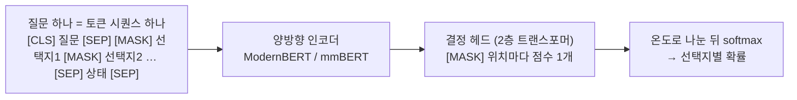
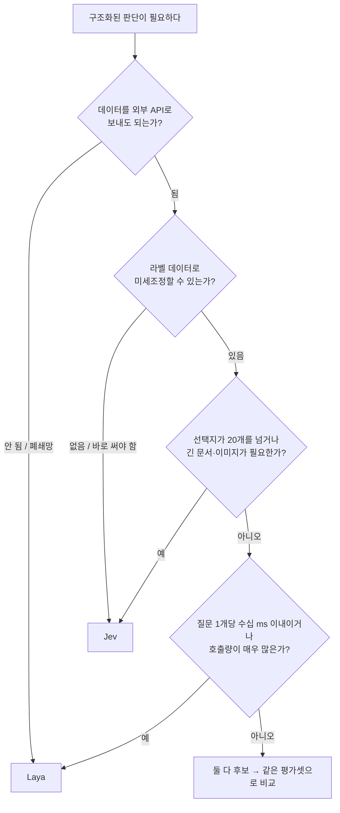

> [!summary] 요약
> **Laya**는 Convai Innovations가 공개한 **오픈 가중치 결정 모델**입니다. [[Jev]]와 같은 질문 형식(`choice`·`score`·`noul`)과 같은 HTTP API(`POST /v1/systemone`)를 쓰지만, **내 서버에서 직접 돌린다**는 점이 가장 큰 차이입니다.
> - **Jev**: 미리 학습된 상태로 바로 쓸 수 있는(zero-shot) **호스팅 API**입니다. 선택지가 많아도 강하고, 따로 학습할 필요가 없습니다.
> - **Laya**: Apache-2.0 라이선스의 421M·322M 파라미터 **인코더 모델**입니다. 빠르고 무료이며 사내 서버에 둘 수 있습니다. 대신 **내 데이터로 미세조정해야 제 성능이 나옵니다.**
> - 한 줄로 정리하면, **바로 쓰려면 Jev, 데이터가 밖으로 나가면 안 되거나 내 데이터로 학습시킬 수 있으면 Laya**입니다.

---

## 1. Laya란?

### 1.1 개요

Laya는 [[Jev]]가 처음 내세운 **System One(시스템 1) 결정 모델**의 오픈소스 버전에 해당합니다. 문서·이메일·티켓·JSON 같은 상태(state)와 타입이 정해진 질문을 받아, **텍스트를 생성하지 않고 인코더의 순전파(forward pass) 한 번**으로 선택지별 확률을 돌려줍니다.

- **만든 곳**: Convai Innovations (저자 Nandha Kishor M)
- **배경**: 저자는 2025년 영업 대화의 전환 확률을 강화학습으로 예측한 연구([arXiv:2503.23303](https://arxiv.org/abs/2503.23303))와, 스키마 기반 RL 프레임워크 후속 연구([arXiv:2510.01237](https://arxiv.org/abs/2510.01237))를 바탕으로 만들었다고 밝힙니다. Jev가 나온 뒤에는 "비슷한 것을 1년 전에 만들었다"는 글과 함께 Jev의 오픈 대안으로 공개했습니다.
- **라이선스**: Apache-2.0. 가중치(safetensors), 미세조정 노트북, 평가 코드가 모두 공개되어 개인·상업 용도로 쓸 수 있습니다.
- **저자 스스로의 정의**: "a fast base to specialise, not a zero-shot decision engine". 바로 쓰는 판단 엔진이 아니라 **특화시키기 위한 빠른 기반 모델**이라는 뜻입니다.

### 1.2 질문 유형

Jev와 이름과 의미가 같습니다. 각 유형의 자세한 설명은 [[Jev#2.2 질문(Question)과 프리미티브]]를 참고하세요.

| 유형 | 설명 | 답 |
|---|---|---|
| `choice` | 선택지 중 하나 고르기 | 선택지, 확률 분포, 신뢰도 |
| `score` | 순서 있는 등급에 위치 매기기 | 기대 등급, 등급별 분포, 신뢰도 |
| `noul` | 예/아니오 명제가 참일 확률 | P(true) |

Jev의 `Box`(이미지 속 위치 찾기)에 해당하는 기능은 없습니다. Laya는 **텍스트 전용**입니다.

### 1.3 구조



- **선택지마다 `[MASK]` 토큰**을 하나씩 붙이고, 그 위치의 은닉 상태를 점수로 바꿉니다. 선택지는 요청할 때 정해지므로 **새 스키마에도 재학습이 필요 없습니다.**
- 한 요청의 질문들은 각각 한 행이 되어 **한 배치로 묶여** 처리됩니다. Jev처럼 질문끼리 서로의 답을 보지 않습니다.
- **학습 방식(RLCD)**: Jev와 같은 이름의 방법을 씁니다. 교차 엔트로피 대신 **엄격한 적정 점수 규칙**(strictly proper scoring rule: 로그·구면 점수, RPS)을 보상으로 하는 강화학습(GRPO 방식 REINFORCE)입니다. 확률을 정직하게 보고해야 보상이 최대가 되도록 설계했습니다.

| 체크포인트 | 인코더 | 파라미터 | 컨텍스트 | 용도 |
|---|---|---|---|---|
| `laya` | ModernBERT-large | 421M | 512 | 영어 분류·가드레일·이메일 분류 |
| `laya-multilingual` | mmBERT-base | 322M | 1,024 (최대 8,192) | 100개 이상 언어, 영어 체크포인트보다 빠름 |
| `laya-typed-decisions` | ModernBERT-large | 421M | 1,024 | 4가지 업무 흐름(에이전트 관측, 고객지원, 송장, 보안 알림)에 미세조정한 모델 |

- **`Router`**: 요청이 들어오면 문자 체계와 언어를 1ms 이내로 감지해 체크포인트를 자동으로 고릅니다. 영어 체크포인트는 비라틴 문자에서 **틀리면서도 높은 신뢰도**를 내기 때문입니다. 예를 들어 크메르어에서는 정확도 0.000에 원시 신뢰도 0.952가 나왔습니다. 그래서 순전파 전에 라우팅을 해야 합니다.

### 1.4 사용법

```bash
pip install laya              # Python 3.10 이상
pip install "laya[serve]"     # HTTP 서버 (fastapi + uvicorn)
# 그 밖의 extra: laya[mcp], laya[langchain], laya[llamaindex], laya[crewai], laya[onnx], laya[structured]
```

```python
from laya import Router

router = Router()   # 처음 쓸 때 체크포인트를 내려받음. 서버에서는 Router(preload=True) 권장

state = "Hi, we were billed twice for March. Please refund the duplicate today or we will cancel our plan."
questions = {
    "department": {"type": "choice", "instructions": "Which department should handle this?",
                   "criteria": {"billing": "invoices, payments, refunds",
                                "technical": "bugs, outages, system errors",
                                "other": "everything else"}},
    "urgency": {"type": "score", "instructions": "How urgent is this?",
                "criteria": ["not urgent", "soon", "blocking"]},
    "churn_risk": {"type": "noul", "instructions": "Does the user threaten to cancel or leave?",
                   # Laya의 noul은 criteria(true/false)를 꼭 주는 편이 안전 — 아래 한계 참고
                   "criteria": {"true": "the user threatens to cancel", "false": "no threat to cancel"}},
}

result = router.predict(state, questions)
print(result["answers"]["department"]["choice"])   # billing
print(result["answers"]["churn_risk"]["noul"])     # P(true)
print(result["routing"]["model"])                  # english — 어떤 체크포인트가 답했는지
```

Jev SDK는 `response.answers["id"].choice`처럼 **객체 속성**으로 답을 꺼내고, Laya는 `result["answers"]["id"]["choice"]`처럼 **딕셔너리**로 꺼냅니다. 질문을 정의하는 형식은 Jev의 HTTP JSON 형식과 같습니다.

```bash
# CLI
laya "My payment failed twice" --preset triage    # 미리 만든 질문 세트: triage, email, guard, moderation, router

# HTTP 서버 — Jev와 같은 POST /v1/systemone 형식
LAYA_DEVICE=cuda LAYA_PRELOAD=1 LAYA_API_KEY=... laya-serve   # 0.0.0.0:8000
```

> [!warning] laya-serve 인증
> `laya-serve`는 `0.0.0.0`에 바인딩되고, `LAYA_API_KEY`를 설정하지 않으면 **인증이 없습니다.** 외부에 노출할 때는 반드시 키를 설정합니다.

- **그 밖의 기능**
  - `predict_batch`: 여러 상태를 한 번에 처리
  - `predict_long`: 긴 문서를 창(window)으로 나눠 처리
  - `decide`: JSON 스키마나 pydantic 모델 모양으로 결과 반환
  - `min_confidence`: 신뢰도가 기준 미만이면 답을 보류(abstention)
- **연동**: LangChain/[[langgraph-and-multiturn-routing|LangGraph]]용 `LayaRouter`·`LayaGuardrail`·`LayaDecision`, MCP 서버, TypeScript 클라이언트(`laya-client`), 브라우저·Node 추론용 `laya-ts`(ONNX)를 제공합니다.
- **커뮤니티 포트**: Apple GPU용 Laya-MLX, Neural Engine용 Laya-CoreML, 로컬 서버 Ollaya, Ascend NPU용 포트가 있습니다.

### 1.5 미세조정

- **방법**: Kaggle 2×T4 노트북 하나로 데이터셋 구성 → RLCD 학습 → 온도 보정 → 평가 → Hugging Face 업로드까지 진행합니다. 약 3만 개 질문, 4 epoch 기준 4~5시간이 걸립니다. Apple Silicon(MPS)용 스크립트도 있습니다.
- **효과 1**: typed-decisions 벤치마크에서 기본 체크포인트의 정확도는 0.362(무작위 0.318)였지만, 미세조정 후 **0.766**까지 올랐습니다.
- **효과 2**: 커뮤니티 사례로, 16GB GPU 한 장에서 브라우저 에이전트용 헤드를 학습시켜 요소 선택 정확도를 0.10에서 0.66으로, 작업 성공률을 0%에서 62%로 올렸습니다. 한 단계당 17~23ms였습니다.

---

## 2. Jev와의 차이점

### 2.1 한눈에 비교

| 항목 | [[Jev]] | Laya |
|---|---|---|
| 만든 곳 | TypeSafe | Convai Innovations |
| 공개 범위 | 가중치 비공개, **호스팅 API만** | **가중치·학습·평가 코드 공개** (Apache-2.0) |
| 구조 | 비공개 (자체 아키텍처 + 병렬 샘플러) | 양방향 인코더(ModernBERT/mmBERT) + 결정 헤드 |
| 모델 크기 | 비공개 | 421M / 322M |
| 실행 위치 | TypeSafe 클라우드 | 로컬·사내 서버·폐쇄망, CPU·Apple·NPU도 가능 |
| 비용 | 입력 100만 토큰당 $0.042, 출력 무료 | 토큰 비용 없음 (서버·GPU 비용만) |
| 응답 시간 (질문 1개, p50) | 236~276ms (제3자 측정) / 문서상 대부분 약 100ms | **32.8~39.5ms** (T4 GPU, 저자 측정). CPU에서는 193~580ms |
| 바로 쓰기(zero-shot) | **바로 쓸 수 있음** | 기본 체크포인트는 무작위에 가까움 → **미세조정 전제** |
| 선택지 개수 | **최대 255개** | 약 20개를 넘으면 정확도 급락, HTTP 서버는 100개로 제한 |
| 컨텍스트 | 64k (Long-Context 헤더로 262k) | 512~1,024 토큰 (다국어는 최대 8k). 약 4,000토큰을 넘으면 불안정 |
| 질문 유형 | Noul·Choice·Score + **Box(이미지, 미리보기)** | noul·choice·score (텍스트만) |
| 언어 | 영어 위주, 다른 언어는 정확도 낮음 | 영어·다국어 체크포인트를 Router가 자동 선택 |
| 신뢰도 | `confidence` (분포의 뾰족함) | `confidence`는 Jev와 계산식이 다름. 판정에는 `answer_confidence` 사용 |
| API 호환 | `POST /v1/systemone` | `laya-serve`가 같은 형식 구현 → **Jev 클라이언트를 그대로 연결 가능** |
| 생태계 | 공식 SDK(Python·JS), Claude Code 스킬, 쿡북 | LangChain·LlamaIndex·CrewAI·MCP 연동, CLI 프리셋, 커뮤니티 포트 |

### 2.2 벤치마크 비교

Laya 저자가 공개한 비교입니다. (Jev 1.13.0 기준, 2026-10-23 확인)

| 데이터셋 | Jev | Laya | 비고 |
|---|---|---|---|
| typed-decisions (결정 2,000개) | 0.727 | **0.766** | Laya는 이 벤치마크의 학습 데이터로 **미세조정한** 체크포인트. 기본 체크포인트는 0.362 |
| AG News (레이블 4개) | 0.910 | **0.950** | |
| DAIR Emotion (레이블 6개) | 0.480 | **0.595** | |
| Banking77 (레이블 77개) | **0.870** | 0.425 | 선택지가 많으면 Laya가 크게 약함 (토너먼트 방식으로 0.610까지 개선) |
| ECE, 보정 오차 (낮을수록 좋음) | 0.246 | **0.081** | Laya는 **온도 보정 후** 값. 보정 전은 0.466 |
| 소프트 정확도 (교사 분포와 비교) | **0.580** | 0.471 | 미세조정 체크포인트끼리 비교 |

> [!warning] 수치를 그대로 믿기 어려운 이유
> - **같은 조건이 아닙니다.** Laya 수치는 저자가 직접 측정했고, Jev 수치는 일부가 제3자 측정입니다. 저자도 표본 크기와 프롬프트가 다를 수 있다고 밝힙니다.
> - **Laya에 유리한 비교입니다.** Laya가 앞선 typed-decisions 결과는 "미세조정한 Laya 대 미세조정 없는 Jev"의 비교이고, ECE도 Laya만 온도 보정을 거친 값입니다. 보정 전 원시 보정도는 Jev가 더 좋습니다.
> - **출처 글도 확인이 필요합니다.** 파이토치 한국 사용자 모임 글은 GPT로 정리한 초안을 바탕으로 했다고 밝히고 있어, 세부 수치는 원본 README와 BENCHMARKS.md로 확인해야 합니다.
> - 이 노트는 위 수치를 **직접 재현하지 않았습니다.**

### 2.3 한국어

| 모델 | 한국어 관련 정보 |
|---|---|
| Jev | 영어 위주로 학습. 한국어를 포함한 CJK 언어는 처리하지만 정확도가 낮다고 공식 문서에 명시. 한국어 수치는 공개되지 않음 |
| Laya | 한국어 정확도 `laya` **0.110**, `laya-multilingual` **0.450** (파이토치 한국 사용자 모임 글 기준). 자체 데이터로 **미세조정과 온도 보정이 전제** |

두 모델 모두 **한국어 서비스에 바로 넣을 수준은 아니고**, 내 데이터로 먼저 측정해야 합니다. 다만 Laya는 미세조정으로 개선할 수 있고, Jev는 사용자가 학습시킬 방법이 없습니다.

### 2.4 Laya의 알려진 약점

Jev의 약점은 [[Jev#6. 한계와 주의점]]에 정리되어 있습니다. 여기서는 Laya에만 해당하는 것을 모았습니다.

| 약점 | 내용 | 대응 |
|---|---|---|
| `noul` 레이블 편향 | `criteria` 없이 쓰면 영어 체크포인트는 입력과 상관없이 "아니오"로 답함. 기본 `true:`/`false:` 문구에 끌려감 | `criteria`(true/false)를 꼭 주고, `labels`로 모델에 보이는 이름을 `A`/`B`로 바꿈 |
| 예/아니오 단어 레이블 | 선택지 키가 `yes`/`no`·`true`/`false`면 내용 대신 키 단어를 따라감 | 의미 있는 키나 `A`/`B` 같은 중립적인 키 사용 |
| 부정문 | "해지하지 않겠다" 같은 부정 요청에도 `cancel_account`를 고른 사례 | 경계 사례를 직접 테스트 |
| 많은 선택지 | 선택지가 토큰 예산(192/256)을 나눠 써서, 많아지면 상태가 잘림 | 20개 이하 유지, `predict_shortlist`(임베딩으로 후보 20개 추림), `predict_tournament` |
| `score` 위치 편향 | 다국어 체크포인트가 첫 번째 등급을 거의 고르지 않음 | 영어 score 질문은 `model="english"`로 지정 |
| 과신 | 기본 체크포인트의 신뢰도가 실제 정확도보다 높음. 다국어 체크포인트는 온도 보정값이 없음 | 내 검증 데이터로 온도 보정 후 임계값 설정 |
| 학습 분포 밖 | 탈옥 탐지 0.708~0.762, 유해성 중재 0.530 | 해당 영역 데이터로 미세조정 |

---

## 3. 언제 무엇을 쓸까



### 3.1 Jev가 좋은 경우

- **라벨 데이터가 없고 바로 써야 할 때**: 질문만 잘 쓰면 바로 쓸 만한 정확도가 나옵니다. Laya 기본 체크포인트는 같은 조건에서 무작위에 가깝습니다.
- **선택지가 많을 때**: 의도 분류처럼 선택지가 수십~255개인 경우입니다. Banking77에서 0.870 대 0.425로 차이가 큽니다.
- **긴 상태를 넣어야 할 때**: 64k(최대 262k) 토큰까지 넣을 수 있습니다. 정책 문서와 대화 기록, 주문 내역을 한 상태에 넣는 경우가 여기에 해당합니다.
- **이미지 판단이 필요할 때**: `Box`와 이미지 상태를 지원합니다. 다만 아직 미리보기 단계입니다.
- **운영 부담을 지기 싫을 때**: GPU 서버, 모델 버전 관리, 온도 보정을 직접 하지 않아도 됩니다.
- **프로토타입 단계**: 쿡북과 패턴 문서가 풍부합니다. Claude Code 스킬로 연동 코드를 빠르게 만들 수 있습니다. ([[Jev#7. 코딩 에이전트와 함께 쓰기]])

### 3.2 Laya가 좋은 경우

- **데이터가 밖으로 나가면 안 될 때**: 사내 문서, 개인정보, 폐쇄망 환경이 여기에 해당합니다. 가중치를 받아 사내 서버에서 돌립니다.
- **라벨 데이터가 있고 특정 업무에 특화시키고 싶을 때**: 미세조정으로 내 업무에 맞출 수 있습니다. typed-decisions에서는 미세조정 후 Jev보다 높게 나왔습니다.
- **지연 시간이 매우 중요할 때**: GPU에서 질문 1개당 약 33~40ms라 실시간 UI, 게임, 에이전트의 매 단계 판단에 쓸 수 있습니다.
- **호출량이 많을 때**: 토큰 비용이 없으므로 대량 문서 분류나 로그·트레이스 분류처럼 호출이 많을수록 유리합니다.
- **선택지가 적은 분류**: 스팸·피싱 탐지, 부서 분류, 감정 분류처럼 선택지가 20개 이하인 경우입니다. 저자 측정으로 Enron 스팸 0.993, 피싱 0.980이 나왔습니다.
- **LangChain·LangGraph 파이프라인에 바로 넣고 싶을 때**: `LayaGuardrail`, `LayaRouter` 노드를 제공합니다.
- **Jev로 프로토타입을 만든 뒤 자체 호스팅으로 옮길 때**: 같은 `/v1/systemone` 형식이라 클라이언트 코드를 거의 바꾸지 않아도 됩니다.

### 3.3 함께 쓰는 방법

두 모델의 API 형식이 같으므로 다음과 같이 단계적으로 쓸 수 있습니다.

1. **Jev로 시작**: 질문 설계와 임계값을 검증하고, 응답을 기록해 둡니다.
2. **라벨 데이터로 쓰기**: 쌓인 답 중 사람이 확인한 것을 Laya 미세조정 데이터로 씁니다. 이때 Jev 답을 그대로 쓰면 Jev의 오류까지 학습하므로 검수가 필요합니다.
3. **Laya로 옮기기**: 미세조정한 Laya를 `laya-serve`로 띄우고, **같은 평가셋**으로 Jev와 비교합니다. 성능이 비슷하면 엔드포인트만 바꿉니다.
4. **어려운 경우는 Jev로 넘기기**: Laya의 신뢰도가 낮은 경우만 Jev나 LLM으로 보냅니다. 이는 Jev 쿡북의 SDE cascade와 같은 구조입니다.

비교·평가 방법은 [[llm-model-change-evaluation|LLM 모델 교체 평가]]를 참고합니다.

---
##### 참조
[Laya 공식 사이트 (Convai Innovations)](https://laya.convaiinnovations.com/) / [Laya 문서](https://nandhakishorm.github.io/laya/) / [GitHub: NandhaKishorM/laya](https://github.com/NandhaKishorM/laya) / [BENCHMARKS.md](https://github.com/NandhaKishorM/laya/blob/main/BENCHMARKS.md)
[Hugging Face 체크포인트](https://huggingface.co/convaiinnovations/laya) / [웹 데모](https://huggingface.co/spaces/convaiinnovations/laya-demo) / [미세조정 노트북 (Kaggle 2×T4)](https://github.com/NandhaKishorM/laya/blob/main/notebooks/laya_finetune_typed_decisions_2xT4_kaggle.ipynb)
[파이토치 한국 사용자 모임: Laya 소개 (Jev 비교)](https://discuss.pytorch.kr/t/laya-jev/12027) / [저자 개발기 (dev.to)](https://dev.to/nandakishor_m_6cc0adfde9f/i-built-non-autoregressive-decision-models-a-year-ago-then-a-frontier-lab-called-it-a-18me)
[arXiv:2503.23303](https://arxiv.org/abs/2503.23303) / [arXiv:2510.01237](https://arxiv.org/abs/2510.01237)
Jev 쪽 출처는 [[Jev]] 글의 참조 섹션을 참고하세요.

##### 관련 글
- [[Jev]] — 비교 대상인 TypeSafe의 호스팅 System One 모델 (개념·문법·패턴 정리)
- [[langgraph-and-multiturn-routing|LangGraph 핵심 개념과 멀티턴 대화 설계]] — Laya가 `LayaGuardrail`·`LayaRouter` 노드를 제공하는 프레임워크
- [[서브에이전트를 메인 에이전트 루프로 합치기]] — 소형 모델에서 선택지가 많을 때의 계층 라우팅
- [[llm-model-change-evaluation|LLM 모델 교체 평가]] — Jev에서 Laya로 옮길 때 같은 평가셋으로 비교하는 방법
