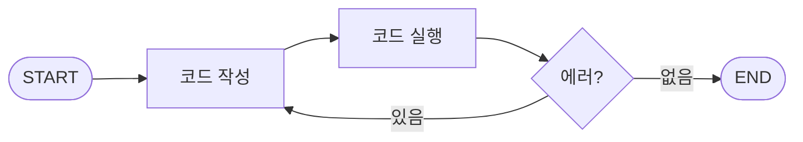

## LangGraph 한 줄 요약

LangGraph는 LLM 애플리케이션의 실행 흐름을 **그래프(노드 + 엣지)로 선언하고 실행**하는 프레임워크입니다. LLM은 기본적으로 1회성 답변만 하지만, LangGraph는 상태(State)로 지금까지 한 일을 기억하게 하고, 조건부 엣지로 다음 행동을 정하게 해 줍니다. 그래서 흔히 시스템의 "지휘자"이자 "기억 장치"라고 부릅니다.

## 핵심 개념

### 1. State: 모든 노드가 공유하는 바구니

그래프 전체가 공유하는 데이터입니다. 각 노드는 State를 읽고, 자기가 처리한 결과를 State에 더합니다. 계주에서 배턴을 넘기는데 배턴 안에 지금까지의 정보가 계속 쌓이는 느낌입니다.

```python
class AgentState(TypedDict, total=False):
    query: str
    messages: list
    is_in_scope: bool       # guardrail 노드가 채움
    selected_tools: list    # router 노드가 채움
    tool_results: list      # tool_executor 노드가 채움
```

### 2. Node: 한 단계 = 하나의 함수

State를 받아 일부 필드를 갱신한 dict를 반환하는 함수입니다. 예를 들어 `guardrail`(안전성·범위 검사) → `router`(도구 사용 판단) → `param_generator`(도구 호출 인자 생성) → `tool_executor`(실행)처럼, 각 노드는 자기 역할만 하고 끝납니다.

### 3. Edge: 노드 간 연결

- **일반 엣지**: A가 끝나면 무조건 B로
- **조건부 엣지**: A가 끝나면 State를 보고 다음 노드를 결정. if/else를 코드 안이 아니라 **그래프 구조로** 표현하는 것이 핵심입니다.

```python
def route_after_router(state: AgentState) -> str:
    if state.get("is_in_scope") is False:
        return "skip_tools"
    return "use_tools"

graph = StateGraph(AgentState)
graph.add_node("guardrail", guardrail_fn)
graph.add_node("router", router_fn)
graph.add_conditional_edges("router", route_after_router, {
    "skip_tools": "respond",
    "use_tools": "param_generator",
})
workflow = graph.compile()
```

`START`와 `END`는 그래프의 시작점과 종료점을 나타내는 특수 마커입니다. 라우팅 함수가 `END`를 반환하면 실행이 거기서 끝납니다.

### 4. StateGraph와 compile()

`StateGraph(AgentState)`로 "이 그래프는 이런 모양의 상태를 다룬다"고 선언하고, 노드와 엣지를 모두 등록한 뒤 `.compile()`하면 실행 가능한 객체가 나옵니다.

### 5. 실행과 스트리밍

`invoke()`는 끝난 뒤 최종 결과만 주지만, `astream(state, stream_mode="updates")`는 노드가 하나 끝날 때마다 바뀐 State 조각을 이벤트로 흘려보냅니다. 이걸 SSE로 프론트엔드에 보내면 "안전성 검사 통과", "도구 실행 중" 같은 진행 상황을 실시간으로 보여줄 수 있습니다.

> [!tip] 응답 생성은 그래프 밖에 둘 수도 있다
> 최종 답변의 토큰 스트리밍까지 그래프 노드 안에서 처리하지 않고, 그래프는 "어떤 근거로 무엇을 답할지"까지만 정한 뒤 실제 생성은 바깥 서비스 레이어에서 하는 구조도 가능합니다. 스트리밍 호환성을 다루기가 더 쉬워집니다.

### 6. 체크포인터

`MemorySaver`나 `PostgresSaver` 같은 체크포인터를 붙이면 실행 상태를 자동으로 저장했다가 다음 요청에서 대화 맥락을 복원할 수 있습니다. 반대로 대화 기록을 이미 자체 DB에 저장하고 있다면, 매 요청마다 히스토리를 조회해 초기 State에 직접 넣는 방식도 가능합니다. 이 경우 "어떤 범위의 히스토리를 얼마나 넣을지"를 직접 설계해야 합니다.

## 순환 구조: 자가 수정 에이전트

조건부 엣지로 이전 노드로 되돌아가면 루프를 만들 수 있습니다. 코드를 짜고, 실행하고, 에러가 나면 다시 짜는 에이전트가 대표적인 예입니다.



1. State를 `{user_requirement, code, error_message, iteration_count}`로 정의합니다.
2. 작성 노드가 요구사항을 읽고 코드를 만들어 `code`에 저장합니다.
3. 실행 노드가 격리된 환경에서 코드를 돌리고, 에러가 나면 `error_message`를 기록하고 `iteration_count`를 올립니다.
4. 조건부 엣지가 `error_message`를 보고 작성 노드로 되돌립니다.
5. 작성 노드는 이번엔 이전 `code`와 `error_message`까지 받아서 "아까 이 부분에서 에러가 났구나"를 보고 고칩니다.
6. 에러가 없으면 `END`로 갑니다.

반복 횟수를 State에 두고 최대치를 넘으면 멈추게 하는 **안전장치(max iterations)** 는 비용과 무한 루프를 막기 위해 꼭 필요합니다.

## 멀티턴 대화에서 생각할 것

**싱글턴**은 질문 하나에 답 하나로 끝나는 대화입니다. **멀티턴**은 대화가 여러 차례 이어지고, LLM이 되묻기도 하고, 사용자가 이전 답을 참조하거나 중간에 주제를 바꿉니다. 그래서 LLM이 대화의 맥락을 이해하고 있어야 합니다.

RAG와 결합하면 고민이 하나 더 생깁니다. **대화 맥락이 바뀌었을 때 그걸 알아차리고 새 소스를 검색해야** 합니다. 멀티턴에서 RAG를 잘 쓰면 다음을 얻을 수 있습니다.

- 대화의 맥락 유지
- 이미 찾은 정보의 중복 처리 최소화
- 사용자 질문의 의도 파악

LangGraph로 이걸 설계한다면, 매 턴 "이 질문이 이전 대화를 이어 가는 것인지, 새 주제인지"를 판단하는 단계가 필요합니다. 이 판단을 잘못하면 새 주제인데 예전 히스토리를 끌고 와서 답이 오염되고, 반대로 후속 질문인데 맥락을 버려서 엉뚱한 검색을 하게 됩니다.

> [!tip] 멀티턴 그래프를 설계할 때 체크리스트
> - **병렬 노드 사이에는 정보 의존성이 없어야** 한다. 한 노드의 판단이 다른 노드의 결과를 필요로 한다면, 그 판단은 두 결과가 모두 모인 뒤로 옮긴다.
> - 분기마다 **테스트 문장 표**를 만든다. 단독 턴, 후속 질문, 주제 전환처럼 상태별로 입력과 기대 분기를 적어 두면 회귀 확인이 빨라진다.
> - 명확한 패턴은 규칙으로 먼저 거르고, 애매한 경우만 LLM 라우터에 맡기면 비용과 지연이 줄고 테스트도 쉬워진다.

## 정리

LangGraph는 State·Node·조건부 Edge·스트리밍만 이해해도 대부분의 에이전트 흐름을 표현할 수 있습니다. 어려운 건 프레임워크가 아니라 **멀티턴에서 어떤 정보를 언제 알 수 있는지**를 설계하는 일이라고 생각합니다. 이런 그래프를 관측하는 방법은 [[langfuse-tracing-users-scores]]에 정리했습니다.

##### 참조
- [위키독스 - LangGraph](https://wikidocs.net/293297)
