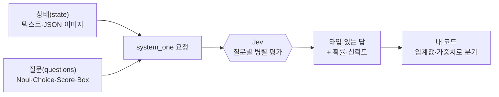
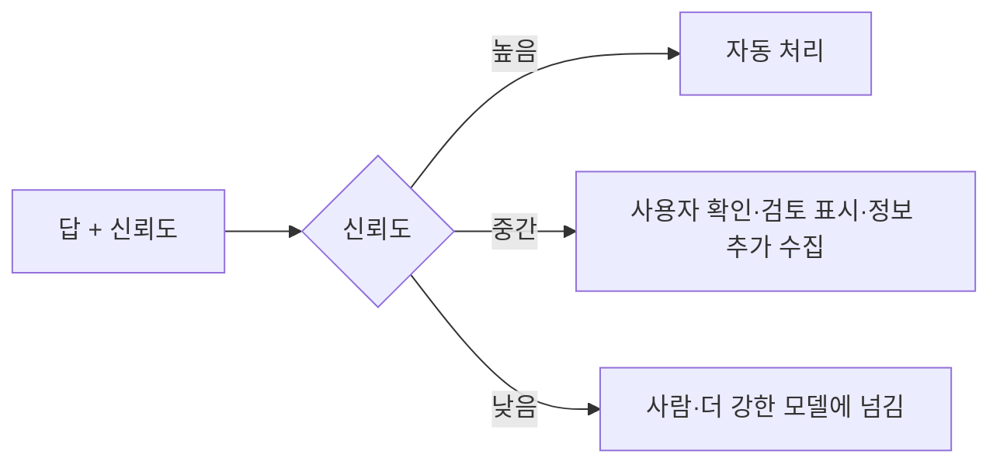
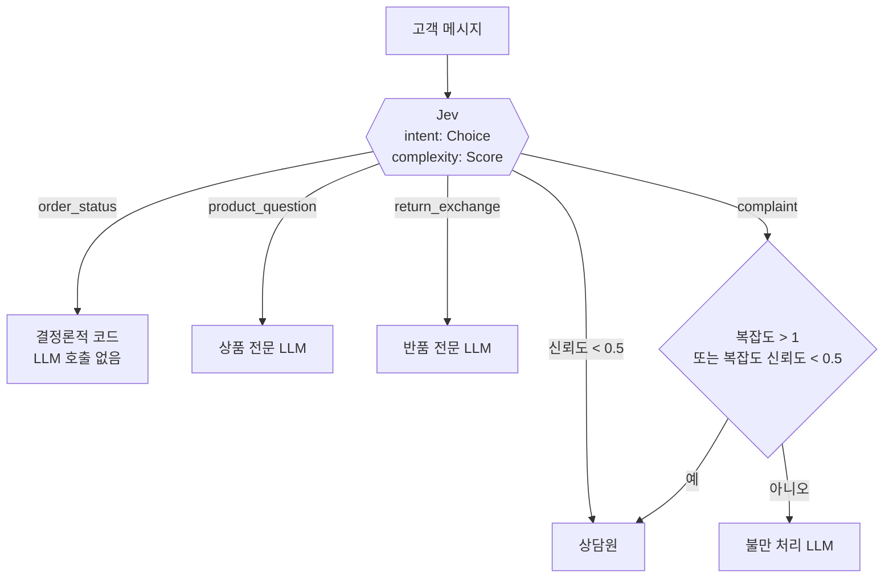

> [!summary] 요약
> **Jev**는 TypeSafe가 만든 첫 번째 **System One 모델**입니다. 채팅 모델처럼 글을 써 주는 대신, 코드가 넘긴 **상태(state)** 에 대해 미리 정해 둔 **질문(question)** 에만 답하고, 결과를 **타입이 정해진 값과 확률**로 돌려줍니다.
> - 질문 유형은 `Noul`(예/아니오 확률), `Choice`(선택지 중 하나), `Score`(순서 있는 등급), `Box`(이미지 속 위치, 미리보기)입니다.
> - 질문은 모두 **병렬·독립**으로 평가되므로, 한 번에 여러 개를 물어도 응답 시간이 거의 늘지 않습니다.
> - 흐름 제어는 **코드가 맡고**, Jev는 "이 문의가 환불 요청인가?" 같은 **좁은 판단**만 맡는 구조로 씁니다.



---

## 1. Jev란?

### 1.1 System One 모델이라는 개념

이름은 대니얼 카너먼의 『생각에 관한 생각(Thinking, Fast and Slow)』에서 따왔습니다. 사람의 사고를 빠르고 직관적인 **시스템 1**과 느리고 숙고하는 **시스템 2**로 나누는데, Jev는 시스템 1처럼 **빠른 직관 판단**만 하도록 만든 모델입니다.

LLM은 사람이 읽을 글을 만들도록 설계되었습니다. 그래서 코드가 판단 결과를 받아 쓰려면 "JSON으로 답해 줘"라고 시킨 뒤 다시 파싱해야 합니다. Jev는 이 과정을 없애고, **답의 형태를 처음부터 정해 둔 채** 값과 확률만 돌려줍니다. TypeSafe는 이를 "프런티어급 지능을 가진 함수 호출"이라고 표현합니다.

| 구분 | 기존 LLM | System One 모델 (Jev) |
|---|---|---|
| 출력 | 자유 형식 텍스트 → 파싱·검증 필요 | 타입이 정해진 값 + 확률 |
| 입력 | 순서대로 쌓이는 메시지(대화) | 구조화된 프로그램 상태(JSON 등) |
| 생성 방식 | 토큰을 하나씩 생성 | 모든 답을 한 번의 병렬 질의로 계산 |
| 학습 목표 | RLHF/RLVR (선호도·검증 가능한 정답) | RLCD (보정된 결정, Reinforcement Learning for Calibrated Decisions) |
| 확신도 | 보정되지 않음 | 보정됨: 확신이 높을수록 정확도도 높게 학습 |
| 못 하는 것 | — | 글·코드 생성, 대화, 추론 과정 설명 |
| 어울리는 일 | 챗봇, 코파일럿, 코딩 에이전트 | 분류, 라우팅, 점수화, 검증·가드레일, 대량 데이터 처리, 실시간 판단 |

> [!note] 보정(Calibration)이란?
> "확률 0.8이라고 답한 것들을 모아 보면 실제로 약 80%가 맞는다"는 성질입니다. 다만 이는 **여러 예측을 묶었을 때의 성질**이므로, 답 하나하나가 맞는다는 보장은 아닙니다.

### 1.2 속도와 비용

TypeSafe 블로그와 Models 문서에서 밝힌 수치입니다. (2026-10-23 기준)

| 항목 | 기존 LLM | Jev |
|---|---|---|
| 입력 비용 | 100만 토큰당 $0.20~$10 | 100만 토큰당 **$0.042** |
| 출력 비용 | 입력의 약 5배 | **무료** |
| 응답 시간 | 3~329초 | **70~500ms** (대부분 약 100ms) |

> [!warning] 회사가 직접 밝힌 수치입니다
> "193.6배 빠르고 444.6배 저렴하다"는 홈페이지 수치는 TypeSafe가 직접 만든 **워크플로우 평가(Workflow evals)** 에서 나왔습니다. 블로그도 기준 답(GPT-6 Astra와 Fable 5.1의 평균)과 워크플로우를 자기 팀이 정했다는 점, 비교 데모 입력을 자사에 유리하게 골랐다는 점을 인정합니다. 공개 벤치마크 결과는 없습니다. "환각 0%"도 실험 결과가 아니라, **정해진 선택지 밖의 답은 나올 수 없다**는 구조상의 의미입니다. 정확도는 [[#6. 한계와 주의점|한계]]를 참고하세요.

### 1.3 모델과 가격

| 모델 ID | 별칭 | 입력 가격 | 컨텍스트 (요청 전체 / 질문 하나) | 비고 |
|---|---|---|---|---|
| `jev-1.13.0` | `jev-latest` (SDK 기본값) | $0.042 / Mtok | 64k / 32k | 최신 안정판 |
| `jev-1.14.0` | `jev-preview` | $0.042 / Mtok | 64k / 32k | 2026-10-14 공개, 이미지·`Box` 지원 |

- 출력 토큰은 무료이고, 입력 토큰에만 과금합니다.
- **컨텍스트 제한**은 두 가지입니다. 상태와 질문 전체를 합쳐 64k를 넘으면 안 되고, 상태와 질문 하나를 합쳐 32k를 넘어도 안 됩니다. 이 범위 안이라면 질문 개수 제한은 없습니다.
- `TypeSafe-Danger-Zone-Long-Context: true` 헤더를 보내면 두 제한이 모두 262k로 늘어납니다. 가격은 같지만 느려지고 정확도가 떨어집니다.
- 별칭(`jev-latest` 등)은 새 버전이 나오면 가리키는 모델이 바뀝니다. 신뢰도 임계값을 특정 버전에 맞춰 조정했다면 버전 ID를 고정하세요.
- 요청 한도(토큰/초, 요청/초)를 넘으면 `429`를 돌려줍니다. SDK는 `retry-after` 헤더를 따라 자동으로 재시도합니다.

### 1.4 언제 쓰고, 언제 쓰지 않나

| 쓰면 좋은 경우 | 쓰지 않는 경우 |
|---|---|
| 코드가 바로 쓸 수 있는 빠른 판단이 필요할 때 (라우팅·분류·점수) | 문장·코드·설명을 만들어야 할 때 → LLM 사용 |
| 같은 내용에 대해 독립적인 질문을 여러 개 하고 싶을 때 | 여러 단계를 거쳐 추론해야 할 때 → 질문을 쪼개거나 LLM 사용 |
| 확신도에 따라 자동 처리할지 사람에게 넘길지 정하고 싶을 때 | 계산·날짜 비교 → 코드로 처리 |
| 깨지기 쉬운 "JSON으로 답해" 프롬프트를 타입 있는 값으로 바꾸고 싶을 때 | 코딩 에이전트의 모델을 바꾸려 할 때 → 불가능 ([[#7. 코딩 에이전트와 함께 쓰기]]) |

---

## 2. 핵심 개념

### 2.1 상태(State)

Jev가 평가할 **내용**입니다. 요청의 `state` 필드로 보냅니다.

| 형식 | 쓰임 | 예 |
|---|---|---|
| 문자열 | 메시지·글 한 개 | `"카드가 두 번 결제됐어요."` |
| 객체(JSON) | 이름 붙은 필드, 서로 관련된 레코드 | `{"message": "...", "order_id": "A-104"}` |
| 배열 | 순서 있는 메시지·레코드 목록 | 고객 메시지 목록 |
| 이미지 | `jev-1.14` 미리보기 기능 | [[#3.7 Box와 이미지 (미리보기)]] |

- **대부분 객체를 권장**합니다. 필드 이름이 있으면 각 부분의 의미와 관계가 분명해집니다.
- **판단에 필요한 정보는 한 상태에 모읍니다.** 예: 문의 내용 + 주문 내역 + 환불 정책.
- **사실은 상태에, 판단은 질문에** 둡니다. 정책 문서는 상태에 넣고, "정책상 환불이 가능한가?"는 질문으로 묻습니다.
- **필요한 것만 넣습니다.** 관련 없는 내용이 많으면 정확도가 떨어집니다. 모델이 원래 알고 있는 지식보다 내 데이터를 넣어 주는 편이 낫습니다.

### 2.2 질문(Question)과 프리미티브

질문 하나는 상태에 대한 **판단 하나**입니다. 모든 질문에는 다음 항목이 있습니다.

| 항목 | 설명 |
|---|---|
| **ID** | 답을 꺼낼 때 쓰는 내 키입니다. **모델에는 보내지 않습니다.** |
| `type` | `noul`, `choice`, `score`, `box` 중 하나 |
| `instructions` | 상태에 대한 질문이나 판단할 문장. 문자열·객체·배열 모두 가능 |
| `criteria` | Choice는 선택지, Score는 순서 있는 등급, Noul은 (선택) 예/아니오 기준, Box는 없음 |

| 유형 | 묻는 것 | 답 필드 | 이럴 때 |
|---|---|---|---|
| `Noul` | 이게 사실인가? | `noul` (0~1) | 깔끔한 예/아니오 판단 |
| `Choice` | 이 중 어느 것인가? | `choice`, `probabilities`, `confidence` | 순서 없는 선택지 (분류·라우팅) |
| `Score` | 어느 등급인가? | `score`, `legend`, `probabilities`, `confidence` | 스펙트럼 위의 위치 (심각도·불만도) |
| `Box` | 이미지 어디에 있나? | `box`(상하좌우), `confidence` | 이미지 속 대상 위치 |

> [!tip] 두 유형이 다 맞는 것 같다면
> **코드가 그대로 쓸 수 있는 답**을 주는 쪽을 고릅니다. Noul 0.5는 "중간 정도"가 아니라 "반반의 확률"이라는 뜻입니다. 정도를 묻고 싶다면 Score를 쓰세요.

### 2.3 병렬·독립 평가

- 한 요청의 질문들은 **같은 상태를 보지만 서로의 답은 보지 않습니다.** 질문끼리 맥락을 공유하지 않으므로, 질문이 많아져도 앞 내용에 묻혀 성능이 떨어지는 컨텍스트 열화(context rot)가 없습니다.
- 질문을 추가해도 응답 시간은 거의 늘지 않고, 질문당 토큰 몇 개만 더 듭니다. Parallel questions 쿡북에서는 질문 13개를 한 번에 보냈을 때 **비용 약 11.5배, 시간 약 9.6배를 줄였습니다.**
- 앞 질문의 답으로 다음 상태나 선택지를 만들어야 할 때만 **요청을 나눕니다.** 예: 계층 분류에서 대분류를 먼저 고르고 그 하위 선택지로 다시 묻는 경우.

### 2.4 확률과 신뢰도(Confidence)

| 유형 | `probabilities` | `confidence` |
|---|---|---|
| Choice | 선택지별 확률 (합 1) | 있음. 확률이 한 선택지에 몰릴수록 1에 가까움 |
| Score | 등급별 확률 (합 1) | 있음. 멀리 떨어진 등급에 확률이 퍼질수록 낮아짐 |
| Noul | — (`noul` 자체가 확률) | 없음. 필요하면 2p − 1의 절댓값으로 계산 |
| Box | — | 있음 |

- Choice 신뢰도 공식: 선택지가 n개이고 가장 높은 확률이 p_max일 때 `(p_max − 1/n) / (1 − 1/n)`입니다. 확률이 고르게 퍼지면 0, 한곳에 몰리면 1이 됩니다.
- 신뢰도는 **분포의 모양**을 나타낼 뿐, 정답 여부를 보장하지 않습니다.
- **임계값은 행동의 위험도에 따라 다르게** 잡습니다. 잔액 조회처럼 틀려도 피해가 작은 일은 낮은 신뢰도로도 진행하고, 송금 승인처럼 위험한 일은 0.9 이상이나 사용자 확인을 요구합니다.



### 2.5 설계 원칙: 코드가 흐름을 쥔다

TypeSafe는 소프트웨어를 세 가지로 나눕니다.

- **전통적 소프트웨어**: 결정론적 로직만으로 이루어집니다.
- **LLM 에이전트**: 모델이 루프를 돌며 다음 단계를 스스로 정합니다. 사람이 지켜보면 쓸 만하지만, 루프를 돌 때마다 위험이 쌓입니다.
- **AI 기반 소프트웨어(권장)**: 흐름 제어와 결정론적 작업은 코드가 맡고, 모델은 "프로그래밍 가능한 상식"이 필요한 좁은 판단에만 부릅니다.

[[서브에이전트를 메인 에이전트 루프로 합치기]]가 에이전트 내부 구조를 다룬다면, 이쪽은 **에이전트 루프 자체를 일반 워크플로우로 바꾸라**는 입장입니다.

1. **코드로 할 수 있으면 코드로** 합니다. 규칙, 흐름 제어, 부수 효과(side effect)는 코드에 둡니다.
2. **상태를 쪼갭니다.** 각 질문에 필요한 맥락만 넣습니다.
3. **입력을 구조화합니다.** 중첩 JSON을 쓰고, `` `support.tickets[0].message` `` 같은 경로로 특정 값을 가리킵니다.
4. **질문을 원자 단위로 쪼갭니다.** 질문 하나는 성질 하나만 확인합니다. "이 사업 계획을 평가해 줘" 대신 시장 규모, 기술 실현성, 차별성을 따로 묻습니다.
5. **질문도 구조화합니다.** 배경·예시·동적 데이터는 이름 붙은 필드로 분리합니다.
6. **많은 질문을 한 번에** 보냅니다.
7. **답은 코드에서 합칩니다.** 규칙이나 가중합을 쓰거나, 확률을 고전적인 ML 모델의 피처(feature)로 넣습니다.
8. **불확실성에 따라 분기합니다.** 신뢰도가 낮으면 사람이나 더 강한 모델에 넘깁니다.

```python
# 7. 답을 코드에서 가중합으로 합치기 — 우선순위를 바꿀 때 프롬프트가 아니라 계수만 고친다
quality = (
    0.4 * answers["answers_request"].noul
    + 0.4 * answers["citations_are_supported"].noul
    + 0.2 * (1 - answers["contradicts_context"].noul)
)
```

---

## 3. 사용 문법

### 3.1 설치와 API 키

- 필요 환경은 Python 3.10 이상, Node.js 20 이상(TypeScript를 바로 실행하려면 22.18 이상), 또는 curl 7.76 이상입니다.
- API 키는 [TypeSafe 콘솔](https://console.typesafe.ai/keys)에서 발급받아 환경변수 `TYPESAFE_API_KEY`에 넣습니다.

```bash
export TYPESAFE_API_KEY="your-api-key"

# Python
pip install typesafe-sdk        # 또는 uv add typesafe-sdk

# JavaScript / TypeScript
npm install @typesafe-ai/sdk
```

### 3.2 첫 호출

고객 문의 하나에 질문 세 개(담당 팀, 불만 정도, 긴급 여부)를 한 번에 묻는 예입니다.

```python
from typesafe_sdk import Choice, Noul, Score, TypeSafeClient

ticket = "Our API integration started returning 500 errors on every request about 20 minutes ago, and we can't process any customer orders until this is fixed."

with TypeSafeClient(model="jev-latest") as client:  # TYPESAFE_API_KEY를 자동으로 읽음
    response = client.system_one(
        state=ticket,
        questions={
            "department": Choice(
                instructions="Which team should handle this",
                criteria={
                    "billing": "Payment or subscription issues",
                    "technical": "Bugs or integration problems",
                    "sales": "Pricing or account questions",
                },
            ),
            "frustration": Score(
                instructions="How frustrated the customer appears",
                criteria=[
                    "Calm, just stating facts",
                    "Frustrated but civil",
                    "Very angry, strong language",
                ],
            ),
            "is_urgent": Noul(
                instructions="The message conveys urgency or time-sensitivity",
            ),
        },
    )

print(response.answers["department"].choice)   # technical
print(response.answers["frustration"].score)   # 0.67
print(response.answers["is_urgent"].noul)      # 0.99
```

- `system_one(state, questions)`의 첫 번째 인자는 상태, 두 번째 인자는 질문입니다. 위치 인자로도, `state=`·`questions=` 키워드로도 넘길 수 있습니다.
- 그 밖에 `model`, `response_model`, `assets`, `retry` 키워드 인자를 받습니다.
- 답은 `response.answers[ID]`로 꺼냅니다. 유형별 묶음인 `response.choices`, `response.scores`, `response.nouls`, `response.boxes`로도 꺼낼 수 있습니다.
- 모델을 지정하지 않으면 환경변수 `TYPESAFE_DEFAULT_MODEL`을 쓰고, 그것도 없으면 `jev-latest`를 씁니다.

같은 요청을 JavaScript와 HTTP로 보내면 다음과 같습니다.

```javascript
import { choice, noul, score, TypeSafeClient } from "@typesafe-ai/sdk";

const client = new TypeSafeClient({ defaultModel: "jev-latest" });
const response = await client.systemOne({
  state: ticket,
  questions: {
    department: choice("Which team should handle this", {
      billing: "Payment or subscription issues",
      technical: "Bugs or integration problems",
      sales: "Pricing or account questions",
    }),
    frustration: score("How frustrated the customer appears", [
      "Calm, just stating facts",
      "Frustrated but civil",
      "Very angry, strong language",
    ]),
    is_urgent: noul("The message conveys urgency or time-sensitivity"),
  },
});
// TypeScript에서는 response.answers.department.choice의 타입이
// "billing" | "technical" | "sales" 로 추론된다
```

```bash
curl https://api.typesafe.ai/v1/systemone \
  -H "Authorization: Bearer $TYPESAFE_API_KEY" \
  -H "Content-Type: application/json" \
  -d '{
    "state": "Our API integration started returning 500 errors ...",
    "model": "jev-latest",
    "questions": {
      "is_urgent": {"type": "noul", "instructions": "The message conveys urgency or time-sensitivity"}
    }
  }'
```

### 3.3 응답 형식

```json
{
  "model": "jev-1.13.0",
  "answers": {
    "department": {
      "type": "choice",
      "choice": "technical",
      "confidence": 1.0,
      "probabilities": {"technical": 1.0, "billing": 0.0, "sales": 0.0}
    },
    "frustration": {
      "type": "score",
      "score": 0.67,
      "confidence": 0.5,
      "legend": {"0": "Calm, just stating facts", "1": "Frustrated but civil", "2": "Very angry, strong language"},
      "probabilities": {"0": 0.33, "1": 0.67, "2": 0.0}
    },
    "is_urgent": {"type": "noul", "noul": 0.99}
  },
  "usage": {"input_tokens": 428, "output_tokens": 73}
}
```

- `model`에는 별칭이 아니라 **실제로 답한 버전 ID**가 들어 있습니다.
- Python SDK의 응답 객체는 불변(`frozen`)이고 타입 검사가 엄격(`strict`)합니다.
- 같은 입력이라도 Jev 버전이 바뀌면 값이 달라질 수 있습니다.

### 3.4 Noul — 예/아니오 확률

질문이 참일 **확률**(0~1)을 돌려줍니다. 1에 가까우면 강한 "예", 0에 가까우면 강한 "아니오", 0.5 근처면 판단이 반반이라는 뜻입니다.

```python
from typesafe_sdk import Noul, NoulCriteria, TypeSafeClient

review = "The headphones are okay, they were a bit dusty and they came 3 days late"

with TypeSafeClient() as client:
    response = client.system_one(
        review,
        {
            "delay": Noul(instructions="Does the review mention delay?"),
            "broken": Noul(instructions="Does the review mention the product being broken?"),
            "positive": Noul(instructions="Is the review positive?"),
            "contacted_before": Noul(
                instructions="Has the customer contacted support before?",
                # 경계가 애매할 때만 예/아니오의 기준을 정해 준다
                criteria=NoulCriteria(
                    true="Mentions a prior attempt, ticket, or that they have asked before",
                    false="No sign of any previous contact",
                ),
            ),
        },
    )

print(response.answers["delay"].noul)   # 예: 0.99
```

- **임계값**: 처음에는 0.7 이상을 "예", 0.3 이하를 "아니오"로 두고, 그 사이는 사람이 검토하게 합니다. 이후 틀렸을 때의 비용을 보고 조정합니다. 잘못된 "예"가 비싸면 "예" 기준을 올립니다.
- 조건은 **질문 하나에 하나만** 넣고, 여러 조건은 코드에서 합칩니다.
- **높은 값이 "예"가 되도록** 묻습니다. 부정형 질문은 피합니다.
- `NoulCriteria`는 **예/아니오의 경계를 분명하게 하는 용도**입니다. 경계가 뚜렷하면 없어도 되니, 넣은 경우와 뺀 경우를 모두 테스트해 봅니다.

### 3.5 Choice — 선택지 중 하나

```python
from typesafe_sdk import Choice, Noul, TypeSafeClient

with TypeSafeClient() as client:
    response = client.system_one(
        state="My running shoes arrived in the wrong size. Can I swap them for a size 10?",
        questions={
            "department": Choice(
                instructions="Which team should handle this?",
                criteria={                      # 키 = 선택지 이름, 값 = 선택지 설명
                    "returns": "Exchanges, wrong or damaged items",
                    "shipping": "Delivery status, delays, lost packages",
                    "billing": "Charges, invoices, payment problems",
                },
            ),
            "tone": Choice(
                instructions="What is the customer's tone?",
                criteria={"calm": None, "frustrated": None, "angry": None},  # 이름만으로 분명하면 설명 생략
            ),
        },
    )

dept = response.answers["department"]
print(dept.choice, dept.confidence, dept.probabilities)
# returns 1.0 {'shipping': 0.0, 'returns': 1.0, 'billing': 0.0}
```

- 선택지는 **최대 255개**입니다. 선택지 이름과 설명이 **모두 모델에 전달**되므로, 설명은 선택지끼리 구분되게 씁니다.
- 일부만 추리지 말고 **전체 선택지**를 줍니다.
- 모든 입력을 다 다루지 못할 수 있으면 `other`나 `none` 선택지를 둡니다.
- **Jev는 주어진 선택지 안에서만 답합니다.** 관련 없는 입력에도 그중 하나를 고르므로, `Noul`로 먼저 해당 여부를 묻고 "예"일 때만 Choice 답을 쓰는 방법도 있습니다. 예: "`message`가 `our_products` 중 하나를 언급하는가?"
- 계층이 깊으면 레벨별로 Choice를 이어 묻습니다. 확률이 높은 경로 K개를 남기는 빔 서치(beam search) 방식도 있습니다.

### 3.6 Score — 순서 있는 등급

```python
from typesafe_sdk import Score, ScoreAnswer, SystemOneResponse, TypeSafeClient


class BugResponse(SystemOneResponse):   # 질문 ID와 같은 이름의 필드를 선언하면 속성으로 접근 가능
    severity: ScoreAnswer


with TypeSafeClient() as client:
    response = client.system_one(
        state={"report": "Nobody on our team can log in. Every login attempt returns a server error."},
        questions={
            "severity": Score(
                instructions="How severe is the problem reported? Is there a workaround?",
                criteria=[                                  # 낮은 등급 → 높은 등급 순서
                    "Cosmetic issue, users can complete their job normally",
                    "A feature is broken, but users can use a workaround",
                    "A blocking issue, users cannot work around it",
                ],
            )
        },
        response_model=BugResponse,
    )

print(response.severity.score)        # 예: 1.9 (0~2)
print(response.severity.confidence)
```

- `criteria`는 **낮은 등급에서 높은 등급 순으로** 2~10개를 줍니다. 등급 번호는 배열 위치(0부터)입니다.
- `score`는 **기댓값**입니다. 확률이 0.0, 0.57, 0.43이면 `0×0.0 + 1×0.57 + 2×0.43 = 1.43`이므로 **등급 사이 값**도 나옵니다. 정확한 등급이 필요할 때만 반올림합니다.
- 등급 설명에는 **정도("꽤 심각함")가 아니라 상황**을 씁니다. `"0"`, `"1"`, `"2"`처럼 숫자만 쓰면 신뢰도가 1.0에서 약 0.33으로 떨어진 사례가 있습니다.
- 한 질문에는 **한 차원만** 둡니다. 신뢰도가 낮으면 대개 등급이 겹치거나, 한 질문에 여러 차원이 섞였거나, 상태에 정보가 부족한 경우입니다.
- 여러 Score를 합칠 때는 각각 `len(criteria) - 1`로 나눠 0~1로 정규화한 뒤 가중합합니다. ([[#4.3 복합 점수(Composite scoring)]])

### 3.7 Box와 이미지 (미리보기)

`jev-1.14`부터 이미지를 상태·질문·선택지에 넣을 수 있고, 이미지 속 대상의 위치를 찾는 `Box` 질문이 추가되었습니다.

> [!warning] 아직 실서비스용이 아닙니다 ("Dreamer-ready")
> - 이미지나 Box 질문이 든 요청에는 `TypeSafe-Danger-Zone-Images: true` 헤더가 필요하고, 모델은 `jev-preview` 또는 `jev-1.14.0`을 써야 합니다.
> - 요청 형식과 한도는 바뀔 수 있습니다.
> - 같은 문서 안에서도 System One·State 페이지에는 여전히 "텍스트만 지원"이라고 적혀 있어 서로 맞지 않습니다. (2026-10-23 확인)

```python
from pathlib import Path
from typesafe_sdk import Image, TypeSafeClient

with TypeSafeClient(model="jev-preview") as client:
    response = client.system_one(
        state={"photo": Image(Path("kitchen.jpg"))},   # SDK가 업로드와 참조 연결을 처리
        questions={
            "mug_visible": {"type": "noul", "instructions": "Is there a coffee mug in `photo`?"},
            "mug": {"type": "box", "instructions": "the coffee mug in `photo`"},
        },
    )

edges = response.answers["mug"].box   # top/bottom/left/right, 0~1 비율 (왼쪽 위 기준)
# 픽셀 좌표 = 비율 × 이미지 너비·높이
```

> [!note] 헤더 설정
> 이미지 헤더를 SDK에서 어떻게 넣는지는 문서에서 찾지 못했습니다. 위 코드는 문서에 나온 `Image` 클래스와 질문 형식을 조합한 것이므로, 실제로 쓸 때 [Images 문서](https://docs.typesafe.ai/images)를 확인하세요.

- **Box는 항상 상자를 하나 돌려줍니다.** "없음"이라는 답이 없으므로, `Noul`로 존재 여부를 따로 묻고 낮으면 상자를 무시합니다.
- 대상이 여러 개면 "싱크대에 가장 가까운 머그"처럼 특정하고, 대상마다 질문을 따로 만듭니다.
- 작은 대상은 영역을 먼저 고른 뒤(타일에 대한 Choice) 그 타일에서 Box를 묻습니다.
- 상자가 대상을 잘라먹었는지는 모서리마다 Noul로 확인합니다. 테스트에서는 이 방식이 하나의 질문으로 확인하는 방식보다 잘린 경우를 더 많이 잡았습니다(30건 대 26건).
- **이미지 한도**: PNG·JPEG 정지 이미지만 받습니다. 이미지당 16 MiB, 가로·세로 각각 280~1568px이고, 요청 본문은 32 MiB까지입니다. 한도를 넘으면 크기를 줄여 주지 않고 거절하며, 이미지 하나만 실패해도 요청 전체가 실패합니다.
- HTTP로 보낼 때는 multipart를 권장합니다. 최상위 `assets` 맵에 이미지를 등록하고 상태에서 참조합니다. **참조하지 않은 asset이 있으면 `400`** 을 돌려줍니다.

### 3.8 구조화된 질문과 상태 경로 참조

Jev는 JSON 구조를 잘 이해합니다. `instructions`, Choice 선택지 설명, Score 등급 설명, Noul의 `true`·`false` 기준은 모두 **문자열·객체·배열**을 받습니다.

```python
from typesafe_sdk import Choice, TypeSafeClient

state = {
    "student": {
        "experience": "I know Python variables, loops, and functions, but have never built a web API.",
        "projects": [
            {"goal": "Build a Python API that lets my mobile app save and retrieve study logs."},
            {"goal": "Make a personal portfolio website later."},
        ],
    },
}

with TypeSafeClient() as client:
    response = client.system_one(
        state=state,
        questions={
            "recommendation": Choice(
                instructions={
                    # 백틱 경로로 상태의 특정 값을 가리킨다
                    "question": "Which learning topic does best fit `student.projects[0].goal`?",
                    "context": "See `student.experience` when considering the skills of the user.",
                },
                criteria={
                    # 선택지마다 같은 필드 이름을 쓰면 서로 비교하기 쉽다
                    "frontend": {
                        "topics": ["HTML", "CSS", "browser interfaces"],
                        "prerequisites": "No previous web development required.",
                    },
                    "python_api": {
                        "topics": ["HTTP", "Python API routes", "database storage"],
                        "prerequisites": "Basic Python, variables, loops, and functions.",
                    },
                    "data_analysis": {
                        "topics": ["CSV files", "dataframes", "charts"],
                        "prerequisites": "Basic Python.",
                    },
                    "none": {"description": "None of the listed topics fits the current project."},
                },
            )
        },
    )

print(response.answers["recommendation"].choice)   # python_api 예상
```

- `question`, `context`, `not_for`, `examples` 같은 필드 이름은 **API 예약어가 아닙니다.** 모델은 이름표로 읽기만 하므로 원하는 이름을 써도 됩니다.
- 헷갈리기 쉬운 선택지는 객체로 **무엇을 다루고 무엇은 다루지 않는지**를 적으면 경계가 선명해집니다.
- 분류 체계(taxonomy)를 따라 내려갈 때는 선택지 값으로 **하위 트리**를 넣어, 모델이 그 아래에 무엇이 있는지 보고 고르게 할 수 있습니다.

### 3.9 비동기 클라이언트와 오류 처리

```python
import asyncio
from typesafe_sdk import AsyncTypeSafeClient, Noul, TypeSafeAPIError


async def main():
    async with AsyncTypeSafeClient(model="jev-latest") as client:
        try:
            response = await client.system_one(
                "Please cancel my subscription.",
                {"cancel": Noul(instructions="Does the customer want to cancel?")},
            )
            print(response.nouls["cancel"].noul)
        except TypeSafeAPIError as error:
            print(error.status, error.request_id)


asyncio.run(main())
```

- API 키가 잘못되면 요청을 보내기 전, 클라이언트를 만들 때 `TypeSafeError`가 발생합니다.
- 사용 가능한 모델 목록은 `client.models.list()`나 `GET /v1/models`로 확인합니다.

---

## 4. 적용 패턴

공식 문서의 Patterns 섹션에서 소개하는 네 가지 구조입니다.

### 4.1 투기적 팬아웃(Speculative fan-out)

**필요할지도 모르는 질문까지 한 번에 다 묻고**, 쓸 답은 코드가 고릅니다. 질문이 병렬로 처리되므로 질문을 더해도 비용이 적고, 두 번째 왕복 요청을 아낄 수 있습니다.

```python
category = response.answers["category"]          # Choice
bug_severity = response.answers["bug_severity"]  # Score — 버그일 때만 의미 있음
bug_repro = response.answers["has_reproducible_steps"]
refund = response.answers["refund_requested"]    # 결제 문의일 때만 의미 있음

if category.choice == "bug_report":
    if bug_severity.score > 1.5 and bug_repro.noul > 0.6:
        escalate_to_engineering(ticket_id, severity="high")
    else:
        add_to_bug_backlog(ticket_id)
elif category.choice == "billing":
    route_to_billing(ticket_id, refund_likely=refund.noul > 0.7)
```

### 4.2 신뢰도 기반 라우팅(Confidence-gated routing)

**답은 "무엇을 할지", 신뢰도는 "지금 해도 되는지"** 를 알려줍니다. 신뢰도를 두 번째 판단 축으로 씁니다.

```python
answer = response.answers["card_help_topic"]

if answer.confidence < 0.8:
    route_to_human_review(ticket)
else:
    route_to_handler(answer.choice, ticket)
```

### 4.3 복합 점수(Composite scoring)

복잡한 판단 하나를 **원자 단위 점수 여러 개로 쪼개고**, 가중치는 코드에서 정합니다. 우선순위를 바꿀 때 프롬프트를 다시 쓰지 않고 계수만 고치면 됩니다. [[llm-as-a-judge-in-practice|LLM-as-a-Judge]]에서 평가 기준 하나에 질문 하나를 두는 것과 같은 발상입니다.

### 4.4 의도 라우팅(Intent routing)

비싼 LLM 앞에 Jev를 **빠르고 싼 분류기**로 둡니다. 요청마다 가장 알맞은 처리기(결정론적 코드, 전문 LLM, 사람)로 보냅니다.



---

## 5. 적용 예시

### 5.1 활용 분야

[Use case map](https://docs.typesafe.ai/concepts/use-case-map) 문서는 다음 다섯 분야를 듭니다.

| 분야 | 내용 | 주로 쓰는 작업 |
|---|---|---|
| AI 자동화 소프트웨어 | 코드가 흐름을 쥐고 언어 이해만 Jev에 맡겨, 사람 없이 대규모로 돌림 | 분류, 라우팅 |
| 실시간 애플리케이션 | 게임·UI에 들어갈 만큼 빠른 판단 | 분류, 탐지, 점수 |
| 빅데이터 맵리듀스 | 대량 문서 검색·분류, 에이전트 트레이스 분류, 피처 추출 | 검색, 분류, ML 피처 추출 |
| 범용 검증 | 다른 AI의 프롬프트·추출 결과·도구 호출·출력에서 탈옥(jailbreak)·인용 오류·환각 검출 | 탐지, 검증 |
| 하네스 엔지니어링 | 모델 라우팅, 컨텍스트 검색, 오류 탐지, 가드레일, 트레이스 분류 | 라우팅, 검색, 탐지, 분류 |

업종별로는 고객지원, 보험 청구, 금융 범죄, 법무·컴플라이언스, 이커머스, 콘텐츠 모더레이션, 채용, 리드 발굴, 광고, 게임, 수요 예측, 지식그래프 등을 예로 듭니다.

### 5.2 LLM 가드레일

**사용자 입력과 모델 출력을 각각 요청 한 번으로 검사합니다.** 위험 항목은 Noul로, 심각도는 Score로 묻습니다.

| 질문 | 유형 | 기준을 넘으면 |
|---|---|---|
| `jailbreak` (지시 무시·노출 시도) | Noul | block |
| `harmful_request` (신체 위해·불법 행위) | Noul | block |
| `medical_advice` (진단·용량·치료 결정) | Noul | review (사람 검토) |
| `self_harm` (자해 가능성) | Noul | support (지원 경로로 안내) |
| `severity` (무해~심각, 4단계) | Score | 2.0 이상이면 review를 block으로 격상 |

- 확률은 Jev가 주고 **임계값과 행동은 코드가 정합니다.** 예: strict 정책은 0.70, permissive 정책은 0.85.
- 그래서 질문을 바꾸지 않고도 정책을 조정할 수 있습니다.
- 입력 쪽 질문은 "이런 것을 요구하는가", 출력 쪽 질문은 "이런 것을 제공했는가"로 같은 구조를 씁니다.

### 5.3 RAG 검색 결과 걸러내기

RAG 파이프라인에서 검색과 답변 생성 사이에 분류 단계를 넣는 예시입니다. 검색된 문단마다 요청을 한 번 보내 네 가지를 묻고, 통과할지는 **코드의 임계값**으로 정합니다.

```python
THRESHOLDS = {"injection_max": 0.70, "contradicts_min": 0.70, "relevant_min": 0.45, "evidence_min": 0.55}

def route(answers, thresholds=THRESHOLDS):
    if answers["contains_prompt_injection"] > thresholds["injection_max"]:
        return "exclude"                     # 보안 판단을 가장 먼저
    if answers["contradicts_query_premise"] > thresholds["contradicts_min"]:
        return "conflicting_evidence"        # 질문의 전제를 반박하는 문단은 따로 전달
    if answers["is_relevant"] < thresholds["relevant_min"]:
        return "exclude"
    if answers["contains_answer_evidence"] > thresholds["evidence_min"]:
        return "include"
    return "exclude"
```

- **결과 1**: 유사도 1위였던 문단은 끝에 모델을 겨냥한 지시가 숨어 있는 포럼 글이었습니다. 이 글은 프롬프트 인젝션 점수 0.99로 제외되었습니다.
- **결과 2**: "리프레시 토큰은 30일 뒤 만료된다"는 잘못된 전제의 질문에는 전제를 반박하는 문단(유사도 7위, 반박 점수 0.92)이 충돌 근거로 분리되었습니다. 그 결과 답변 모델은 "30일"을 지어내지 않았습니다.
- **주의**: 인젝션 검사는 **필터일 뿐 보안 경계가 아닙니다.** 임계값 아래의 문단은 그대로 프롬프트에 들어가므로, 답변 모델에도 모든 문단을 신뢰할 수 없는 텍스트로 다루라고 지시합니다.
- 이 결과는 `jev-1.12`와 `claude-sonnet-5`로 2026-08-27에 기록되었습니다.

### 5.4 지식그래프 엔티티 정렬

두 맥주 카탈로그에서 뽑은 후보 쌍 450개가 **같은 제품인지** 판단하는 예시입니다. 이는 [[industrial-ontology-basics|온톨로지]]·지식그래프 통합에서 자주 나오는 문제이기도 합니다.

- **잘못 합치는 비용이 더 큽니다.** 합쳐진 엔티티가 양쪽의 사실을 모두 물려받기 때문입니다. 그래서 "다름 / 애매함(큐레이터 검토) / 같음(`sameAs` 연결)"의 **3단계 Score**를 씁니다.
- 같은 요청에 `same_name`, `same_brewery`, `same_style` Noul을 함께 물어, **어느 필드가 다른지** 큐레이터에게 보여 줍니다.
- 도수(abv) 비교처럼 숫자로 할 수 있는 것은 **코드로** 계산합니다.
- 결과는 `sameAs` 40쌍(8.9%), 검토 대기 50쌍(11.1%), 연결 안 함 360쌍(80.0%)이었습니다. 임계값을 따로 조정하지 않고 점수를 가장 가까운 등급으로 반올림했습니다.

```python
OUTCOME = {0: "leave unlinked", 1: "curator queue", 2: "assert sameAs"}
outcome = OUTCOME[min(int(score_value + 0.5), len(LEVELS) - 1)]   # 가장 가까운 등급으로
```

### 5.5 그 밖의 쿡북

| 쿡북 | 한 줄 요약 |
|---|---|
| Function calling | 자연어 거래 요청을 신뢰도를 고려한 질문으로 타입 있는 함수 호출에 매핑 |
| Skill suggestion | Hermes Agent의 스킬 182개 중 턴마다 최대 1개를 요청 두 번으로 추천 |
| Citation check | 인용문이 주장을 뒷받침하는지 Choice 하나로 확인 |
| Hierarchical classification | 깊은 분류 체계를 Choice 확률 기반 병렬 빔 서치로 탐색 |
| Re-ranking | BM25로 추린 법률 문서 후보를 쌍마다 질문 하나로 재정렬 |
| Date extraction | 날짜 부분은 Choice로 뽑고, 해석·검증은 코드로 처리 |
| Pre-parsed value extraction | 정규식으로 후보 값을 찾고, Jev가 그중 요청한 값을 선택 |
| SDE cascade | 소형 모델 → 검증 → 추론 모델 단계로 올려, 큰 모델의 품질을 싸게 확보 |
| Simple memory | 기억할 요청·답을 Jev가 고르고, 이후 호출에 덧붙임 |
| Twitch chat filter | 욕설·스팸·스포일러를 코드로 정의한 규칙에 따라 숨김 |

---

## 6. 한계와 주의점

`jev-1.13` 기준으로 공식 문서가 밝힌 약점(model jaggedness)입니다.

| 약점 | 내용 | 대응 |
|---|---|---|
| 글자 그대로 읽음 | 숨은 의도, 부정, 범위를 한정하는 말을 놓침 | 조건과 경계 사례를 명시 |
| 수학·숫자 | 계산, 개수 세기, 색상 코드 같은 수치에 약함 | 계산은 코드로 |
| 날짜·시간 비교 | 날짜를 텍스트로 취급 | 날짜 부분만 Choice로 뽑고 비교는 코드로 |
| 간접 표현 | 이중 부정과 여러 단계 추론에서 정확도 하락 | 직접적인 지시, 관련 상태 경로 명시 |
| 큰 상태 | 무관한 내용이 많으면 정확도 하락 | 먼저 걸러내거나 Noul로 관련성 필터 |
| 적대적 내용 | 상태 속의 주입·오도 텍스트에 흔들림 | 기준을 명시하고 경계 사례 테스트 |
| 지시와 기준의 모순 | 질문과 선택지 설명이 어긋나면 혼란 | 문구를 일치시킴 |
| 선택지 순서 | **첫 번째 선택지를 선호**하는 경향 | 순서를 바꿔 일관성 확인 |
| 생성 | 텍스트 생성용이 아님 | 정규식·LLM으로 후보를 만들고 Jev가 고름 |

- **언어**: 주 학습 언어는 영어입니다. 한국어를 포함한 CJK 언어도 처리하지만 신뢰도가 낮으므로, 신뢰도 값을 더 엄격하게 봐야 합니다.
- **입력 형식**: 오디오와 영상은 지원하지 않습니다. 이미지는 미리보기 단계입니다. ([[#3.7 Box와 이미지 (미리보기)]])
- **평가는 직접**: 등급과 선택지의 문구에 따라 결과가 달라집니다. 몇 개 예시에 맞추지 말고, 라벨이 있는 내 데이터로 임계값을 정합니다. 평가 설계는 [[llm-evaluation-metrics-and-benchmarks|LLM 평가지표와 벤치마크]], [[llm-as-a-judge-in-practice|LLM-as-a-Judge 실전]]을 참고합니다.

---

## 7. 코딩 에이전트와 함께 쓰기

- Jev는 [[claude-code-and-skills|Claude Code]]나 Cursor의 모델을 대신할 수 없습니다. `model: "jev-latest"`처럼 바꿔 끼우는 방식이 아닙니다.
- 대신 **코딩 에이전트가 Jev를 호출하는 코드를 쓰게** 합니다. 이를 위해 TypeSafe가 에이전트 스킬을 제공합니다. ([[claude-code-and-skills|스킬]] 구조)

```bash
claude plugin marketplace add typesafe-ai/skills
claude plugin install typesafe@typesafe-ai
# 사용: /typesafe:typesafe-ai
# 업데이트: claude plugin marketplace update typesafe-ai && claude plugin update typesafe@typesafe-ai
```

- 설치 전에 TypeSafe Playground에서 텍스트를 상태로 붙여 넣고 질문을 추가해 보는 방법도 있습니다. 다만 블로그 기준으로 얼리 액세스 사용자만 쓸 수 있습니다.

---
##### 참조
[Introducing System One models and Jev (TypeSafe 블로그)](https://typesafe.ai/blog/introducing-system-one-models-and-jev)
[Introduction](https://docs.typesafe.ai/introduction) / [Quick start](https://docs.typesafe.ai/introduction/quickstart) / [Jev with coding agents](https://docs.typesafe.ai/introduction/coding-agents) / [Example use cases](https://docs.typesafe.ai/concepts/use-case-map)
[System One](https://docs.typesafe.ai/concepts/system-one) / [State](https://docs.typesafe.ai/concepts/state) / [How to build with TypeSafe](https://docs.typesafe.ai/concepts/how-to-build-with-system-one) / [Confidence](https://docs.typesafe.ai/confidence) / [Models](https://docs.typesafe.ai/models)
[Primitives](https://docs.typesafe.ai/primitives) / [Choice](https://docs.typesafe.ai/primitives/choice) / [Score](https://docs.typesafe.ai/primitives/score) / [Noul](https://docs.typesafe.ai/primitives/noul) / [Box](https://docs.typesafe.ai/primitives/box) / [Advanced: structure](https://docs.typesafe.ai/primitives/advanced) / [Images](https://docs.typesafe.ai/images)
[Patterns](https://docs.typesafe.ai/patterns) / [Speculative fan-out](https://docs.typesafe.ai/patterns/fan-out) / [Intent routing](https://docs.typesafe.ai/patterns/intent-routing) / [Jev 1.13 jaggedness](https://docs.typesafe.ai/model-jaggedness/jev-1.13)
[Guardrails for LLMs](https://docs.typesafe.ai/cookbooks/llm_guardrails) / [Classifying RAG passages](https://docs.typesafe.ai/cookbooks/classifying_rag_passages) / [Knowledge graph entity alignment](https://docs.typesafe.ai/cookbooks/entity_alignment) / [Cookbooks 전체](https://docs.typesafe.ai/cookbooks)
[Python SDK 기본 사용법](https://docs.typesafe.ai/sdk/python/usage/basic) / [Answers and responses](https://docs.typesafe.ai/sdk/python/api/types/responses) / [Agent skill](https://docs.typesafe.ai/agent-skill) / [문서 색인 llms.txt](https://docs.typesafe.ai/llms.txt)

##### 관련 글
- [[Jev vs Laya]] — 같은 형식의 오픈 가중치 대안 Laya와 비교, 언제 무엇을 쓸지
- [[서브에이전트를 메인 에이전트 루프로 합치기]] — 에이전트 루프 설계 (Jev는 루프 대신 코드가 흐름을 쥐는 쪽)
- [[langgraph-and-multiturn-routing|LangGraph 핵심 개념과 멀티턴 대화 설계]] — guardrail·router 노드에 Jev 패턴을 적용해 볼 수 있는 구조
- [[llm-as-a-judge-in-practice|LLM-as-a-Judge 실전]] — 평가 기준을 쪼개 점수화하는 방식 (복합 점수와 비슷한 발상)
- [[rag-evaluation-ragas-deepeval|RAG 평가 - RAGAS와 DeepEval]] — RAG 검색 문단의 관련성·근거 평가
- [[llm-model-change-evaluation|LLM 모델 교체 평가]] — 모델을 바꾸거나 도입할 때의 평가 방법
- [[industrial-ontology-basics|산업 온톨로지 입문]] — 엔티티 정렬(`sameAs`)이 필요한 지식그래프 통합
- [[Flue]] — 다른 AI 에이전트 프레임워크
