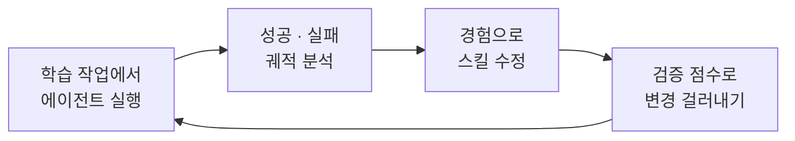
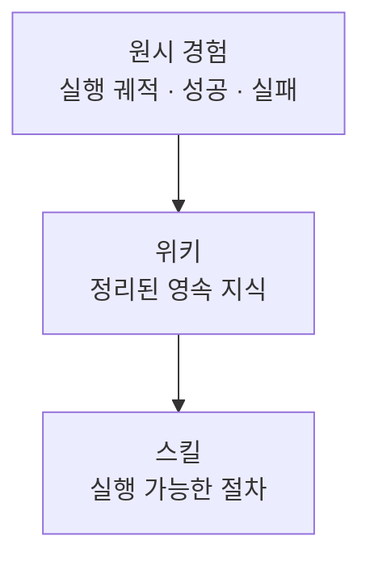

## 어떤 논문인가

WikiSkill은 Google Research와 Virginia Tech 연구진이 공개한 연구로, **LLM 에이전트의 실행 경험을 영속적인 지식 베이스(위키)로 압축한 뒤, 그 지식 위에서 실행 가능한 스킬을 반복 개선하는** 프레임워크를 제안합니다. 이 글은 파이토치 한국 사용자 모임의 소개글을 읽고 핵심 발상과 제 생각을 정리한 것입니다.

먼저 배경이 되는 **에이전트 스킬**부터 짚고 가겠습니다. 스킬은 모델 파라미터를 건드리지 않고 전문성을 담는 가벼운 개방형 형식입니다. 스킬 하나는 지시문, 스크립트, 부속 자원을 하나의 파일 시스템 디렉터리로 묶은 모듈입니다. 구조와 작성법은 [[claude-code-and-skills]]에 정리했습니다.

## 문제: 좋은 스킬을 사람이 쓰기는 어렵다

- 좋은 스킬을 만드는 일 자체가 어렵습니다.
- 에이전트가 앞으로 어떤 절차 지식과 작업 흐름을 필요로 할지 **미리 예측**해야 합니다.

그래서 최근 연구들은 스킬을 자동으로 만들고 검증하는 방향으로 옮겨 가고 있습니다. 공통된 순환은 이렇습니다.

EvoSkill, Trace2Skill, SkillOpt 같은 방법이 이 계열입니다. 그런데 이 방법들은 **배운 것 자체를 별도의, 스스로 진화하는 지식 표현으로 유지하지 않습니다.** 그래서 반복을 거치며 얻은 지식이 체계적으로 재사용되지 못합니다.

## 발상의 전환: 지식과 절차를 분리하고 지식만 영속시킨다

WikiSkill의 질문은 "에이전트의 경험도 영속 지식으로 정리해서 장기적인 스킬 진화를 뒷받침할 수 있는가?"입니다. 답은 원시 경험과 실행 가능한 절차 **사이에** 구조화된 지식 계층을 두는 것입니다.

소개글의 비유가 이해하기 좋았습니다.

| | 기존 방법 | WikiSkill |
|---|---|---|
| 비유 | 대출 기록만 남겨 두고 책은 매번 새로 씀 | 서가를 따로 두고, 그 서가를 참고해 매뉴얼을 고쳐 씀 |
| 경험의 형태 | 스킬 수정에 바로 소비되고 사라짐 | 위키에 누적되어 다음 개선의 재료가 됨 |

## 읽으면서 든 생각

> [!tip] 사람이 이미 하고 있는 방식과 닮았다
> 개발자가 장애를 겪을 때마다 런북을 직접 고치기보다, 먼저 트러블슈팅 노트를 쌓고 그 노트를 바탕으로 런북을 다시 쓰는 것과 같은 구조라고 느꼈습니다. "절차(스킬)"는 자주 바뀌어도 되지만 "왜 그렇게 하는지(지식)"는 누적되어야 한다는 점이 핵심입니다.

- **점진적 공개와 잘 맞는다.** 스킬은 frontmatter → 본문 → 참조 파일 순으로 필요할 때만 읽히는 구조입니다. 위키 계층은 이 중 참조 파일 자리에 자연스럽게 들어갈 수 있을 것 같습니다.
- **백그라운드 에이전트의 메모리 설계와도 통한다.** 정해진 시간마다 도는 에이전트가 북마크·보고 원장·실행 기록을 영속 저장소에 남겨 다음 실행에 쓰는 구조는, 규모는 작지만 "경험은 영속, 절차는 분리"라는 같은 발상입니다([[context-engineering-and-agent-automation]]).
- **결국 평가가 관건이다.** 스킬 변경을 "검증 점수로 걸러낸다"는 부분은 평가 설계의 문제와 같습니다. 채점기가 틀리거나 평가셋에 과적합되면 위키에 잘못된 지식이 쌓일 수 있습니다([[llm-as-a-judge-in-practice]]).

아직 소개글 수준으로만 읽은 상태라, 위키를 어떤 구조로 유지하고 갱신하는지, 실험에서 얼마나 효과가 있었는지는 원문을 더 읽고 보강할 예정입니다.

##### 참조
- [PyTorchKR - WikiSkill: 에이전트의 실행 경험을 위키에 쌓아 스킬을 진화시키는 3계층 구조에 대한 연구](https://discuss.pytorch.kr/t/wikiskill-3/11772)
- [The Complete Guide to Building Skills for Claude](https://claude.com/blog/complete-guide-to-building-skills-for-claude)
