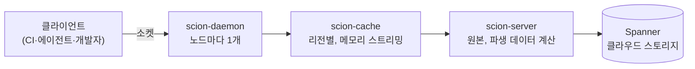
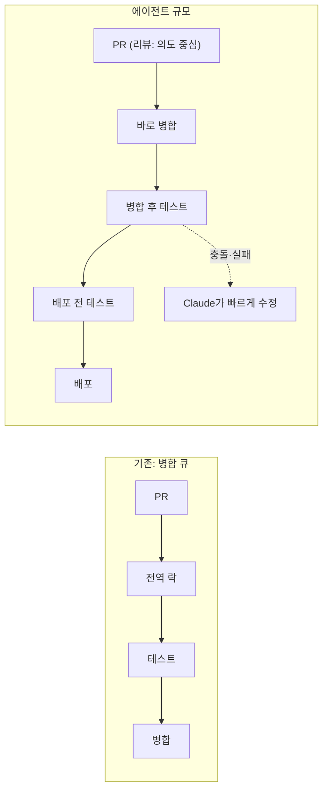

> [!summary]
> 코딩 에이전트가 코드를 쏟아내면서 Anthropic의 하루 병합(merge) 수가 **10배 이상** 늘었고, **git이 개발의 병목**이 되었습니다. 그래서 사내 버전 관리 시스템 **Scion**을 직접 만들어 모노레포를 git에서 5개월 만에 옮긴 이야기입니다.
> - 출처: Anthropic Engineering 소스 컨트롤 팀 / 2026-10-13 (10-15 갱신)
> - 핵심: git은 "사람이 오프라인에서도 작업하는" 전제로 설계됐지만, 지금 클라이언트의 대부분은 **항상 온라인인 에이전트와 CI 작업**입니다. 그래서 전제부터 다시 설계했습니다.
> - 7명이 Scion(버전 관리) + Antique(코드 리뷰) + 코드 검색 + 권한 관리(IAM)를 만들고 이전까지 완료했습니다.
> - 앞으로 **에이전트 시대의 CI·코드 리뷰·병합 방식**이 어떻게 바뀌는지 보여 주는 사례입니다.

## 1. 배경: 에이전트가 만든 병목

| 지표 | 수치 |
| --- | --- |
| 하루 병합 수 | 2026년 5월 약 **2,500건** → 9월 **30,000건 이상** |
| 메인 브랜치 이력 크기 | 약 100 GB (압축된 작업 사본만 25 GB 이상) |
| CI용 코드 체크아웃 | 하루 약 **2,500만 회** (개발 환경·에이전트 샌드박스·연구 작업 제외) |
| 단순하게 fetch했다면 | 하루 **600 PB 이상**의 git 트래픽 |
| 최대 운영한 git 미러 | 수백 개 |

Anthropic은 다른 회사보다 Claude로 소프트웨어를 훨씬 많이 만들기 때문에, **사람 규모로 설계된 도구의 한계에 먼저 부딪힙니다.** 같은 시기 claude.ai 성능 스프린트에서도 2주간 3,000건 이상을 병합했습니다(→ [[context-engineering-and-agent-automation|컨텍스트 엔지니어링과 에이전트 자동화]]).

### git으로 버티려던 시도와 한계

- 얕은 클론(shallow), 희소 체크아웃(sparse), 부분 클론(partial), 사내 미러 수백 개, blob 스토리지에 둔 시드(seed) 스냅샷 등을 썼습니다.
- 병합량이 늘수록 운영이 어려워졌습니다. 시드는 main 최신 상태와 금방 벌어지고, 부분 클론에서는 diff·blame처럼 이력이 필요한 작업이 어려웠습니다.
- **근본 원인**: git은 분산형이라 모든 클라이언트가 **완전한 사본**을 가집니다(오프라인 작업용). 그런데 클라이언트 대부분이 항상 온라인인 에이전트·작업이니 이 설계가 오히려 짐이 됐습니다.
- packfile은 계속 저장소 유지보수가 필요하고, fetch 협상은 클라이언트가 "내가 가진 것"을 설명하는 방식이라 대규모에서 비효율적입니다.

## 2. 에이전트 규모 소스 컨트롤의 원칙

| 원칙 | git | Scion |
| --- | --- | --- |
| **클라이언트 연결** | 오프라인 가정, 전체 사본 보유 | **항상 온라인** 가정, 필요한 데이터만 그때그때 가져옴 |
| **역할 분담** | 클라이언트와 서버가 대칭 | **비대칭**: 이력·blame·커밋·병합·리베이스는 서버가, 클라이언트는 제한된 로컬 캐시와 작업 사본만 |
| **API** | 대부분 로컬 저장소에서 실행 | **포괄적인 소스 컨트롤 API** — 많은 작업이 로컬 저장소 없이 API 질의로 끝남 |
| **확장** | 저장소 하나 = 한 덩어리 | **수평 확장**: 데이터를 분산, 어디에도 전체 사본 없음, packfile·저장소 유지보수 없음 |
| **커밋** | 클라이언트에서 생성 후 push | **서버에서 생성**, 변경 크기에 비례한 비용, 락 없음. ref는 main·release 브랜치로 제한 |
| **작업 사본** | 항상 체크아웃 | **선택·희소**: 많은 CI·쓰기 작업은 체크아웃 자체를 안 함. 체크아웃해도 실제로 읽는 파일만 내려받음 |

> [!tip] ref를 줄인 이유
> 모든 서버가 합의해야 하는 전역 상태(ref)는 그 자체로 확장 문제가 됩니다. 그래서 main과 release 브랜치 외의 ref는 쓰지 않도록 했습니다.

## 3. Scion의 구조

### 데이터

- **Changeset**: 작업 단위입니다. write-ahead log에 기록되며, **첫 번째 부모 대비 바뀐 파일**과 압축된 blob을 가리키는 내용 주소(content-addressed) 포인터를 저장합니다. 서버에서 생성됩니다.
  - 첫 번째 부모 기준인 이유: 트렁크 기반 모노레포에서는 사람들이 주로 main의 이력·blame만 봅니다.
- **Ref 이동**: Spanner의 한 행에 대한 compare-and-swap으로, changeset 생성과 분리되어 있습니다.
- **파생 데이터**: blame, 경로 이력, 커밋 그래프 skip list를 changeset에서 하나의 범용 메커니즘으로 재귀 계산합니다. 미리(eager) 또는 필요할 때(lazy) 계산하며, 내부 방식을 바꿔도 클라이언트에 영향이 없습니다.
- **fetch 프로토콜**: 클라이언트가 루트 트리부터 내려가며 **없는 트리와 blob만** 요청합니다. 재개 가능하고 수 GB짜리 packfile이 없습니다.

### 3계층 서버

- 모든 계층이 같은 RPC를 쓰고, 계층 구분을 엄격히 지켜 **장애를 격리**합니다.
- 데이터가 내용 주소 기반이라 어느 서버든 캐시할 수 있습니다. 각 캐시 계층의 적중률은 99% 이상입니다.

### 결과

| 항목 | 효과 |
| --- | --- |
| 인프라 자원 | 이전 git 미러 구성 대비 CPU·메모리 **약 200배 절감** |
| CI·연구 작업 체크아웃 | **분 단위 → 초 단위** |
| CI 용량 | CPU 여유 **25% 증가** |
| git→Scion 데이터 수집 파이프라인 | Claude가 다시 작성해 메모리 20배 절감, 4배 빠름 |

## 4. 만들면서 배운 것

### 작은 팀의 빠른 이전

7명이 5개월 만에, 그것도 하루 병합량이 10배로 늘어나는 와중에 시스템 구축과 이전을 끝냈습니다. 이런 **빠른 대규모 이전이 앞으로 흔해질 것**이라고 봅니다.

### 엔지니어 역할의 변화

- 엔지니어는 **설계 트레이드오프**를 정하고, Claude가 시스템 제약을 어기면 **"안 된다"고 말하는 일**에 집중합니다.
- 리뷰어는 모든 줄을 읽기보다 **변경의 의도**를 검토합니다.
- 코딩 에이전트 도입 시 역할 변화·리뷰 피로 문제는 [[coding-assistant-to-coding-agent|코딩 어시스턴트에서 코딩 에이전트로]]에서도 정리했습니다.

### 품질과 최적화

- 밀폐된(hermetic) 시뮬레이션, 퍼징(fuzzing), 속도 제한(rate limiting)을 갖췄습니다.
- Claude가 인덱스를 타지 않던 조상(ancestry) 질의의 최적화 지점을 찾아냈습니다.

### 보안

처음부터 **저장소 단위 접근 제어, 디렉터리 단위 권한, 의미 기반 승인 조건**을 넣었습니다.

- **Antique**(코드 리뷰 도구)의 승인 규칙은 의미를 구분할 수 있습니다. 주석만 바꾼 변경과 민감한 로직 변경을 다르게 취급해, 사람 리뷰어가 중요한 변경에 집중하게 합니다.
- 모노레포 하나 안에서도 민감한 코드는 디렉터리 권한으로 보호합니다.

### 운영: "슈퍼팬(superfan)" 에이전트

- 컴포넌트 하나(scion-daemon, scion-cache, Antique 병합 큐 등)만 지켜보는 Claude 인스턴스를 [Claude Tag](https://www.anthropic.com/news/introducing-claude-tag)(Slack 속 Claude)로 운영합니다.
- 텔레메트리와 로그를 보고 이상 징후를 찾습니다. 대시보드를 계속 새로고침하는 엔지니어처럼요.
- 기존 알림을 대체하지 않고 함께 돌리며, **고정 임계값 알림이 놓치는 미묘하고 새로운 문제**를 잡습니다.
- 비슷한 에이전트 운영 설계는 [[context-engineering-and-agent-automation|컨텍스트 엔지니어링과 에이전트 자동화]]에서 다뤘습니다.

## 5. CI·병합 방식의 재설계

> [!important] 병합 큐(merge queue)를 버린 이유
> 전통적인 병합 큐는 **전역 락**을 걸고 하나씩 테스트 후 병합합니다. 테스트가 도는 동안 수백~수천 건이 들어오는 규모에서는 이 방식이 성립하지 않습니다.

- 전역 락을 재현하지 않고, 대신 **병합 후 테스트(post-merge)**와 **배포 전 테스트(pre-deploy)** 자동화에 투자했습니다.
- 트레이드오프: 동시에 들어온 변경끼리 충돌할 수 있습니다. 하지만 **Claude가 사람이 충돌을 알아채는 것보다 빨리 해결**합니다.
- CI 체크아웃이 분→초로 줄고 많은 작업이 체크아웃 없이 API로 끝나므로, CI 자체의 비용 구조도 바뀝니다.

> [!question] 정리: 앞으로의 CI에 대한 시사점 (기사 내용을 바탕으로 한 정리)
> 1. **병목이 "코드 작성"에서 "통합·검증"으로 이동**합니다. 코드 생성량이 10배가 되면 리뷰·병합·CI가 먼저 막힙니다.
> 2. **병합 전 완벽 검증 → 병합 후 빠른 검증·복구**로 무게중심이 옮겨 갑니다. 대신 배포 전 테스트와 빠른 수정 능력이 전제 조건입니다.
> 3. **리뷰는 의도와 위험도 중심**으로. 의미 기반 승인 규칙으로 사람의 주의를 중요한 변경에만 씁니다.
> 4. **체크아웃 없는 CI**: 저장소 전체를 받지 않고 API·희소 체크아웃으로 필요한 것만 쓰는 방향입니다.
> 5. **에이전트가 운영에도 참여**: 컴포넌트별 감시 에이전트가 기존 알림을 보완합니다.

## 6. git 생태계에 주는 제안

Scion은 코드 리뷰·코드 검색·CI까지 함께 옮겨야 하므로 **범용 git 대체재로는 적합하지 않다**고 밝힙니다. 대신 생각을 공유해 git 생태계가 가져갈 수 있는 것을 제안합니다.

- git 서버가 클라이언트 동작을 그대로 따라 할 필요는 없습니다. **새로운 서버 아키텍처**로 훨씬 잘 확장할 수 있습니다.
- git 플랫폼이 **포괄적인 서버 측 RPC**를 제공하고, 가능하면 포지(GitHub 등) 간에 표준화해 git 클라이언트가 쓰게 합니다.
- **fetch 협상 프로토콜**을 개선합니다.
- git의 sparse·shallow 기능이 **함께 동작하도록** 설계합니다.
- 목표는 git의 전체 모델은 유지하면서 이런 개선을 받아들이는 것입니다.

### 선행 사례

- Google **Piper**, Meta **Sapling**이 설계에 영향을 줬습니다.
- 특히 Sapling의 서버인 **Mononoke**가 Scion이 쓰는 많은 기법(특히 **Bonsai 데이터 모델**)을 먼저 시도했습니다.

## 느낀 점

이 글을 읽으면서 **엔지니어의 역할이 확실히 변하고 있다**는 것을 느꼈습니다. 코드를 직접 한 줄씩 작성하는 일보다, 설계 트레이드오프를 정하고 에이전트가 시스템 제약을 어길 때 "안 된다"고 판단하는 일, 그리고 변경의 의도를 검토하는 일이 엔지니어의 중심 업무가 되어 가고 있습니다.

또한 git이 병목이 된 것처럼 **사람 규모로 설계된 도구가 에이전트 규모에서 한계를 드러내는 문제**는 Anthropic만의 이야기가 아니라고 생각합니다. 개발자들이 에이전트 사용에 익숙해질수록 코드 생성량은 계속 늘어날 것이고, 리뷰·병합·CI 같은 통합 단계의 병목은 곧 우리 주변에서도 발생할 것이라는 데 동감합니다.

##### 참조

- [Redesigning source control at Anthropic (Anthropic Engineering)](https://www.anthropic.com/engineering/redesigning-source-control)
- [Piper (Google)](https://en.wikipedia.org/wiki/Piper_(source_control_system)) / [Sapling (Meta)](https://sapling-scm.com/) / [Mononoke README](https://github.com/facebook/sapling/blob/main/eden/mononoke/README.md)
- [Claude Tag 소개](https://www.anthropic.com/news/introducing-claude-tag)
- [Agentic coding is straining CI — test impact analysis at Anthropic](https://claude.com/blog/agentic-coding-is-straining-ci-heres-how-we-scaled-test-impact-analysis-at-anthropic)
- 관련 글: [[context-engineering-and-agent-automation|컨텍스트 엔지니어링과 에이전트 자동화]], [[coding-assistant-to-coding-agent|코딩 어시스턴트에서 코딩 에이전트로]], [[claude-code-and-skills|Claude Code와 Skills]], [[llm-as-a-judge-in-practice|LLM-as-a-Judge와 힐클라이밍]]
