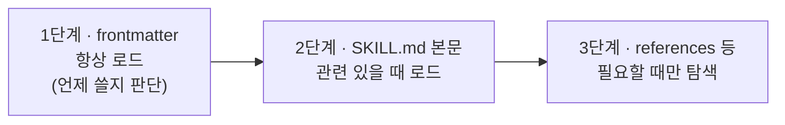

## Claude Code란

Claude Code는 터미널에서 동작하는 AI 코딩 에이전트입니다. 파일을 읽고 고치고, 명령을 실행하고, Git 작업까지 합니다. VS Code·JetBrains 확장, 데스크톱 앱, 웹에서도 쓸 수 있습니다. 코딩 에이전트가 일반 챗과 구조적으로 무엇이 다른지는 [[coding-assistant-to-coding-agent]]에 따로 정리했습니다.

## 무엇을 어디에 넣을까

처음 쓸 때 가장 헷갈렸던 건 "이 지시를 어디에 둬야 하나"였습니다. 정리하면 이렇습니다.

| 구성 | 언제 로드되나 | 언제 쓰나 | 예시 |
|---|---|---|---|
| **CLAUDE.md** | 모든 세션 시작 시 | 항상 지켜야 할 규칙 | "npm 대신 pnpm", "커밋 전 테스트 실행" |
| **Rules** (`.claude/rules/*.md`) | 지정한 경로의 파일이 관련될 때 | 특정 영역에만 적용되는 규칙 | 마이그레이션 파일은 수정 금지 |
| **Skills** | 요청과 관련 있다고 판단될 때 | 재사용 가능한 절차·참조 문서 | 배포 체크리스트, API 문서 |
| **MCP** | 도구 호출 시 | **외부** 데이터·작업 연결 | DB 조회, 메신저 게시, 브라우저 제어 |
| **Subagents** | 위임할 때 | 컨텍스트 격리, 병렬 작업 | 파일을 잔뜩 읽고 요약만 돌려주는 조사 |
| **Hooks** | 이벤트 발생 시 항상 | 예외 없이 실행돼야 하는 자동화 | 편집 후 포매터 실행, 위험 명령 차단 |

> [!tip] 판단 기준
> "모델이 알아서 판단해도 되는가?"가 기준입니다. 판단에 맡겨도 되면 CLAUDE.md·스킬, **반드시 매번** 실행돼야 하면 Hooks, 권한 문제라면 `settings.json`의 `permissions`입니다.

### CLAUDE.md

- 세션 시작 시 읽히므로, 내용을 바꾸면 `/clear` 등으로 컨텍스트를 새로 시작해야 반영됩니다.
- 짧게 유지하는 게 효과적입니다(대략 200줄 이내). 저장소를 보면 알 수 있는 내용은 빼고, **코드베이스에서 실수하기 쉬운 지점**에 집중합니다.
- 개인용 설정은 `CLAUDE.local.md`에 두고 gitignore 합니다.
- `/init`으로 프로젝트를 분석해 초안을 만들 수 있습니다.

### Rules

frontmatter로 적용 경로를 지정하면 해당 파일을 다룰 때만 컨텍스트에 들어갑니다.

```markdown
---
paths:
  - "db/**/*.ts"
  - "migrations/**/*.sql"
---

# Database
- 이미 생성된 마이그레이션 파일은 절대로 수정하지 않는다
```

### Hooks

`settings.json`에 이벤트별로 명령을 등록합니다. 예를 들어 파일 편집 후 항상 포매터를 돌리려면 이렇게 씁니다.

```json
{
  "hooks": {
    "PostToolUse": [
      {
        "matcher": "Edit|Write",
        "hooks": [{ "type": "command", "command": "jq -r '.tool_input.file_path' | xargs npx prettier --write" }]
      }
    ]
  }
}
```

### Permissions

모든 실행을 묻는 수동 모드, 파일 편집만 자동으로 허용하는 모드, 위험 명령 외에는 자동 실행하는 모드가 있고, `settings.json`에서 명령 단위로 허용·거부를 정할 수 있습니다.

```json
{
  "permissions": {
    "allow": ["Bash(npx tsc --noEmit)"],
    "deny": ["Bash(npm run deploy*)"]
  }
}
```

### 자주 쓰는 흐름

- **Plan mode**: 큰 리팩토링 전에 먼저 조사하고 계획을 세운 뒤, 계획을 다듬고 실행
- **인터뷰로 스펙 만들기**: 무엇을 만들지 설명하기 어려울 때 "질문 도구로 나를 인터뷰해서 SPEC.md를 작성해 줘"라고 요청한 뒤, 새 세션에서 그 스펙으로 구현에 집중
- **`/rewind`, `/compact`, `/fork`**: 대화와 코드를 특정 시점으로 되돌리기, 긴 컨텍스트 요약, 같은 맥락에서 다른 방법 시도하기. `/rewind`는 Claude가 한 작업만 되돌리고 사람이 직접 고친 내용은 되돌리지 않습니다.
- **`/context`, `/model`**: 컨텍스트 사용량 확인, 모델과 effort 선택
- **Worktrees**: 두 작업을 병렬로 할 때 각자 분리된 복사본에서 작업해 파일 충돌 방지
- **Subagents**: 여러 에이전트는 각자 독립된 컨텍스트를 가지므로 메인 대화를 어지럽히지 않음

## 스킬 작성 가이드 요약

Anthropic이 공개한 *The Complete Guide to Building Skills for Claude*를 읽고 핵심만 정리했습니다.

### 스킬의 구조

스킬은 특정 작업을 처리하는 방법을 가르치는 **폴더로 묶인 지시문 세트**입니다.

```
my-skill/
├── SKILL.md        # 필수: YAML frontmatter + 지시문
├── scripts/        # 선택: 실행 코드
├── references/     # 선택: 필요할 때 읽는 문서
└── assets/         # 선택: 템플릿, 아이콘 등
```

- 파일명은 정확히 `SKILL.md`, 폴더명은 kebab-case
- 스킬 폴더 안에는 README.md를 두지 않음
- frontmatter에 XML 꺾쇠(`<` `>`)는 금지. frontmatter가 시스템 프롬프트에 들어가므로 지시 주입을 막기 위함입니다.

### 점진적 공개(Progressive Disclosure)



토큰을 아끼면서 전문성을 유지하는 핵심 원칙입니다. 그래서 **frontmatter의 `description`이 가장 중요합니다.** Claude는 이걸 보고 스킬을 쓸지 결정하므로, 무엇을 하는지와 언제 써야 하는지(사용자가 실제로 쓸 법한 트리거 문구)를 구체적으로 적어야 합니다.

```yaml
---
name: sprint-planning
description: 이슈 트래커의 스프린트 계획을 세우고 작업을 생성한다. "스프린트 계획 짜줘", "이번 스프린트 작업 만들어줘" 같은 요청에 사용.
---
```

"Helps with projects."처럼 모호하거나, 기술 용어만 있고 트리거 문구가 없는 description은 잘 트리거되지 않습니다.

### 스킬과 MCP의 관계

가이드의 비유가 좋았습니다. **MCP는 전문 주방**(도구·재료에 대한 접근), **스킬은 레시피**(가치 있는 결과를 만드는 단계별 방법)입니다. MCP만 있으면 연결은 됐는데 매번 처음부터 시작하고 결과가 들쭉날쭉합니다. 스킬이 있으면 워크플로와 모범 사례가 매번 반영됩니다.

### 세 가지 유형

| 유형 | 용도 | 핵심 기법 |
|---|---|---|
| 문서·결과물 생성 | 일관된 품질의 문서, 코드, 디자인 | 스타일 가이드·템플릿 내장, 완성 전 체크리스트 |
| 워크플로 자동화 | 일관된 방법론이 필요한 다단계 작업 | 검증 게이트가 있는 단계, 반복 개선 루프 |
| MCP 강화 | MCP 도구 위에 사용법을 얹음 | 여러 MCP 호출 순서 조율, 오류 처리 |

### 만들고 개선하는 순서

1. 코드를 쓰기 전에 **구체적인 유즈케이스 2~3개**(트리거, 단계, 결과)를 정한다
2. 성공 기준을 정한다. 예: 트리거되어야 할 질의 10~20개 중 대부분에서 스킬이 실행되는지, 같은 요청을 3~5번 했을 때 결과가 일관적인지
3. **어려운 작업 하나를 성공할 때까지 반복한 뒤, 성공한 방식을 스킬로 추출**한다
4. 트리거 테스트(관련 요청엔 로드, 무관한 요청엔 미로드) → 기능 테스트 → 스킬 유무 성능 비교 순으로 확인한다

| 신호 | 증상 | 해결 |
|---|---|---|
| 과소 트리거 | 로드돼야 할 때 안 됨 | description에 세부 내용·키워드 추가 |
| 과다 트리거 | 무관한 질의에 로드 | 부정 트리거(`Do NOT use for ...`) 추가, 범위 구체화 |
| 지시를 안 따름 | 지시가 장황하거나 묻혀 있음 | 간결하게 목록화, 중요한 지시는 맨 위로 |

> [!tip] 중요한 검증은 스크립트로
> 반드시 지켜야 할 검증은 자연어 지시 대신 **검증 스크립트를 번들**하는 편이 낫습니다. 코드는 결정적이지만 언어 해석은 그렇지 않습니다. 그리고 `SKILL.md`는 5,000단어 이하로 두고 상세 내용은 `references/`로 빼는 것을 권합니다.

## 정리

Claude Code를 잘 쓰는 핵심은 프롬프트를 길게 쓰는 게 아니라 **정보를 알맞은 자리에 두는 것**이었습니다. 항상 필요한 것은 CLAUDE.md, 가끔 필요한 것은 스킬, 반드시 실행돼야 하는 것은 Hooks. 이 원칙을 더 일반화한 이야기는 [[context-engineering-and-agent-automation]]에, 스킬을 사람이 아니라 경험으로 진화시키는 연구는 [[wikiskill-paper-review]]에 이어서 정리했습니다.

##### 참조
- [Claude Code 공식 문서 - 빠른 시작](https://code.claude.com/docs/ko/quickstart)
- [Claude Code Hooks 가이드](https://code.claude.com/docs/ko/hooks-guide)
- [The Complete Guide to Building Skills for Claude](https://claude.com/blog/complete-guide-to-building-skills-for-claude)
- [Agent Skills 개요 (Claude 문서)](https://platform.claude.com/docs/en/agents-and-tools/agent-skills/overview)
- [anthropics/skills](https://github.com/anthropics/skills)
