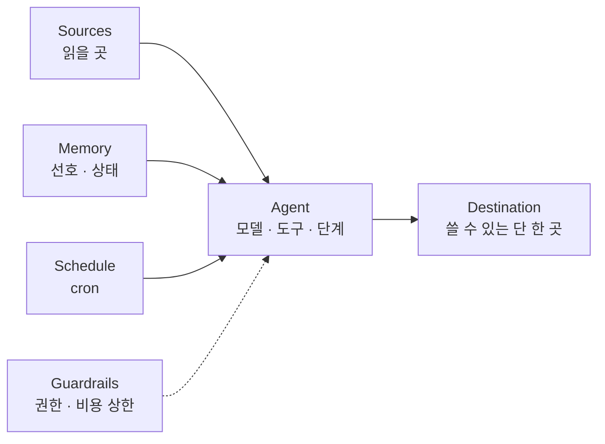

## 들어가며

최근 Anthropic 블로그에서 읽은 글들이 같은 방향을 가리키고 있어서 함께 정리합니다. 하나는 최신 모델을 위한 **컨텍스트 엔지니어링**의 변화, 하나는 정해진 시간마다 혼자 도는 **백그라운드 에이전트** 설계법, 마지막은 Claude와 함께 claude.ai를 2주 만에 약 3배 빠르게 만든 **측정 기반 개선** 사례입니다. 공통점은 "모델에게 규칙을 더 많이 주기"보다 **좋은 인터페이스와 안전장치를 설계하기**입니다.

## 1. 컨텍스트 엔지니어링: 규칙에서 판단으로

글의 핵심을 표 하나로 요약하면 이렇습니다.

| 예전 방식 | 지금 권장 |
|---|---|
| 규칙을 준다 | 판단을 맡긴다 |
| 예제를 준다 | 인터페이스(도구·스크립트)를 설계한다 |
| 필요할지 모르는 건 전부 미리 넣는다 | 점진적 공개를 쓴다 |
| 같은 말을 반복해서 강조한다 | 도구 설명을 간결하게 쓴다 |
| 메모리를 CLAUDE.md에 직접 쓴다 | 자동 메모리를 활용한다 |
| 짧은 스펙 | 풍부한 참조 |

제가 이해한 포인트는 네 가지입니다.

- **시스템 프롬프트는 제품 맥락이다.** Claude Code를 쓸 때는 손댈 일이 거의 없지만, 자체 에이전트 하네스를 만든다면 가장 많이 투자해야 할 부분입니다.
- **CLAUDE.md는 짧게, 함정 위주로.** 저장소를 보면 알 수 있는 건 쓰지 말고, 실수하기 쉬운 지점에 시간을 쓰라고 합니다. 검증 방법 같은 긴 지침은 스킬로 빼고 CLAUDE.md에서는 참조만 합니다.
- **스킬은 과하게 제약하지 않는다.** 정말 중요한 영역이 아니면 Claude가 필요할 때 찾아보는 안내서 정도로 두고, 자신·팀·제품에 특화된 의견과 지식을 담을 때 가장 효과적이라고 합니다.
- **참조는 코드 형태가 낫다.** 디자인을 설명하는 글이나 스크린샷보다 HTML 목업이 더 좋은 결과를 낸다고 합니다. 모델이 잘 아는 언어로 된 명확한 지시이기 때문입니다.

> [!tip] 내 CLAUDE.md를 다시 보는 기준
> "폴더 구조"처럼 모델이 저장소를 보면 알 수 있는 내용은 지우고, "기존 문서의 사실 오류는 고치지 말고 표시만 할 것"처럼 **모델이 스스로 알기 어려운 규칙**만 남기는 것이 이 글의 권장 방향이라고 이해했습니다.

## 2. 백그라운드 에이전트 자동화

두 번째 글은 정해진 시간마다 메신저 채널과 코드 저장소를 읽고, **지난 실행 이후 바뀐 것만** 브리핑하는 에이전트를 레퍼런스로 만들면서 겪은 실패 유형을 정리합니다. 백그라운드 자동화의 어려움은 "소스 접근이 끊겨도 아무도 모른다"는 것과 "사용자 선호를 따르지 않는다"는 것입니다.

에이전트를 여섯 가지 구성요소로 나눠 봅니다.

### 기억해 둘 원칙

1. **고정 시간창이 아니라 소스별 북마크부터 읽는다.** "지난 24시간"으로 읽으면 실행이 밀리거나 겹칠 때 누락·중복이 생깁니다.
2. **읽기 실패를 "조용한 날"로 착각하지 않는다.** 소스를 못 읽었으면 그 소스의 북마크는 그대로 두고, 브리핑 끝에 "읽을 수 없음"을 명시합니다.
3. **게시 직전에 모든 항목을 다시 확인한다.** 그사이 해결된 이슈를 브리핑하지 않도록. "오래된 '아직 대기 중' 하나가 빠진 항목 열 개보다 신뢰를 더 깎는다"는 문장이 인상적이었습니다.
4. **게시 성공을 확인한 뒤에 북마크와 기록을 갱신한다.** 순서가 바뀌면 실패한 실행의 내용이 영영 사라집니다. 불확실하면 "maybe posted"로 남깁니다.
5. **선호 설정은 에이전트가 수정할 수 없는 저장소에서 매 실행마다 다시 읽는다.** 읽지 못하면 기본값으로 돌지 말고 중단합니다.
6. **읽기만 하는 곳은 읽기 전용 권한으로, 실행당 비용 상한을 둔다.** 상한은 처음에 일반 실행 비용의 3~5배로 시작해 실측치를 보며 줄입니다. 너무 낮으면 에이전트가 멈춰서 "브리핑이 조용해진 것처럼" 보입니다.

그 밖에도 날짜를 서버가 아니라 **사용자 타임존**으로 계산하라는 것, 링크를 직접 조립하지 말고 소스가 주는 링크 필드를 복사하라는 것, 보고한 항목을 변하지 않는 ID와 함께 **보고 원장(ledger)** 에 남겨 중복 보고를 막으라는 것 같은 실용적인 팁이 많았습니다.

### 프롬프트 인젝션을 전제로 설계하기

이 에이전트는 남이 쓴 메시지와 이슈를 읽습니다. 그 텍스트가 지시로 해석될 수 있다는 걸 전제로, **따르더라도 피해가 작도록** 권한을 설계합니다. 저장소 접근 권한과 선호 저장소는 읽기 전용, 네트워크는 허용 목록 호스트만, 게시용 봇은 필요한 채널에만 초대합니다. 자격증명은 별도 보관소(vault)에 두고, 샌드박스 안에는 placeholder만 둔 채 허용된 호스트로 나갈 때만 플랫폼이 실제 값으로 바꿔 넣는 방식도 인상적이었습니다.

## 3. 측정할 수 있으면 개선할 수 있다

세 번째 글은 Anthropic 팀이 2주 스프린트 동안 메신저 채널 하나에서 Claude와 함께 claude.ai와 데스크톱 앱의 핵심 사용 경험을 평균 약 3배 빠르게 만든 과정입니다. 핵심 교훈은 "Claude는 **측정할 수 있는 것이면** 개선할 수 있다"였습니다.

- **결정적 지표를 만든다.** 실제 경과 시간은 들쭉날쭉해서 CI 기준으로 쓰기 어렵기 때문에, CPU 명령어 수나 상호작용당 렌더 횟수처럼 한 번 실행으로 재현되는 지표를 만들고, 그 지표가 실제 지연과 연동되는지부터 증명했습니다.
- **래칫(ratchet)으로 성과를 고정한다.** 해당 경로의 지표를 나쁘게 만드는 PR은 CI에서 실패하고, 수치가 내려가면 상한선도 함께 낮춥니다.
- **안전장치를 먼저 정한다.** 최적화 전 단위 테스트, 사용자에게 보이는 변경은 단기 피처 플래그 뒤에, 점진 배포, 모든 PR에 사람 승인.
- **사람은 조타를 맡는다.** Claude는 병목 탐색·벤치마크 구축·배포 모니터링을, 사람은 목표 설정·취향 판단·트레이드오프 결정을 맡았습니다. 흥미로운 점은 Claude가 기본적으로 범위를 신중하게 잡기 때문에, 가드레일을 믿고 "더 대담해지라"고 독려하는 것도 사람의 역할이었다는 부분입니다.

이건 LLM 평가에서 말하는 힐클라이밍과 같은 구조입니다. 믿을 수 있는 채점기(지표)를 먼저 만들고, 한 번에 하나씩 바꾸고, 되돌릴 수 있게 둡니다([[llm-as-a-judge-in-practice]]).

## 세 글을 겹쳐 보면

- 컨텍스트 엔지니어링의 "판단을 맡긴다"는 무책임하게 맡긴다는 뜻이 아닙니다. 맡길 수 있도록 **인터페이스(도구, 참조, 메모리 구조)와 경계(권한, 비용, 테스트)를 먼저 설계**한다는 뜻으로 읽었습니다.
- 그리고 모두 "조용한 실패"를 경계합니다. 읽기 실패, 비용 상한 도달, 게시 실패, 성능 회귀가 정상처럼 보이지 않게 만드는 것. LLM 앱의 관측성을 다룰 때도 같은 결론이었습니다([[langfuse-tracing-users-scores]]).
- 실행 경험을 영속 저장소에 쌓아 다음 실행에 쓰는 브리핑 에이전트의 메모리 구조는 [[wikiskill-paper-review]]의 발상과도 닮았습니다.

스킬과 CLAUDE.md의 구체적인 작성법은 [[claude-code-and-skills]]에 정리했습니다.

##### 참조
- [The new rules of context engineering for Claude 5 generation models](https://claude.com/blog/the-new-rules-of-context-engineering-for-claude-5-generation-models)
- [Building effective agent automations (claude.dev)](https://claude.dev/blog/building-effective-agent-automations/)
- [레퍼런스 구현: managed-agents/daily-brief](https://github.com/anthropics/claude-quickstarts/tree/main/managed-agents/daily-brief)
- [How we made claude.ai 3x faster in two weeks (claude.dev)](https://claude.dev/blog/how-we-made-claude-ai-faster/)
