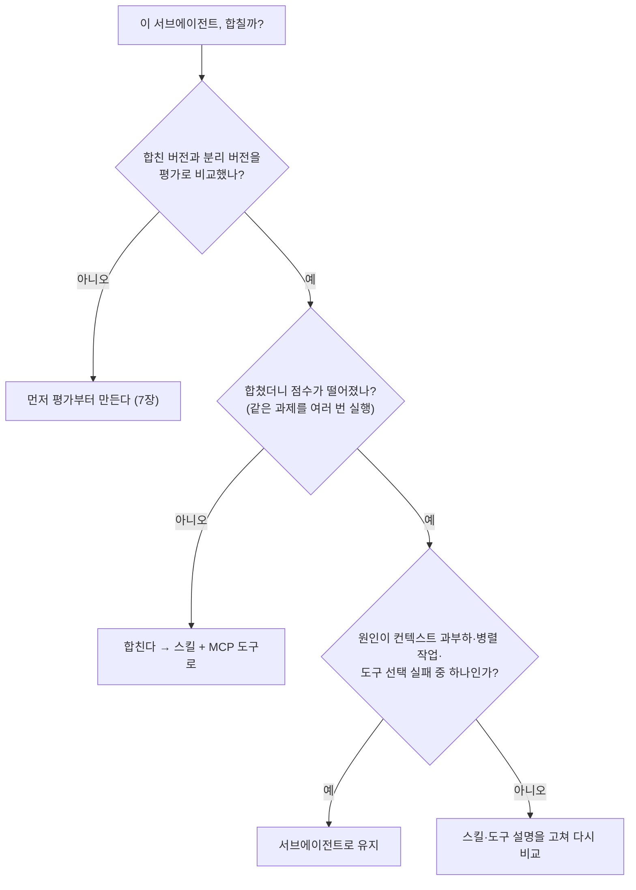
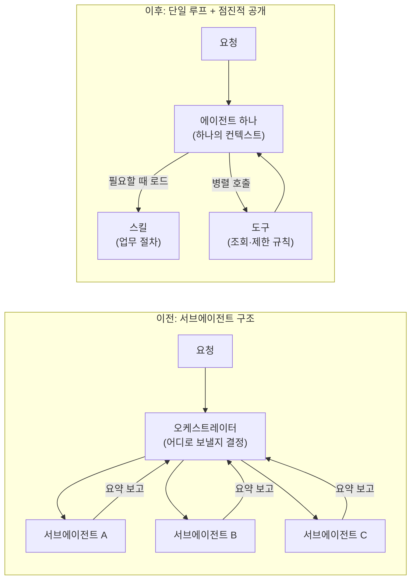
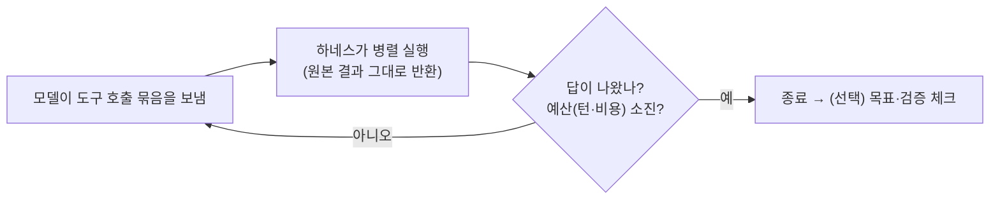
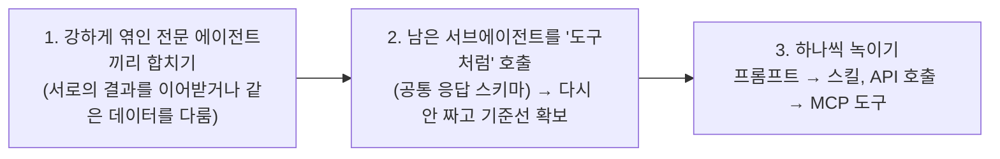

> [!summary] 한 줄 요약
> "일을 여러 전문 에이전트에게 나눠 맡기는 구조(서브에이전트)"보다, **에이전트 하나가 필요한 매뉴얼(스킬)과 도구를 그때그때 꺼내 쓰는 구조(단일 루프 + 점진적 공개)** 가 품질·비용·속도 모두에서 나은 경우가 많아졌다. 그러니 서브에이전트를 **평가로 확인하면서 하나씩** 메인 루프 안으로 합쳐 가자는 글.
> - 출처: Diane Sarkis, Claude 블로그 (Best practices) / 2026-10-22
> - 서브에이전트가 쓸모없다는 얘기가 아니다. **측정해 보고 꼭 필요한 경우에만** 쓰자는 것

> [!example] 기사가 든 근거
> - 여러 기업 배포를 비교했더니, **스킬을 가진 단일 에이전트**가 "프롬프트 하나로 다 하는 설계"와 "서브에이전트 설계" 둘 다보다 나은 경우가 많았다
> - 한 고객사: 전문 서브에이전트 10여 개로는 **일관된 브랜드 톤**을 유지하기 어렵고 지연도 늘었다
> - 다른 고객사: 멀티 에이전트 대신 단일 루프로 바꿔 실행 시간이 **약 2배 빨라졌다**

---
## 1. 먼저 비유로 이해하기

> [!example] 회사 업무에 비유하면
> **서브에이전트 구조** = 팀장(오케스트레이터)이 일을 받으면 "이건 A팀, 저건 B팀"으로 나눠 보내고, 각 팀이 결과를 보고서로 올리면 팀장이 합친다.
> → 일을 넘길 때마다 **설명이 빠지고**(맥락 손실), 팀이 늘수록 **누가 뭘 하는지 관리가 안 되고**, 왔다 갔다 하느라 **느리다**.
>
> **단일 루프 구조** = 유능한 담당자 한 명이 처음부터 끝까지 맡는다. 다만 모든 매뉴얼을 외우고 있는 게 아니라, **필요할 때 서랍에서 해당 매뉴얼(스킬)만 꺼내 보고**, 필요한 도구만 그때 찾아 쓴다.
> → 전체 맥락을 한 사람이 다 알고 있으니 앞뒤 연결이 잘 되고, 넘기는 비용이 없다.

예전 모델은 "한 사람이 다 하기엔 머리가 부족해서" 일을 쪼갰다. Opus 4.5 이후 모델은 한 루프에서 처리할 수 있는 양이 크게 늘었기 때문에, **쪼개는 것 자체가 손해**인 경우가 많아졌다.

---
## 2. 용어 정리

| 용어 | 쉬운 설명 |
|---|---|
| **에이전트 루프** | 모델이 "생각 → 도구 호출 → 결과 확인 → 다음 행동"을 반복하는 과정 |
| **서브에이전트** | 메인 에이전트가 일을 맡기는 별도 에이전트. 자기만의 컨텍스트·도구·지시문을 가진다 (→ [[claude-code-and-skills|Claude Code 핵심 기능과 스킬 작성법]]) |
| **오케스트레이터** | 요청을 보고 어느 서브에이전트에 보낼지 정하는 "팀장" 역할 |
| **핸드오프** | 한 에이전트가 다른 에이전트에게 일을 넘기는 것. 이때 요약을 거치며 정보가 빠지기 쉽다 |
| **컨텍스트** | 모델이 지금 한 번에 보고 있는 정보(대화, 지시문, 도구 결과 등) |
| **점진적 공개 (Progressive disclosure)** | 처음부터 모든 정보를 넣지 않고, **필요해지는 순간에** 꺼내 보여 주는 방식 |
| **스킬 (Skill)** | 특정 업무 절차를 적어 둔 매뉴얼. 평소엔 이름·설명만 보이고, 필요할 때 본문을 읽는다 (→ [[claude-code-and-skills|스킬 작성법]]) |
| **MCP 도구** | 외부 시스템 조회·실행을 표준 방식으로 연결한 도구 (→ [[claude-code-and-skills|Claude Code]]) |
| **도구 검색 (Tool search)** | 수많은 도구 정의를 미리 다 넣지 않고, 필요한 도구만 찾아서 불러오는 기능 (지연 로딩) |
| **하네스 (Harness)** | 모델 바깥에서 루프를 돌리는 코드. 턴 수·비용 한도, 위험한 쓰기 작업 승인(write gate) 등을 담당 |
| **평가 (Eval)** | 에이전트가 제대로 답하는지 정답 예제로 채점하는 테스트  |

---
## 3. 서브에이전트가 큰 조직에서 망가지는 방식

| 문제 | 무슨 뜻인가 |
|---|---|
| **넘길 때 맥락 손실** | 팀장이 요약해서 넘기니 서브에이전트는 원래 요청의 뉘앙스를 모르고, 돌아오는 요약에서도 정보가 빠진다 |
| **서브에이전트 난립** | 팀마다 하나씩 만들다 보니 주인도 없고 표준도 없는, 역할이 겹치는 에이전트가 수백 개 쌓인다 |
| **"프랑켄프롬프트"** | 여러 팀이 시스템 프롬프트에 한 문장씩 덧붙이다 보니 **서로 충돌하는 지시**가 생긴다 |
| **평가가 조각남** | 각 팀이 자기 부분만 테스트하고 전체 평가 세트의 주인이 없어서, 경영진에게는 희석된 점수만 보인다 |
| **느림** | 에이전트 사이를 오가는 단계가 늘수록 지연이 쌓인다 |

---
## 4. 그래도 서브에이전트가 맞는 경우

아래에 해당하면 서브에이전트를 **계속 쓰는 게 낫다.**

1. **컨텍스트가 너무 불어나서** 단일 루프의 품질이 측정 가능할 정도로 떨어질 때
2. 일을 **병렬로** 돌리고, 끝나면 그 컨텍스트를 **버려도 되는** 작업일 때 (예: 여러 문서를 동시에 조사하고 결과만 받기)
3. 도구가 너무 많아 한 에이전트가 **올바른 도구를 고르지 못하거나**, 지시문끼리 충돌할 때

> [!tip] 판단 기준
> "나누면 더 깔끔해 보인다"는 이유로 나누지 않는다. **평가로 측정해서 단일 루프가 실제로 나빠질 때만** 나눈다.

---
## 5. 지금 단일 루프가 잘 되는 이유

- **공유 컨텍스트**: 한 에이전트가 모든 단계를 직접 보니, 서브에이전트가 돌려주는 요약보다 앞뒤를 더 잘 연결하고 정보 손실이 적다
- **점진적 공개로 비대해지지 않음**: 스킬(필요할 때 읽는 매뉴얼)과 도구 검색(필요할 때 불러오는 도구) 덕분에 시스템 프롬프트를 거대하게 만들 필요가 없다
  - 기사에 따르면 Claude Code는 더 똑똑한 모델용 시스템 프롬프트를 **80% 이상 줄였다** (→ [[context-engineering-and-agent-automation|컨텍스트 엔지니어링]])
- **모델이 좋아짐**: 예전엔 코드(하네스)로 정해 주던 판단을 이제 모델에게 맡길 수 있다

---
## 6. 목표 구조: 단일 루프

### 루프는 이렇게 돈다

- **모델 하나, 컨텍스트 하나**로 끝이 정해지지 않은 도구 루프를 돈다. 턴 수·비용 한도와 쓰기 승인은 하네스가 건다
- 매 턴마다 모델이 **도구 호출을 여러 개 한꺼번에** 보내고, 하네스가 병렬로 실행해 **가공하지 않은 결과**를 돌려준다
- 답이 나오거나 예산이 다 되면 멈추고, 필요하면 목표 달성 여부를 검증하는 단계를 붙인다
- **계획도 모델이 직접** 컨텍스트 안에서 세우고 고친다 → 계획하는 쪽과 실행하는 쪽이 같다

| 무엇을 | 어디에 둘까 |
|---|---|
| 업무 순서·도메인 절차·노하우 | **스킬** |
| 절대 어기면 안 되는 제한, 대화 중 필요한 조회 | **도구** |
| 거의 항상 필요하고 값싼 로딩, 기계적인 작업 | 그냥 **코드**로 둬도 됨 |

---
## 7. 옮기는 순서 (한 번에 바꾸지 않는다)

### ① 평가부터 만든다
- 중앙 팀이 관리하는 **전체(end-to-end) 평가 세트 하나** + 스킬별 작은 평가 세트
- 정답 예제 **10개 정도**로 시작해도 충분하다
- 최종 답은 루브릭으로 채점하고, 오케스트레이터가 남아 있는 동안은 **라우팅이 맞았는지**, 합친 뒤에는 **올바른 스킬·도구를 골랐는지**를 본다
- 중요한 이벤트에 타임스탬프를 남겨 두면, 나중에 그 장면을 다시 재생하는 **표적 평가**로 쓸 수 있다

### ② 서브에이전트를 조금씩 줄인다

- 2단계(도구처럼 호출)만으로는 남는 문제가 있다: 전문 에이전트별 프롬프트·평가 관리, 요약으로 인한 정보 손실, 중첩 루프로 인한 지연
- 3단계에서 하나씩 녹일 때마다 **합친 버전 vs 유지한 버전**을 평가로 비교한다

### ③ 꼼꼼히 비교한다
- 전체 점수만 보지 말고 **어떤 과제가 성공↔실패로 뒤집혔는지** 하나씩 본다
- 가끔만 나타나는 퇴행이 있으니 **같은 과제를 여러 번** 돌린다

> [!bug] 기사 사례: 고객지원 에이전트
> 서브에이전트 하나를 합쳤더니 속도는 빨라졌는데, 메인 에이전트가 **배송 담당 서브에이전트에게 배송일을 묻는 단계를 건너뛰어** 업무 절차가 깨졌다. 이 실패는 **두 번 실행 중 한 번만** 나타났다 → 한 번만 돌렸다면 놓쳤을 문제.

---
## 8. 팀은 어떻게 기여할까

서브에이전트를 하나씩 만드는 대신, **기여하는 형태**를 나눈다.

| 기여 형태 | 무엇을 담나 | 원칙 |
|---|---|---|
| **MCP 도구** | 실행(액션), 실시간 데이터, 형태가 정해진 결과 | API마다 하나씩이 아니라 **사용자 의도 단위로 묶는다** (도구 정의가 **30~50개를 넘으면** 도구 선택 품질이 떨어지는 경향). 도구 검색 + 지연 로딩 활용. **사용자별 권한은 도구 안에서** 검사 |
| **스킬** | 팀의 일하는 방식: 절차, 규칙, 판단 기준 | 각 팀 담당자(DRI)가 자기 스킬을 소유하고, **평가와 함께** 배포 |
| **지식 베이스** | 가끔만 필요한 참고 자료 | 검색·조회 도구 뒤에 두거나 스킬의 참고 파일로. **코드가 프롬프트에 통째로 붙여 넣지 않는다** |
| **중앙 팀** (소규모) | 시스템 프롬프트, 전체 품질 | 새 스킬·도구·평가를 검토해 받아들인다 |

---
## 9. 도와주는 도구

| 도구 | 하는 일 |
|---|---|
| [Migration kit](https://github.com/anthropics/single-agent-loop-kit) | 멀티 에이전트 시스템을 진단하고 단일 루프로 옮기는 가이드형 워크플로우 (모의 시스템 데모 포함) |
| `/claude-api build-eval` | 전체 또는 스킬별 평가 생성 |
| `/claude-api prompt-audit` | 예전 모델용으로 쓴 지시문을 찾아냄 |
| `/claude-api hillclimb` | 평가 기준으로 스킬·도구 설명·시스템 프롬프트를 반복 개선. "합친 버전 vs 유지한 버전" 비교도 가능 |
| `/claude-api cost-optimize` | 캐싱, 토큰 절감, effort, 모델 선택으로 비용 절감안 제안 |
| `/skill-creator`, `/skill-doctor` | 스킬 작성·점검·정리. 스킬별 비용과 사용 빈도 확인 |

---
## 10. 오픈소스·소형 모델에도 적용될까?

기사는 Claude 모델을 전제로 한 글입니다. "모델이 좋아져서 합친다"가 이유라면, 아직 그만큼 강하지 않은 오픈소스 모델은 멀티 에이전트를 고수하는 편이 나은지 따로 찾아봤습니다. 결론은 **"모델이 약하면 쪼개라"가 기본값은 아니다**입니다.

### 연구들이 보여 준 것

| 연구 | 내용 |
|---|---|
| Rethinking Scale (2026) | 10B 미만 오픈소스 모델 27개를 금융 과제 20개로 비교했다. **도구를 쓰는 단일 에이전트가 성능 대비 비용 균형이 가장 좋았고**, 멀티 에이전트는 오버헤드가 큰 데 비해 이득이 제한적이었다. 3B 미만 모델에서 단일 에이전트의 이점이 가장 뚜렷했다 |
| Towards a Science of Scaling Agent Systems | 멀티 에이전트는 에이전트마다 토큰 예산을 나눠 쓰므로 **도구가 많은 과제에서 조율 비용이 크다**. 단일 에이전트 정확도가 약 45%를 넘으면 에이전트를 더해도 이득이 줄거나 오히려 손해였다 |
| When Single-Agent with Skills Replace Multi-Agent Systems (2026) | 멀티 에이전트를 스킬 라이브러리를 가진 단일 에이전트로 "컴파일"하면 토큰·지연을 크게 줄이면서 정확도가 경쟁력 있었다. 다만 **스킬이 많아지면 선택 정확도가 급격히 떨어지는 임계점**이 있고, 카테고리별 계층 라우팅으로 완화된다 |
| 후속 연구 (arXiv 2604.01608) | 스킬로 합치는 방식이 성능을 +28%p 올리기도, 오히려 떨어뜨리기도 한다. **일관되게 되는 것은 아니다** |
| 도형 추론 과제 비교 | 오픈소스 모델, 특히 중간 크기에서는 **멀티 에이전트로 문제를 분해하는 편이 이득**이었다. 상용 강한 모델은 단일 에이전트가 더 나았다. 다만 4비트 양자화 모델 기준이다 |

### 정리하면

- **멀티 에이전트가 약한 모델의 해법이 되지는 않는다.** 약한 모델일수록 에이전트 사이 핸드오프, 컨텍스트 분할, 형식 오류가 누적되어 손해가 커질 수 있다. 소형 오픈소스 모델은 도구 선택·인자 형식에서 특히 약해서(MCP형 과제에서 급격히 하락했다는 벤치마크가 있다), 쪼갠다고 이 약점이 사라지지 않는다.
- **다만 "하나의 에이전트에 모든 것"도 위험하다.** 소형 모델은 컨텍스트가 길어지거나 스킬·도구가 많아지면 선택 품질이 먼저 무너진다. 이 경우에는 서브에이전트가 아니라 **도구·스킬을 카테고리로 묶는 계층 라우팅**, 또는 **고정된 워크플로우(코드로 짠 단계)** 가 현실적인 대안이다.
- **분해가 이득인 경우**는 과제가 자연스럽게 독립된 하위 문제로 나뉘고, 각 단계의 입출력이 명확하며, 단계별로 작은 모델을 쓰는 것이 비용에 유리할 때다.
- 결국 4장의 판단 기준이 그대로 유효하다. **모델 크기가 아니라 내 과제에서 측정한 결과로 정한다.** 모델을 바꾸면(예: Claude → 오픈소스) 평가를 다시 돌려 합친 버전과 분리한 버전을 다시 비교해야 한다.

> [!warning] 한계
> 위 연구 대부분은 프리프린트이고 과제·모델 계열·양자화에 따라 결과가 갈립니다. 컨텍스트 길이만을 변수로 분리한 연구는 찾지 못해서, 컨텍스트 관련 설명은 토큰 예산 분할이라는 메커니즘에 기대고 있습니다.

---
## 11. 결론

> [!important]
> 작은 전체 평가를 만들고 → 서브에이전트 하나를 합쳐 보고 → **합친 버전이 더 나쁠 때만** 서브에이전트로 남기고 → 반복한다.
> 아키텍처도 결국 **측정하고, 하나만 바꾸고, 버티는 것만 남긴다.** 이 전환은 한 번에 하지 말고 조금씩 해도 된다.

##### 참조
[Rethinking Scale: Deployment Trade-offs of Small Language Models under Agent Paradigms](https://arxiv.org/abs/2604.19299) / [Towards a Science of Scaling Agent Systems](https://arxiv.org/abs/2512.08296)
[When Single-Agent with Skills Replace Multi-Agent Systems and When They Fail](https://arxiv.org/abs/2601.04748) / [arXiv 2604.01608](https://arxiv.org/abs/2604.01608)
[Do Multi-Agents Solve Better Than Single? (도형 추론)](https://arxiv.org/abs/2512.16698)
[Building agents: When to fold subagents into your main agent loop (Claude)](https://claude.com/ko/resources/articles/building-agents-when-to-fold-subagents-into-your-main-agent-loop)
[Migration kit (anthropics/single-agent-loop-kit)](https://github.com/anthropics/single-agent-loop-kit)
[Multi-agent research system (Anthropic Engineering)](https://www.anthropic.com/engineering/multi-agent-research-system) / [Building multi-agent systems: when and how to use them](https://claude.com/blog/building-multi-agent-systems-when-and-how-to-use-them)
[The anatomy of effective commerce agents](https://claude.com/blog/the-anatomy-of-effective-commerce-agents) / [Seeing like an agent](https://claude.com/blog/seeing-like-an-agent)
[Task budgets](https://platform.claude.com/docs/en/build-with-claude/task-budgets) / [Tool search tool](https://platform.claude.com/docs/en/agents-and-tools/tool-use/tool-search-tool)

##### 관련 글
- [[claude-code-and-skills|Claude Code 핵심 기능과 스킬 작성법]] — 서브에이전트·스킬·도구 검색을 실제로 쓰는 코딩 에이전트
- [[context-engineering-and-agent-automation|컨텍스트 엔지니어링과 에이전트 자동화 설계 원칙]] — 규칙을 늘리기보다 판단을 맡기는 방향
- [[flue-agent-framework|Flue]] — 스킬·MCP·서브에이전트를 Hook으로 붙이는 에이전트 프레임워크
- [[langgraph-and-multiturn-routing|LangGraph 핵심 개념과 멀티턴 대화 설계]] — 노드·그래프로 멀티 에이전트를 구성하는 프레임워크
