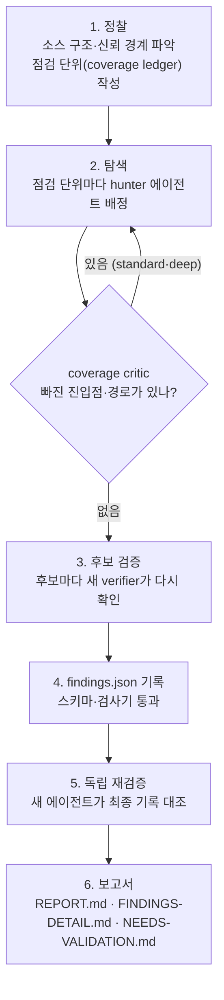

> [!summary] 요약
> Cloudflare가 공개한 보안 점검용 에이전트 [[claude-code-and-skills|스킬]]입니다(MIT). 소스 코드를 근거로 "실제 신뢰 경계를 넘는" 취약점만 찾고, 증거·재현 방법·우선순위·가장 작은 수정안을 함께 내도록 절차를 정해 둡니다.
> - 평소에는 **가이드 모드**(범위를 좁혀 대화로 보고)로 쓰고, **전체 감사 모드**(6단계, 파일 생성)는 명시적으로 요청할 때만 돕니다.
> - 결과는 `confirmed` / `needs_validation` / `rejected`로 나뉘고, **심각도는 `confirmed`에만** 붙습니다.
> - 운영 서버·실제 계정에는 절대 요청을 보내지 않고, 대상 코드는 격리 환경에서만 실행합니다.

- 출처: [cloudflare/security-audit-skill](https://github.com/cloudflare/security-audit-skill). Cloudflare 사내 취약점 탐색 하네스의 출발점이 된 스킬이고, 그 과정은 블로그 글 [Build your own vulnerability harness](https://blog.cloudflare.com/build-your-own-vulnerability-harness)에 나와 있습니다.
- 필요 조건: 도구 호출과 **병렬 하위 에이전트**를 지원하는 모델, 결과 검사기용 Node.js, 대상 코드를 실행할 때 쓸 OS 수준 샌드박스. 샌드박스가 없으면 대상 코드를 실행하지 않고 의심 사항을 `needs_validation`으로 남깁니다.
- skills.sh 평가(2026-11-13 기준): Gen Agent Trust Hub Pass, Socket Pass, Snyk Warn.
- 저는 저장소마다 설치하지 않고 **전역(사용자 홈)** 에 설치해 씁니다. 실제 파일은 `~/.agents/skills/security-audit`에 있고, `~/.claude/skills/security-audit`는 그곳을 가리키는 심볼릭 링크입니다.

---

## 1. 설치·갱신·삭제

```bash
# 전역 설치 (홈 폴더에서 실행 — 저장소 안에서 실행하면 프로젝트 설치가 될 수 있음)
cd ~
npx skills add https://github.com/cloudflare/security-audit-skill --skill security-audit -g -y

# 갱신 / 목록 / 삭제
npx skills update -g security-audit
npx skills ls -g
npx skills remove -g security-audit
```

- `-g`(`--global`) 없이 저장소 안에서 실행하면 `<저장소>/.agents/`, `.claude/skills/security-audit`, `skills-lock.json`이 생깁니다. 저장소에 두지 않을 거라면 실수로 생긴 파일을 지웁니다.
- 전역 설치 기록은 `~/.agents/.skill-lock.json`에 남습니다(출처, 설치·갱신 시각, 폴더 해시).
- 설치 후 새 Claude Code 세션부터 스킬 목록에 `security-audit`가 보입니다.
- 스킬은 에이전트 권한 그대로 실행됩니다. 갱신하면 `SKILL.md`와 `.cjs` 스크립트의 바뀐 부분을 한 번 확인합니다.

## 2. 파일 구성

점진적 공개(Progressive Disclosure) 구조입니다. `SKILL.md`만 먼저 읽고, 나머지는 단계와 대상에 맞는 것만 불러옵니다.

| 파일 | 역할 |
|---|---|
| `SKILL.md` | 진입점. 두 가지 모드, 실행 안전 규칙, 심각도 기준, 전체 감사 6단계, 하지 말아야 할 것 |
| `RECONNAISSANCE.md` | 정찰: 소스 구조·신뢰 경계·점검 단위(coverage ledger) 정하기, 이전 실행 결과 읽기 |
| `HUNTING.md` | 탐색: 점검 단위별 하위 에이전트 배정, 후보 통과 기준(candidate gate), 결과 형식, 누락 검토(coverage critic) |
| `VALIDATION-AND-REPORTING.md` | 후보 검증, 독립 재검증, 보고서 작성 |
| `ATTACK-CLASSES.md` | 공격 유형 목록(공통) |
| 영역별 문서 10개 | 아래 표에서 대상에 맞는 것만 읽음 |
| `report-schema.json`, `validate-findings.cjs`, `validate-coverage-ledger.cjs` | 전체 감사 결과(JSON) 형식 검사기. node로 파일을 읽어 검사만 함(네트워크·외부 실행 없음) |
| `*.test.cjs` | 위 검사기의 테스트 |

| 영역별 문서 | 이럴 때 읽음 |
|---|---|
| `WEB-PROTOCOL-AND-AUTH` | HTTP 파싱·캐시, 세션, JWT·OAuth, 비밀번호 찾기, CSRF 등 서버 쪽 인증 |
| `CLIENT-SIDE` | 브라우저에서 신뢰 판단이나 외부 입력 렌더링이 일어날 때(XSS, postMessage, 브라우저 저장소) |
| `DATA-ISOLATION-AND-LIFECYCLE` | 권한별 데이터, 캐시·검색·내보내기 사본, 삭제·보존 |
| `AI-AND-LLM` | 챗봇, RAG, 에이전트 메모리, 도구 호출, MCP, 모델 출력으로 동작하는 코드(프롬프트 인젝션 등) |
| `SUPPLY-CHAIN-AND-RELEASE` | 의존성, CI, 릴리스·서명, 플러그인·업데이트 |
| `CLOUD-AND-DEPLOYMENT` | 클라우드 권한, 컨테이너, 서버리스, 인그레스, 환경별 설정 |
| `RESOURCE-EXHAUSTION-AND-AVAILABILITY` | 외부 입력으로 CPU·메모리·유료 API·큐를 고갈시키거나 공유 서비스를 멈출 수 있을 때 |
| `PROTOCOLS-RPC-AND-MESSAGING` | gRPC, GraphQL, 웹훅, 메시지 큐 |
| `DESKTOP-MOBILE-AND-LOCAL-IPC` | 데스크톱·모바일 앱, 로컬 데몬, 딥링크, 웹뷰 브리지 |
| `MEMORY-SAFETY-AND-BINARY` | C/C++, Rust `unsafe`, FFI, 바이너리 파서 |

일반적인 웹 서비스(서버 렌더링 + API 서버 + LLM 기능)라면 주로 `WEB-PROTOCOL-AND-AUTH`, `CLIENT-SIDE`, `DATA-ISOLATION-AND-LIFECYCLE`, `AI-AND-LLM`을 쓰게 됩니다.

## 3. 두 가지 모드

| | 가이드 모드 (기본) | 전체 감사 모드 |
|---|---|---|
| 언제 | 범위를 좁힌 점검, 보안 질문, 특정 의심 사항 조사 | "전체 보안 감사", "모의해킹", "보고서 파일로"처럼 **명시적으로** 요청할 때만 |
| 하는 일 | 필요한 부분만 읽고 결과를 대화로 보고(필요하면 하위 에이전트 사용) | 6단계(정찰 → 탐색 → 후보 검증 → JSON 기록·검사 → 독립 재검증 → 보고서) |
| 파일 생성 | 없음 | 저장소 **밖** `~/security-audit-skill/<repo>/run-N/`에 결과 파일 |
| 비용 | 작음 | 큼(하위 에이전트 여러 개). `quick` / `standard`(기본) / `deep` 프로필, 범위 지정, 에이전트 수 예산을 줄 수 있음 |

애매하게 요청하면 스킬이 어느 모드인지 먼저 묻습니다. 스킬을 불러왔다고 해서 전체 감사나 파일 생성이 허용된 것은 아닙니다.

### 3.1 전체 감사 6단계



- **역할 분리**: 찾는 에이전트(hunter), 빠진 곳을 보는 에이전트(critic), 확인하는 에이전트(verifier)를 나눕니다. 확인은 후보를 찾지 않은 **새 에이전트**가 합니다. 찾은 쪽이 스스로 맞다고 판정하는 편향을 막기 위해서입니다. [[fold-subagents-into-main-loop|서브에이전트를 메인 에이전트 루프로 합치기]]에서 말하는 "독립 검증이 필요할 때는 서브에이전트가 맞다"는 경우에 해당합니다.
- **공유 파일**: `findings.json`, 보고서 같은 공유 파일은 부모(조정) 에이전트만 씁니다. 하위 에이전트는 자기 `agents/<id>/scratch/`에만 쓸 수 있습니다.
- **종료 조건**: 실행은 두 상태 중 하나로만 끝납니다.
  - 보고서 3개가 작성되고 검사기 2개를 통과함
  - `run_status: "incomplete"`와 그 이유를 기록하고, 보고서에 빠진 부분을 밝힘

| 결과 파일 | 내용 |
|---|---|
| `run-metadata.json` | 대상, 소스 커밋, 프로필, 범위, 예산, 실행 상태 |
| `architecture.md` | 정찰 단계의 구조·신뢰 경계 요약 |
| `coverage-ledger.json` | 점검 단위별 진행 상태(무엇을 봤고 무엇이 남았는지) |
| `findings.json` | 최종 기록(`confirmed` / `needs_validation` / `rejected`) |
| `REPORT.md` | 요약 보고서 |
| `FINDINGS-DETAIL.md` | 확정 취약점 상세 |
| `NEEDS-VALIDATION.md` | 확인이 필요한 항목과 확인 방법 |

### 3.2 프로필과 예산

| 프로필 | 하는 일 | 쓸 때 |
|---|---|---|
| `quick` | 점검 단위를 크게 묶고, 탐색 1회 + 누락 검토 1회. 검토에서 나온 추가 단위는 `deferred`로만 남김 | 작은 대상, 재실행, 빠른 첫 점검 |
| `standard` | 문서에 적힌 그대로. 누락이 없을 때까지 탐색과 누락 검토를 반복 | 기본값 |
| `deep` | 하위 시스템·생애주기별로 잘게 나누고, 후보 검증과 최종 재검증을 다른 에이전트가 맡음 | 위험도가 높거나 큰 대상 |

- 프로필은 점검의 **폭과 중복도**만 바꿉니다. 후보 통과 기준, 독립 검증, `needs_validation` 원칙은 줄지 않습니다.
- **예산**은 전체 단계의 에이전트 호출 수 상한입니다. 정찰 4회 + 누락 검토 + 최소 1회 검증을 먼저 떼어 두고 남는 만큼 탐색에 씁니다. 이 최소분도 안 되는 예산이면 아무 에이전트도 띄우지 않고 범위·프로필·예산 조정을 요청합니다.
- 예산이 모자라 후보를 다 검증하지 못하면 `incomplete`로 끝내고, 검증하지 못한 후보를 따로 표시합니다. 정해 준 예산을 몰래 넘기지 않습니다.
- **이전 실행 결과**는 같은 결과 폴더의 이전 `run-N`을 읽어 이어서 씁니다.
  - 소스가 그대로면 이전 확정 건을 다시 찾지 않고 재확인만 합니다.
  - 소스가 바뀐 곳과 이전에 `needs_validation`·`deferred`였던 곳은 다시 작업 대상이 됩니다.
- README에 따르면 **한 번 실행으로 찾는 취약점은 여러 번 실행해 찾은 전체의 절반 정도**입니다. 중요한 범위는 반복 실행을 권장합니다.

## 4. 요청 예시

가이드 모드 — 평소에는 이렇게 씁니다. (경로는 예시입니다)

```text
/security-audit 가이드 모드로 src/routes/admin/users.ts 와 관련 화면 코드를 점검해줘.
                인증 게이트, SQL 입력 처리, 수정·삭제 권한을 봐줘.
```

```text
security-audit 스킬로 이번 브랜치 변경분(git diff main...HEAD)만 점검해줘. 파일은 만들지 마.
```

```text
src/routes/mypage/profile.ts 의 프로필 수정 API가 다른 회원 데이터를 바꿀 수 있는지 security-audit 기준으로 봐줘.
```

전체 감사 — 비용을 정하고 범위를 좁혀서 요청합니다.

```text
security-audit 전체 감사를 quick 프로필로 src/routes/payment/ 만 대상으로 해줘. 에이전트 예산 15개.
```

- 결과 폴더는 저장소 밖(기본 `~/security-audit-skill/<repo>/run-N`)에 생깁니다. 저장소 안으로 지정하려면 git이 무시하는 폴더여야 합니다.
- 범위 지정·`quick` 결과는 "부분 점검"으로 표시됩니다. 나머지가 안전하다는 뜻이 아닙니다. 범위 밖은 `covered`가 아니라 `out_of_scope`로 기록됩니다.
- 예산 15개는 `quick`에서 정찰 4 + 누락 검토 1 + 검증분을 떼고 나면 탐색에 쓸 수 있는 호출이 많지 않습니다. 후보가 많이 나오면 `incomplete`로 끝날 수 있습니다.

## 5. 결과 읽는 법

| 상태 | 뜻 | 심각도 |
|---|---|---|
| `confirmed` | 소스(필요하면 격리된 로컬 시험)로 경계 침범과 결과를 확인함 | critical / high / medium / low / informational |
| `needs_validation` | 소스상 의심되지만 결정적 사실이 소스 밖(웹 서버 설정, 운영 계정 구성 등)에 있음. 무엇을 확인하면 되는지 함께 나옴 | 없음 |
| `rejected` | 검증 결과 문제 아님 | 없음 |

- **후보 기록 형식**: 모든 후보에 "누가(낮은 권한) → 무엇을 입력 → 어떤 통제를 → 어떤 경계를 넘어 → 누구의 무엇에 → 어떤 결과"를 적게 합니다. "모범 사례가 아님"만으로는 취약점으로 올리지 않습니다.
- **심각도 기준**
  - critical: 비로그인 상태에서 코드 실행, 전체 DB 접근, 임의 계정 탈취
  - high: 인증 우회, 타 회원 데이터 읽기·쓰기, 다른 사용자에게 실행되는 저장형 XSS
  - medium: 조건이 까다롭거나 범위가 좁은 경계 침범
  - low: 비밀이 아닌 내부 정보 노출
  - informational: 확인은 됐지만 영향이 미미한 관찰
- **high와 medium의 구분**: 명시적인 보안 통제를 **완전히 무력화**했는가, 아니면 **약화**만 했는가로 나눕니다. 구체적인 피해를 말할 수 없으면 생각보다 낮은 등급입니다.
- **`needs_validation`의 의미**: "확신이 낮은 취약점"이 아니라 "**확인이 막힌 가설**"입니다. 그래서 심각도를 붙이지 않습니다.
- **수정안**: 코드가 지켜야 할 불변 조건과, 마지막 신뢰 판단 지점에서 그것을 지키게 하는 **가장 좁은 수정**을 제시합니다. 일반적인 보안 강화 조언보다 파일 단위 수정과 회귀 테스트를 우선합니다.

> [!note] 스킬이 취약점으로 올리지 않는 것 (SKILL.md의 Anti-patterns)
> - 체크리스트 위반만으로 취약점이라 하는 것
> - 실제로 넘을 수 있는 경계가 없는 다중 방어 조언
> - 소스에 없는 프록시·브라우저·배포 동작을 추측하는 것
> - 자기 권한 안의 동작이나 자기 자신에게만 미치는 영향을 경계 침범이라 하는 것
> - 관찰한 것보다 센 결과로 부풀리는 것(예: 크래시 → 코드 실행)
> - `needs_validation`에 심각도를 붙이는 것
> - 독립 재검증 전에 보고서를 쓰는 것, 보고서와 JSON이 서로 다른 것

## 6. 안전하게 쓰기 위한 규칙

스킬 자체 규칙에, 실제로 써 보면서 정한 규칙을 더했습니다.

- **운영 서버·운영 DB·실제 계정에 요청을 보내지 않습니다.** 스킬도 배포된 엔드포인트, 외부 서비스, 공유 인프라, 다른 사용자 데이터에 대한 시험을 금지합니다.
- 대상 코드를 실행해야 하면 다음 조건을 **모두** 갖춘 격리 환경에서 가짜 데이터로만 합니다. 하나라도 못 갖추면 실행하지 않고 `needs_validation`으로 남깁니다.
  - 외부 네트워크 차단(로컬 루프백만)
  - 허용 목록으로만 채운 빈 환경변수
  - 대상과 도구는 읽기 전용, 쓰기는 지정된 `scratch/`만
  - CPU·메모리·프로세스·디스크·시간 제한
  - 예: 화면 XSS를 재현할 때는 공유 개발 DB 대신, 저장소에 있는 UI 라이브러리와 가짜 데이터로 만든 HTML을 외부 요청을 막은 헤드리스 브라우저(Playwright)에서 열어 확인합니다.
- 의존성을 새로 설치하거나 빌드가 내려받게 하지 않습니다. 로컬에 있는 도구만 씁니다. 유료 API 사용량도 쓰지 않습니다.
- 여러 사람이 함께 쓰는 개발 DB라면, DB가 꼭 필요할 때만 테스트용 계정 데이터를 따로 만들어 쓰고 끝나면 지웁니다.
- 관리자 인증 정보는 조회하지 않습니다. 관리자 로그인이 필요한 확인은 `needs_validation`으로 남기고 사람이 브라우저로 확인합니다.
- 스킬은 수정안만 냅니다. 실제 수정은 따로 요청해 평소 작업 절차(개발 확인 → 커밋 → 배포)로 진행합니다.

## 7. 써 보니

관리자 화면 하나를 가이드 모드로 점검해 봤습니다. 결과는 대략 이런 모양으로 나옵니다(내용은 일반화했습니다).

| 항목 | 결과 |
|---|---|
| SQL 입력 | 문제 없음 — 모든 쿼리가 파라미터 바인딩, 코드 값 검사, 처리자 정보는 세션 값 사용 |
| 후보 목록 HTML | 문제 없음 — 이스케이프 후 HTML 생성 |
| 목록 그리드 셀 | **confirmed(medium 이하)** — 그리드 컴포넌트가 셀 값을 HTML로 넣음. 격리 시험에서 `` 실행 확인. 일반 사용자가 자기 정보에 넣은 값이 관리자 화면에서 실행될 수 있음. 비슷한 다른 화면은 이미 셀 이스케이프 함수를 쓰는데 이 화면만 빠져 있었음 → 이스케이프 추가 후 같은 시험에서 글자로만 표시됨 확인 |
| 메뉴 권한 | needs_validation — 관리자 게이트가 로그인만 확인하고 메뉴별 권한은 서버에서 검사하지 않음. 이 화면을 쓰면 안 되는 관리자 계정이 실제로 있는지 확인 필요 |
| CSRF | needs_validation — 변경 POST에 토큰 없음. 세션 쿠키 SameSite 설정(웹 서버 설정)에 따라 결정 |

확정과 확인 필요를 나누고 "실제로 누가 그 값을 넣을 수 있는가"까지 추적하게 해 줘서 보고서 근거로 쓰기 좋았습니다. 특히 "다른 화면에는 있는 방어가 이 화면에만 빠졌다"처럼, 같은 저장소 안의 기존 패턴과 비교해 누락을 찾는 점이 유용했습니다. 평소에는 가이드 모드로 범위를 좁혀 쓰고, 전체 감사는 범위·프로필·예산을 정해 요청합니다.

> [!tip] 스킬을 만들 때 참고할 예시
> 운영 중 발생하는 오류는 Sentry 같은 모니터링 도구로 보고, 이 스킬은 배포 전 소스 점검에 씁니다. 스킬 구조 자체(점진적 공개, 참조 파일 분리, 검사 스크립트 동봉)는 직접 스킬을 만들 때 좋은 예시입니다.

---
##### 참조
[GitHub: cloudflare/security-audit-skill](https://github.com/cloudflare/security-audit-skill) / [skills.sh 페이지](https://skills.sh/cloudflare/security-audit-skill/security-audit)
[Cloudflare 블로그: Build your own vulnerability harness](https://blog.cloudflare.com/build-your-own-vulnerability-harness)

##### 관련 글
- [[claude-code-and-skills|Claude Code 핵심 기능과 스킬 작성법]] — 스킬 구조(점진적 공개, 참조 파일·스크립트 동봉) 작성 원칙, 스킬 설치 위치와 Skills·Subagents 기능
- [[fold-subagents-into-main-loop|서브에이전트를 메인 에이전트 루프로 합치기]] — 독립 검증이 필요할 때 서브에이전트를 쓰는 기준 (hunter·critic·verifier 분리)
- [[hermes-agent|Hermes Agent]] — `hermes security audit`(플러그인 공급망 점검) 등 에이전트 자체의 보안 설정
- [[llm-as-a-judge-in-practice|LLM-as-a-Judge 실전]] — 결과를 독립 에이전트로 검증·채점하는 구조의 다른 사례
