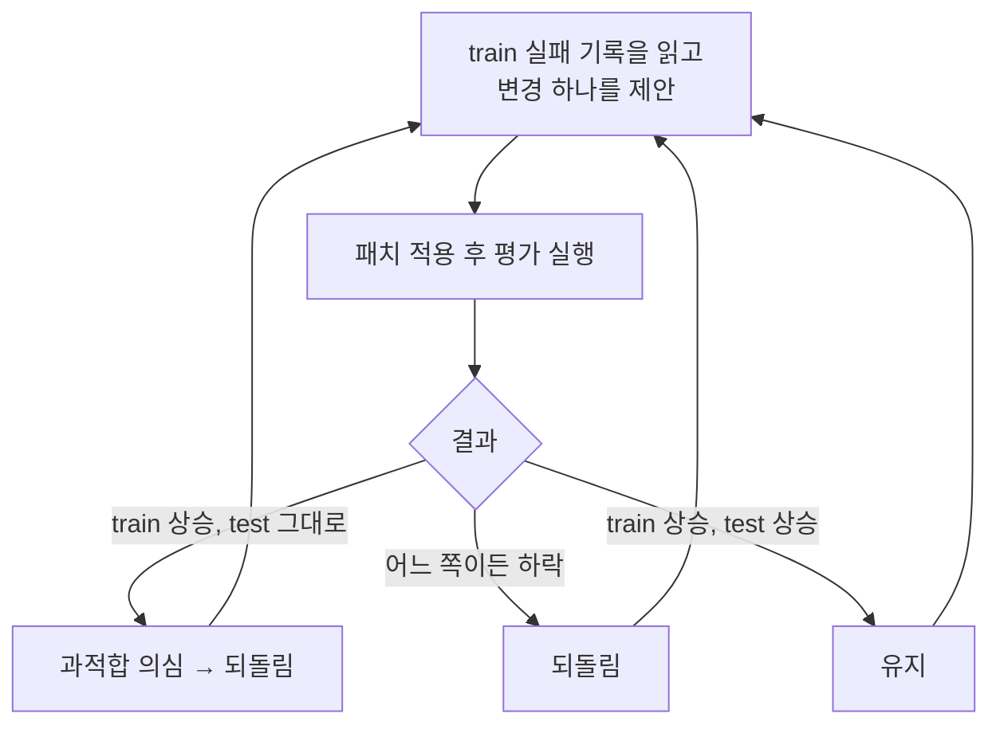

## LLM-as-a-Judge 복습

평가 기준이 담긴 프롬프트를 주고 다른 LLM이 응답을 채점하게 하는 방식입니다. 기준(사실성, 유용성, 안전성 등), 점수 범위, 각 점수의 의미를 구체적으로 써 주고, 점수와 함께 근거를 출력하게 합니다.

- **절대 평가**: 응답 하나를 단독으로 채점. G-Eval처럼 Chain-of-Thought로 기준을 세분화하는 방식이 대표적입니다.
- **비교 평가(Pairwise)**: 두 응답을 나란히 놓고 더 나은 쪽을 고름. MT-Bench, Chatbot Arena가 쓰는 방식이고, 모델 교체 평가에도 잘 맞습니다([[llm-model-change-evaluation]]).

편향 세 가지(자기 선호, 장문, 위치)는 [[llm-evaluation-metrics-and-benchmarks]]에서 다뤘습니다. 이 글은 "그래서 실제로 어떻게 쓰나"에 대한 정리입니다.

## judge 후보에서 먼저 걸러야 할 것

judge를 고르다 보면 생각보다 선택지가 좁다는 걸 알게 됩니다. 두 가지는 처음부터 후보에서 빼야 합니다.

- **임베딩·리랭커 모델은 judge가 될 수 없습니다.** 둘 다 텍스트를 벡터나 관련도 점수로 바꾸는 인코더 구조라, "판단하고 이유를 서술하는" 생성형 대화 자체가 안 됩니다. 같은 모델 계열 이름이 붙어 있어도 역할이 완전히 다릅니다.
- **생성 모델과 같은 가중치는 judge로 쓰면 안 됩니다.** 서빙 이름이나 용도별 별칭이 달라도 물리적으로 같은 모델이면 "자기가 자기를 채점하는" 상황이 됩니다. 자기 선호 편향이 그대로 들어옵니다.

남는 선택지는 보통 둘입니다.

1. 다른 계열의 채팅형 모델을 judge 전용으로 별도 배포 (가능하면 더 큰 모델)
2. 외부 API 모델을 judge로 사용 (평가 데이터를 외부로 보내도 되는지 먼저 확인)

## 좋은 평가의 네 가지 조건

Anthropic의 *Automating eval design and hillclimbing with Claude*는 평가를 설계할 때 확인할 조건을 이렇게 정리합니다.

1. **실제 운영 환경을 반영한다**: 만들기 쉽거나 채점하기 쉬운 과제가 아니라, 기능이 실제로 쓰일 상황에서 과제를 뽑습니다.
2. **더 강한 모델·더 많은 추론일수록 점수가 오른다**: 그렇지 않다면 과제가 모호하거나 채점기가 잘못 맞춰져 있을 가능성이 큽니다.
3. **최고 모델에도 넘을 수 있는 여유가 있다**: 최고 설정도 100%보다 한참 낮아야 변경의 효과를 판단할 수 있습니다. 단, 그 여유가 불가능하거나 모호한 과제 때문이면 안 됩니다. 좋은 과제는 두 명의 전문가가 같은 판정을 내리는 과제입니다.
4. **실행마다 편차가 작다**: 편차가 크면 대개 과제가 모호하거나, 같은 출력에 채점기가 다른 판정을 내리는 경우입니다.

> [!warning] 적대적 샘플링의 함정
> "오늘의 모델이 틀린다"는 이유로 과제를 고르면, 평가는 본질적으로 어려운 것이 아니라 **그 모델의 실패 패턴**을 측정하게 됩니다. 어려운 과제는 사람이 왜 어려운지 설명할 수 있을 때 넣고, 운영 로그·버그 리포트에서 나온 실제 실패 사례를 포함합니다. 반대로 사용자 트래픽만 믿으면 사용자가 "잘될 것 같은 것만" 시도하는 경향 때문에 쉬운 쪽으로 치우칠 수 있습니다.

## 채점기부터 검증하기

글에서 가장 기억에 남은 문장은 "채점된 기록을 직접 읽어 보기 전에는 채점기를 믿지 말라"였습니다. 채점 오류는 평가가 잘못 설계되는 가장 흔한 원인 중 하나입니다.

| 채점 방식 | 언제 | 방법 |
|---|---|---|
| 프로그램 검증 | 출력이 제한된 경우 | 정확히 일치, 정해진 라벨 중 하나, JSON 스키마, 테스트 통과 |
| LLM-as-a-Judge | 출력은 자유롭지만 기준이 명확한 경우 | 다른 모델이 입력·출력·루브릭을 읽고 근거와 함께 점수 반환 |

출력에 맞는 **가장 싼 채점기**를 먼저 고르고, judge를 쓸 때는 세 가지 원칙을 지킵니다.

- 루브릭은 1~5점 척도보다 **확인 가능한 주장(checkable claims)** 목록으로 쓴다
- 기준선과 비교할 때는 두 출력을 **무작위 순서로**, 어느 쪽이 기준선인지 모르게 보여준다
- **평가 대상 모델을 judge로 쓰지 않는다**

기준선을 돌릴 때 함께 확인할 진단 항목도 있습니다.

- **채점기 일관성**: 같은 출력을 두 번 채점해 판정이 바뀌는지
- **배관(plumbing)**: 타임아웃, API 오류, 잘린 답변 같은 인프라 잡음을 모델 성능 차이로 착각하지 않도록 따로 집계
- **여유(headroom)**: 기준선이 이미 95% 이상이면 품질 개선 효과를 측정할 수 없으니, 비용이나 지연 시간을 목표로 삼기

RAGAS나 DeepEval의 지표도 결국 "채점기"이므로 같은 검증이 필요하다고 생각합니다([[rag-evaluation-ragas-deepeval]]).

## 힐클라이밍과 과적합

믿을 수 있는 채점기가 생기면 점수를 끌어올릴 수 있습니다. 프롬프트·스킬 문서처럼 **바꾸고 되돌리기 싼 대상**, 점수 변화의 **원인을 특정할 수 있는 대상**이 좋은 개선 대상입니다. "성능 개선해 줘"처럼 범위가 모호하면 멈추기 쉽고, 평가가 포화된 경우에는 "성능은 유지하면서 비용 줄이기"가 좋은 목표가 됩니다.

문제는 평가가 실제 운영 분포와 완전히 같을 수 없다는 점입니다. 점수는 오르는데 실제로는 그대로인 과적합이 생깁니다. 벤치마크 특유의 표현에 맞춰 프롬프트가 튜닝되거나, 읽은 실패마다 패치를 하나씩 붙이는 식입니다.

> [!tip] 과적합 방지책
> - 사례를 **train / test로 나누고**, 개선하는 쪽은 test를 보지 않는다
> - 실패 기록을 읽더라도 **그 내용을 프롬프트에 복사하지 않는다**
> - 정답을 구조적으로 모델 손에 닿지 않게 둔다 (보상 해킹 방지)
> - 첫 라운드 전에 **평가 잡음**이 의미 있게 볼 최소 개선폭보다 작은지 확인한다. 개선폭이 잡음 범위 안이면 머지하지 않는다

글의 사례 중 인상 깊었던 것은 점수가 정체됐을 때의 대응입니다. 더 고치지 않고 **남은 실패를 원인별로 분류**해 보니 원인이 "내용 부족"이 아니라 "모델이 학습 데이터의 옛 API 형태로 코드를 쓰는 것"이었고, 일부는 채점기 자체가 틀린 경우였습니다. 점수가 안 오를 때는 채점기부터 의심하라는 교훈입니다.

## 정리

- judge 선택에서 가장 먼저 확인할 것은 "생성형 모델인가", "평가 대상과 다른 모델인가"입니다.
- 채점기는 사람이 직접 몇 개를 읽어 보고, 같은 출력을 두 번 채점해 본 뒤에 믿습니다.
- 점수를 올릴 때는 한 번에 하나씩 바꾸고, 따로 떼어 둔 test 세트로 과적합을 잡습니다.

이 시리즈는 [[llm-evaluation-metrics-and-benchmarks]] → [[rag-evaluation-ragas-deepeval]] → [[llm-model-change-evaluation]] → 이 글 순서로 읽으면 됩니다.

##### 참조
- [Automating eval design and hillclimbing with Claude (claude.dev)](https://claude.dev/blog/automating-eval-design-and-hillclimbing/)
- [Demystifying evals for AI agents (Anthropic Engineering)](https://www.anthropic.com/engineering/demystifying-evals-for-ai-agents)
- [claude-api 스킬 (anthropics/skills)](https://github.com/anthropics/skills/tree/main/skills/claude-api)
