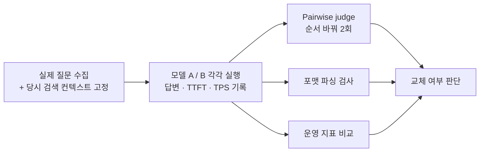

## 무엇을 평가하고 싶은가

RAG 파이프라인 전체의 품질이 아니라, **LLM 자체의 변경**으로 인한 차이만 보고 싶을 때가 있습니다.

- 다른 오픈 웨이트 모델로 교체
- 양자화(Quantization) 적용
- 파인튜닝(Fine-tuning)

이때 검색 결과까지 매번 달라지면, 점수가 바뀌어도 그게 모델 때문인지 검색 때문인지 알 수 없습니다. 그래서 대원칙은 하나입니다.

> **검색 결과를 고정(freeze)하고, 같은 프롬프트와 같은 컨텍스트를 줬을 때 답이 어떻게 달라지는지 측정한다.**

[[rag-evaluation-ragas-deepeval]]이 검색과 생성을 **나눠서** 보는 방법이었다면, 이 글은 검색을 **고정해서** 생성만 보는 방법입니다.

## 네 가지 평가 축

### 1. 1:1 비교 평가 (Pairwise LLM-as-a-Judge) - 가장 추천

기존 모델 A와 새 모델 B의 답을 나란히 두고, judge 모델이 블라인드로 더 나은 쪽을 고르게 합니다. Chatbot Arena나 MT-Bench에서 쓰는 방식입니다.

- **원리**: 같은 평가 데이터셋(프롬프트 + 고정된 검색 문서)을 두 모델에 각각 넣어 답 A와 답 B를 얻고, judge에게 "어느 쪽이 지시를 더 잘 따르고, 더 정확하고, 더 유창한지" 묻습니다.
- **지표**: 승률(Win Rate). "새 모델이 기존 모델 대비 65%의 프롬프트에서 더 낫거나 같다"처럼 직관적인 결과를 얻습니다.
- **주의**: judge는 먼저 제시된 답을 선호하는 위치 편향이 있으므로, **A/B 순서를 바꿔 두 번** 평가(swap test)하는 것이 원칙입니다.

### 2. G-Eval 기반 절대 평가 (다차원 채점)

두 모델을 비교하는 대신 각 답에 독립적으로 점수를 매겨 평균을 냅니다. Chain-of-Thought로 judge가 기준에 따라 1~5점을 줍니다.

- **유창성·일관성**: 문법이 자연스럽고 논리 흐름이 매끄러운가. 파인튜닝이나 과도한 양자화 뒤에는 어휘력이 떨어지는 경우가 많아 이를 잡아냅니다.
- **어조·페르소나 유지**: 시스템 프롬프트에서 지시한 어조를 끝까지 유지하는가.
- **간결성**: 불필요하게 장황하지 않은가. 작은 모델일수록 말을 끝맺지 못하고 반복하는 장황함(verbosity)이 자주 나타납니다.

### 3. 지시 이행·포맷 준수 (IFEval 방식)

RAG 시스템에서 LLM은 글만 쓰는 게 아니라 **시스템의 부품**으로 동작합니다. 그래서 포맷을 기계적으로 잘 지키는지가 중요하고, 이건 judge 없이 정규식이나 파서로 객관적으로 채점할 수 있습니다.

- "JSON으로만 출력하라"는 지시에서 `json.loads()`가 에러 없이 되는 비율
- "3문장 이내로 요약하라"는 지시에서 실제 문장 수

내용이 좋아도 JSON이 깨져서 애플리케이션이 에러를 낸다면, 그 모델은 그 자리에 부적합합니다.

### 4. 운영 지표

품질과 함께 **비용과 속도**를 봐야 합니다. 품질이 약간 떨어져도 속도가 두 배 빠르면 교체할 가치가 있을 수 있기 때문입니다.

| 지표 | 의미 |
|---|---|
| TTFT (Time To First Token) | 질문 후 첫 글자가 찍히기까지의 시간. 체감 반응 속도 |
| TPS (Tokens Per Second) | 초당 생성 토큰 수. 생성 속도 |
| VRAM 사용량 | 새 모델이나 양자화(GGUF, AWQ 등)를 적용했을 때 GPU 메모리에 안정적으로 올라가는지 |

## 교체 테스트 워크플로

1. **프롬프트·컨텍스트 고정**: 실제 사용자 질문 100~200개를 뽑고, 그때 검색된 문서를 하드코딩해 묶어 둡니다. 검색기 성능이라는 변수를 완전히 통제하기 위해서입니다.
2. **실행과 로깅**: 고정된 데이터셋을 모델 A와 B에 각각 통과시키고 답변과 생성 시간을 기록합니다.
3. **judge 선택**: 보안상 외부 API를 쓸 수 없는 환경이라면, Prometheus-2처럼 평가 목적으로 만든 모델이나 대형 instruct 모델을 내부에 띄워 judge로 쓸 수 있습니다. 어떤 경우든 **평가 대상과 다른 모델**이어야 합니다.
4. **포맷 테스트**: 구조화된 출력을 요구한 프롬프트들이 에러 없이 파싱되는 비율을 확인합니다.

> [!tip] 품질과 운영 지표를 한 표에
> 승률, 차원별 점수, 파싱 성공률, TTFT·TPS·VRAM을 **한 표에 같이** 놓고 판단하는 것이 핵심이라고 생각합니다. 품질만 보면 늘 큰 모델이 이기고, 속도만 보면 늘 작은 모델이 이깁니다.

judge 자체를 고르고 검증하는 방법은 [[llm-as-a-judge-in-practice]]에서 이어서 다룹니다.
