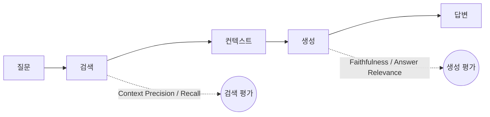

## RAG는 왜 따로 평가해야 하나

[[llm-evaluation-metrics-and-benchmarks]]에서 본 일반적인 LLM 평가는 "답이 좋은가"만 봅니다. RAG(Retrieval-Augmented Generation) 파이프라인에서는 질문이 더 늘어납니다.

- 검색된 문서가 질문과 관련이 있는가?
- 모델이 검색된 문서에 **충실하게** 답했는가?
- 답에 필요한 정보가 검색 결과에 빠짐없이 들어 있는가?

답이 틀렸을 때 검색이 문제인지 생성이 문제인지 모르면 고칠 방향도 정할 수 없습니다. 그래서 단계를 나눠서 평가합니다.

## RAGAS: 검색과 생성을 분리해서 본다

RAGAS(RAG Assessment)는 **질문, 검색된 컨텍스트, 생성된 답변, 사람이 작성한 정답**을 입력으로 받아 네 가지 핵심 지표를 계산합니다.

| 지표 | 단계 | 계산 방식 | 점수가 낮으면 |
|---|---|---|---|
| 충실도(Faithfulness) | 생성 | 답변을 개별 주장으로 분해하고, 각 주장이 컨텍스트로 뒷받침되는지 판정 | 근거 없는 내용(환각)을 생성 중 |
| 답변 관련성(Answer Relevance) | 생성 | 답변으로부터 역질문을 여러 개 만들고, 원래 질문과의 임베딩 코사인 유사도 계산 | 의도를 못 잡았거나 불필요한 내용이 많음 |
| 컨텍스트 정밀도(Context Precision) | 검색 | 유용한 문서가 검색 결과 상위에 있는지. 정답(golden set)이 필요 | 랭킹 품질 문제 |
| 컨텍스트 재현율(Context Recall) | 검색 | 정답 문장 중 컨텍스트로 뒷받침되는 비율 | 필요한 문서를 놓치는 중 |

점수가 낮을 때 손볼 곳도 지표마다 다릅니다.

- **답변 관련성**이 낮으면: 프롬프트에서 질문의 초점을 명확히 지시하거나 답변 길이를 제한합니다.
- **컨텍스트 정밀도**가 낮으면: 관련 문서를 상위로 올리는 랭킹, 예를 들어 리랭커 도입을 검토합니다.
- **컨텍스트 재현율**이 낮으면: 청크 크기 조정, 검색 쿼리 확장, 색인 대상 문서 보강을 시도합니다.

> [!tip] 운영할 때 기억할 것
> 지표 계산에 LLM 호출이 들어가기 때문에 API 비용이 발생하고, 평가 데이터셋도 충분히 커야 의미가 있습니다. 충실도와 답변 관련성은 결국 LLM이나 임베딩 모델이 판정하는 값이라, 판정 자체가 일관적인지도 확인해야 합니다([[llm-as-a-judge-in-practice]]).

## DeepEval: LLM 평가를 테스트 코드처럼

LLM 애플리케이션이 모두 RAG는 아닙니다. 챗봇, 요약, 분류, 코드 생성 같은 작업에도 환각·유해성·관련성은 측정해야 합니다. DeepEval은 이런 범용 평가를 위한 오픈소스 Python 프레임워크입니다.

- **pytest와 통합**되도록 설계되어 있어, 기존 테스트 흐름에 그대로 얹을 수 있습니다.
- 자연어 출력은 기대값과 단순 비교가 안 되기 때문에, 품질 속성을 0~1 점수로 바꾸는 **메트릭** 단위로 접근합니다.
- 메트릭을 고르고 **통과 기준(threshold)** 을 정한 뒤 테스트를 실행합니다.

대표 내장 메트릭은 이렇습니다.

| 메트릭 | 보는 것 |
|---|---|
| GEval | 평가 기준을 자연어로 쓰면 평가용 LLM이 그 기준으로 채점 (LLM-as-a-Judge 기반) |
| Hallucination | 주어진 컨텍스트에 없는 내용을 만들었는지 |
| Toxicity | 욕설·혐오·차별·폭력적 표현이 있는지 |
| 그 밖에 | 답변 관련성, 충실도, 컨텍스트 정밀도·재현율, 편향, 요약 품질 등 |

## 어떻게 나눠 쓸까

두 도구를 정리하면서 든 생각입니다.

- **RAGAS**는 검색·생성을 나눠 보는 진단 도구에 가깝습니다. "어디가 문제인가"를 찾을 때 씁니다.
- **DeepEval**은 테스트 프레임워크에 가깝습니다. 메트릭과 threshold를 정해 두면 프롬프트나 모델을 바꿀 때마다 같은 기준으로 회귀 여부를 확인할 수 있습니다.
- 둘 다 RAGAS의 Faithfulness와 DeepEval의 Hallucination처럼 비슷한 개념을 다루므로, 한 시스템에서 중복으로 돌리기보다 **역할을 나눠** 쓰는 편이 비용 면에서도 낫다고 생각합니다.

처음부터 모든 지표를 다 붙이기보다 **검색과 생성을 분리해서 보는 것**부터 시작하는 것을 추천합니다. 답이 틀린 이유가 검색인지 생성인지만 알아도 고칠 곳이 절반으로 줄어듭니다.

다음 글 [[llm-model-change-evaluation]]에서는 반대로 검색을 고정하고 LLM만 바꿨을 때의 차이를 재는 방법을 다룹니다.

##### 참조
- [위키독스 - RAGAS를 이용한 RAG 평가](https://wikidocs.net/338723)
- [위키독스 - DeepEval을 이용한 자동 평가](https://wikidocs.net/338724)
