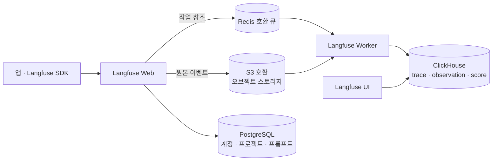
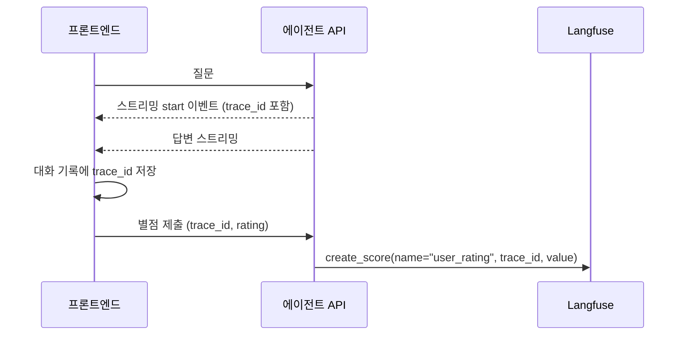

## 왜 LLM 앱에 관측성이 필요한가

LLM 앱은 같은 입력에도 같은 답을 하지 않습니다. 에이전트는 도구를 여러 번 호출하면서 내부 상태가 계속 바뀝니다. 그래서 기존 로그만으로는 **에이전트가 왜 그런 판단을 내렸는지** 추적하기 어렵습니다.

Langfuse는 LLM 애플리케이션을 위한 오픈소스 관측성(Observability) 플랫폼입니다. 퓨즈가 회로를 보호하고 감시하듯 앱 내부 흐름을 추적하고 시각화합니다. OpenTelemetry 기반으로 동작하고, 하나의 요청을 Trace로 기록해 LLM 호출·도구 실행·검색 결과를 타임라인으로 보여줍니다.

## 데이터 구조: Trace와 Observation

- **Trace**: 하나의 요청에 대한 전체 실행 흐름
- **Observation**: Trace 안의 개별 작업 단위
  - `span`: 일반 작업(함수 실행, DB 쿼리 등)
  - `generation`: LLM 호출(입력·출력·모델·토큰 수)
  - `event`: 특정 시점의 로그·메트릭
  - `tool`, `retriever`, `guardrail`: 도구 호출, 검색, 안전성 검사

여기에 `user_id`, `session_id`, `tags`(기능·버전·환경·모델별 필터링)를 붙이면 사용자별, 대화별, 실험별로 잘라 볼 수 있습니다.

## 주요 기능

| 기능 | 하는 일 |
|---|---|
| Tracing | 단계별 지연 시간, 토큰 사용량, 입출력 전문, 에이전트 그래프 시각화 |
| Users / Sessions | 사용자별 비용·사용량, 연속된 대화를 하나의 채팅방처럼 묶어 보기 |
| Prompt Management | 프롬프트를 코드 밖에서 버전 관리하고 레이블(production 등)로 배포. 문제가 생기면 이전 버전으로 롤백 |
| Evaluators | LLM-as-a-Judge 템플릿(환각, 관련성, 유용성, 유해성, 컨텍스트 관련성)으로 자동 채점 |
| Datasets & Experiments | 골든 데이터셋으로 프롬프트·모델 변경 전후를 비교하는 회귀 테스트 |
| Scores | 평가 결과를 담는 유연한 객체. 수치·범주·불리언, 출처(API·자동·수동) 구분 |

Score는 Trace(응답 품질), Observation(LLM 호출 단위 정확도), Session(대화 완결성), Dataset Run(실험 결과)에 각각 붙일 수 있습니다. 평가 방법은 LLM-as-a-Judge, 사람의 annotation, API·SDK로 직접 기록하는 커스텀 점수 세 가지입니다.

> [!tip] 프롬프트 관리가 생각보다 유용한 이유
> 시스템 프롬프트를 코드에 하드코딩하면 말투 하나 바꿀 때도 배포가 필요합니다. Langfuse에서 프롬프트를 버전 관리하면 UI에서 수정·배포하고, 버전별 지연·비용·평가 점수를 비교하고, 환각이 심해진 버전은 바로 롤백할 수 있습니다. Trace에 프롬프트 버전을 연결해 두면 "어떤 버전에서 이 답이 나왔는지"도 추적됩니다.

## 셀프호스팅 아키텍처



Langfuse는 원래 PostgreSQL을 메인으로 썼지만, v3부터 대용량 관측 데이터는 ClickHouse(실시간 분석에 특화된 컬럼 지향 OLAP DB)가 맡고, PostgreSQL은 계정·설정·프롬프트 같은 트랜잭션 데이터만 저장합니다. Redis 계열 큐는 Web과 Worker 사이의 버퍼 역할을 해서 웹 서버의 응답 지연을 막습니다.

> [!tip] "이벤트는 쌓였는데 화면에 안 보여요"
> Web은 원본 이벤트를 오브젝트 스토리지에 먼저 쓰고 큐에 작업을 넣습니다. Worker가 이를 처리해 ClickHouse에 넣어야 UI에 보입니다. 즉 스토리지에 이벤트가 있다는 건 Web까지만 도달했다는 뜻이고, 화면에 안 보이면 Worker → ClickHouse 단계를 봐야 합니다.

오브젝트 스토리지와 큐는 S3·Redis 호환 구현이면 다른 제품으로 바꿀 수 있어서, 라이선스 정책에 맞춰 구성요소를 고를 여지가 있습니다.

## Users 탭 켜기

Users 탭에는 별도 활성화 스위치가 없습니다. trace에 `user_id`가 실려 오면 자동으로 사용자별 집계(요청 수, 비용, 토큰 사용량)가 시작됩니다. 즉 할 일은 설정이 아니라 **trace 생성 코드에 `user_id`를 넣는 것**입니다.

OTel 기반 Python SDK에서는 trace 레벨 속성을 `propagate_attributes()` 컨텍스트 매니저로 설정합니다.

```python
import hashlib
from langfuse import Langfuse, propagate_attributes
from langfuse.langchain import CallbackHandler

langfuse = Langfuse()

def pseudonymize(email: str | None) -> str:
    # 사용자별로 안정적이지만 원문을 복원할 수 없는 값
    return hashlib.sha256(email.encode()).hexdigest()[:16] if email else "anonymous"

with langfuse.start_as_current_observation(as_type="span", name="workflow") as root:
    user = pseudonymize(email)
    # child span(LLM 호출)이 생기기 전에 진입해야 한다
    with propagate_attributes(user_id=user, session_id=f"{user}:{conversation_id}"):
        handler = CallbackHandler(
            trace_context={"trace_id": root.trace_id, "parent_span_id": root.id}
        )
        result = run_graph(callbacks=[handler])
        root.update(output=result)
```

SDK 소스를 확인하면서 알게 된 주의점입니다.

- 확인한 SDK 버전에서는 span 객체에 `update_trace()`가 없었습니다. trace 속성은 패키지 최상위의 `propagate_attributes()`로 설정합니다. 클라이언트 인스턴스의 메서드가 아니라 자유 함수입니다.
- `propagate_attributes()`는 진입 시점 이후에 생기는 span에만 전파됩니다. **늦게 들어가면 앞서 만든 span에는 적용되지 않습니다.**
- `CallbackHandler`의 `trace_context`는 이미 만든 trace에 span을 붙이는 용도이지, 메타데이터를 설정하는 용도가 아닙니다.
- `user_id`·`session_id`·`tags` 등은 문자열만 허용되고, 200자를 넘으면 예외 없이 경고만 남기고 조용히 버려집니다.
- 변경 전에 쌓인 trace에는 소급 적용되지 않습니다.

## 세션 ID 충돌과 개인정보

`session_id`를 정할 때 흔히 하는 실수가 있습니다. 대화방 번호처럼 **사용자마다 1부터 매겨지는 값**을 그대로 넘기면, 서로 다른 사용자의 첫 대화가 하나의 세션으로 묶입니다. Sessions 뷰는 `user_id`와 상관없이 `session_id`만으로 그룹화하기 때문입니다.

- 해결: `session_id`를 `{사용자 식별자}:{대화방 번호}`처럼 전역에서 유일하게 조합합니다.
- 개인정보: `user_id`에 이메일 원문을 넣으면 관측 도구에 PII가 그대로 저장됩니다. 사용자별로 안정적이면서 복원할 수 없는 값(예: 이메일 해시의 일부)으로 가명화하면 집계는 그대로 유지하면서 노출을 막을 수 있습니다.

## 사용자 별점을 Score로

채팅 화면의 별점을 해당 대화의 trace에 연결하면, 점수가 낮은 대화만 골라 원인을 분석할 수 있습니다.



- trace_id를 스트리밍 시작 이벤트에 실어 프론트엔드에 넘기고, 대화 기록과 함께 저장합니다.
- `score_id`를 `user_rating:{trace_id}`처럼 **결정적으로** 만들면 사용자가 별점을 다시 매겨도 새 Score가 쌓이지 않고 덮어써집니다.
- 0점(미평가)은 기록하지 않습니다.
- trace_id가 없는 이전 대화는 별점을 매겨도 Langfuse 호출을 조용히 건너뛰게 두면, 기존 별점 저장 흐름을 깨지 않고 점진적으로 도입할 수 있습니다.

## 정리

관측성은 로그를 남기는 것보다 "이 사용자가, 이 대화에서, 어떤 판단을 거쳐 이 답을 받았는가"에 답할 수 있게 만드는 일이라고 생각합니다. 그 위에 사용자 피드백과 자동 평가 Score를 올리면, 운영 로그에서 평가 데이터셋을 계속 보강할 수 있습니다([[llm-as-a-judge-in-practice]]). 관측 대상이 되는 그래프 구조는 [[langgraph-and-multiturn-routing]]에 정리했습니다.

##### 참조
- [Langfuse 공식 문서](https://langfuse.com/docs)
- [ClickHouse - Langfuse](https://clickhouse.com/docs/ko/cloud/features/ai-ml/langfuse)
- [RAG Observability and Evals (Langfuse 블로그)](https://langfuse.com/blog/2025-10-28-rag-observability-and-evals)
- [위키독스 - Langfuse](https://wikidocs.net/293431)
- [langfuse-python - propagation.py](https://github.com/langfuse/langfuse-python/blob/v4.9.0/langfuse/_client/propagation.py)
