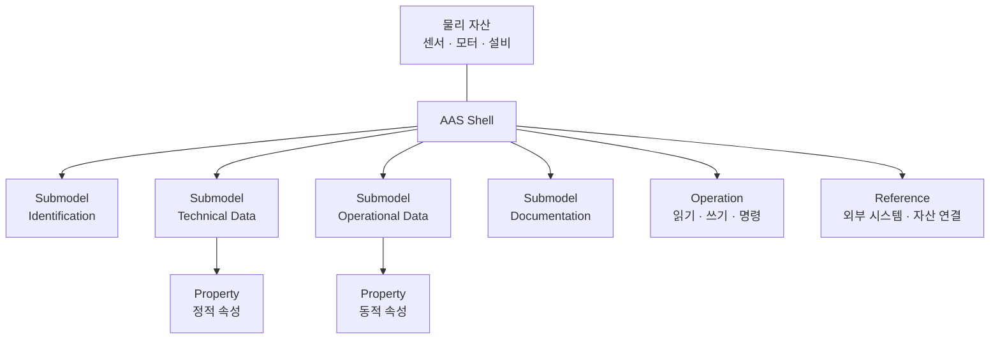
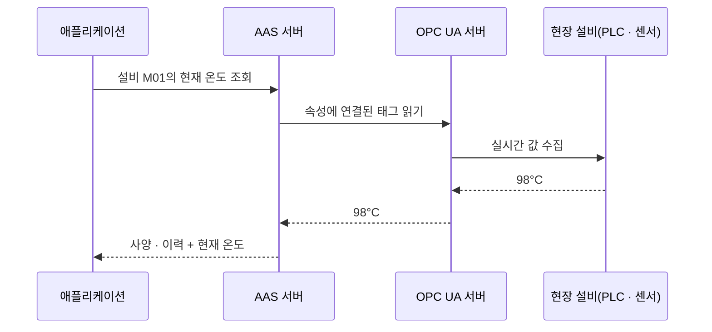

## AAS란

AAS(Asset Administration Shell, 자산 관리 쉘)는 Industry 4.0과 스마트 제조에서 **물리 자산의 디지털 트윈**을 구현하기 위한 국제 표준(IEC 63278)입니다. 쉽게 말해 자산의 **디지털 신분증**입니다.

- 기계, 부품, 제품 같은 물리 자산의 정보와 기능을 표준화된 방식으로 표현하는 "관리 껍데기"
- 제조사와 장비가 달라도 같은 형식으로 정보를 주고받게 해 상호운용성을 높임
- 데이터 중심 자산 관리, 디지털 트윈과 자율 제어의 기반

## 구성요소

- **자산(Asset)**: AAS가 가리키는 실제 물리 자산. 현장의 모든 설비와 부품이 해당합니다.
- **Shell**: 자산을 디지털 공간에서 설명하고 제어하기 위한 본체. 하나의 자산에 하나 이상의 AAS가 대응될 수 있습니다.
- **서브모델(Submodel)**: 자산의 특정 측면을 담는 묶음입니다.
  - Identification: 자산 ID, 일련번호, 제조·공급사, 버전 정보
  - Technical Data: 기술 사양, 인증 정보
  - Operational Data: 운용 과정에서 쓰는 정보
  - Documentation: 도면, 사양서, 매뉴얼
- **속성(Property)**: 서브모델을 이루는 기본 단위. 모델 번호·제조사·설치일 같은 **정적 속성**과 온도·진동처럼 시간에 따라 변하는 **동적 속성**이 있습니다.
- **운영(Operation)**: 자산이 수행할 수 있는 동작. 데이터 읽기·쓰기, 명령 실행, 구성 변경 등을 REST API나 OPC UA로 호출합니다.
- **레퍼런스(Reference)**: 외부 시스템이나 다른 자산과의 연결

## OPC UA와의 역할 분담

AAS와 OPC UA는 경쟁 관계가 아니라 역할이 다릅니다.

| 구분 | AAS | OPC UA |
|---|---|---|
| 성격 | 정보 모델 | 실시간 통신 |
| 다루는 것 | 식별 정보, 기술 사양, 도면·매뉴얼, 수명주기 이력 등 정적·개념적 데이터 | PLC·센서에서 발생하는 실시간 시계열 데이터 |
| 비유 | 자산의 신분증과 이력서 | 자산의 실시간 맥박 |

### 연계 방식 두 가지

1. **OPC UA 정보 모델로 매핑**: AAS 서브모델 구조를 OPC UA 노드 구조로 변환해, OPC UA 서버 안에 AAS 데이터를 올려 서비스합니다.
2. **자산 인터페이스 연동**: AAS의 동적 속성이 현장 OPC UA 태그를 참조하도록 링크를 걸어 두면, AAS를 조회할 때 OPC UA를 통해 현장 값이 실시간으로 채워집니다.

## 온톨로지와는 어떻게 만나나

AAS는 **자산 단위의 구조**를 표준화하고, 온톨로지는 **자산·공정·관측·문서 사이의 의미와 관계**를 다룹니다. 그래서 둘을 결합하는 연구가 나오고 있습니다. 예를 들어 AAS 모델을 OWL 기반 온톨로지로 변환해 디지털 제품 여권(DPP)을 검증하는 연구, AAS와 산업 분류 체계를 결합해 기업 간 연합 질의를 가능하게 하는 자동차 산업 데이터 생태계의 표준이 있습니다.

제가 생각하는 제조 현장의 궁극적인 그림은 이렇습니다. 데이터를 정규화하고, AAS로 자산을 표준화해 디지털 트윈을 만들고, 온톨로지로 그 사이를 연결해 시설 전체를 실시간으로 관제한다. 더 나아가 이미 쌓인 지식으로 가상 시뮬레이션을 돌려 조건 변화에 따른 결과를 예측한다. 다만 이건 검증된 데이터 기반 위에서 단계적으로 가야 할 목표이고, 시작은 [[industrial-ontology-basics]]에서 말한 것처럼 작은 범위의 확인 가능한 질문부터라고 생각합니다.

##### 참조
- [CX-0067 Ontology Models to Realize Federated Query in Catena-X](https://catenax-ev.github.io/docs/standards/CX-0067-OntologyModelsToRealizeFederatedQueryInCatenaX)
- [Nguyen 등, JOT 2026 - PDTO](https://www.jot.fm/issues/issue_2026_03/a21.pdf)
