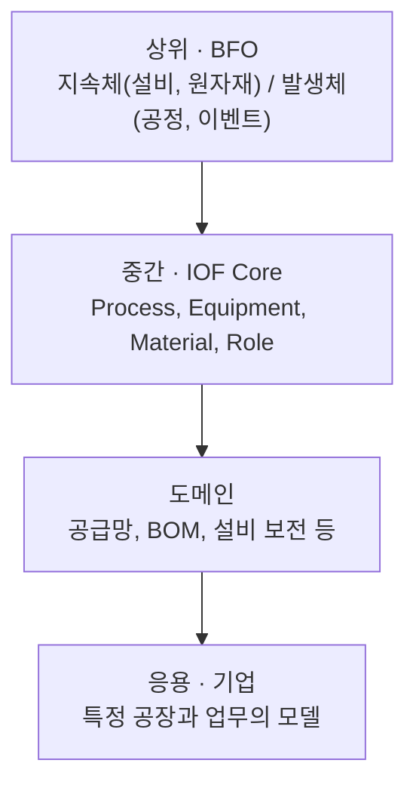

## 왜 온톨로지인가

기업의 문제는 대부분 문서에서 시작합니다. 문서는 사람이 보기 편하게 만들어졌지만 AI에게는 극도로 자유롭고 불규칙합니다. 그래서 문서 AI를 도입하면 이런 일이 생깁니다.

- OCR 정확도는 높은데 여전히 사람이 다시 본다
- RAG로 답은 나오지만 근거가 불안하다
- 에이전트가 일을 할 수는 있는데 맡기기 불안하다

문서를 읽긴 했지만 **그 의미가 업무 기준으로 고정되지 않았기** 때문입니다. 제조 현장이라면 ERP·MES·PLM·센서 데이터가 서로 다른 식별자와 용어, 단위로 흩어진 데이터 사일로 문제도 겹칩니다. 파일을 모으고 API를 연결하면 데이터에 **접근**할 수는 있지만, MES의 `EQ-001`, 센서 플랫폼의 `M01`, 정비일지의 "1호 모터"가 같은 설비인지까지 자동으로 맞춰지지는 않습니다. 온톨로지는 이 의미를 고정하는 장치입니다.

기대할 수 있는 효과는 세 가지로 정리됩니다.

- **지식의 단일화**: 부서·시스템별 용어 불일치 해소
- **다중 홉 질의·추론**: 여러 관계를 엮어야 하는 질문에 답
- **근거 연결**: 답에 출처를 붙여, 정의되지 않은 정보를 걸러 내는 가드레일 역할

> [!warning] 환각 감소는 "보장"이 아니라 "가설"
> 논리적으로 모순 없는 데이터도 현실에서는 틀릴 수 있습니다. 잘못 추출한 설비 ID나 오래된 정비 상태가 모델의 규칙을 위반하지 않을 수도 있습니다. 그래서 AI 응답의 신뢰성은 온톨로지만이 아니라 원천 데이터 정확성, 추출 품질, 검색 범위, 응답 평가를 함께 관리해야 하고, 환각 감소는 실증에서 **검증할 가설**로 다루는 게 맞다고 생각합니다.

## 온톨로지란

특정 도메인의 개념, 개체, 속성, 관계를 **컴퓨터가 읽고 추론할 수 있는 형태**로 정형화한 지식 모델입니다. 철학의 존재론에서 유래했고, 데이터를 보관하는 구조(DB)라기보다 데이터를 **사용하기 위한 규칙**에 가깝습니다.

### 어노테이션 · 시맨틱 레이어 · 온톨로지

미술관에 비유하면 이해가 쉬웠습니다.

| 구분 | 비유 | 하는 일 | 한계 |
|---|---|---|---|
| 어노테이션 | 그림 옆의 작품 설명 | 데이터 하나하나에 붙는 설명 라벨 | 개체 간 연결·계산을 하지 않음 |
| 시맨틱 레이어 | 소장품을 세는 기준 | 지표를 한 곳에서 한 번 정의해 모든 팀이 같은 계산을 하게 함 | 미리 정의한 계산 중심 |
| 온톨로지 | 그림을 잇는 도슨트의 머릿속 | 클래스·관계·규칙으로 연결하고 추론 | 구축·운영 비용이 큼 |

결국 "이 시스템은 내가 직접 입력하지 않은 결론을 규칙과 사실을 엮어 스스로 꺼낼 수 있는가?"에 그렇다고 답할 수 있으면 온톨로지라고 볼 수 있습니다. 계층 분류만 남긴 가벼운 버전은 택소노미(taxonomy)라고 부릅니다.

다만 이 구분을 너무 단순하게 받아들이면 안 됩니다. 어노테이션도 참조 대상을 연결할 수 있고, 시맨틱 레이어도 제품에 따라 관계와 조인 기반 질의를 지원합니다. "연결되는가"보다는 각 기술의 **목적과 표현 범위**로 비교하는 것이 정확합니다. 지식 그래프는 대상과 관계를 그래프로 표현한 지식 집합이고, 온톨로지는 그 그래프의 **의미 모델** 역할을 합니다.

### 구성요소

OWL 기반 모델을 기준으로 보면 이렇습니다.

| 요소 | 의미 | 제조 예시 |
|---|---|---|
| 클래스(Class) | 대상의 유형 또는 범주 | Motor, Equipment, MaintenanceActivity |
| 개체(Individual) | 모델에서 식별하는 구체적 대상 | Motor_01, 정비작업 MA_12 |
| 객체 속성(Object Property) | 개체와 개체 사이의 관계 | Motor_01이 Line_C에 설치되어 있음 |
| 데이터 속성(Data Property) | 개체와 값의 관계 | Motor_01의 일련번호가 M-001임 |
| 공리(Axiom) | 분류·관계·동일성에 대한 논리적 진술 | Motor는 Equipment의 하위 클래스 |

일부 자료는 이를 "5-튜플 구조"로 소개하지만, 모든 온톨로지가 따르는 유일한 표준 구조는 아닙니다. 개체도 물리적 사물에 한정되지 않아서, 관측 한 건, 문서 한 건, 정비 작업 한 건도 개체로 모델링합니다.

## 산업 온톨로지의 계층과 재사용

모든 걸 처음부터 만들 필요는 없습니다. 산업 온톨로지 파운드리(IOF)는 따로 개발된 온톨로지들이 원칙이 달라 서로 연결하기 어려웠던 문제를 풀기 위해, 계층 구조로 공통 개념을 재사용합니다.

- **BFO**는 특정 분야에 치우치지 않은 상위 온톨로지로(ISO/IEC 21838-2), 시간이 지나도 같은 대상인 **지속체**와 시간 속에서 일어나는 **발생체**를 구분합니다. 이 구분은 실무 판단 기준이 됩니다. 예를 들어 "정비"를 설비의 속성으로 넣을지 고민될 때, 정비는 발생체이니 별도 작업 개체로 만들고 설비와 연결합니다.
- 센서·관측은 **SSN/SOSA**, 단위는 **QUDT**, 출처는 **PROV-O**처럼 검증된 표준 모델을 가져다 쓰면 개발 비용을 줄이고 다른 시스템과 의미를 맞추기도 쉬워집니다.
- 단, 같은 BFO 기반이라고 자동으로 연결되지는 않습니다. 이름이 비슷하다는 이유만으로 연결하지 말고 정의·적용 범위·제약·라이선스·버전을 확인하고, 표준 모델을 통째로 가져오기보다 **필요한 개념만** 골라 씁니다. 모델이 커질수록 질의와 추론이 느려지고 이해하기 어려워지기 때문입니다.

## 구축 절차

Ontology Development 101을 참고해 정리한 반복 절차입니다. 한 번에 끝나는 순차 과정이 아니라, 작은 데이터로 질문에 답해 보면서 모델과 질문을 함께 고쳐 나가는 과정입니다.

| 단계 | 주요 작업 | 확인 기준 |
|---|---|---|
| 1. 목적·범위 정의 | 사용자, 의사결정, 답해야 할 역량 질문(CQ) 정의 | CQ별 입력·예상 답·제외 범위 |
| 2. 데이터·기존 모델 조사 | 원천 데이터, 소유자, 갱신 주기, 재사용 모델 확인 | 데이터 목록과 모델 선택 근거 |
| 3. 용어·식별자 정리 | 설비·공정·Lot의 정의와 ID 대응 | 용어사전, 중복 처리 규칙 |
| 4. 클래스·관계 설계 | 분류, 개체 관계, 시간·단위·출처 표현 | 모델 초안과 대표 데이터 예제 |
| 5. 데이터 매핑 | 구조화 데이터 변환, 문서 추출·연결 | 매핑 규칙과 원문 추적 정보 |
| 6. 추론·검증·CQ 평가 | 일관성, 필수값, 질의 결과 점검 | 실패 목록, 정답 비교 |
| 7. 배포·변경 관리 | 승인 버전 배포, 변경 검토 | 버전 이력과 운영 책임 |

### 역량 질문이 범위를 정한다

1단계의 핵심이 **역량 질문(Competency Questions)**, 온톨로지가 반드시 답해야 하는 질문 목록입니다. 이게 없으면 관련 개념을 끝없이 추가하게 됩니다.

"설비 이상 원인을 알 수 있는가?"처럼 넓은 질문은 필요한 데이터와 평가 방법을 정하기 어렵습니다. 대상, 시간 범위, 조건, 기대 출력, 근거를 포함해 구체적으로 씁니다.

> 지정한 라인의 설비 중 지난 24시간 동안 유효한 온도 관측이 임계값을 초과한 설비는 무엇이며, 각 설비에 연결된 최근 정비일지의 원문 위치는 어디인가?

이 질문은 원인 확정이 아니라 **상태 조회와 문서 연결**을 요구합니다. 예측이나 원인 분석이 필요하면 별도 질문과 검증 계획으로 분리합니다. 처음에는 실제 업무에서 자주 묻는 질문 5~10개로 시작하고, **정답을 확인할 방법이 있는지**를 기준으로 고르는 것이 좋다고 생각합니다.

### LLM은 초안까지

문서에서 용어와 관계 후보를 뽑거나 초안을 만드는 데는 LLM이 도움이 됩니다. 하지만 정의와 관계가 맞는지는 현장 전문가가 검토해야 합니다. 특히 정비일지의 "베어링 이상 추정"처럼 **추정을 확정 사실로 적재하지 않도록**, 원문·작성자·검토 상태와 함께 저장해야 합니다.

## 참고할 만한 공개 사례

- **외교부 공공 데이터 온톨로지**: 발간자료, 브리핑, 보도자료, 외교일지 네 종류 문서를 지역·국가·인물·기관·사건·연도 같은 핵심 대상으로 연결해 LOD로 제공합니다. foaf, schema.org 같은 표준 어휘를 재사용하고 고유 개념만 추가한 점이 참고가 됩니다. 제조로 옮기면 가운데에 정비일지와 검사 보고서를, 주변에 설비·공정·Lot를 두는 구조입니다.
- **Palantir Ontology**: 데이터셋을 오브젝트 유형으로, 행을 오브젝트로, 열을 속성으로, 조인을 링크로 읽고, 그 위에 액션·Functions·권한 같은 실행 기능을 결합한 제품입니다. OWL 온톨로지 자체의 기능과 제품의 실행·보안 기능은 구분해서 이해해야 합니다.

## 정리

온톨로지의 가치는 모델의 크기가 아니라 **검증된 질문과 재사용 가능한 연결의 수**에서 나온다고 생각합니다. 시작은 작은 범위의 확인 가능한 질문부터입니다. 이 모델을 실제로 표현·조회·검증하는 기술(RDF, OWL, SPARQL, SHACL)과 작은 실증을 평가하는 방법은 [[ontology-rdf-owl-sparql-shacl]]에서 이어서 다룹니다.

##### 참조
- [Noy · McGuinness, Ontology Development 101](https://protege.stanford.edu/publications/ontology_development/ontology101.pdf)
- [IOF Core](https://spec.industrialontologies.org/portal/release/202603/core.html) · [NIST의 IOF Core 논문](https://tsapps.nist.gov/publication/get_pdf.cfm?pub_id=935068)
- [W3C OWL 2 Primer](https://www.w3.org/TR/owl-primer/)
- [W3C SSN/SOSA](https://www.w3.org/TR/vocab-ssn/) · [PROV-O](https://www.w3.org/TR/prov-o/)
- [외교부 온톨로지 모델](https://opendata.mofa.go.kr/lod/ontologyModel.do)
- [Palantir Ontology 개요](https://www.palantir.com/docs/foundry/ontology/overview)
- [위키독스 - 온톨로지](https://wikidocs.net/336064)
