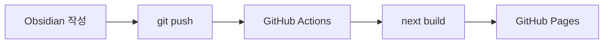

---
# Tistory에서 GitHub Pages로 블로그를 옮겼습니다

## 왜 옮겼나

Tistory에서 글을 쓰다 보니 **회사에서 Obsidian으로 정리한 노트**와 블로그 글이 따로 놀았습니다. 이제는 Obsidian에서 쓴 마크다운이 그대로 블로그 글이 됩니다.

> [!summary] 한 줄 요약
> Obsidian으로 쓰고 → `git push` → GitHub Actions가 Next.js로 빌드해서 GitHub Pages에 배포

## 구성

| 영역 | 기술 |
|---|---|
| Framework | Next.js (static export) |
| Style | Tailwind CSS v4 |
| Content | Obsidian Markdown |
| Deploy | GitHub Actions + Pages |



## Obsidian 문법 지원

- 위키링크: [[블로그 이전|이 글 자신]], 없는 글은 [[아직 안 쓴 글]]처럼 표시
- ==하이라이트==와 #Obsidian 인라인 태그
- 콜아웃

> [!tip]- 접히는 콜아웃
> 클릭하면 열립니다.

```ts title="next.config.ts"
const nextConfig = {
  output: "export",
  trailingSlash: true,
};
```

수식도 됩니다: $E = mc^2$
